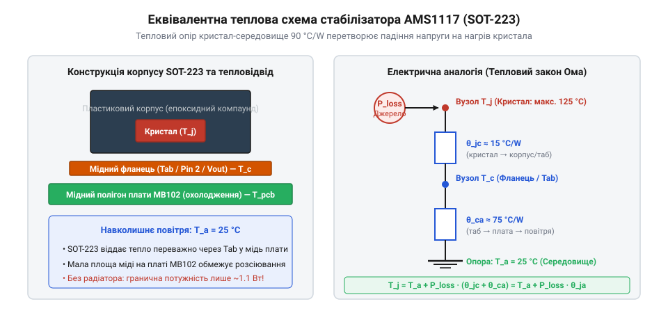
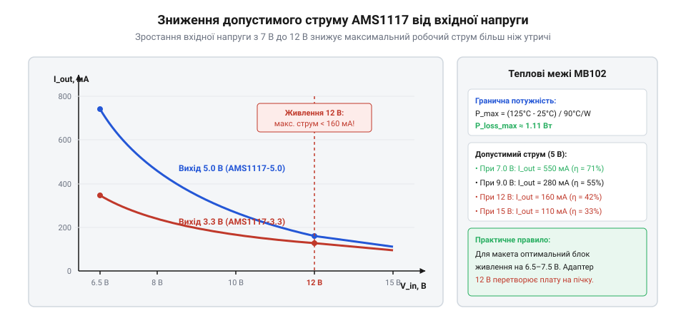

# Модуль живлення для макетної плати

## Теплова потужність втрат лінійного стабілізатора AMS1117

Лінійні стабілізатори сімейства AMS1117 працюють за принципом керованого реостата: їхній внутрішній регулювальний біполярний транзистор безперервно змінює свій динамічний опір так, щоб падіння напруги на ньому точно компенсувало різницю між вхідною та вихідною напругою.

Оскільки струм навантаження протікає безпосередньо крізь регулювальний транзистор, уся надлишкова енергія перетворюється на тепло. За законом збереження енергії розсіювана теплова потужність стабілізатора складається з двох часток:

`
P_loss = (V_in - V_out) · I_load + V_in · I_q
`

де:
- V_in — напруга первинного джерела живлення (DC-роз'єму або USB),
- V_out — стабілізована напруга на шині макета (5.0 В або 3.3 В),
- I_load — струм споживання підключених компонентів схеми,
- I_q — власний струм споживання стабілізатора (струм спокою, @@en|quiescent current@@).

Для мікросхем AMS1117 струм спокою становить приблизно 5–10 мА. При робочих струмах навантаження від 50 мА і вище часткою V_in · I_q можна знехтувати, використовуючи базову інженерну формулу теплових втрат:

`
P_loss ≈ (V_in - V_out) · I_load
`

*Еквівалентна теплова схема корпусу SOT-223: потужність розсіювання P_loss створює температурний градієнт на тепловому опорі θ_JA.*

Розсіювана потужність викликає розігрів кристала відносно навколишнього повітря. Здатність корпусу мікросхеми віддавати тепло в середовище описується тепловим опором «перехід-середовище» (позначається грецькою літерою тета θ_JA, від англ. @@en|junction-to-ambient@@, вимірюється в °C/Вт). Для стандартного корпусу SOT-223, запаяного на мініатюрну двошарову плату модуля MB102 без спеціальних мідних теплопровідних полігонів і без радіатора:

`
θ_JA ≈ 90 °C/Вт
`

Температура кремнієвого кристала T_j при стаціонарній роботі розраховується за формулою теплового балансу, аналогічною закону Ома для електричного кола:

`
T_j = T_amb + P_loss · θ_JA
`

де T_amb — температура навколишнього середовища (типово 25 °C у лабораторії).

**Приклад розрахунку для типового 9-вольтового адаптера:**
Нехай модуль живиться від мережевого блока 9 В, вихід налаштовано на 5.0 В, а схема споживає I_load = 200 мА (0.2 А).
Обчислюємо потужність втрат:

`
P_loss = (9.0 - 5.0) · 0.200
       = 4.0 · 0.200
       = 0.80 Вт
`

Температурний приріст напівпровідника відносно повітря:

`
ΔT = P_loss · θ_JA
   = 0.80 Вт · 90 °C/Вт
   = 72 °C
`

Температура кристала становить:

`
T_j = 25 + 72
    = 97 °C
`

При 97 °C корпус мікросхеми розігрівається до температури, коли до нього неможливо доторкнутися пальцем без опіку, проте внутрішня температура кремнію все ще не перевищує гранично допустиму межу надійності.

> 🔧 **Навіщо це.**
> Тепловий розрахунок заздалегідь показує, коли модуль вийде з ладу або почне перезавантажувати мікроконтролер через перегрів, ще до того, як плата буде ввімкнена в розетку.

Конструкція корпусу SOT-223 спеціально оптимізована для поверхневого монтажу та відведення тепла через широкий центральний вивід — тепловідвідний язичок (@@en|TAB@@), який електрично з'єднаний із виходом стабілізатора V_out.

Тепловий опір від кристала до самого металевого язичка θ_JC (від англ. @@en|junction-to-case@@) у чипів AMS1117 становить лише 15 °C/Вт. Весь основний тепловий бар'єр (решта 75 °C/Вт із загальних 90 °C/Вт) припадає на теплопередачу від корпусу та друкованої плати в нерухоме навколишнє повітря. Оскільки епоксидний компаунд корпусу проводить тепло в сотні разів гірше за метал, єдиним ефективним шляхом охолодження стає розсіювання тепла крізь мідну фольгу друкованої плати, до якої припаяний язичок TAB.

Значення θ_JA ≈ 90 °C/Вт є типовим для мінімального монтажного майданчика площею лише кілька квадратних міліметрів, як на дешевих платах MB102 або YP-08, де через щільний монтаж місце під радіаторний полігон практично відсутнє. Проте якщо розробник самостійно проєктує плату й формує суцільний мідний полігон, тепловий опір різко падає зі збільшенням площі охолодження:

- При площі мідного полігону S = 100 мм² (квадрат 10×10 мм завтовшки 35 мкм): θ_JA знижується до 65 °C/Вт.
- При площі полігону S = 500 мм² (квадрат приблизно 22×22 мм): θ_JA падає до 50 °C/Вт.
- При максимальній ефективній площі S ≥ 1000 мм² з обох боків плати зі з'єднанням наскрізними тепловими перехідними отворами (@@en|thermal vias@@): опір сягає межі близько 35–40 °C/Вт.

Оцінимо ефект збільшення площі міді на попередньому числовому прикладі з розсіюваною потужністю P_loss = 0.80 Вт (живлення 9 В, струм 200 мА). Якщо на платі передбачено мідний полігон площею 500 мм² (θ_JA = 50 °C/Вт), новий приріст температури складе:

`
ΔT_poly = P_loss · θ_JA_poly
        = 0.80 Вт · 50 °C/Вт
        = 40 °C
`

Відповідно, температура кристала знизиться:

`
T_j_poly = 25 + 40
         = 65 °C
`

Зниження температури з небезпечних 97 °C до комфортних 65 °C істотно підвищує ресурс роботи кремнієвого кристала та стабільність вихідної напруги. Проте модуль MB102 позбавлений такого теплового полігону, тому інженер мусить розраховувати саме на найгірший тепловий опір 90 °C/Вт і суворо обмежувати струм навантаження.

## Граничний струм навантаження та залежність ККД від вхідної напруги

Усі інтегральні стабілізатори лінійки AMS1117 мають вбудовану схему теплового захисту (@@en|thermal shutdown@@). Коли температура кристала сягає критичної позначки T_j_trip ≈ 150–165 °C, внутрішній компаратор закриває вихідний транзистор, повністю знеструмлюючи макет. За нормами тривалої експлуатації максимальна робоча температура кристала не повинна перевищувати:

`
T_j_max = 125 °C
`

Звідси максимальний допустимий тепловий перепад для кімнатної температури T_amb = 25 °C дорівнює:

`
ΔT_max = T_j_max - T_amb
       = 125 - 25
       = 100 °C
`

Гранична теплова потужність, яку корпус SOT-223 модуля MB102 може безперервно віддавати в навколишнє повітря без радіатора:

`
P_loss_max = ΔT_max / θ_JA
           = 100 °C / 90 °C/Вт
           ≈ 1.11 Вт
`

Це фундаментальна константа конструкції: плата MB102 фізично не здатна розсіяти понад 1.1 Вт тепла в тривалому режимі.

Максимально допустимий струм навантаження стабілізатора визначається формулою:

`
I_max = P_loss_max / (V_in - V_out)
      = 1.11 / (V_in - V_out)
`

*Крива допустимого навантаження AMS1117: зростання вхідної напруги призводить до різкого гіперболічного спаду безпечного струму.*

Розрахуємо граничний струм I_max та коефіцієнт корисної дії η ≈ V_out / V_in для трьох типових джерел вхідного живлення при стабілізації 5.0 В:

**1. Оптимальне джерело: V_in = 6.5 В (мінімальний запас понад dropout 1.2 В):**
Падіння напруги: V_in - V_out = 6.5 - 5.0 = 1.5 В.

`
I_max = 1.11 Вт / 1.5 В
      ≈ 0.74 А  (740 мА)
`

Ефективність: η = 5.0 / 6.5 ≈ 76.9%.
При напрузі 6.5 В стабілізатор здатен віддати майже паспортні 800 мА струму без ризику перегріву.

**2. Мережевий адаптер: V_in = 9.0 В:**
Падіння напруги: V_in - V_out = 9.0 - 5.0 = 4.0 В.

`
I_max = 1.11 Вт / 4.0 В
      ≈ 0.278 А  (278 мА)
`

Ефективність: η = 5.0 / 9.0 ≈ 55.6%.
Струмова спроможність модуля скоротилася майже втричі порівняно з паспортом.

**3. Стандартний блок живлення роутера: V_in = 12.0 В:**
Падіння напруги: V_in - V_out = 12.0 - 5.0 = 7.0 В.

`
I_max = 1.11 Вт / 7.0 В
      ≈ 0.158 А  (158 мА)
`

Ефективність: η = 5.0 / 12.0 ≈ 41.7%.
Якщо ж на макеті використовується шина 3.3 В, падіння становить 12.0 - 3.3 = 8.7 В:

`
I_max(3.3В) = 1.11 Вт / 8.7 В
            ≈ 0.127 А  (127 мА)
`

Ефективність у режимі 3.3 В падає до катастрофічних:

`
η = 3.3 / 12.0
  = 27.5%
`

Майже три чверті енергії блока живлення (72.5%) перетворюються на даремне тепло. Якщо ж навколишня температура підніметься до 35 °C (літній день або закритий навчальний клас), запас ΔT_max скорочується до 90 °C, а безпечний струм шини 3.3 В падає нижче 80–90 мА. Спроба підключити від 12 В плату з кількома світлодіодами та Wi-Fi чипом ESP8266 призводить до відключення стабілізатора за 10–15 секунд через тепловий захист.

Тому при роботі з модулями типу MB102 або мережевими джерелами [HLK-PM01/PM03/PM12](root:cat-hw-power/hlk-pm-mains) золотим інженерним правилом є мінімізація вхідної напруги: для стабілізації 5 В найкраще обирати адаптер на 6.5–7.5 В, а при живленні від 12 В встановлювати попередній імпульсний знижувач напруги.

Описані вище обмеження базувалися на стаціонарному тепловому балансі, коли температура вже стабілізувалася. Проте в реальних схемах навантаження часто має імпульсний характер: заряджання вхідних електролітичних конденсаторів під час старту, спрацьовування котушки реле чи передача пакета даних Wi-Fi чипом створюють короткочасні сплески струму силою до I_pulse = 1.5 А.

У перші мікросекунди й мілісекунди після виникнення імпульсу тепло ще не встигає досягти поверхні плати та розсіятися в повітря. Воно поглинається внутрішньою тепловою ємністю напівпровідникового кристала та мідного фланця (@@en|thermal capacitance@@, позначається як C_th). Для корпусу SOT-223 еквівалентна теплоємність нагрітої зони становить приблизно:

`
C_th ≈ 0.045 Дж/°C
`

При стрибку струму до 1.5 А під час живлення від адаптера 9 В миттєва потужність розсіювання на регуляторі 5.0 В злітає до:

`
P_pulse = (V_in - V_out) · I_pulse
        = (9.0 - 5.0) · 1.5
        = 6.0 Вт
`

Це майже у 6 разів перевищує гранично допустиму стаціонарну потужність 1.11 Вт. Оскільки процес на початковому етапі є адіабатичним, швидкість зростання температури кристала описується простим співвідношенням:

`
dT/dt = P_pulse / C_th
      = 6.0 Вт / 0.045 Дж/°C
      ≈ 133.3 °C/с
`

Якщо модуль стартував із холодного стану (25 °C), запас до порогу спрацьовування теплового захисту T_j_trip = 150 °C складає ΔT_trip = 150 - 25 = 125 °C. Час до аварійного вимкнення становить:

`
t_trip ≈ ΔT_trip / (dT/dt)
       = 125 / 133.3
       ≈ 0.94 с
`

Тобто холодний стабілізатор здатний витримати півтораамперний імпульс майже цілу секунду. Проте якщо стабілізатор уже був розігрітий тривалим базовим навантаженням до температури 97 °C, вільний температурний запас становить лише:

`
ΔT_res = 150 - 97
       = 53 °C
`

У цьому випадку час до спрацьовування захисту скорочується до:

`
t_trip_hot = 53 / 133.3
           ≈ 0.40 с  (400 мс)
`

А при живленні від 12 В миттєва потужність становить (12 - 5) · 1.5 = 10.5 Вт, швидкість нагрівання сягає 233.3 °C/с, і гарячий стабілізатор відключається всього за 220 мс. Після вимкнення вихідного транзистора струм припиняється, кристал повільно остигає з тепловою сталою часу корпусу τ_th = θ_JA · C_th ≈ 90 · 0.045 ≈ 4 с. Щойно температура знижується на 10–15 °C нижче порогу (гістерезис теплового компаратора), AMS1117 знову відкривається, моментально перегрівається і знову відключається. Цей циклічний процес називається режимом теплової гикавки (@@en|thermal hiccup mode@@) і проявляється у вигляді циклічних провалів живлення макета з частотою 0.5–2 Гц, викликаючи нескінченні перезавантаження мікроконтролера.
