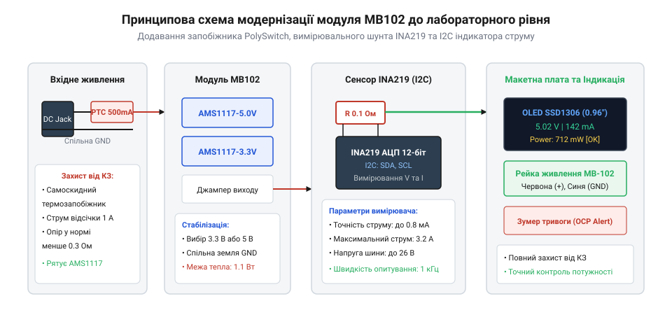
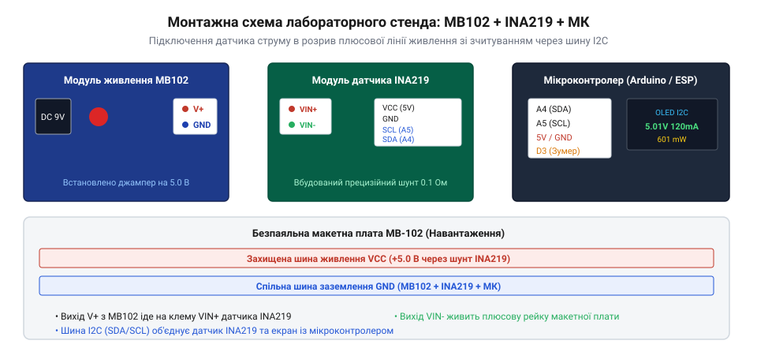

# Модуль живлення для макетної плати

<preknowlist>
- [HLK-PM01/PM03/PM12 — живлення від 220 В](root:cat-hw-power/hlk-pm-mains) — принципи організації первинного стабілізованого живлення для лабораторних макетів
</preknowlist>

## Проблема незахищеного макетування та мета модернізації

Безпаяльна макетна плата (@@en|solderless breadboard@@) — найзручніший інструмент швидкого прототипування, проте саме на ній найчастіше трапляються фатальні аварії. Під час ручного встановлення перемичок, підключення датчиків чи модулів достатньо помилитися одним отвором, щоб закоротити шину живлення на землю або випадково замкнути вихідні контакти електролітичного конденсатора.

Стандартний живильний модуль MB102, який встановлюється безпосередньо в рейки макетної плати, побудований на базі двох дешевих лінійних стабілізаторів AMS1117 (на 5.0 В та 3.3 В). У фабричному виконанні цей модуль має два критичні недоліки:
1. **Відсутність повноцінного захисту від короткого замикання**: хоча мікросхеми AMS1117 формально містять вбудований термозахист, тепловий опір компактного корпусу SOT-223 надто високий. При випадковому закороченні струм стрибає до 1.2–1.5 А, кристал розігрівається вище 150 °C за секунди, і за частих аварій стабілізатор пробиває наскрізь, пускаючи повну вхідну напругу 9–12 В безпосередньо в лінії чутливих мікросхем.
2. **Сліпе споживання струму**: розробник не бачить реального споживання своєї схеми. Немає жодного способу дізнатися, чи модуль споживає штатний струм 30 мА, чи завис у стані @@en|latch-up@@ і тягне 450 мА, доки над платою не з'явиться дим.

Інженерна мета модернізації полягає в перетворенні бюджетної плати MB102 на повноцінний безпечний лабораторний вузол живлення. Доопрацювання передбачає встановлення самовідновлюваного запобіжника PolySwitch (PTC) для апаратного відсікання надструмів та інтеграцію цифрового сенсора струму і напруги INA219 з відображенням параметрів у реальному часі.

Потреба в доопрацюванні зумовлена топологією самої заводської плати MB102. Напруга від круглого гнізда DC 5.5×2.1 мм або порту USB надходить на фіксуючий кнопковий перемикач живлення SW1, а з його вихідних контактів прямує широкою доріжкою на паралельно з'єднані входи VIN обох лінійних стабілізаторів AMS1117-5.0 та AMS1117-3.3. Саме ця ділянка є критичною: перерізання мідної доріжки безпосередньо біля виводу перемикача створює єдину захищену точку врізання самовідновлюваного полімерного запобіжника PolySwitch (PTC). Завдяки монтажу запобіжника в цей розрив захищаються одночасно обидва канали стабілізації та вхідні згладжувальні електролітичні конденсатори. Для механічної стійкості виводи запобіжника припаюють до зачищених від паяльної маски ділянок міді, а сам компонент фіксують краплею нейтрального термоклею або компаунду, щоб вібрації від макетування не відірвали тонкі доріжки.

Паралельно з апаратним захистом модуль потребує інтеграції цифрового вимірювального вузла на базі INA219. Для збереження компактності датчик монтують у вигляді мезонінної надбудови над роз'ємом USB або вихідними пінами живлення. Живлення логічної частини датчика (VCC та GND) підключається до стабілізованої лінії 3.3 В або 5 В, а його вимірювальний шунт номіналом 0.1 Ом врізається послідовно у плюсову рейку після стабілізаторів перед контактними штирями. Сигнальні лінії шини I2C (SDA та SCL) виводяться на чотириконтактну кутову колодку для підключення мікроконтролера моніторингу, причому на платі обов'язково встановлюють підтягувальні резистори номіналом 4.7 кОм до лінії живлення логіки для забезпечення стійкої передачі даних без збоїв від наводок.

Особливу увагу приділено алгоритму фільтрації та візуалізації на компактному 0.96-дюймовому OLED-дисплеї SSD1306 із роздільною здатністю 128×64 пікселі. Під час увімкнення складних макетів із великими блокувальними ємностями (наприклад, модулів Wi-Fi ESP32 чи драйверів двигунів) зарядний струм конденсаторів створює короткочасний сплеск до 600–800 мА тривалістю кілька мілісекунд. Якщо система реагуватиме на одиничні миттєві виміри, виникатимуть безперервні хибні спрацьовування тривоги. Щоб усунути цей ефект, мікропрограма реалізує цифрову фільтрацію за алгоритмом експоненційного згладжування або ковзного середнього на ковзному вікні з 8–16 вибірок, відсікаючи безпечні мікросекундні імпульси заряду, але миттєво фіксуючи стійке перевантаження понад 400 мА. Графічний інтерфейс дисплея відображає чотири ключові параметри: поточну напругу шини (V), реальний струм навантаження (мА), споживану потужність (мВт) та динамічний смуговий індикатор навантаження (@@en|bargraph@@). При виході струму за межі 85% від номіналу активується попереджувальний сигнал активного зумера, а при прямому замиканні контролер негайно виводить повідомлення про аварію та знеструмлює навантаження.

## Принципова електрична схема модернізації

Модернізація передбачає мінімальне хірургічне втручання в заводську друковану плату MB102 з виведенням ліній вимірювання та захисту на компактну надбудову.

*Принципова електрична схема доопрацювання модуля MB102: встановлення самовідновлюваного запобіжника PolySwitch та вимірювального шунта INA219 у розрив плюсової шини живлення.*

### Точка встановлення самовідновлюваного запобіжника PTC

Самовідновлюваний терморезистор із позитивним температурним коефіцієнтом (@@en|PolySwitch / PTC@@) захищає від перевантажень без необхідності ручної заміни плавких вставок:
- **Місце врізання**: найвдаліша точка монтажу — розрив між виходом кнопкового вимикача живлення SW1 та спільним входом лінійних регуляторів AMS1117. Завдяки цьому PTC захищає обидва канали стабілізації та вхідні конденсатори.
- **Підбір характеристик**: обирається компонент із струмом утримання I_hold = 500 мА та струмом спрацьовування I_trip = 1000 мА на робочу напругу до 16–30 В (наприклад, полімерний запобіжник серії RXEF050 або SMD-аналог типорозміру 1812). У штатному режимі його опір становить менше 0.4 Ом і не створює суттєвого спаду напруги. У разі замикання джоулеве тепло переводить полімер у високоомний стан, обмежуючи аварійний струм до безпечних десятків міліампер. Після зняття навантаження та охолодження структура полімеру відновлюється самостійно.

### Включення вимірювального сенсора INA219

Для цифрового обліку параметрів використовується спеціалізована мікросхема INA219, що містить прецизійний підсилювач та 12-бітний АЦП:
- **Вимірювання у плюсовій шині (@@en|high-side sensing@@)**: вимірювальний шунт номіналом 0.1 Ом вмикається в розрив позитивної лінії живлення між виходом регулятора AMS1117 та вихідними штировими колодками макета. На відміну від нижньоплечового шунта (@@en|low-side@@), таке включення не розриває і не піднімає потенціал земляної шини, зберігаючи єдиний рівень GND для сигналів I2C, SPI та UART.
- **Цифрова шина I2C**: сенсор передає виміряну напругу шини (до 26 В) та спад напруги на шунті по інтерфейсу I2C через лінії SDA та SCL, підтягнуті до лінії +3.3 В або +5 В резисторами 4.7 кОм.
- **Аварійний сигнал перевантаження**: до керуючого мікроконтролера підключається активний п'єзоелектричний випромінювач (зумер) та червоний світлодіод тривоги, що миттєво сповіщають розробника звуковим сигналом при перевищенні безпечного ліміту струму (наприклад, 400 мА).

### Апаратне переривання через вивід ALERT

Програмне періодичне опитування регістрів через шину I2C створює часову затримку від 20 до 50 мс між виникненням аварії та реакцією мікроконтролера. Для миттєвого захисту чутливих напівпровідників використовується апаратний вивід ALERT мікросхеми INA219:
- **Схемотехніка відкритого стоку**: вивід ALERT виконано за схемою з відкритим стоком (@@en|open-drain@@) з активним низьким рівнем. До лінії підключають зовнішній підтягувальний резистор номіналом 10 кОм до напруги живлення мікроконтролера (3.3 В або 5 В), а сам вивід з'єднують із виводом зовнішнього апаратного переривання мікроконтролера (наприклад, INT0 / D2 на платах AVR або GPIO4 на ESP32).
- **Внутрішній апаратний компаратор**: мікросхема INA219 містить внутрішній цифровий компаратор порогів. Під час ініціалізації у конфігураційний регістр записують граничний спад напруги на шунті або граничну потужність. Щойно внутрішній АЦП фіксує перевантаження (наприклад, спад на шунті понад 40 мВ, що відповідає струму 400 мА), лінія ALERT апаратно притискається до землі без необхідності обміну даними по шині I2C.
- **Миттєва відсічка навантаження**: сигнал низького рівня на вході переривання викликає обробник ISR, який за лічені мікросекунди скидає керуючий сигнал затвора силового польового транзистора (MOSFET), розриваючи коло навантаження задовго до того, як мікроконтролер встигне завершити черговий програмний цикл. Лише після гарантованого знеструмлення макета контролер спокійно зчитує аварійні параметри через I2C для виведення на екран та вмикає звуковий зумер.

> 🔧 **Навіщо це.**
> Поєднання апаратного запобіжника PTC та цифрового монітора на INA219 створює багаторівневий захист: PTC фізично рятує регулятори від термічного руйнування при прямому КЗ, а мікроконтролер відстежує плавне наростання струму, попереджаючи про перегрів або витік задовго до аварії.

## Практичне складання та монтаж апаратної частини

Модернізація заводської плати MB102 вимагає мінімальних монтажних робіт і виконується у кілька послідовних кроків із перевіркою кожного вузла.

*Монтажна схема з'єднань модернізованого модуля: живлення від плати MB102 проходить через сенсор INA219, а мікроконтролер забезпечує відображення телеметрії на екрані та аварійну сигналізацію.*

### Розрахунок та встановлення запобіжника PolySwitch

Для ефективного захисту лінійних стабілізаторів AMS1117-5.0 та AMS1117-3.3 параметри запобіжника розраховують виходячи з теплових можливостей їхнього корпусу SOT-223:
- **Струм утримання (I_hold)**: обирається рівним 500 мА. За кімнатної температури (+25 °C) стабілізатор здатен розсіювати струм до 400–500 мА при перепаді напруги 2–4 В без перевищення критичної температури кристала 125 °C.
- **Струм спрацьовування (I_trip)**: становить 1.0 А (номінал 2 × I_hold). Якщо в макеті виникає коротке замикання, струм через запобіжник миттєво зростає понад 1 А, викликаючи лавиноподібний нагрів провідного полімеру до температури фазового переходу (+120...130 °C). Внутрішній опір деталі стрибає від часток ома до десятків кілоом, знижуючи залишковий струм витоку до безпечних 15–20 мА.

Монтаж виконується скальпелем або гравером: перерізають мідну доріжку на зворотному боці плати MB102 між перемикачем живлення та входами мікросхем AMS1117, і в місце розриву запаюють виводи запобіжника PolySwitch.

### Інтеграція вимірювальної плати та індикатора

1. Плату датчика струму INA219 розміщують на невеликій макетній надбудові або припаюють шлейфом безпосередньо до вихідних пінів живлення MB102.
2. Вхід вимірювального шунта IN+ з'єднують із виходом стабілізатора, а IN- підключають до шини живлення безпаяльної плати.
3. Лінії I2C (SDA та SCL) підключають до мікроконтролера керування (наприклад, Arduino Nano або ESP32), який опитує датчик і виводить вольти, міліампери та мілівати на 0.96-дюймовий екран.
4. До дискретного виходу мікроконтролера підключають активний зумер із червоним світлодіодом тривоги.

> 🔧 **Навіщо це.**
> Таке компонування зберігає повну сумісність із макетною платою: модуль, як і раніше, вставляється у бічні рейки живлення, але тепер оснащений повним захистом та цифровим ампервольтметром.

## Розробка мікропрограми моніторингу на базі INA219

Мікросхема INA219 містить внутрішній аналогово-цифровий перетворювач і математичний співпроцесор, здатний самостійно перемножувати напругу й струм для обчислення миттєвої потужності.

### Конфігурація та калібрування регістрів

Для точного зчитування струму в діапазоні до 800 мА з кроком 0.1 мА налаштовуються два головні регістри:
1. **Регістр конфігурації (0x00, CONFIG)**:
   - Діапазон напруги шини: 32 В (базовий режим).
   - Підсилювач шунта (PGA): ділення /8 (діапазон вимірювання спаду на шунті до ±320 мВ).
   - АЦП напруги й струму: 12-бітний режим із часом перетворення 532 мкс.
   - Біти режиму: безперервне вимірювання (Continuous Mode). Записуване значення — x399F.
2. **Калібрувальний регістр (0x05, CALIBRATION)**:
   При встановленому на платі модулі резисторі номіналом 0.1 Ом значення калібрувального коефіцієнта обчислюється як:
   Cal = trunc(0.04096 / (Current_LSB * R_shunt))
   Для цільової дискретності Current_LSB = 0.0001 А (0.1 мА):
   Cal = trunc(0.04096 / (0.0001 * 0.1)) = 4096 (0x1000).

### Реалізація драйвера на мові C

Низькорівневий драйвер реалізовано у вигляді модульної бібліотеки без динамічного виділення пам'яті:

:::code proj-breadboard-lab-bench-power/c/ina219.h

:::code proj-breadboard-lab-bench-power/c/ina219.c

:::code proj-breadboard-lab-bench-power/c/main.c

### Об'єктно-орієнтована архітектура на C++

Для гнучкого керування живленням у середовищі Arduino або ESP32 створено клас PowerMonitor, що інкапсулює аварійні пороги та автоматичне відключення:

:::code proj-breadboard-lab-bench-power/cpp/PowerMonitor.h

:::code proj-breadboard-lab-bench-power/cpp/PowerMonitor.cpp

:::code proj-breadboard-lab-bench-power/cpp/main.cpp

### Особливості фільтрації шумів I2C при комутації індуктивних навантажень на макеті

Комутація індуктивних навантажень на безпаяльній макетній платі — електромагнітних реле, крокових або колекторних електродвигунів, соленоїдів чи котушок — створює найважчі електромагнітні умови для цифрових шин обміну даними. У момент різкого знеструмлення індуктивності виникає високовольтний викид ЕРС самоіндукції, амплітуда якого у відкритому контурі макета може сягати сотень вольт.

Через паразитну ємність між сусідніми рейками макетної плати (близько 2–4 пФ на контакт) та паразитну індуктивність довгих з'єднувальних провідників (приблизно 10–15 нГн на кожен сантиметр дроту) цей високовольтний імпульс проникає у сигнальні лінії інтерфейсу I2C — SCL (лінія тактування) та SDA (лінія даних). Внаслідок цього цифровий сенсор INA219 або мікроконтролер сприймає паразитний викид як хибний фронт тактового сигналу або біт даних, що викликає апаратне зависання шини або збій адресації.

Для забезпечення безвідмовної роботи вимірювального вузла на практиці застосовують комплексний трирівневий захист:

1. **Оптимізація підтягувальних резисторів (Pull-Up)**:
   Стандартні внутрішні підтягувальні резистори мікроконтролерів номіналом 30–50 кОм є занадто високоомними для макетних плат, де сумарна паразитна ємність монтажу часто сягає 150–250 пФ. Високий опір затягує фронт наростання сигналу та робить лінію вкрай чутливою до наведених завад. Для надійного придушення шуму паралельно лініям SDA та SCL встановлюють зовнішні дискретні резистори номіналом 2.2–3.3 кОм, підтягнуті до шини живлення мікроконтролера (+3.3 В або +5.0 В). Менший опір забезпечує швидкий стік наведених струмів і формує круті прямокутні фронти навіть за значного рівня навколишніх перешкод.

2. **Апаратна RC-фільтрація та супресорний захист**:
   У безпосередній близькості до виводів мікроконтролера або модуля INA219 у розрив провідників SDA і SCL впаюють послідовні демпферні резистори номіналом 33–100 Ом. Разом із внутрішньою ємністю контактних площадок вони утворюють фільтр низьких частот першого порядку, що гасить високочастотний резонансний «дзвін» у дротах. Додатково паралельно сигнальним лініям на землю можна встановити мініатюрні конденсатори ємністю 22–47 пФ, що відсікають наносекундні сплески без порушення форми інформаційних сигналів на стандартній частоті I2C 100 кГц.

3. **Програмний алгоритм розблокування шини (I2C Bus Recovery)**:
   Найнебезпечнішим проявом завади є стан «затиснутої шини» (@@en|stuck bus@@). Якщо сплеск шуму припадає на момент передачі даних або біта підтвердження (ACK), ведений пристрій може опустити лінію SDA у логічний нуль і чекати на наступний тактовий імпульс SCL, який мікроконтролер уже вважає завершеним. Жодні спроби перезапуску передачі за протоколом I2C у такому стані не працюють, оскільки лінія зайнята.
   Для виходу з цього клінчу в драйвер закладають алгоритм тактування:
   - Контролер переводить вивід SCL із режиму апаратного I2C у стандартний режим виходу GPIO (Push-Pull).
   - Формується пачка з 9 послідовних тактових імпульсів частотою 50–100 кГц. Кожен імпульс змушує внутрішній зсувний регістр сенсора видавати наступний біт, поки він не вичерпає байт і не відпустить лінію SDA у високий стан.
   - Контролер формує умову STOP (перепад SDA з низького рівня у високий при високому рівні SCL), примусово повертаючи шину в стан очікування (IDLE).
   - Після цього периферійний модуль I2C мікроконтролера реініціалізується у штатному режимі.

4. **Цифрова фільтрація вимірювальних даних**:
   У моменти комутації потужних котушок сенсор INA219 через короткочасний спад напруги або імпульсний струм перезарядки конденсаторів може зафіксувати аномальний сплеск струму тривалістю кілька мікросекунд. Щоб мікроконтролер не вимикав захист OCP (Over-Current Protection) від одиничного імпульсу, у мікропрограму додають програмний фільтр ковзного середнього (або медіанний фільтр на 3–5 точок) та затримку верифікації перевантаження тривалістю 20–50 мс.

## Логіка захисту та візуалізації даних

Супервізор живлення працює у безперервному неблокуючому циклі з періодом опитування 50 мс, що гарантує миттєву реакцію на аномальні струми.

### Алгоритм фільтрації та аварійні пороги

1. **Захист від надструмів (OCP)**: якщо виміряний струм перевищує граничний ліміт 400 мА, контролер негайно переводить систему у стан TrippedOverCurrent. Якщо в коло встановлено керуючий MOSFET, навантаження негайно знеструмлюється.
2. **Захист від просідання (UVP)**: падіння напруги на лінії 5 В нижче 4.5 В свідчить про глибоке перевантаження стабілізатора AMS1117 або виснаження вхідного джерела (наприклад, батареї «Крона»).
3. **Звукове сповіщення**: при виході струму за 85% від ліміту система генерує попереджувальні короткі сигнали, а при аварійній відсічці вмикає безперервний сигнал зумера до ручного перезапуску кнопкою скидання.

> 🔧 **Навіщо це.**
> Постійний контроль струму рятує дорогі мікроконтролери: помітивши струм 250 мА замість розрахункових 30 мА, розробник може миттєво зняти живлення ще до того, як мікросхема нагріється до температури деградації кристала.
