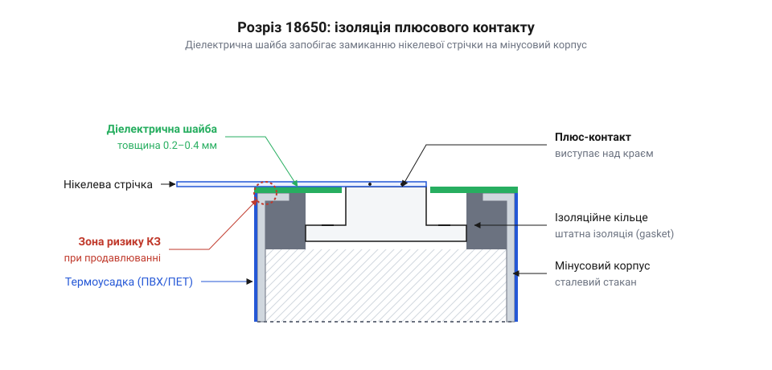
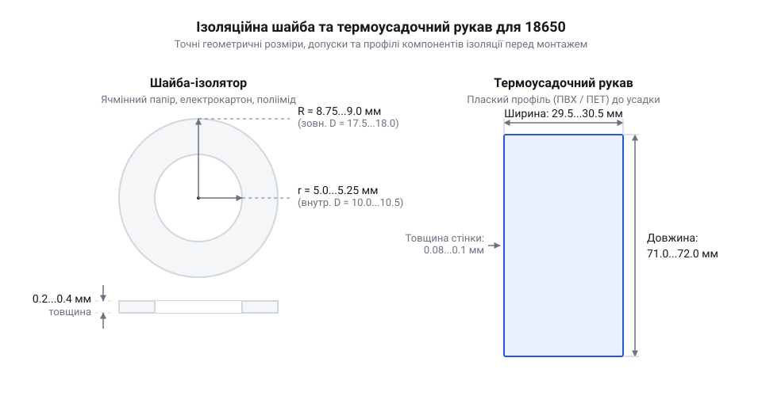

# Специфікація залізного інтерфейсу, розмірів та фізико-хімічних параметрів шайб і термоусадок 18650

<preknowlist>
- [Нікелева стрічка 0.15×10 мм](root:cat-hw-power/nickel-strip) — Знати, що стрічка приварюється поверх ізолятора і може нагріватися під час зварювання, впливаючи на вимоги до шайби.
- [MECHANIC PN360 — апарат точкового зварювання](root:cat-hw-power/spot-welder-pn360) — Знати, що зварювання генерує локальне тепло, яке діелектрик має витримати без проплавлення.
</preknowlist>

## Замикання корпусу і потреба ізоляції

Корпус акумулятора 18650 цілком металевий, і майже вся його поверхня — це мінусовий контакт. Єдиний плюсовий контакт — це центральна кнопка на верхньому торці, яка відокремлена від решти корпусу лише тонким шаром заводської діелектричної плівки. Коли ми збираємо батарею, нам потрібно з'єднати елементи між собою. Найчастіше для цього використовується [нікелева стрічка](root:cat-hw-power/nickel-strip), яка приварюється до полюсів за допомогою [апарата точкового зварювання](root:cat-hw-power/spot-welder-pn360).

Ризик полягає в тому, що стрічка, приварена до плюсового контакту, проходить над краєм мінусового корпусу. Під час зварювання метал нагрівається, а від вібрації чи механічного тиску тонка заводська ізоляція на торці може проплавитися або протертися. Якщо плюсова стрічка торкнеться мінусового краю корпусу, станеться коротке замикання з величезним струмом, що призведе до миттєвого перегріву і, можливо, займання елемента.

*Розріз верхньої частини показує, як діелектрична шайба перекриває край корпусу, залишаючи відкритим лише плюсовий контакт для безпечного приварювання стрічки.*

Щоб гарантовано запобігти цьому, під плюсову стрічку обов'язково підкладають додаткову діелектричну шайбу (кільце). Вона створює надійний механічний і термічний бар'єр між струмопровідною стрічкою та мінусовим краєм корпусу, роблячи замикання неможливим навіть при випадковому продавлюванні чи зміщенні. Для фіксації на нижній бік шайби нанесено шар акрилового клею. Клей утримує ізолятор рівно по центру під час складання батареї і не дає йому зміститися від поштовхів зварювальних електродів. З часом від нагрівання акумулятора клей пересихає і втрачає свої властивості. Надалі шайба тримається на місці виключно завдяки фізичному притисканню привареною нікелевою стрічкою.

## Геометрія і допуски ізоляційних шайб

Щоб шайба захищала елемент від короткого замикання, вона має повністю закривати торець акумулятора, не виступаючи за його межі, і водночас залишати плюсовий контакт відкритим для зварювання. Для формату 18650 акумулятор має зовнішній діаметр рівно 18.0 мм, проте його край на торці завжди злегка закруглений. Тому стандартний зовнішній діаметр ізоляційної шайби роблять меншим — від 17.0 до 17.5 мм. Такий допуск дозволяє наклеїти її точно на плоску частину торця. Якщо шайба матиме повні 18 мм або випадково з'їде вбік і виступить за межі циліндра, вона одразу стане механічною перешкодою. Під час збирання батареї такий акумулятор просто не влізе у стільник жорсткого пластикового холдера, або ж край шайби замнеться об стінку і вона відклеїться ще до початку зварювання.

Внутрішній отвір шайби вирізають з діаметром від 10.0 до 10.5 мм. Сама плюсова кнопка акумулятора має розмір 8.0–9.0 мм. Зазор у міліметр навколо кнопки потрібен не лише для того, щоб компенсувати похибку під час наклеювання вручну чи автоматом. Цей вільний простір гарантує, що [нікелева стрічка 0.15×10 мм](root:cat-hw-power/nickel-strip) ляже безпосередньо на метал контакту, а електроди зварювального апарата не зачеплять край діелектрика і не пропалять його іскрою.

*Креслення показує співвідношення зовнішнього та внутрішнього діаметрів шайби, а також плоскі розміри термоусадочного рукава.*

Найбільше на процес монтажу впливає товщина шайби. Вона зазвичай становить від 0.2 до 0.4 мм, залежно від обраного матеріалу (картон чи пластик). Коли ми наклеюємо шайбу на торець, вона піднімає загальний рівень поверхні навколо плюсового контакту. Оскільки кнопка елемента 18650 сама по собі виступає над торцем лише на частки міліметра, товста шайба може зрівнятися з нею по висоті, або навіть виявитися вищою за сам контакт.

Це створює пастку під час зварювання. Стрічка лягає на шайбу, а до кнопки в центрі їй доводиться прогинатися. Якщо шайба занадто товста (наприклад, 0.4 мм на елементі з низькою кнопкою), стрічка зависає в повітрі над плюсовим контактом. Коли майстер притискає [MECHANIC PN360 — апарат точкового зварювання](root:cat-hw-power/spot-welder-pn360) до стрічки, електродам доводиться силоміць продавлювати нікель донизу. Це порушує паралельність притиску, електроди можуть зісковзнути під кутом, а імпульс струму замість глибокого провару дасть іскру на поверхні, пропаливши стрічку наскрізь. Щоб уникнути цього, для елементів із низькими кнопками завжди обирають найтонші шайби 0.2 мм. Тоді стрічка лежить плоско на контакті й не вимагає зусилля на вигин під час притискання.

Крім того, товщину шайб необхідно враховувати під час розрахунку габаритів самої батареї. Якщо збірка має кілька ярусів акумулястру, з'єднаних послідовно (наприклад, для електротранспорту), зайві 0.3–0.4 мм на кожному торці перетворюються на кілька міліметрів загальної довжини блоку. Це може призвести до того, що готова батарея не поміститься у відведений для неї тісний корпус, або ж натягнута стрічка між ярусами опиниться під постійним механічним напруженням і з часом відірветься від вібрації.

## Властивості матеріалів діелектричних шайб

Вибір матеріалу шайби залежить від умов, у яких працюватиме батарея. Найпоширеніший варіант — так званий ячмінний папір (@@en|barley paper@@). Це спеціально оброблений електротехнічний картон. Його головна перевага — відмінна термостійкість. Він легко витримує миттєвий нагрів під час точкового зварювання, не плавиться і зберігає свою структуру. Проте папір боїться вологи: якщо батарея працюватиме у вологому середовищі без герметизації, він може ввібрати воду, набрякнути і втратити діелектричні властивості.

Якщо батарея призначена для роботи в умовах високої вологості, використовують полімерні шайби з ПЕТ (поліетилентерефталат) або ПВХ (полівінілхлорид). Вони абсолютно водостійкі й мають високу пробійну напругу, тобто надійно ізолюють контакти. Але їхній недолік — нижча температура плавлення. При інтенсивному точковому зварюванні пластик може підплавитися, тому майстер мусить ретельніше контролювати енергію імпульсу.

Для найвідповідальніших збірок, де поєднуються високі температури і вимоги до надійності, застосовують поліімідні (каптонові) шайби. Цей матеріал витримує нагрівання до 300°C і більше, має виняткову механічну міцність і вологостійкість, але коштує значно дорожче за картон чи ПЕТ. Таким чином, матеріал підбирають так, щоб збалансувати технологічність зварювання, умови експлуатації та бюджет.

## Заміна заводської термоусадки

З часом або внаслідок неакуратного розбирання старих батарей заводська плівка на акумуляторі 18650 може подряпатися, надірватися або прогоріти. Оскільки під плівкою по всій довжині знаходиться мінусовий корпус, будь-яке пошкодження ізоляції робить елемент небезпечним. У такому випадку пошкоджену плівку обов'язково замінюють на нову термоусадку (рукав).

Для елементів 18650 використовують термоусадочну трубку, яка в плоскому вигляді має ширину близько 29.5–30.0 мм, а довжину — 71.5–72.0 мм. Вона виготовляється переважно з тонкого ПВХ.

Процес заміни починається з повного видалення старої плівки. Важливий момент: на плюсовому торці лежить тонке пластикове кільце (ізолятор). Його обов'язково треба зберегти або замінити на нове, оскільки саме воно захищає край корпусу під плівкою. Новий рукав надягають на акумулятор так, щоб з обох боків (на плюсі і мінусі) залишалися рівні виступи трубки приблизно по 3 мм. Після цього акумулятор з рукавом рівномірно нагрівають будівельним феном при температурі близько 80–100°C. Трубка швидко збігається, щільно охоплюючи циліндр і загинаючись на торцях, надійно фіксуючи захисне кільце на плюсовому контакті.