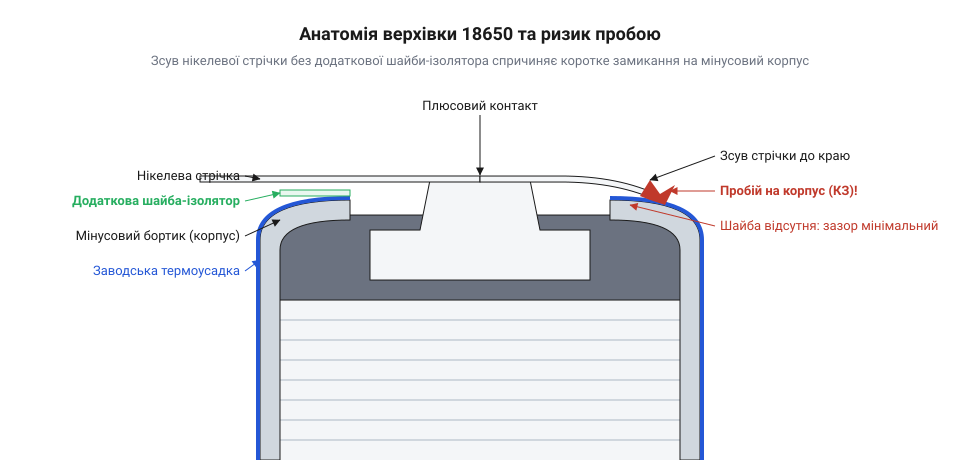
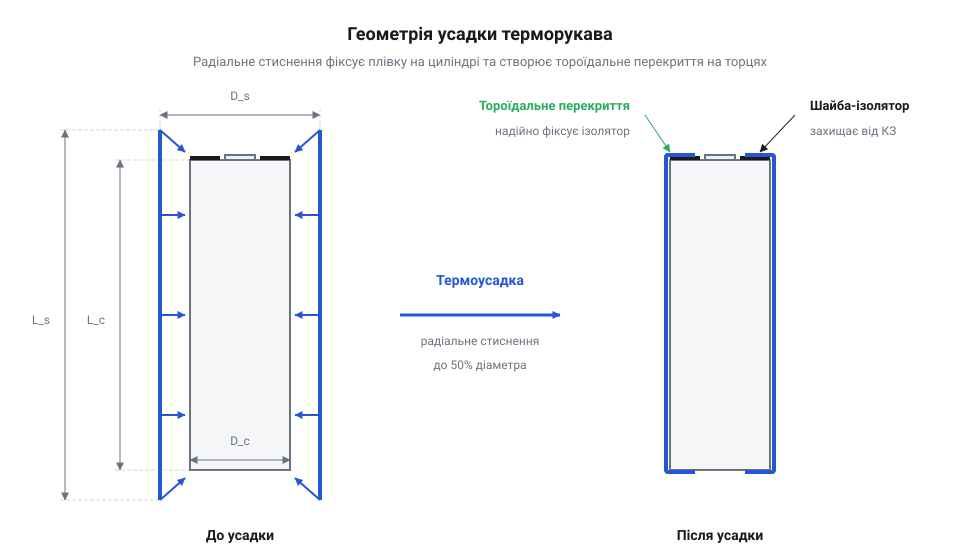
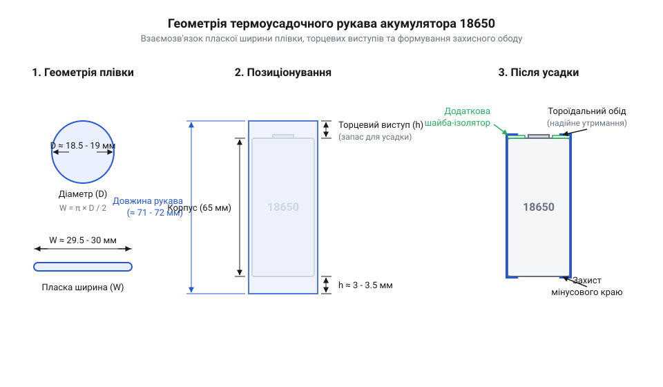

# Шайби-ізолятори й термоусадка для 18650

<preknowlist>
- [Нікелева стрічка 0.15×10 мм](root:cat-hw-power/nickel-strip) — Способи прокладання струмознімальних смуг на торцях елементів та геометрію їх перекриття з бортиком гільзи.
- [MECHANIC PN360 — апарат точкового зварювання](root:cat-hw-power/spot-welder-pn360) — Режими локального нагріву й ризики розбризкування ікрових розрядів під час зварювання контактів.
</preknowlist>

## Анатомія гільзи 18650 та ризики замикання

Циліндричний акумуляторний елемент @@en|18650@@ (від англ. @@en|18650@@ — цифровий кодифікатор розміру циліндричного елемента: 18 мм діаметр, 65 мм довжина) зовні нагадує звичайну побутову пальчикову батарейку, проте за своєю фізичною конструкцією є високоенергетичною судиною під тиском із кардинально іншою схемою розподілу електричних потенціалів. Його зовнішній корпус являє собою суцільнотягнуту сталеву гільзу (від нім. @@de|Hülse@@ — оболонка, патрон), покриту тонким шаром нікелю для захисту від корозії та забезпечення високої електропровідності. Головна конструктивна особливість цього формофактора полягає в тому, що вся бічна стінка гільзи, її плоске дно та верхній завальцований бортик безпосередньо з'єднані з негативним електродом (анодом) і перебувають під повним мінусовим потенціалом комірки.

Позитивний контакт (катод) розташований виключно на верхньому торці акумулятора у вигляді випнутого або плаского металевого майданчика. Позитивний полюс відокремлений від негативного металевого бортика гільзи вузьким кільцевим зазором, у якому встановлено гумову або полімерну ізолюючу прокладку. Ця прокладка герметизує верхню кришку та утримує внутрішні захисні елементи: пристрій @@en|CID@@ (від англ. @@en|Current Interrupt Device@@ — пристрій переривання струму при критичному підвищенні внутрішнього тиску) та терморезистор @@en|PTC@@ (від англ. @@en|Positive Temperature Coefficient@@ — терморезистор з позитивним температурним коефіцієнтом опору). Радіальна відстань між зовнішнім краєм плюсового майданчика та внутрішньою кромкою мінусового бортика становить усього 1.0–1.5 мм, що створює критично вузьку зону діелектричного розділення.


*Поперечний розріз верхівки елемента 18650: відносна близькість позитивного плюсового майданчика до мінусового бортика металевої гільзи створює критичну зону пробою при механічному зсуві або пошкодженні ізоляції.*

Для захисту всієї мінусової поверхні від випадкового контакту із зовнішнім середовищем акумулятор ще на заводі обгортають у тонкий термоусадочний рукав (від англ. @@en|shrink sleeve@@ — плівкова трубка, що стискається під дією температури), виготовлений з полівінілхлориду (від грец. @@el|poly-@@ — багато та англ. @@en|polyvinyl chloride@@, скорочено @@en|PVC@@). Цей рукав покриває циліндричну стінку й загинається на верхній та нижній торці, утворюючи тороїдальний нахлест. Однак товщина стандартної плівки @@en|PVC@@ становить лише 0.08–0.1 мм. Під час складання батарейних блоків, установки елементів у металеві холдери або експлуатації в умовах постійної вібрації ця плівка зазнає точкових механічних навантажень.

Пошкодження діелектричної оболонки у формі мікроподряпин, потертостей чи надривів на бічній поверхні або біля верхнього торця оголює суцільну металеву гільзу. Якщо металевий предмет, елемент корпусного кріплення або зміщена [струмознімальна нікелева стрічка](root:cat-hw-power/nickel-strip) перекриває межу між позитивним контактом і оголеним бортиком, виникає пряме коротке замикання. Внутрішній опір високотокових акумуляторів @@en|18650@@ є надзвичайно малим і становить 10–25 мОм.

Згідно з законом Ома для повного кола, струм короткого замикання обчислюється як відношення початкової напруги заряду комірки до її внутрішнього опору:

    I_sc = U_cell ÷ R_int
    = 4.2 В ÷ 0.015 Ом      [підстановка параметрів заряду та опору]
    = 280 А                  [значення струму короткого замикання]

Пікова теплова потужність розсіювання в зоні короткого замикання визначається за законом Джоуля-Ленца через квадрат струму та опір контакту:

    P_heat = I_sc² × R_int
    = (280 А)² × 0.015 Ом   [підстановка струму короткого замикання]
    = 1176 Вт                [пікова теплова потужність]

Теплова потужність понад 1000 Вт, яка розсіюється в мікроскопічному об'ємі точки контакту, миттєво піднімає температуру металу й спричиняє локальний дуговий пробой та розігрів внутрішнього рулону електродів до температури понад 130–150 °C. За такої температури внутрішній пористий поліолефіновий сепаратор (від лат. @@la|separator@@ — розділювач) плавиться й руйнується, призводячи до масштабного внутрішнього міжелектродного замикання. Рідкий органічний електроліт закипає й розкладається з виділенням горючих газів та кисню з кристалічної ґратки катода, викликаючи незворотний @@en|thermal runaway@@ (від англ. @@en|thermal runaway@@ — неконтрольоване саморозігрівання акумулятора з вибуховим виділенням газів і вогню).

У перших поколіннях комерційних акумуляторів 1990-х років виробники обмежувалися лише одношаровим зовнішнім терморукавом без додаткового торцевого захисту. Проте масова експлуатація у ноутбуках показала високий відсоток аварій через стирання плівки на краях гільзи. Це змусило інженерів розробити двобар'єрну систему ізоляції з додатковими тороїдальними шайбами. Детальніше про цей історичний етап та зміну конструкторських стандартів ви можете прочитати у матеріалі про [еволюцію зовнішньої ізоляції](root:cat-hw-power/cell-insulators-and-wrap/hist-18650-insulation-evolution.md). Точні фізичні розміри та електричні допуски елементів наведено у матеріалі [специфікація залізного інтерфейсу](root:cat-hw-power/cell-insulators-and-wrap/api-18650-insulation-and-sleeve-hardware-spec.md), а математичні формули розрахунку пробійної напруги — у статті про [електричну міцність діелектрика](root:cat-hw-power/cell-insulators-and-wrap/math-18650-sleeve-geometry-and-dielectric-strength.md).

## Торцеві шайби та бар'єр нікелевої стрічки

Особливо вразливою зоною акумулятора @@en|18650@@ є верхній торцевий перехід між плюсовим майданчиком та мінусовим бортиком під час електричного з'єднання комірок у батарейний модуль. Для комутації елементів використовується [нікелева стрічка 0.15×10 мм](root:cat-hw-power/nickel-strip), яка приварюється до терміналів за допомогою [апарата точкового зварювання](root:cat-hw-power/spot-welder-pn360). Ширина такої стрічки часто перевищує діаметр позитивного майданчика, через що її краї нависають безпосередньо над завальцьованим бортиком металевої гільзи.

Під час експлуатації батарейного блоку в електротранспорті, силових інструментах чи безпілотних апаратах модуль зазнає постійних вібрацій та циклічних температурних розширень. Гострі заусенці, що утворюються на штампованих краях нікелевої стрічки або виникають під час приварювання, діють як мікроскопічні леза. Під дією вібрацій вони поступово прорізають тороїдальний загин тонкого зовнішнього рукава @@en|PVC@@, торкаються оголеного сталевого бортика й викликають міжполюсне коротке замикання.

Для усунення цього ризику на позитивний торець кожної комірки перед укладкою нікелевої стрічки обов'язково встановлюють додаткову кільцеву шайбу-ізолятор. Ця шайба створює товстий механічний та діелектричний бар'єр, який перекриває всю зону завальцьованого бортика й унеможливлює прямий контакт шини з мінусом.

Вибір матеріалу для торцевих шайб-ізоляторів визначається їхньою механічною міцністю на прокол і зсув, термостійкістю під час зварювання та стабільністю фізичних властивостей. У сучасній інженерній практиці застосовують три основні матеріали:

1. Вулканізований ячмінний папір (від англ. @@en|barley paper@@ — ячмінний папір, також відомий як @@en|fish paper@@):
   Це композитний матеріал на основі високоочищеної целюлози (від лат. @@la|cellulose@@ — клітковина), підданої хімічній вулканізації хлоридом цинку з подальшим каландруванням. Матеріал володіє унікальною волокнистою структурою, яка забезпечує високу зсувну міцність та еластичність. При натисканні гострої кромки нікелевої стрічки ячмінний папір не розтріскується і не прорізається, а пружно деформується, амортизуючи вібраційні удари. Під час точкового зварювання іскрові розряди та виплески розплавленого металу від [пристрою точкового зварювання](root:cat-hw-power/spot-welder-pn360) не розплавляють ячмінний папір, оскільки целюлоза є термореактивним волокном і обуглюється лише за температур понад 300 °C без втрати формостійкості. Хоча сирий папір здатний поглинати вологу з повітря (вологопоглинання до 5–8%), технічний @@en|barley paper@@ просочують органосиліконовими або акриловими смолами, що робить його гідрофобним і стабільним у вологих середовищах. На зворотний бік шайби нанесено термостійкий клейовий шар для надійної фіксації на торці комірки.

2. Поліетилентерефталат (від грец. @@el|poly-@@ — багато та англ. @@en|polyethylene terephthalate@@, скорочено @@en|PET@@):
   Синтетична полімерна плівка, що вирізняється абсолютною гідрофобністю, високою гладкістю поверхні та електричною міцністю понад 150 кВ/мм при товщині 0.1 мм. Шайби з @@en|PET@@ мають мінімальну товщину й низьку вартість. Проте головним недоліком @@en|PET@@ є його термопластичність: температура плавлення становить лише 250–260 °C. Під час точкового зварювання виплеск гарячих іскор або тривалий прогрев нікелевої стрічки викликає миттєве локальне проплавлення шайби @@en|PET@@ з утворенням наскрізного отвору. Крім того, під постійним вібраційним тиском гострого краю нікелевої стрічки плівка @@en|PET@@ схильна до плинності матеріалу та прорізання.

3. Поліімід (від грец. @@el|poly-@@ — багато та хімічної групи амідів, англ. @@en|polyimide@@, відомий під торговельною маркою @@en|Kapton@@):
   Високотехнологічний ароматичний полімер із надзвичайно широким робочим діапазоном температур від -269 °C до +400 °C. Поліімідні шайби не плавляться, не горять і зберігають найвищу діелектричну міцність (понад 200 кВ/мм) та стійкість до зсуву навіть за екстремальних токових навантажень. Вони є ідеальним вибором для авіаційних, гоночних та високопотужних батарейних блоків, однак мають вищу вартість порівняно з ячмінним папером.


*Геометрія термоусадочного рукава 18650 до і після термічної обробки: формування тороїдального торцевого нахлесту забезпечує надійне утримання торцевої шайби-ізолятора та фіксацію гільзи.*

Геометричні параметри кільцевих шайб підбираються відповідно до стандарту 18650: внутрішній діаметр повинен становити 10–11 мм, щоб не перекривати плюсовий контактний майданчик і не заважати позиціонуванню електродів зварювального апарата, а зовнішній діаметр — 17–17.5 мм для повного перекриття завальцьованого бортика. Детальний [геометричний розрахунок термоусадки](root:cat-hw-power/cell-insulators-and-wrap/math-18650-sleeve-geometry-and-dielectric-strength.md) визначає оптимальну величину торцевого нахлесту для надійного затискання шайби.

Для практичного освоєння безпечної технології заміни пошкодженої плівки та правильного позиціонування шайб скористайтеся матеріалом [практикум з перепакування](root:cat-hw-power/cell-insulators-and-wrap/proj-18650-rewrapping-and-insulator-replacement-workshop.md). Для безпечного зберігання та транспортування елементів із пошкодженою оболонкою до моменту ремонту обов'язково застосовуйте [чохол безпечного транспортування](root:cat-hw-power/lipo-safety-bag), а перевірку напруги та стану комірок виконуйте через [сигналізатор розряду акумуляторів](root:cat-hw-power/lipo-voltage-alarm).

## Матеріали та параметри термоусадочних рукавів

Навіть якщо позитивний торець елемента 18650 захищений якісною діелектричною шайбою, послаблення або пошкодження бічної оболонки робить акумулятор критично вразливим. У щільних батарейних блоках акумулятори затискають у пластикові матричні @@en|холдери@@ (англ. *holder* — утримувач, від *hold*). Якщо рукав зсунеться або лопне під дією вібрації, оголений металевий корпус одного елемента торкнеться суміжного корпусу або металевого кріплення. Оскільки циліндрична гільза з'єднана з негативним електродом, такий контакт спричиняє пряме дугове коротке замикання між послідовними ланками акумулятора. З іншого боку, надто товста або нерівномірно зсаджена плівка збільшує зовнішній діаметр елемента понад допустимі 18.5 мм, через що акумулятор заклинює в комірці @@en|холдера@@ під час збирання чи обслуговування.

Основними полімерами для виготовлення термоусадочних рукавів є @@en|полівінілхлорид@@ (грец. *poly* — багато + лат. *vinum* — вино + грец. *chloros* — зелений; @@en|PVC@@) та @@en|поліетилентерефталат@@ (від грец. @@el|poly-@@ — багато та англ. @@en|polyethylene terephthalate@@; @@en|PET@@). Вони кардинально відрізняються за механічною міцністю, термостійкістю та поведінкою під час нагріву.

Плівки з @@en|PVC@@ є найпоширенішим бюджетним рішенням. Товщина стінки такого рукава після усадки становить 0.08–0.12 мм, а температурний діапазон експлуатації лежить у межах від -40 °C до +105 °C. Усадка @@en|PVC@@ починається при відносно низькій температурі 80–100 °C, а коефіцієнт радіальної усадки становить близько 48–50%. Головний недолік @@en|PVC@@ — схильність до поздовжньої усадки (до 3–5%), через що під час прогріву торцеві краї плівки можуть стягуватися дужче, ніж розраховано, оголюючи верхній бортик гільзи. Крім того, @@en|PVC@@ має нижчий поріг стійкості до розриву при виникненні мікропорізів і легко розм'якшується під час локального нагріву контактів.

Рукави з @@en|PET@@ належать до професійного класу ізоляції. Вони мають меншу товщину стінки (0.06–0.08 мм в усадженому стані) при вищій механічній міцності на пробій та розрив. Робочий температурний діапазон @@en|PET@@ сягає від -50 °C до +125 °C, а температура початку усадки становить 90–110 °C. Радіальний коефіцієнт усадки досягає 50–55%, тоді як поздовжня усадка мінімальна і не перевищує 1–2%. Завдяки меншій товщині @@en|PET@@-плівка не виходить за габаритні допуски @@en|холдерів@@ 18.4–18.5 мм і забезпечує краще відведення тепла від корпусу елемента. Як показує [аналіз еволюції матеріалів](root:cat-hw-power/cell-insulators-and-wrap/hist-18650-insulation-evolution.md), перехід від одинарних плівок з ПВХ до тонкостінних високотемпературних полімерів став ключовим чинником підвищення надійності промислових батарейних модулів.

Для забезпечення надійного захисту без деформації рукава необхідно правильно вибирати геометричні розміри заготовки: ширину рукава у пласкому стані `W_flat` та його довжину `L_sleeve`.

Пласка ширина рукава обчислюється на основі зовнішнього діаметра елемента `D_cell` з урахуванням необхідного зазору для вільного надягання плівки до усадки:

```
W_flat = (π · D_cell) / 2
       = (3.1416 · 18.3) / 2     [підстановка діаметра оголеного елемента]
       = 28.75 мм                [теоретична пласка ширина плівки]
```

На практиці стандартна пласка ширина рукава для елементів 18650 становить 29.5 мм (або 30 мм). Рукав шириною 29.5 мм у розправленому стані відповідає внутрішньому діаметру трубки 18.78 мм, що дозволяє легко натягнути його на гільзу діаметром 18.3–18.4 мм.

Довжина заготовки рукава `L_sleeve` повинна враховувати висоту циліндра `L_cell` (65.0 мм) та торцеві виступи `H_overhang` з обох боків, які при радіальній усадці формують @@en|тороїдальний нахлест@@ (грец. *toros* — тороїд, бублик; @@en|toroidal overhang@@):

```
L_sleeve = L_cell + (2 · H_overhang)
         = 65.0 + (2 · 3.5)      [додавання торцевих залишків нахлесту]
         = 72.0 мм               [підсумкова довжина заготовки рукава]
```

При довжині заготовки 72.0 мм торцевий виступ 3.5 мм після усадки утворює акуратне кільцеве завальцювання шириною 1.8–2.2 мм на позитивному та негативному полюсах. Якщо виступ зробити меншим за 2.5 мм, плівка не охопить край верхнього бортика і залишить негативний метал оголеним під дією поздовжньої усадки. Якщо ж виступ перевищить 4.5 мм, усаджений полімер перекриє центральну частину позитивного полюса, перешкоджаючи спрацюванню аварійного клапана тиску або заважаючи приварюванню нікелевої стрічки.


*Схема пласкої та кругової геометрії термоусадочного рукава 18650 демонструє співвідношення пласкої ширини плівки до її внутрішнього діаметра та формування тороїдального ободу залежно від величини торцевого виступу.*

Електрична міцність (грец. *dia-* — через + *elektron* — бурштин; @@en|dielectric strength@@) матеріалу визначає максимальну напругу, яку ізоляція здатна витримати без локального пробою. Для @@en|PET@@-плівки товщиною 0.07 мм при діелектричній міцності 200 кВ/мм гранична напруга пробою обчислюється як:

```
V_breakdown = E_strength · t_wall
            = 200 kV/mm · 0.07 mm     [підстановка міцності та товщини]
            = 14 kV                   [теоретична напруга пробою бар'єра]
```

Такий запас електричної міцності повністю усуває ризик електричного пробою між елементами навіть у разі значних сплесків напруги в високовольтних послідовних збірках. Точний [розрахунок діелектричного бар'єра](root:cat-hw-power/cell-insulators-and-wrap/math-18650-sleeve-geometry-and-dielectric-strength.md) дозволяє обґрунтовано вибирати товщину оболонки залежно від робочої напруги батарейного блоку. Всі стандартизовані розміри, товщини та допуски рукавів зведено в [окремій специфікації параметрів](root:cat-hw-power/cell-insulators-and-wrap/api-18650-insulation-and-sleeve-hardware-spec.md).

## Технологія безпечної дефектовки та перепакування

Знання характеристик ізоляційних матеріалів дає змогу перейти до практичного відновлення елементів 18650 із пошкодженою оболонкою. Процес починається з @@de|дефектовки@@ (лат. *defectus* — недолік; @@de|Defekt@@) — візуального й інструментального огляду поверхні комірки під яскравим бічним світлом. Особливу увагу приділяють плечовому переходу у верхній частині гільзи біля позитивного полюса. Зношення плівки у вигляді мікротріщин, здертих ділянок або вкраплень металевої стружки робить елемент непридатним до збирання без повної заміни рукава. Також перевіряють металевий корпус на наявність вм'ятин або глибоких задирок: гострі задирки на бортику можуть проколоти нову плівку зсередини під час усадки.

Головна небезпека під час демонтажу старої плівки — випадкове коротке замикання металевим інструментом. Використання сталевих скальпелів, ножів чи металевих пінцетів біля позитивного торця неприпустиме. Достатньо одного необережного руху лезом між позитивним ковпачком і негативним бортиком гільзи, щоб висікти потужну електричну дугу, яка розплавить метал і викличе тепловий розгон акумулятора.

Демонтаж пошкодженого покриття виконують виключно діелектричним інструментом — керамічним ножем, пластиковим спаджером або дерев'яним тримером. Надріз роблять у середній частині циліндра вздовж поздовжньої осі, де відстань від гільзи до внутрішніх активних компонентів є безпечною, після чого плівку обережно знімають пальцями. Стару шайбу-ізолятор на позитивному полюсі демонтують і оглядають. Якщо вона зроблена з ячмінного паперу й не має розривів чи пропалин, її можна використати повторно, проте безпечніше встановити нове самоклеюче кільце. Поверхню металевого корпусу протирають ізопропіловим спиртом для видалення залишків клею та бруду.

Технологічний процес установки нового ізоляційного покриття складається з трьох послідовних етапів:

1. **Центрування ізоляційної шайби.** На позитивний торець очищеного елемента наклеюють діелектричну шайбу з вулканізованого ячмінного паперу або полііміду. Шайба повинна сидіти суворо симетрично відносно позитивного контакту, повністю закриваючи металевий бортик гільзи й не зміщуючись убік. 2. **Позиціонування термоусадочного рукава.** На елемент натягують попередньо нарізаний рукав довжиною 72.0 мм. Елемент вирівнюють усередині плівки так, щоб торцеві виступи зверху й знизу були однаковими і становили приблизно 3.5 мм. 3. **Термічна усадка феном.** Для прогріву використовують будівельний @@en|термофен@@ (грец. *therme* — тепло + нім. *Föhn* — теплий вітер; @@en|heat gun@@) із вузькою насадкою-концентратором. Застосування побутових фенів для волосся недоцільне, оскільки вони не забезпечують необхідної температури потоку повітря.

Температурно-часовий режим є найкритичнішим параметром усадки. Температуру повітряного потоку @@en|термофена@@ встановлюють на рівні 130–150 °C при середній швидкості обдуву. 

Прогрів починають із позитивного торця елемента. Фен тримають на відстані 5–8 см від плівки, здійснюючи швидкі колові рухи протягом 2–3 секунд. Потім аналогічно прогрівають негативний торець для фіксації поздовжнього положення рукава. Після формування торцевих ободів фен плавно переміщують уздовж бічної поверхні циліндра, постійно обертаючи елемент навколо власної осі. Загальний час термічної обробки одного акумулятора не повинен перевищувати 8–10 секунд.

Головним ризиком при занадто тривалому нагріванні є термічна деградація внутрішнього @@lat|сепаратора@@ (лат. *separator* — розділювач; @@lat|separator@@) акумулятора. Внутрішній @@lat|сепаратор@@ Li-ion елемента виготовляють із мікропористого поліетилену або поліпропілену товщиною 12–25 мкм, температура плавлення якого становить від 130 °C до 165 °C. Якщо утримувати @@en|термофен@@ на одному місці понад 5 секунд, металева гільза швидко акумулює тепло і передає його всередину рулону електродів. Це призводить до розплавлення @@lat|сепаратора@@, місцевого короткого замикання анода й катода та неминучого теплового розгону комірки.

Після завершення усадки елементу дають охолонути до кімнатної температури природним шляхом. Проводять фінальний контроль якості:
- Торцеві бортики з плівки повинні бути рівними, без зморшок, розривів та здуттів. - Ізоляційна шайба на позитивному полюсі має бути надійно притиснута усадженим ободом плівки без зсувів. - Бічна поверхня повинна бути гладкою, без повітряних бульбашок.

Як детально демонструє [практичний посібник із перепакування](root:cat-hw-power/cell-insulators-and-wrap/proj-18650-rewrapping-and-insulator-replacement-workshop.md), дотримання цієї технології повністю відновлює заводський рівень діелектричного захисту комірок 18650. Після перепакування акумулятор готовий до збирання в модуль, де на позитивний полюс приварюється [тонка нікелева стрічка](root:cat-hw-power/nickel-strip) за допомогою [роботи зварювального апарата](root:cat-hw-power/spot-welder-pn360) без ризику пробою на корпус.