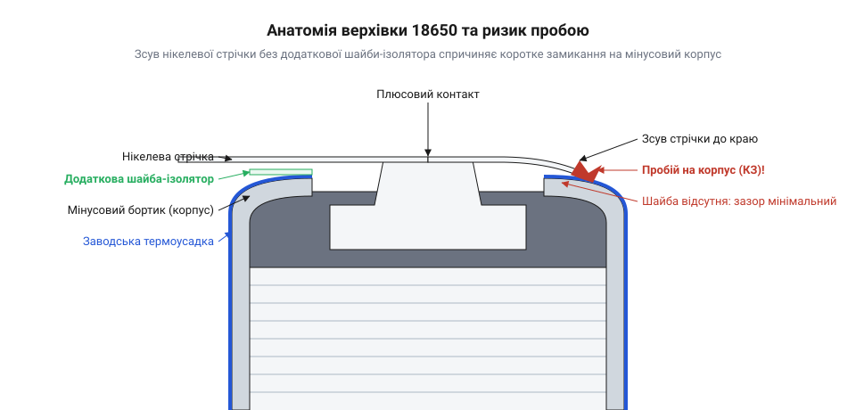
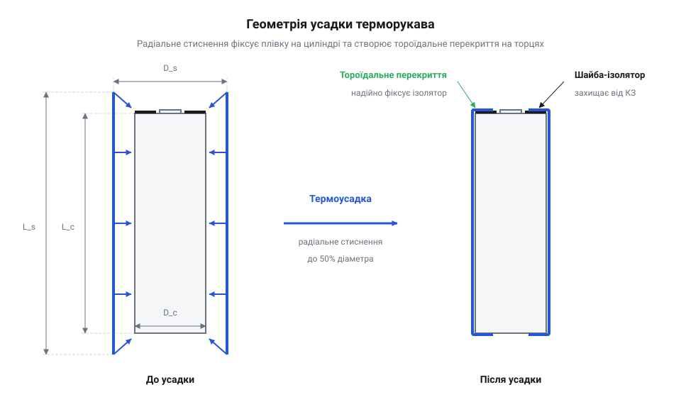

# Шайби-ізолятори й термоусадка для 18650

<preknowlist>
- [Нікелева стрічка 0.15×10 мм](root:cat-hw-power/nickel-strip) — геометрія перекриття струмознімальних смуг з бортиком гільзи
- [MECHANIC PN360 — апарат точкового зварювання](root:cat-hw-power/spot-welder-pn360) — ризики розбризкування іскор під час зварювання контактів
</preknowlist>

## Анатомія гільзи та ризик замикання

Коли ви тримаєте в руках акумулятор 18650, майже вся його металева поверхня під плівкою — це негативний контакт. Плюсовий полюс займає лише невеликий виступ на одному з торців, і від мінусового бортика його відділяє вузький зазор шириною міліметр або менше.

*Поперечний переріз торця 18650: плюсовий виступ та мінусовий бортик розділені міліметровим зазором, де пошкодження ізоляції створює прямий шлях для короткого замикання.*

Заводська термоусадкова плівка — єдине, що стоїть між зовнішнім світом і цим величезним мінусовим корпусом. На плюсовому торці плівка загинається всередину, закриваючи мінусовий бортик. Під цією плівкою на торці немає жодної іншої ізоляції, тому найменший прокол одразу оголює метал. Якщо ця тонка оболонка пошкодиться саме на торці, будь-який металевий предмет, що торкнеться одночасно плюса й відкритого металу бортика, миттєво замкне акумулятор. Без запобіжників це призводить до різкого нагрівання та небезпечного теплового розгону акумулятора.

## Торцеві шайби під нікелеву стрічку

Під час збирання батарей акумулятори з'єднують між собою [нікелевою стрічкою 0.15×8 мм](root:cat-hw-power/nickel-strip). Стрічка лягає на плюсовий контакт і неминуче перекриває загорнутий край мінусового бортика. Краї стрічки гострі, і при механічному тиску вони здатні продавити тонку заводську плівку. Крім того, [MECHANIC PN360 — апарат точкового зварювання](root:cat-hw-power/spot-welder-pn360) іноді дає розбризкування іскор, які можуть пропалити ізоляцію поруч із точкою зварювання.

Щоб запобігти цьому, на плюсовий торець наклеюють додаткові шайби-ізолятори з міцного картону або пластику. Зазвичай така шайба самоклеюча, і під час монтажу її важливо точно відцентрувати: внутрішній отвір має повністю залишати відкритим плюсовий контакт, щоб не завадити зварюванню, а суцільне кільце — накривати мінусовий бортик. Вона створює надійний діелектричний та механічний бар'єр, який неможливо продавити стрічкою чи пропалити випадковою іскрою, гарантуючи, що полюси не замкнуться.

## Термоусадковий рукав та безпечна заміна

Тонкий термоусадковий рукав покриває весь циліндр акумулятора та загинається на обох торцях, ізолюючи мінусовий корпус від зовнішніх контактів. Якщо плівка подряпалася, акумулятор стає небезпечним для використання в щільних збірках, тому ізоляцію треба замінити.

Знімати пошкоджену плівку можна лише неметалевим інструментом, наприклад пластиковою лопаткою або нігтем. Металевий ніж може легко замкнути плюс із мінусовим бортиком під час надрізання.

*Новий термоусадковий рукав виступає за краї циліндра рівними відрізками, щоб після нагрівання утворити рівномірне кільцеве перекриття на обох торцях.*

Новий рукав надівають так, щоб він виступав за краї акумулятора рівномірно з обох боків. Для усадки потрібен швидкий прогрів феном: гаряче повітря змушує матеріал миттєво стягнутися та щільно облягти корпус. Швидкий прогрів важливий, щоб плівка сіла на місце до того, як сам акумулятор встигне небезпечно нагрітися.