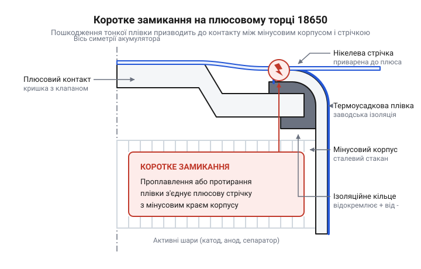

# Еволюція зовнішньої ізоляції елементів 18650: від одинарного терморукава до тороїдальних діелектричних шайб

<preknowlist>
- [MECHANIC PN360 — апарат точкового зварювання](root:cat-hw-power/spot-welder-pn360) — Розуміння процесу точкового зварювання, яке вимагає сильного притискання електродів і нагріває метал, створюючи ризик механічного й термічного пошкодження тонкої ізоляції.
</preknowlist>

## Тонка плівка та перші замикання

Перші масові збірки акумуляторів формату 18650 покладалися на найпростіший захист — тонку термоусадкову плівку з полівінілхлориду (@@en|polyvinyl chloride, PVC@@). Ця оболонка мала єдину мету: ізолювати мінусовий металевий корпус елемента від сусідніх комірок та провідників. Проте в умовах реальної експлуатації тонка ПВХ-плівка швидко виявила свою вразливість. Під дією вібрацій, тертя та температурних коливань оболонка стоншувалася і протиралася, що відкривало шлях до найнебезпечнішого сценарію — короткого замикання на позитивному торці. 

Саме конструкція позитивного контакту 18650 стала головним викликом для одношарової ізоляції. Плюсовий вивід утворює випнутий бортик, який розташований у міліметрах від загнутого краю мінусового стакана. Ця небезпечна близькість є неминучим наслідком способу герметизації циліндричного елемента: сталевий стакан слугує одночасно мінусовим контактом і посудиною для хімічних компонентів. Щоб надійно закрити акумулятор і втримати плюсову кришку проти тиску внутрішніх газів, верхній край мінусового стакана завальцьовують — загинають усередину, міцно обтискаючи нею кришку через тонку ізоляційну прокладку. Змінити цю форму неможливо, адже завальцьовування залишається єдиним методом міцно запечатати корпус під тиском без застосування зварювання, яке б одразу закоротило різнойменні контакти. Відповідно, якщо зовнішня плівка на цьому загнутому краї пошкоджується, будь-який металевий провідник чи навіть сусідній акумулятор легко замикає обидва полюси.

*Конструкція торця акумулятора, де тонка ізоляція є єдиним бар'єром між близько розташованими плюсовим контактом і мінусовим корпусом.*

Коли плюсовий бортик прорізав ослаблену ізоляцію і торкався корпусу, виникало неконтрольоване коротке замикання з миттєвим виділенням величезної кількості тепла. Початкова ізоляція не витримувала тривалих механічних навантажень, що призводило до локальних перегрівів, витоку електроліту і часто до займання всієї збірки.

## Вплив зварювання та електротранспорту

Поява електротранспорту та потреба у надзвичайно щільних батарейних блоках докорінно змінили підхід до збирання акумуляторів. Замість пружинних контактів індустрія масово перейшла на нерозбірне з'єднання елементів за допомогою [нікелевих стрічок](root:cat-hw-power/nickel-strip) і точкового зварювання. Цей процес дозволив передавати значні струми без втрат на перехідний опір, однак створив нові загрози для зовнішньої ізоляції.

Будь-який [апарат точкового зварювання](root:cat-hw-power/spot-welder-pn360) вимагає сильного притискання електродів до металу для надійного контакту. Під час короткого розряду виділяється значна кількість тепла, яка локально розплавлює нікелеву стрічку та контактний майданчик акумулятора. Точка зварювання формується в центрі позитивного виводу, проте тепло швидко поширюється металевою чашечкою на всі боки. 

Оскільки сталевий корпус акумулятора має високу теплопровідність, теплова хвиля миттєво досягає загнутих країв позитивного торця, де корпус впритул підходить до зовнішньої оболонки. ПВХ-плівка розм’якшується вже при 80 °C, а при температурах зварювання починає незворотно деградувати. Тиск від електродів, який передається через жорстку нікелеву стрічку на край бортиків, у поєднанні з високою температурою продавлював і пропалював ізоляцію на згинах. 

Зменшення потужності зварювання не було виходом. За меншого струму або коротшого імпульсу нікелева стрічка не проварювалася до корпусу. З'єднання виходило слабким, і перехідний опір у точці контакту стрімко зростав. Під час роботи на високих струмах такий поганий контакт перегрівався, що призводило до плавлення ізоляції вже під час штатної експлуатації батареї. Виникла суперечність: надійне зварювання вимагало значної енергії, але ця енергія руйнувала захисну плівку.

Дефекти ізоляції часто залишалися прихованими. Навіть якщо зварювання здавалося успішним візуально і плівка не мала наскрізних дірок, термічно пошкоджений пластик втрачав свої діелектричні властивості та механічну міцність. У щільних збірках, які постійно зазнавали вібрацій під час руху транспорту, такі мікропошкодження з часом перетворювалися на повноцінні пробої. Нікелева стрічка, що проходила над пошкодженим краєм, протирала залишки крихкої плівки і замикала позитивний полюс на негативний корпус. Досвід ранніх пожеж в електротранспорті та ноутбуках змусив інженерів визнати, що тепловий і механічний вплив зварювання робить одношарову плівку абсолютно недостатньою.

## Перехід на ПЕТ і торцеві шайби

Щоб подолати недоліки початкової ізоляції, індустрія запровадила стандарт обов'язкового подвійного торцевого захисту. Першим кроком стала заміна ПВХ на поліетилентерефталат (@@en|polyethylene terephthalate, PET@@). ПЕТ-рукави виявилися значно міцнішими на розрив, менш схильними до деградації від нагрівання і краще витримували тертя в щільних корпусах батарей. 

Проте найважливішою зміною стала поява додаткових діелектричних шайб на позитивному торці. Їх почали виготовляти з пресованого електротехнічного картону, відомого як ячмінний папір, або з термостійкого полімеру каптону (@@en|Kapton@@). Ці кільця наклеюються безпосередньо на торець акумулятора під термоусадкову плівку, створюючи товстий і механічно міцний буфер між мінусовим краєм стакана та плюсовим контактом. 

Діелектричні шайби ефективно розсіюють тиск електродів під час зварювання і запобігають термічному пробою плівки. Сьогодні наявність такого захисту є критичною вимогою для будь-якого батарейного блока. Хибне уявлення, що під час ремонту чи перепакування достатньо використати лише новий ПЕТ-рукав без встановлення картонного кільця, є прямою дорогою до короткого замикання. Ячмінний папір і каптонові шайби витримують навантаження там, де будь-яка плівка неминуче прорізається металевими краями акумулятора.