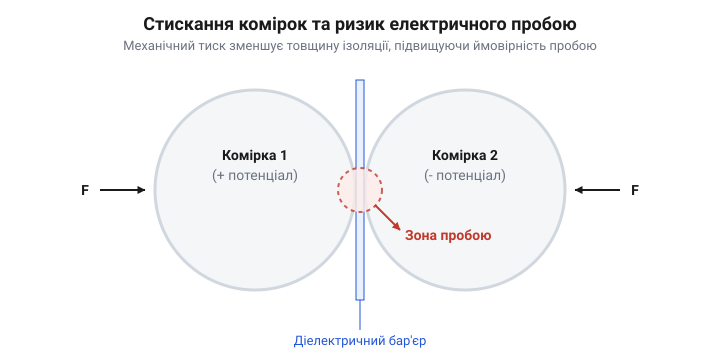
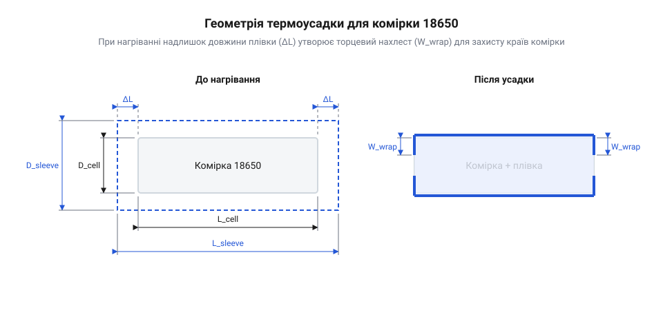

# Геометричний розрахунок термоусадочних рукавів та електричної міцності діелектричного бар'єра 18650

## Небезпека торкання банок у збірці

Коли ми складаємо кілька комірок формату 18650 у єдину батарею, вони неминуче опиняються поруч. У щільній збірці металеві корпуси сусідніх елементів ледве не торкаються один одного. Проблема полягає в тому, що весь циліндричний корпус комірки 18650, окрім позитивного контакту нагорі, є її мінусовим полюсом. Якщо дві сусідні банки з'єднані послідовно, між їхніми корпусами виникає різниця потенціалів.

Заводська ізоляція комірки — це тонка плівка, зазвичай із @@en|полівінілхлориду@@ (ПВХ), що щільно обтягує металевий циліндр. У статичному стані її достатньо, щоб запобігти короткому замиканню. Але під час експлуатації батарея зазнає вібрацій, ударів і температурних розширень. Сусідні банки починають тертися одна об одну. Від постійного механічного впливу заводська плівка протирається, оголюючи метал.

*Між сусідніми комірками утворюється зона механічного контакту, де тертя руйнує заводську плівку, тому потрібен додатковий шар ізоляції.*

Щойно два оголені корпуси з різними потенціалами стикаються, відбувається коротке замикання. Заводська плівка завтовшки близько 0.08 мм не призначена для механічних навантажень: щоб протерти її наскрізь, достатньо регулярних вібрацій з амплітудою всього 0.1–0.2 мм і сили тертя у 5–10 ньютонів, що є типовим для вібронавантаженого транспорту. Струм оминає корисне навантаження й тече безпосередньо через стінки банок. Це призводить до миттєвого перегріву, розплавлення металу, а в найгіршому випадку — до теплового розгону і займання всієї батареї. Тому покладатись лише на заводську плівку в щільних збірках небезпечно. Потрібен надійний діелектричний бар'єр, здатний витримати як механічне тертя, так і електричну напругу. Для цього кожну комірку додатково пакують у термоусадочний рукав.

## Геометрія усадки рукава 18650

Щоб надіти на комірку додаткову ізоляцію, нам потрібна заготовка у вигляді плоского рукава. Завдання полягає в тому, щоб обчислити його ширину так, аби рукав легко надягався на банку, а після нагрівання щільно обтиснув її, захопивши торці.

Комірка 18650 має форму циліндра. Її стандартний діаметр `D` становить 18 мм. Довжина кола цього циліндра `C` дорівнює добутку діаметра на число `π`:

    C
    = π × D              [формула довжини кола]
    = 3.1415 × 18        [підставляємо значення]
    = 56.55              [мм, довжина периметра комірки]

Плоский термоусадочний рукав — це сплющена трубка. Його ширина `W` дорівнює половині периметра внутрішнього кола, яке він утворює в розкритому стані. Якщо ми візьмемо рукав із шириною, що точно дорівнює половині `C`, він налізе на банку надто туго або взагалі не налізе. Тому ми додаємо невеликий допуск `Δ` на вільне надягання, зазвичай близько 1–2 мм.

    W
    = (C ÷ 2) + Δ        [формула плоскої ширини]
    = (56.55 ÷ 2) + 1.5  [підставляємо довжину кола та допуск]
    = 28.27 + 1.5        [ділимо периметр]
    = 29.77              [мм, необхідна плоска ширина]

Отже, для 18650 стандартно використовують рукав шириною 29.5 або 30 мм.

*Рукав до нагрівання вільно охоплює комірку і виступає за її краї, а після нагрівання щільно облягає циліндр, загинаючись на торці.*

Довжина заготовки також має бути розрахована. Довжина самої банки `L` — 65 мм. Рукав повинен не лише покрити стінки, але й загнутися на торцях, щоб надійно зафіксуватися. Довжина випуску на кожному кінці `E` зазвичай становить 2–3 мм. Крім того, при нагріванні рукав сідає не тільки в ширину, а й у довжину (поздовжня усадка), що може становити від 3 до 5 відсотків (коефіцієнт `S`). Це значення закладається ще на етапі виробництва матеріалу і відображає те, наскільки сильно полімер витягнули вздовж під час формування стрічки: чим сильніше розтягнули, тим більше він прагнутиме скоротитися назад. Від режиму нагрівання чи температури фена під час монтажу цей параметр майже не залежить — матеріал просто повертається до свого початкового вільного стану, тому коефіцієнт `S` є сталою характеристикою конкретної партії плівки.

    L_total
    = (L + 2 × E) ÷ (1 - S)          [повна довжина з урахуванням випусків та усадки]
    = (65 + 2 × 3) ÷ (1 - 0.05)      [підставляємо значення для 5% усадки]
    = 71 ÷ 0.95                      [додаємо випуски]
    = 74.7                           [мм, довжина відрізаного рукава]

Завдяки цьому ми отримуємо надійну ізоляцію, яка не злізе з комірки при механічних навантаженнях.

## Обчислення пробійної напруги ізоляції

Вибравши правильні розміри рукава, ми маємо переконатися, що його матеріал витримає різницю потенціалів між комірками. Здатність діелектрика протистояти електричному струму називається його пробійною напругою `U_break`. Якщо напруга між двома дотичними банками перевищить це значення, ізоляція буде пробита і станеться замикання.

Пробійна напруга залежить від двох факторів: електричної міцності самого матеріалу `E_s` та його товщини `d`. Електрична міцність вимірюється у кіловольтах на міліметр (кВ/мм). Наприклад, для якісного ПВХ це значення становить близько 15 кВ/мм.

Залежність тут лінійна: що товщий ізолятор, то вищу напругу він витримує.

    U_break
    = E_s × d            [формула пробійної напруги]
    = 15000 × 0.08       [підставляємо значення для ПВХ завтовшки 0.08 мм]
    = 1200               [Вольт, напруга пробою]

В ідеальних умовах один шар ПВХ завтовшки 0.08 мм здатний витримати 1200 Вольт. Оскільки між двома оголеними корпусами завжди знаходяться два шари ізоляції (по одному на кожній банці), загальна товщина подвоюється, а отже, подвоюється і теоретична пробійна напруга.

Але в реальній батареї ми ніколи не покладаємося на ці ідеальні цифри. Тертя під час вібрацій зменшує фактичну товщину плівки у місцях дотику. Температурний нагрів комірок знижує електричну міцність матеріалу. Тому розраховану пробійну напругу ділять на коефіцієнт запасу, щоб гарантувати безпеку в будь-яких умовах.

## Механічні навантаження між комірками

Коли елементи живлення зібрані в щільний блок, вони тиснуть один на одного. Цей тиск не є сталим: під час заряду та розряду акумулятори нагріваються, і їхні металеві корпуси трохи розширюються. Оскільки банки жорстко зафіксовані в корпусі батареї або стягнуті зовнішньою стрічкою, теплове розширення перетворюється на силу стискання, яка діє прямо на ізоляційну плівку між ними.

Щоб ізолятор виконував свою роль, він має витримувати цей тиск без критичної деформації. Якщо сила стискання перевищить межу плинності матеріалу, плівка почне розплющуватися. Вона стане тоншою, а отже, її електрична міцність, про яку ми говорили раніше, неминуче впаде. У найгіршому випадку вібрація батарейного блоку під час роботи пристрою остаточно протре залишки потоншеного бар'єра, що призведе до короткого замикання між металевими склянками сусідніх елементів.

Щоб знайти граничну силу стискання, яку здатен витримати діелектрик, використовують поняття механічного напруження `σ`. Напруження визначається як сила `F`, що діє на площу контакту `S`. Матеріал починає руйнуватися або пластично деформуватися, коли це напруження досягає межі плинності `σ_T`. 

Але елемент 18650 — це циліндр. Коли два циліндри торкаються боками, площа їхнього контакту `S` геометрично є невидимою лінією нульової товщини. Проте під дією сили стискання і пружності матеріалів ця лінія перетворюється на вузьку смужку. Чим більша сила `F`, тим ширша смужка і тим більша реальна площа `S`. Для безпечної роботи потрібно, щоб напруження у цій смужці було меншим за межу плинності на певний коефіцієнт запасу міцності `k`. Відповідно, безпечна сила стискання обчислюється так:

    F_max
    = σ_T × S             [базова формула граничної сили через площу і межу плинності]
    = (σ_T × S) ÷ k       [врахування коефіцієнта запасу міцності k]

Оскільки площа `S` сама залежить від сили `F` та пружності оболонки, точний розрахунок деформації вимагає моделювання за допомогою закону Гука. Якщо розрахунки показують, що очікуване теплове розширення збірки створить силу, більшу за `F_max`, комірки просто не можна пакувати впритул одна до одної. У такому разі між ними залишають зазор і фіксують їх у пластикових холдерах. Холдери перебирають усе механічне навантаження на себе, і тоді термоусадка взагалі не бере участі в розподілі тиску.

## Вибір товщини діелектричного бар'єра

Тепер ми маємо всі складові, щоб математично обрати конкретну товщину ізоляції. Цей вибір завжди є компромісом: плівка має бути достатньо товстою, щоб не пробитися струмом і не продавитися механічно, але водночас достатньо тонкою, щоб комірка помістилася у стандартне гніздо чи холдер без перекосів і застрягання.

Мінімальну товщину ізолятора `d_min`, яка потрібна суто для захисту від пробою, ми знаходимо безпосередньо з електричної міцності. Нехай максимальна напруга між сусідніми банками у нашій збірці становить `U_max`, а електрична міцність обраного матеріалу (наприклад, ПВХ) — `E_el`. Тоді товщина, що витримає цю напругу на межі пробою, становить:

    d_min
    = U_max ÷ E_el        [визначення товщини через напругу та діелектричну міцність]

Але це ідеальний випадок, який працює лише на столі без навантажень. Як ми щойно з'ясували, під впливом стискання та вібрацій плівка стає тоншою. Крім того, на металевій поверхні комірок можуть бути мікроскопічні задирки або сторонні тверді частинки. Тому до мінімальної електричної товщини обов'язково додають механічний запас `Δd`. Цей запас компенсує продавлювання під дією розрахованої раніше сили `F`. 

Тому фінальна робоча товщина ізолятора `d_work` розраховується як сума цих двох компонентів:

    d_work
    = d_min + Δd                                     [додавання механічного запасу до електричного мінімуму]
    = (U_max ÷ E_el) + Δd                            [підстановка формули для мінімальної товщини]

Зазвичай для збірок з елементів 18650, де напруга між сусідніми елементами невелика (наприклад, вони з'єднані паралельно або знаходяться в одному лотку), використовують стандартні ПВХ-рукави з початковою товщиною стінки 0.08–0.1 мм. Якщо ж напруга між комірками сягає кількох десятків вольт (наприклад, банки з різних кінців послідовного ланцюга опинилися поруч), або очікується сильна вібрація, однієї термоусадки стає недостатньо. 

Збільшувати товщину самої плівки нескінченно не можна — банка просто вийде за межі формату 18650 і не стане в призначене для неї місце. У таких випадках додають ще один бар'єр — ячмінний папір або тонкий текстоліт. Вони мають значно більшу межу плинності і майже не продавлюються під тиском, гарантовано витримуючи механічне навантаження. Термоусадка ж залишається тонкою і виконує переважно базову електричну ізоляцію. Математично це означає, що механічна складова `Δd` переноситься на міцніший допоміжний матеріал, залишаючи для плівки лише електричний критерій `U_max ÷ E_el`.