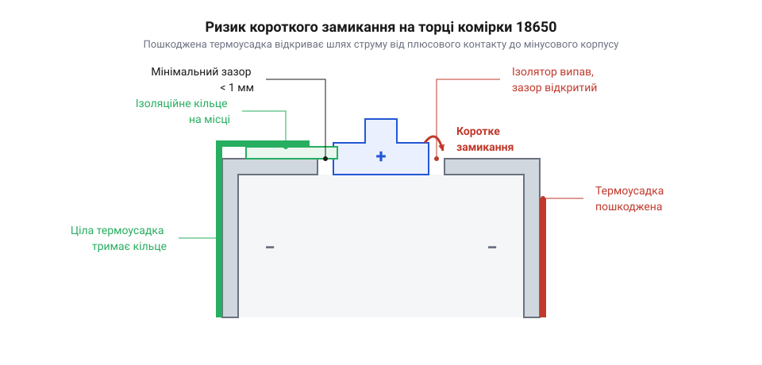

# Практикум з дефектовки, безпечного демонтажу та перепакування ізоляції комірок 18650

## Дефекти старої термоусадки та ризики

Ізоляційна оболонка навколо акумулятора — це не просто декоративна етикетка, а єдина перешкода між позитивним контактом і всім корпусом. У комірках формату 18650 весь зовнішній металевий циліндр є негативним полюсом. Тільки невелика центральна площадка на одному з торців виступає позитивним контактом. Вони розташовані критично близько один до одного, розділені лише тонкою щілиною. 

*Мінімальна відстань між полюсами робить пошкодження ізоляції на торці найбільш небезпечним.*

Якщо термоусадкова плівка рветься або протирається біля позитивного торця, будь-який металевий предмет (наприклад, [нікелева стрічка](root:cat-hw-power/nickel-strip) під час складання батареї) може випадково з'єднати контакт із корпусом. Це спричиняє коротке замикання з миттєвим виділенням величезної кількості тепла, що часто призводить до загоряння або вибуху акумулятора. Особливо підступними є прогари від точкового зварювання, які виникають через надмірну потужність імпульсу або нещільний притиск електродів: іскри та розпечений метал миттєво плавлять пластик, створюючи приховані отвори, крізь які приварена стрічка здатна замкнути на мінусовий край під час найменшої деформації. Тому будь-які подряпини, надриви на краях, сліди термічного пошкодження чи оголення металу під плівкою вимагають негайної заміни ізоляції. Навіть найменший сумнів у цілісності оболонки — це вагомий привід її зняти.

## Безпечний демонтаж пошкодженої ізоляції

Знімати стару оболонку потрібно з розумінням того, де на комірці розташовані небезпечні зони. Майже весь металевий циліндр — це мінусовий контакт, а плюсова площадка знаходиться лише на одному з торців і відділена від стінки корпусу вузьким проміжком. Саме в цьому міліметровому зазорі криється головна небезпека: якщо під час надрізання плівки випадково торкнутися інструментом одночасно центрального плюсового п'ятака і завальцьованого краю гільзи, відбудеться жорстке коротке замикання. Акумулятор миттєво віддасть величезний струм, що призведе до іскріння, оплавлення інструмента й ризику загоряння.

Найголовніше правило під час демонтажу — ніколи не використовувати металеві ножі, скальпелі чи канцелярські леза поблизу позитивного контакту. Метал миттєво стає провідником, який перемикає полюси. Тому для роботи у цій зоні слід застосовувати виключно діелектричні інструменти: керамічний ніж або загострену лопатку з міцного пластику. Вони не проводять струм і гарантують безпеку навіть при зісковзуванні.

Якщо діелектричного ножа немає і доводиться працювати сталевим лезом, механіка процесу має бути іншою. Розріз плівки починають строго від плоского мінусового торця і ведуть уздовж бічної стінки циліндра. Лезо при цьому тримають під невеликим кутом, прорізаючи оболонку і намагаючись не дряпати саму гільзу. Лінію розрізу зупиняють за кілька сантиметрів до плюсового краю, щоб метал леза навіть не наближався до зони ризику. Після цього ніж відкладають убік, а плівку розривають руками вздовж надрізу і стягують з комірки.

Окремого підходу вимагає плюсовий торець. Під загнутим краєм зовнішньої оболонки лежить ізоляційне кільце з електрокартону або пластику. Воно захищає зазор між полюсами, а також перекриває доступ до клапанів скидання тиску — вентиляційних отворів, схованих по периметру плюсової площадки під кришкою. Якщо старе кільце пошкоджене, забруднене або відшаровується, його обов'язково знімають. Робити це треба пластиковою лопаткою або дерев'яною паличкою, обережно піддіваючи край кільця. Застосовувати гострі металеві шила чи пінцети тут заборонено подвійно: вони можуть не лише замкнути контакти, а й випадково проткнути тонку мембрану клапана чи деформувати його край. Зім'ятий або пробитий клапан не зможе безпечно скинути тиск при перегріві, що зробить комірку вибухонебезпечною. Після обережного демонтажу плівки та кільця залишається голий металевий циліндр, готовий до наступного кроку — очищення поверхні.

## Очищення та встановлення ізоляційного кільця

Перш ніж одягати нову плівку, металеву поверхню комірки потрібно ретельно очистити. Залишки старого клею, іржа, плями електроліту або бруд під новою оболонкою з часом можуть призвести до корозії гільзи. Очищення проводять ізопропіловим спиртом та безворсовою серветкою, уникаючи потрапляння рідини всередину комірки через вентиляційні отвори плюсового контакту.

Після очищення необхідно встановити нове ізоляційне кільце (шайбу). Воно виготовляється зі спеціального щільного електрокартону (вулканізованого паперу) і слугує додатковим бар'єром саме там, де небезпека замикання найбільша. Кільце має самоклейну основу. Його потрібно відцентрувати й акуратно наклеїти навколо позитивного виступу, щоб воно повністю перекривало зазор між плюсовим контактом і краєм негативної гільзи. Без цієї шайби покладатися лише на тонкий шар термоусадки небезпечно.

## Фіксація та прогрів нового рукава

Нова ізоляційна оболонка зазвичай постачається у вигляді сплющеного рукава з ПВХ (полівінілхлориду) або ПЕТ (поліетилентерефталату), нарізаного під розмір 18650. Рукав розкривають і надягають на комірку так, щоб акумулятор опинився рівно посередині. З обох боків — з боку мінуса і плюса (разом із наклеєним кільцем) — має виступати однаковий запас плівки, приблизно по 2–3 міліметри.

Для усадки рукава використовують будівельний термофен або паяльну станцію з феном. Температуру потоку встановлюють на рівні 100–120 °C. Прогрівання починають із плюсового торця: потік гарячого повітря направляють на виступаючий край плівки, поки він щільно не обгорне ізоляційне кільце. Далі переходять на мінусовий торець і повторюють процедуру. Лише після того, як обидва торці зафіксовані й плівка надійно тримається, рівномірно прогрівають бічну стінку вздовж усього циліндра. Фен потрібно постійно рухати, щоб уникнути локального перегріву, який може розплавити плівку або пошкодити внутрішній полімерний сепаратор самої комірки.

## Перевірка ізоляції вольтметром

Коли комірка охолоне, її ізоляцію потрібно перевірити. Візуального огляду недостатньо, адже під час усадки плівка могла стоншитися або тріснути в непомітному місці. Найпростіший та найнадійніший метод — використання звичайного мультиметра в режимі вимірювання постійної напруги.

Один щуп вольтметра притискають до позитивного контакту акумулятора, а іншим обережно проводять по поверхні нової термоусадки, приділяючи особливу увагу краям біля плюсового торця та мінусовій основі. Якщо ізоляція ціла, прилад показуватиме нуль, адже електричного контакту з корпусом немає. Якщо ж мультиметр покаже напругу комірки (наприклад, 3.7 В), це означає, що щуп знайшов пробій і торкнувся металу гільзи. У такому разі оболонку доведеться зняти й перепакувати акумулятор заново. Лише після підтвердження повної ізоляції елемент можна вважати безпечним для експлуатації та подальшої роботи, наприклад, для складання батареї.