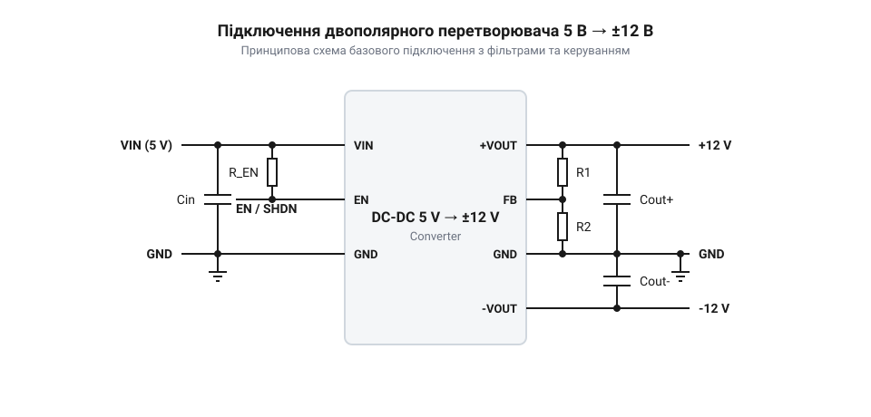
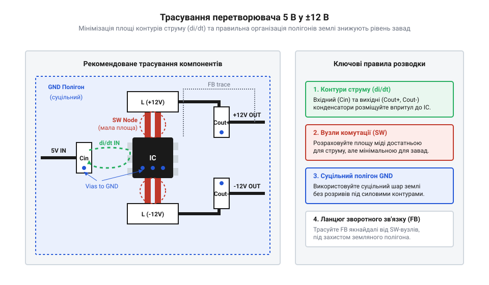

# Електричний інтерфейс, цокольовка та схема підключення перетворювача 5 В → ±12 В

## Призначення виводів і підключення

Двополярне живлення ±12 В необхідне для багатьох аналогових схем: операційних підсилювачів, аудіофільтрів та вимірювальних приладів, де сигнал має відхилятися вище та нижче нуля. Щоб отримати таку напругу від стандартних цифрових 5 В, використовують спеціалізовані двополярні імпульсні перетворювачі.

Базовий модуль такого перетворювача зазвичай має шість основних виводів. `VCC 5V` — вхід позитивної напруги від джерела. `GND` — спільна земля, відносно якої вимірюються всі інші напруги. `+12V OUT` — вихід позитивної напруги, а `-12V OUT` — вихід негативної напруги. Для зворотного зв'язку часто передбачено вивід `FB` (@@en|feedback@@), який використовується мікросхемою для підтримання стабільної вихідної напруги. Вивід `EN/SHDN` (@@en|enable/shutdown@@) дозволяє керувати роботою перетворювача, вмикаючи або вимикаючи його логічним рівнем.

*Принципова схема базового підключення перетворювача до джерела 5 В показує призначення контактів і спільну землю.*

Щоб правильно підключити модуль, вхідний плюс подається на `VCC 5V`, а мінус — на `GND`. Симетричні виходи знімаються з `+12V OUT` та `-12V OUT`, при цьому навантаження підключається між цими виводами та спільною землею. Вивід `FB` фізично підключається до позитивного виходу `+12V OUT` — безпосередньо або через резистивний дільник для налаштування напруги. Щоб мікросхема могла враховувати й компенсувати падіння напруги на силових доріжках, цю лінію слід прокладати окремим провідником і з'єднувати з колом живлення якомога ближче до навантаження, а не робити коротку перемичку на самому модулі. Якщо на платі передбачена загальна шина живлення, її слід узгодити із загальними принципами розподілу, як це робиться у [платі розподілу живлення (PDB)](root:cat-hw-power/power-distribution-board).

## Вимоги до вхідного живлення

Імпульсний перетворювач, що формує ±12 В із 5 В, працює за принципом підвищення та інвертування напруги, що вимагає значного струму від джерела. Оскільки потужність зберігається (за винятком втрат на ККД), вихідна потужність на лініях 12 В прямо пропорційна споживаній потужності з лінії 5 В. Якщо перетворювач видає сумарно 2 Вт на виходах, від джерела 5 В він споживатиме близько 2.5 Вт, враховуючи втрати перетворення, що означає струм споживання щонайменше 500 мА.

Джерело 5 В має забезпечувати напругу в чітких межах, зазвичай від 4.5 В до 5.5 В. Падіння напруги нижче робочого порогу призведе до нестабільної генерації, просідання вихідних напруг або переходу мікросхеми в циклічне перезавантаження. Тому джерело живлення має мати достатній запас по струму, який у півтора-два рази перевищує розрахункове максимальне споживання. Для забезпечення такого стабільного 5 В входу часто використовують якісний [знижувальний перетворювач](root:cat-hw-power/lm2596-buck) від основної батареї.

## Обв'язка та фільтрація шумів

Імпульсний перетворювач не видає ідеально постійну напругу: під час кожного такту внутрішніх ключів на лініях живлення виникають різкі викиди струму та пульсації напруги (@@en|ripple@@). Якщо ці коливання потраплять у чутливі аналогові кола, наприклад, на операційні підсилювачі або АЦП, вони спотворять корисний сигнал. Тому перетворювачу потрібна правильна обв'язка конденсаторами на вході та на кожному з виходів, щоб зафіксувати напругу і поглинути шуми.

На вході 5 В джерело живлення не завжди здатне миттєво віддати струм, коли внутрішній ключ мікросхеми різко відкривається. Щоб напруга на вході не просідала в ці моменти, безпосередньо біля вхідних виводів встановлюють керамічний конденсатор ємністю 10–22 мкФ. Він працює як локальний буфер енергії, забезпечуючи мікросхему живленням під час коротких імпульсів струму. Без нього вхідна напруга стрибатиме, що може порушити стабільність роботи самого перетворювача.

На виходах `+12V OUT` та `-12V OUT` пульсації мають складнішу природу: це відносно повільні коливання від заряду-розряду індуктивності та високочастотний шум від перемикання ключів на сотнях кілогерц. Щоб придушити весь спектр завад, застосовують комбінований фільтр із двох різних конденсаторів на кожному плечі.

Для згладжування низькочастотних коливань та забезпечення запасу енергії при різких змінах навантаження ставлять електролітичний або танталовий конденсатор ємністю 100–470 мкФ. Тут критично важливим є параметр еквівалентного послідовного опору (@@en|ESR@@). Чим нижчий ESR, тим ефективніше конденсатор гасить пульсації напруги, тому для імпульсних схем завжди обирають серії з низьким ESR. Звичайні дешеві електроліти не впораються: їхній власний опір перетворить імпульсний струм на додаткові коливання напруги і призведе до перегріву самого конденсатора.

Високочастотні шуми, або так звані «голки», великі конденсатори не здатні відфільтрувати через власну паразитну індуктивність. Для їх придушення паралельно електроліту ставлять керамічний конденсатор невеликої ємності, зазвичай 0.1–1 мкФ. Кераміка має відмінні частотні характеристики і миттєво реагує на швидкі фронти імпульсів, замикаючи високочастотні завади на землю. 

Обираючи конденсатори, потрібно закладати достатній запас по робочій напрузі. Для вхідної лінії 5 В вистачить конденсаторів на 10 В. Проте на виходах ±12 В компоненти постійно працюють під напругою 12 В, тому їхня номінальна робоча напруга має бути щонайменше 16 В, а краще — 25 В. Використання 16-вольтових танталових конденсаторів без запасу небезпечне: найменший стрибок напруги може викликати їхній пробій і коротке замикання з подальшим загорянням. Тому для тантал-полімерних фільтрів на лінії 12 В обов'язковим є номінал 25 В.

Фізичне розташування компонентів таке ж важливе, як і їхні номінали. Керамічні шунтуючі конденсатори слід розміщувати впритул до виводів мікросхеми. Якщо між виводом і конденсатором буде довга мідна доріжка, вона спрацює як антена: власна індуктивність доріжки зведе нанівець дію конденсатора, і високочастотний шум вільно поширюватиметься платою.

## Правила трасування плати

Навіть ідеальна схема працюватиме зі збоями, якщо розведення доріжок (@@en|routing@@) виконано неправильно. Для імпульсних перетворювачів критичним є поділ силових і сигнальних контурів, щоб потужні імпульсні струми не протікали через ті ж ділянки міді, що й чутливі аналогові сигнали.

Силові доріжки входу 5 В, виходів ±12 В та їхнього підключення до фільтруючих конденсаторів мають бути максимально короткими і широкими. Це зменшує паразитну індуктивність провідників. Земля має розводитися суцільним полігоном або «зіркою», де силова земля перетворювача об'єднується з аналоговою землею схеми лише в одній точці — безпосередньо біля виводу `GND` джерела живлення. Це гарантує, що поворотні струми високої частоти не створюватимуть падіння напруги на ділянках, від яких живляться точні датчики.

*Схема рекомендованого трасування провідників показує короткі силові петлі та єдину точку з'єднання аналогової і силової земель.*

Слід уникати петель землі, коли поворотний струм може піти кількома шляхами, створюючи контур антени, що випромінюватиме завади.

## Керування ввімкненням і захист

Вивід `EN/SHDN` дозволяє дистанційно або логічно керувати запуском перетворювача. Це корисно для заощадження енергії в сплячому режимі або для правильної послідовності подачі напруг у системі. Зазвичай, подача логічної одиниці (високого рівня, наприклад 3.3 В або 5 В) на цей вивід вмикає перетворення, а підключення його до землі — вимикає.

Щоб перетворювач самостійно запускався при появі живлення, вивід `EN` підтягують до лінії `VCC 5V` через резистор опором 10–100 кОм. Залишати його «висіти в повітрі» (без підтяжки) небезпечно, оскільки наведення можуть хаотично вмикати і вимикати живлення. Окрім підтяжки, базовий захист передбачає додавання запобіжника на вході 5 В для захисту від короткого замикання на виходах, а також діодів Шотткі паралельно виходам, якщо є ризик виникнення зворотної напруги при роботі на ємнісні чи індуктивні навантаження.