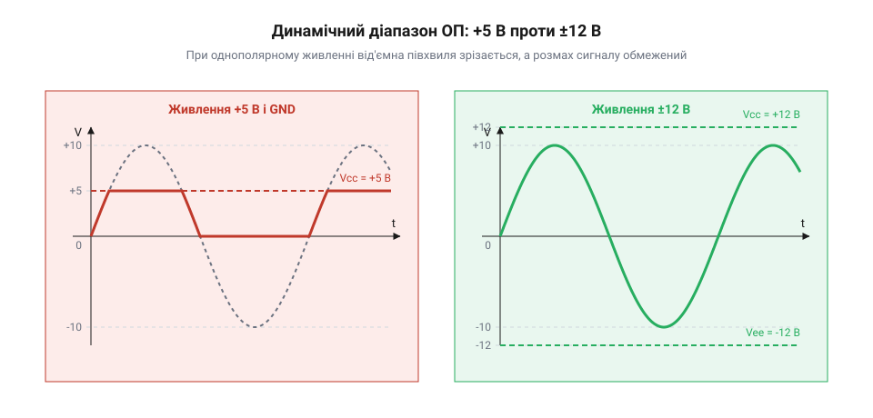
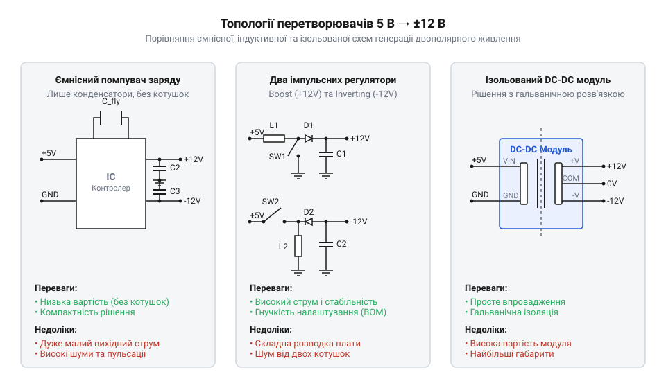
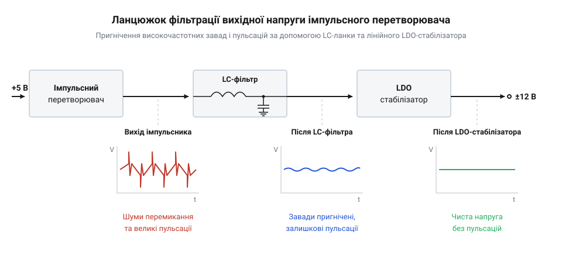
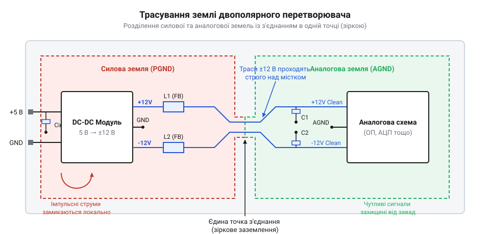

# Перетворювач 5 В → ±12 В (двополярне живлення)

<preknowlist>
- [MT3608 — підвищувач 2 А / 28 В](root:cat-hw-power/mt3608-boost) — Принцип роботи підвищувальних (Boost) імпульсних регуляторів та ключування індуктивності.
- [B0505S-1W — ізольований DC-DC 5 В → 5 В](root:cat-hw-power/b0505s-isolated) — Конструкція та особливості застосування компактних трансформаторних DC-DC перетворювачів з гальванічною розв'язкою.
</preknowlist>

## Обмеження однополярного живлення в аналогових колах

Більшість сучасних цифрових пристроїв, мікроконтролерних систем та одноплатних комп'ютерів живляться від єдиної шини з напругою +5 В, яка постачається через стандартний роз'єм USB або первинний мережевий джерельний блок. Проте реальний світ аналогових сигналів — вихідний звук з мікрофонів, дрібні коливання напруги з мостових тензодатчиків, промислові датчики стандарту ±10 В та швидкісні цифрово-аналогові перетворювачі — вимагає обробки змінних сигналів, що симетрично відхиляються як у позитивний, так і в негативний бік відносно опорного нуля. Коли розробник намагається подати такий двополярний сигнал безпосередньо на аналоговий каскад, зібраний на операційному підсилювачі (від латинського *operatio* — дія, виконання) — @@en|operational amplifier@@, живленому лише від однополярної шини +5 В та землі (0 В), системний тракт негайно втрачає здатність до коректного підсилення та обробки сигналу.

Фізична причина цього обмеження криється у схемотехнічній будові вихідного каскаду операційного підсилювача, який складається з комплементарної пари силових транзисторів. Для нормального проходження струму через верхнє або нижнє плече вихідного каскаду між шиною живлення та вихідним сигналом має зберігатися мінімальний технологічний спад напруги — запаси за напругою (від англійського *headroom* — запаси зверху) @@en|headroom@@. Якщо від'ємне плече живлення підсилювача жорстко прив'язане до загальної землі 0 В, його вихід принципово не може опуститися нижче потенціалу 0 В. Будь-яка від'ємна півхвиля вхідного сигналу спричиняє насичення нижнього транзистора, внаслідок чого вихідний сигнал зрізається (від англійського *clipping* — обрізання) @@en|clipping@@ на рівні 0 В. Навіть при використанні сучасних підсилювачів із виходом @@en|rail-to-rail@@, здатних наближатися до рейок живлення на лічені мілівольти, динамічний діапазон (від грецького *dynamikos* — силовий) @@en|dynamic range@@ обмежений рамками від 0 В до +5 В. Для розмах-до-розмаху сигналу амплітудою (від латинського *amplitudo* — величність) @@en|amplitude@@ 10 В вхідний сигнал просто не вміщується в доступні 5 В, що призводить до катастрофічних гармонічних спотворень.

Штучний вихід із ситуації через створення так званої віртуальної землі (від англійського *virtual ground* — уявна земля) @@en|virtual ground@@ — подільника напруги, який зміщує опорну точку сигналу на рівень +2.5 В, — має серйозні фізичні недоліки. Зсув нуля дозволяє змінному струмові коливатися від +0.5 В до +4.5 В без обмеження півхвиль, але повністю блокує можливість вимірювання постійного струму (DC-сигналів) без застосування розділювальних конденсаторів (від латинського *condensare* — згущувати) @@en|capacitor@@. Крім того, будь-яка пульсація або шум від цифрових кіл на шині +5 В через подільник віртуальної землі потрапляє безпосередньо в сигнальний тракт. Здатність підсилювача пригнічувати завади живлення — коефіцієнт пригнічення нестабільності живлення @@en|PSRR@@ — різко падає із зростанням частоти. При високочастотних завадах на шині живлення аналоговий сигнал спотворюється, через що погіршується співвідношення сигнал/шум @@en|SNR@@ всієї вимірювальної системи.

Наочно продемонструвати фізичну різницю між однополярним та двополярним живленням аналогового каскаду можна за допомогою порівняльних часових діаграм вихідної напруги.


*Порівняння часових діаграм сигналу на виході ОП при живленні від +5 В та ±12 В; видно зрізання від'ємної півхвилі та обмеження динамічного діапазону.*

Історія формування рішень для двополярного живлення охоплює перехід від громіздких двообмоточних трансформаторних блоків 50 Гц до компактних безиндуктивних помпувачів заряду ICL7660 та інтегрованих RS-232 трансиверів MAX232 у 1980-х роках. Зростання вимог до точності та динамічного діапазону аналогових каскадів при обмеженому енергобюджеті цифрових шин +5 В спонукало розробку інвертувальних імпульсних регуляторів та модульних ізольованих DC-DC перетворювачів. Згодом еволюціонували й методи пригнічення імпульсних завад, що призвело до створення сучасної аналогово-цифрової схемотехніки, яка поєднує високочастотне імпульсне перетворення з каскадним LDO-стабілізуванням.

Формування двополярного живлення ±12 В вирішує проблему кардинально: воно забезпечує повну симетрію шин відносно фізичної землі (0 В) та надає сумарний динамічний діапазон 24 В. Це дозволяє аналоговим каскадам обробляти високоамплітудні сигнали без ризику насичення вихідних транзисторів, гарантуючи лінійність підсилення та максимальну точність вимірювальних систем. Проте для збереження високочастотної точності необхідно враховувати [вплив завад живлення](root:hw-analog/psrr-power-supply-rejection-ratio) на каскади операційних підсилювачів, оскільки імпульсні комутації в шинах живлення здатні наводити високовольтні голки безпосередньо у сигнальні лінії.

## Топології безиндуктивного та імпульсного перетворення

Отримання двополярної напруги ±12 В із наявної первинної шини +5 В вимагає схемотехнічного рішення, яке здатне одночасно підвищувати напругу з +5 В до +12 В та інвертувати (від латинського *invertere* — перевертати) @@en|inverter@@ її для формування від'ємного плеча -12 В. Залежно від вимог до вихідного струму, рівня припустимих високочастотних завад, габаритів та гальванічної ізоляції розробники застосовують три основні топології (від грецького *topos* — місце + *logos* — вчення) @@en|topology@@: безиндуктивні помпувачі заряду, неізольовані імпульсні DC-DC регулятори та ізольовані трансформаторні модулі.

Безиндуктивні ємнісні помпувачі заряду (від англійського *pump* — насос) @@en|charge pump@@ на перемикальних конденсаторах @@en|switched-capacitor@@ працюють за принципом періодичного перезаряджання накопичувального конденсатора — так званого літаючого конденсатора (від англійського *flying capacitor* — літаючий конденсатор) @@en|flying capacitor@@. На першій фазі тактового сигналу накопичувальний конденсатор підключається паралельно до вхідної шини +5 В і заряджається до цієї напруги. На другій фазі електронні ключі на MOSFET-транзисторах перемикають його обкладки відносно землі або позитивного виходу, формуючи подвоєну або інвертовану напругу. Головною перевагою безиндуктивних схем є повна відсутність магнітних котушок індуктивності, що виключає випромінювання високочастотного магнітного поля та робить рішення надзвичайно компактним. Проте вихідний опір помпувача заряду визначається опором відкритих каналів ключів та частотою перемикання, через що вихідна напруга стрімко просідає при збільшенні навантаження. Помпувачі ефективні лише при мапи споживання до 20 мА, що детально показує [проєкт безиндуктивного джерела](root:cat-hw-power/dual-rail-converter/proj-dual-rail-charge-pump-module.md) для прецизійних датчиків.

Для забезпечення струмів від десятків міліампер до декількох ампер застосовують неізольовані імпульсні перетворювачі на накопичувальних котушках індуктивності (від латинського *inductio* — наведення) @@en|inductor@@. Позитивна шина +12 В будується за класичною підвищувальною схемою @@en|boost converter@@, де силовий ключ закорочує індуктивність на землю, накопичуючи енергію в магнітному полі, а при розмиканні ключ викидає її через діод у вихідну ємність. Для побудови позитивної шини часто застосовують [підвищувальний імпульсний регулятор](root:cat-hw-power/mt3608-boost) з високою частотою комутації. Для негативного плеча -12 В використовують підвищувально-інвертувальну топологію @@en|inverting buck-boost topology@@, де дросель увімкнений між вузлом комутації та землею. При відкритті ключа дросель заряджається від +5 В, а при закритті струм індуктивності продовжує протікати в тому ж напрямку, витягуючи електрони з негативного вихідного конденсатора та створюючи від'ємний потенціал -12 В відносно землі. Більш детально принцип роботи цього каскаду висвітлює [топологія інвертувального перетворювача](root:hw-power/inverting-buck-boost-topology). Окрім двох окремих мікросхем, можна застосовувати [зв'язані індуктивності](root:hw-power/coupled-inductor) на єдиному осерді, що гарантує симетричне відстеження напруг обох плечей.

Коли аналогові вимірювальні кола мають бути гальванічно від'єднані від цифрової землі системи для усунення паразитичних земляних контурів або із міркувань безпеки, використовують ізольовані DC-DC перетворювачі @@en|isolated DC-DC converter@@. Всередині такого модуля розміщено мікротрансформатор (від латинського *transformare* — перетворювати) @@en|transformer@@ та високочастотний автогенератор або push-pull контролер, який передає енергію через магнітне поле без прямого електричного контакту. Прикладом базового однополярного модуля є [ізольований DC-DC модуль](root:cat-hw-power/b0505s-isolated), а його двополярні модифікації (наприклад, серія B0512XD) одразу видають симетричні шини +12 В та -12 В. Головним обмеженням бюджетних ізольованих модулів є відсутність внутрішнього зворотного зв'язку за напругою, через що вихідні ±12 В значно змінюються при зміні навантаження від холостого ходу до максимального струму.

Схемотехнічні відмінності силових кіл, ключів та накопичувальних елементів для трьох розглянутих топологій наочно показано на порівняльній схемі.


*Схемотехнічне порівняння помпувача заряду, двох імпульсних регуляторів та ізольованого модуля; видно відмінності в силових ключах і компонентах.*

Розрахунок режимів роботи імпульсних каскадів базується на балансі вольт-секундного інтервалу індуктивності у сталому режимі безперервного протікання струму (від англійського *continuous conduction mode* — режим безперервної провідності) @@en|CCM@@. Коефіцієнт заповнення (від англійського *duty cycle* — коефіцієнт заповнення) @@en|duty cycle@@ імпульсів керування `D` визначає співвідношення між вхідною та вихідною напругами.

Для підвищувального каскаду позитивної шини +12 В коефіцієнт заповнення `D_pos` становить:

```
V_out_pos = V_in / (1 - D_pos)                [формула вихідної напруги підвищувача]
D_pos = 1 - (V_in / V_out_pos)                [значення коефіцієнта заповнення D_pos]
```

Для інвертувального каскаду негативної шини -12 В вихідна напруга визначається виразом:

```
V_out_neg = - V_in × (D_neg / (1 - D_neg))      [формула вихідної напруги інвертора]
D_neg = |V_out_neg| / (V_in + |V_out_neg|)      [значення коефіцієнта заповнення D_neg]
```

Мінімально необхідна індуктивність дроселя `L_min` для збереження режиму @@en|CCM@@ при заданій частоті комутації `f_sw` та пульсаціях струму `ΔI_L` обчислюється так:

```
L_min = (V_in × D) / (f_sw × ΔI_L)              [визначення індуктивності для режиму CCM]
```

А амплітуда високочастотних пульсацій напруги `ΔV_out` на вихідному конденсаторі залежить від струму навантаження `I_load` та його еквівалентного послідовного опору (від англійського *equivalent series resistance* — еквівалентний послідовний опір) @@en|ESR@@:

```
ΔV_out = (I_load × D) / (f_sw × C_out) + I_load × ESR    [пульсації на вихідній ємності]
```

Детальний математичний апарат розрахунку втрат та параметрів фільтрів наведено у [розрахунку силових параметрів](root:cat-hw-power/dual-rail-converter/math-dual-rail-calculation.md).

**Розрахунок силових елементів двополярного перетворювача 5 В → ±12 В для струму навантаження 100 мА на частоті 1.2 МГц**:

Припустимо, необхідно спроектувати неізольоване джерело з напругою `V_in = 5 В`, вихідними шинами `V_out_pos = +12 В` та `V_out_neg = -12 В`, струмом навантаження `I_load = 0.1 А` для кожного плеча та частотою контролера `f_sw = 1 200 000 Гц`. Допустимі пульсації струму в дроселі приймаємо рівними `ΔI_L = 0.08 А`.

```
D_pos = 1 - (5 / 12) = 0.583                    [коефіцієнт заповнення підвищувача]
D_neg = 12 / (5 + 12) = 0.706                   [коефіцієнт заповнення інвертора]
L_pos_min = (5 × 0.583) / (1200000 × 0.08)      [обчислення L для позитивного плеча]
= 3.036e-5                                      [індуктивність у генрі (30.4 мкГн)]
L_neg_min = (5 × 0.706) / (1200000 × 0.08)      [обчислення L для негативного плеча]
= 3.677e-5                                      [індуктивність у генрі (36.8 мкГн)]
C_out_pos = (0.1 × 0.583) / (1200000 × 0.01)    [ємність для пульсацій ΔV = 10 мВ]
= 4.858e-6                                      [ємність у фарадах (4.86 мкФ)]
```

З обчислень видно, що для негативного плеча потрібна більша індуктивність (36.8 мкГн проти 30.4 мкГн) через вищий коефіцієнт заповнення (70.6% проти 58.3%), а керамічні вихідні конденсатори ємністю 10 мкФ з низьким @@en|ESR@@ забезпечать рівень пульсацій нижче 10 мВ.

При виборі між розглянутими топологіями розробник керується простим правило-орієнтованим алгоритмом. Якщо струм споживання аналогової частини не перевищує 15–20 мА (наприклад, пара операційних підсилювачів та прецизійний ДАП), вибирають безиндуктивний помпувач заряду. Якщо потрібні високі струми (до 500 мА) з мінімальним рівнем завад, реалізують [проєкт неізольованого перетворювача](root:cat-hw-power/dual-rail-converter/proj-dual-rail-boost-inverting-ldo.md) з подальшим очищенням напруги за допомогою LDO-стабілізаторів. Коли ж головною вимогою є повне усунення земляних петель, застосовують готові трансформаторні DC-DC модулі. Детальна схемотехніка підключення та вираводка компонентів зведені в [довіднику електричного інтерфейсу](root:cat-hw-power/dual-rail-converter/api-dual-rail-converter-hardware.md).

## Пригнічення високочастотних пульсацій і шуму

Обрана та розрахована топологія DC-DC перетворювача здатна ефективно підвищувати та інвертувати напругу первинної шини +5 В для формування двополярного живлення ±12 В. Проте імпульсний принцип роботи силових ключів створює вихідний сигнал, який суттєво відрізняється від ідеально гладкої постійної напруги акумулятора або гальванічного елемента. Під час кожного циклу комутації силового транзистора в системі виникають високочастотні пульсації та струмові сплески, які проникають у вихідні шини живлення. Якщо подати таку неупорядковану напругу безпосередньо на аналоговий тракт, вимірювальна система втратить точність, а аудіопідсилювачі або цифрово-аналогові перетворювачі згенерують високий рівень власних завад.

Для побудови ефективної системи пригнічення шуму необхідно чітко розрізняти два фізично різних види завад, що присутні на виході будь-якого імпульсного перетворювача: високочастотні пульсації комутації @@en|switching ripple@@ (від англ. @@en|ripple@@ — зморшка, дрібна хвиля) та високочастотні комутаційні піки @@en|switching spikes@@ (від англ. @@en|spike@@ — вістря, голка).

Перший вид завад — пульсації комутації — виникає на основній частоті перемикання силового контролера `f_sw` (що зазвичай становить від 100 кГц до 2.5 МГц). Вони обумовлені періодичним накопиченням та віддачею енергії в індуктивності або конденсаторах помпувача заряду. Під час розмикання силового ключа струм індуктивності заряджає вихідний конденсатор, піднімаючи вихідну напругу, а під час замкненого стану ключа навантаження розряджає цей конденсатор, знижуючи напругу. Амплітуда таких пульсацій зазвичай становить від 10 мВ до 50 мВ і має форму трикутних або пилоподібних коливань.

Другий вид завад — комутаційні піки та високочастотний дзвін @@en|ringing@@ (від англ. @@en|ringing@@ — дзвін, осциляція) — виникає в моменти надзвичайно швидких перемикань силових MOSFET-транзисторів за часток наносекунд. Швидкі зміни струму `di/dt` та напруги `dv/dt` взаємодіють із паразитними індуктивностями друкованих провідників, виводів корпусів та паразитною ємністю силових діодів чи ключів. У результаті з'являються дуже вузькі імпульсні сплески з амплітудою від сотень мілівольт до кількох вольт та частотним спектром від 10 МГц до 200 МГц.

Небезпека цих завад для аналогових каскадів полягає в тому, що коефіцієнт пригнічення нестабільності живлення @@en|PSRR@@ операційних підсилювачів стрімко знижується зі зростанням частоти. Якщо на постійному струмі або частоті 50 Гц підсилювач пригнічує завади живлення на 80–100 дБ, то на частотах комутації DC-DC перетворювача (1 МГц і вище) величина @@en|PSRR@@ падає до 10–20 дБ. Високочастотні імпульсні голки легко долають цей бар'єр, потрапляють у сигнальний тракт, детектуються на внутрішніх p-n переходах транзисторів і перетворюються на зсув постійної напруги нуля (зсув офсету), паразитичні наводки та модуляційні завади. Щоб захистити аналогову частину, застосовують комплексну методику очищення напруги, де аналогові каскади ізолюються через спеціальний [вплив завад двополярного живлення](root:hw-analog/psrr-power-supply-rejection-ratio) на параметр @@en|PSRR@@.

Першим рубежем пригнічення завад є правильний вибір первинних вихідних конденсаторів. Використання стандартних алюмінієвих електролітичних конденсаторів є недопустимим через їхній високий еквівалентний послідовний опір @@en|ESR@@ та високу еквівалентну послідовну індуктивність @@en|ESL@@ (від англ. @@en|equivalent series inductance@@ — еквівалентна послідовна індуктивність). На високочастотних імпульсах електролітичний конденсатор перестає працювати як ємність і поводиться як звичайний індуктивний опір, пропускаючи голки шумів без перешкод.

Для ефективного фільтрування застосовують багатошарові керамічні конденсатори @@en|MLCC@@ (від англ. @@en|Multilayer Ceramic Capacitor@@ — багатошаровий керамічний конденсатор) з діелектриками типу X7R або X5R. Керамічні конденсатори мають мікроомний рівень @@en|ESR@@ та мінімальну індуктивність виводів. Проте кожен реальний керамічний конденсатор має власну частоту резонансу, вище якої його імпеданс починає зростати через власну індуктивність корпусу. Тому у вихідній шині паралельно встановлюють декілька конденсаторів різного номіналу: велику ємність 10 мкФ або 22 мкФ для поглинання низькочастотних пульсацій комутації `f_sw`, конденсатор 100 нФ для середньочастотних завад та малий керамічний конденсатор 1 нФ або 100 пФ у корпусі 0402 чи 0201 для шунтування найвищих радіочастотних піків.

Другим рубежем пригнічення завад є пасивні LC-фільтри другого ступеня та феритові намистини @@en|ferrite bead@@ (від англ. @@en|ferrite bead@@ — феритова намистина). Просте збільшення ємності вихідного конденсатора силового регулятора не здатно повністю усунути голки шумів і вимагає надмірної площі на платі. Встановлення послідовно в шину живлення малогабаритного дроселя індуктивністю 2.2 мкГн – 4.7 мкГн із наступним керамічним конденсатором створює фільтр низьких частот другого порядку з крутизною зрізу 40 дБ на декаду.

Однак при проектуванні LC-фільтра існує пастка: реактивні елементи індуктивності `L_f` та ємності `C_f` утворюють коливальний контур із власною резонансною частотою `f_c`. Якщо цей контур має високу добротність @@en|Q-factor@@ (від англ. @@en|quality factor@@ — добротність), будь-який стрибок струму споживання або комутаційний імпульс викликає резонансний дзвін напруги з амплітудою, що перевищує вхідні пульсації. Для приборкання резонансу LC-фільтр обов'язково демпфують. Для цього паралельно керамічному конденсаторові `C_f` підключають демпфувальний ланцюжок із послідовно з'єднаних послідовного резистора `R_damp` та додаткового конденсатора `C_damp` (ємність якого обирають у 3–5 разів більшою за `C_f`), або використовують танталовий конденсатор із помірним значенням @@en|ESR@@, який природно розсіює енергію резонансу.

Для пригнічення радіочастотних сплесків понад 10 МГц замість класичного дроселя часто встановлюють феритові намистини @@en|ferrite bead@@. На низьких частотах феритова намистина має мізерний активний опір (менше 0.05 Ом) і не створює спаду постійної напруги. На частотах понад 30–100 МГц опір фериту стрімко зростає до сотень Ом, причому цей імпеданс має активний характер — ферит перетворює енергію високочастотних радіозавад на тепло, не створюючи загрози резонансного дзвону.

Третім і найефективнішим рубежем очищення напруги для чутливих аналогових кіл є застосування лінійних стабілізаторів зі зверхнизьким спадом напруги @@en|LDO@@ (від англ. @@en|Low Dropout@@ — низький спад напруги).


*Ланцюжок фільтрації вихідної напруги від імпульсного перетворювача через LC-ланку до LDO стабілізаторів; видно пригнічення завад і пульсацій.*

Каскадне підключення імпульсного перетворювача та лінійного стабілізатора @@en|LDO@@ поєднує високий коефіцієнт корисної дії імпульсної топології з мікровольтним рівнем шумів лінійного джерела. Регулювальний транзистор всередині @@en|LDO@@ працює як активний фільтр низьких частот із високою швидкістю зворотного зв'язку. На частотах комутації 100 кГц – 1.5 МГц якісний лінійний стабілізатор забезпечує додаткове пригнічення пульсацій на 60–80 дБ, знижуючи залишок пульсацій з десятків мілівольт до лічених мікровольт.

Для забезпечення нормальної роботи @@en|LDO@@ розробник повинен розрахувати технологічний запас за напругою — спад напруги @@en|dropout voltage@@ `V_drop`. Регулювальний елемент @@en|LDO@@ вимагає мінімального перепаду між входом і виходом (зазвичай від 0.2 В до 0.5 В). Це означає, що первинний імпульсний DC-DC перетворювач повинен генерувати не чисто ±12.0 В, а дещо підвищену напругу — наприклад, ±12.5 В або ±13.0 В.

Наприклад, якщо регулятор видає +12.6 В, а стабілізатор @@en|LDO@@ знижує її до чистої напруги +12.0 В при струмі 100 мА, потужність теплових втрат на стабілізаторі становитиме:

```
P_loss = V_drop × I_load = (12.6 - 12.0) × 0.1 = 0.06 Вт = 60 мВт
```

Це мінімальна платня тепловиділенням за абсолютну чистоту живильних шин аналогових каскадів, що наочно показує [проєкт двополярного джерела](root:cat-hw-power/dual-rail-converter/proj-dual-rail-boost-inverting-ldo.md) з пост-LDO очищенням.

Розрахунок коефіцієнта пригнічення завад пасивного LC-фільтра базується на обчисленні його частоти зрізу `f_c` та порівнянні її з частотою комутації `f_sw`.

Перед проведенням розрахунку визначимо математичні величини: індуктивність дроселя `L_f` у генрі, ємність вихідного керамічного конденсатора `C_f` у фарадах, частота зрізу фільтра `f_c` у герцах, частота перемикання DC-DC регулятора `f_sw` у герцах, коефіцієнт послаблення напруги `A_att` та рівень пульсацій після фільтра `V_ripple_out` у вольтах.

Частота зрізу пасивного LC-фільтра другого порядку обчислюється за виразом:

```
f_c = 1 / (2 × π × √(L_f × C_f))                  [частота зрізу другого ступеня LC-фільтра]
A_att = (f_c / f_sw)²                            [коефіцієнт послаблення на частоті комутації]
V_ripple_out = V_ripple_in × A_att               [амплітуда пульсацій після LC-фільтра]
```

З виразів видно, що на частотах `f_sw`, які значно перевищують частоту зрізу `f_c`, послаблення напруги зростає пропорційно квадрату співвідношення частот (40 дБ на декаду частоти).

**Розрахунок триступеневої системи фільтрації для імпульсного двополярного перетворювача 5 В → ±12.5 В на частоті 1.2 МГц**:

Нехай первинний підвищувально-інвертувальний перетворювач працює на частоті `f_sw = 1 200 000 Гц` і створює на первинних керамічних конденсаторах шин ±12.5 В амплітуду пульсацій `V_ripple_in = 0.035 В` (35 мВ). Для очищення живлення встановлюємо LC-ланку з номіналами `L_f = 2.2 мкГн` (2.2e-6 Гн) та `C_f = 10 мкФ` (1e-5 Ф), після якої напруга подається на стабілізатор LDO з параметром PSRR = 65 дБ на частоті 1.2 МГц.

```
f_c = 1 / (2 × 3.14159 × √(2.2e-6 × 1.0e-5))      [обчислення частоти зрізу LC-фільтра]
= 1 / (2 × 3.14159 × 4.6904e-6)
= 33937.3 Гц                                     [частота зрізу становить 33.94 кГц]

A_att = (33937.3 / 1200000)²                     [коефіцієнт передачі LC-фільтра на f_sw]
= (0.02828)²
= 0.0007998                                      [послаблення у 1250 разів (-61.9 дБ)]

V_ripple_LC = 0.035 × 0.0007998                  [амплітуда пульсацій після LC-ланки]
= 0.00002799 В                                   [пульсації знижено до 28 мкВ]

A_LDO = 10^(-65 / 20)                            [коефіцієнт передачі LDO при PSRR = 65 дБ]
= 0.0005623                                      [послаблення стабілізатора у 1778 разів]

V_ripple_final = V_ripple_LC × A_LDO             [підсумковий рівень пульсацій на виході LDO]
= 0.00002799 × 0.0005623
= 1.574e-8 В                                     [підсумкові пульсації становлять 0.016 мкВ]
```

З покрокових обчислень видно, що комбінація пасивного LC-фільтра (який знижує амплітуду пульсацій із 35 мВ до 28 мкВ) та активного LDO-стабілізатора пригнічує високочастотні завади до абсолютно мікровольтних та нановольтних рівнів, гарантуючи прецизійну чистоту живлення аналогових каскадів.

## Проблема асиметрії навантаження та перекосу

Навіть при ідеальній розрахунковій симетрії вихідних шин ±12 В у реальних електронних модулях розробник майже завжди стикається з ефектом асиметрії струму споживання. Аналогово-цифрова система рідко споживає однакові струми по позитивному та негативному плечах. Позитивна шина +12 В найчастіше навантажена значно сильніше, оскільки окрім негативних і позитивних виводів живлення операційних підсилювачів від неї можуть живитися допоміжні цифрові мікросхеми, світлодіодні індикатори, джерела опорної напруги, аналогово-цифрові перетворювачі та опорні генератори. У результаті споживання по шині +12 В може становити 120–150 мА, тоді як від'ємне плече -12 В живить лише нижні транзистори аналогових каскадів і споживає всього 10–20 мА.

Такий струмовий дисбаланс створює фізичну проблему — ефект перекосу напруг @@en|voltage skew@@ (від англ. @@en|skew@@ — перекіс, ухил) між позитивною та негативною шинами. Ступінь та характер цього перекосу критично залежать від обраної схемотехнічної топології керування перетворювачем.

У дешевих та компактних схемах двополярних джерел живлення, побудованих на єдиному імпульсному контролері з подвійним виходом або на дроселях із [пов'язаними індуктивностями](root:hw-power/coupled-inductor), контур зворотного зв'язку @@en|feedback@@ (від англ. @@en|feedback@@ — зворотний зв'язок) підключено лише до позитивного виходу +12 В. Вихідний вимірник напруги порівнює потенціал позитивної шини з внутрішньою опорною напругою `V_ref` і підлаштовує коефіцієнт заповнення імпульсів `D` силового ключа так, щоб утримувати +12 В на стабільному рівні. Негативне ж плече -12 В регулюється виключно пасивно — за рахунок магнітного зв'язку обмоток або симетрії комутації ємностей.

Коли навантаження стає асиметричним, пасивна перехресна стабілізація @@en|cross-regulation@@ (від англ. @@en|cross-regulation@@ — перехресна стабілізація) ламається і виникають два граничні небезпечні режими:

Режим 1: Позитивне плече навантажене слабо (10 мА), а негативне плече навантажене сильно (150 мА). Системний контролер бачить, що напруга +12 В перебуває в нормі, і зменшує коефіцієнт заповнення `D`. Проте негативному плечу для підтримки струму 150 мА катастрофічно бракує енергії, яка передається в індуктивність за малий час замкненого стану ключа. У результаті напруга від'ємної шини просідає за модулем — замість розрахункових -12 В вона падає до -8 В або -7 В. Зменшення напруги негативного живлення зрізає динамічний діапазон нижньої півхвилі сигналів в операційних підсилювачах.

Режим 2: Позитивне плече навантажене сильно (150 мА), а негативне плече практично вільне (5 мА). Контролер збільшує коефіцієнт заповнення імпульсів `D` до максимуму, щоб прогодувати потужне позитивне навантаження. За кожен цикл комутації в негативну шину накачується надлишкова кількість енергії `E = (L × I²) / 2`. Оскільки споживання по від'ємному плечу відсутнє, ця енергія накопичується на вихідному конденсаторі негативної шини, розганяючи її напругу за модулем. Замість -12 В напруга негативного плеча зростає до -16 В, -18 В або навіть -22 В. Це явище неконтрольованого злету напруги холостого ходу створює реальну загрозу пробою вихідних керамічних конденсаторів та перевищення максимально припустимої напруги живлення аналогових мікросхем.

Для кардинального усунення проблеми перекосу напруг при асиметричному навантаженні схемотехніка пропонує три основні рішення:

Перше рішення — побудова перетворювача на двох повністю незалежних імпульсних регуляторах. Позитивна шина регулюється власною мікросхемою підвищувального перетворювача (Boost), а негативна шина — окремою мікросхемою інвертувального перетворювача (Inverting Buck-Boost). Кожна мікросхема має свій власний підсилювач помилки та свій контур зворотного зв'язку.

У негативному інвертувальному регуляторі вивід зворотного зв'язку `FB` відстежує саме від'ємну напругу. Оскільки вхідний підсилювач помилки мікросхеми розрахований на позитивну опорну напругу `V_ref` відносно власної землі, підключення дільника зворотного зв'язку здійснюється у вигляді підсумовувального вузла між позитивною опорною напругою або шиною живлення та негативним виходом. Якщо негативна шина просідає або злітає, її власний контролер незалежно коригує свій коефіцієнт заповнення `D_neg`, гарантуючи ідеальну стабілізацію незалежно від стану позитивної шини.

Друге рішення — використання диференціального або зваженого зворотного зв'язку @@en|weighted feedback@@ у дводжерельних контролерах. Резистивний дільник напруги підключається не між +12 В і землею, а безпосередньо між позитивною шиною +12 В та негативною шиною -12 В, із середньою точкою, підключеною до виводу `FB`. При такому включенні контролер відстежує не абсолютне значення однієї шини, а сумарну різницю потенціалів між шинами (24 В). Якщо негативна шина починає злітати за модулем, середня точка дільника зміщується, змушуючи контролер пригальмувати накачку енергії. Це запобігає небезпечному перенапруженню, хоча й не усуває повністю дрібного відносного перекосу при екстремальних струмах.

Третє рішення — комбінація баластних резисторів мінімального навантаження @@en|bleeder resistor@@ (від англ. @@en|bleeder resistor@@ — стікальний або баластний резистор) та каскадних LDO-стабілізаторів. Щоб негативне плече не злітало до небезпечних напруг у режимі холостого ходу, паралельно його вихідній ємності запаюють баластний резистор `R_bleed`, який забезпечує постійне мінімальне споживання струму (зазвичай 5–10 мА). Одночасно силову частину імпульсного перетворювача розраховують на видачу підвищеної напруги ±13.5 В, а після неї встановлюють незалежні лінійні стабілізатори LDO на +12.0 В та -12.0 В. Лінійні стабілізатори працюють як буферні клапани: навіть якщо імпульсна напруга негативного плеча гуляє в діапазоні від -13.0 В до -14.5 В через асиметрію навантаження, вихідний стабілізатор LDO видає суворо фіксовані -12.00 В з нульовим перекосом.

Математичний розрахунок дільника зворотного зв'язку для негативного інвертувального каскаду базується на законі Кірхгофа для струмів у підсумовувальному вузлі виводу `FB`.

Перед розрахунком дамо визначення змінним: `V_ref` — внутрішня позитивна опорна напруга підсилювача помилки регулятора у вольтах, `V_out_neg` — задана негативна вихідна напруга у вольтах (величина від'ємна), `R_fb1` — опір нижнього резистора дільника між виводом `FB` та землею (або опорною напругою) у Омах, `R_fb2` — опір верхнього резистора дільника між негативним виходом `V_out_neg` та виводом `FB` у Омах, `I_bleed` — мінімальний струм баластного резистора у амперах, `P_bleed` — потужність розсіювання баластного резистора у ватах.

Для схеми інвертувального регулятора, де вивід `FB` підтримується контролером на рівні потенціалу землі 0 В за допомогою внутрішнього опорного джерела, рівняння балансу струмів має вигляд:

```
V_ref / R_fb1 = |V_out_neg| / R_fb2              [баланс струмів у вузлі FB при опорному потенціалі 0 В]
R_fb2 = R_fb1 × (|V_out_neg| / V_ref)             [формула розрахунку опору плеча зворотного зв'язку]
```

Якщо ж вивід `FB` має позитивний опорний потенціал `V_ref` відносно землі (наприклад, 1.25 В), то верхній резистор `R_fb2` підключається між позитивною опорною напругою `V_ref` (або входом `V_in`) та виводом `FB`, а розрахунковий вираз набуває вигляду:

```
(V_ref - 0) / R_fb1 = (0 - V_out_neg) / R_fb2    [рівняння струмів підсумовувального вузла]
R_fb2 = R_fb1 × (|V_out_neg| / V_ref)             [розрахунок верхнього плеча дільника FB]
```

З виразу видно, що опір верхнього резистора `R_fb2` прямо пропорційний співвідношенню модулів негативної вихідної напруги та опорної напруги контролера.

**Розрахунок елементів зворотного зв'язку та баластного навантаження для негативного плеча -12 В на інвертувальному регуляторі**:

Припустимо, необхідно розрахувати дільник зворотного зв'язку для негативного плеча `V_out_neg = -12.0 В` на базі інвертувального контролера з опорною напругою `V_ref = 1.229 В` та вибраним нижнім резистором `R_fb1 = 10 000 Ом` (10 кОм). Також потрібно обчислити номінал та потужність розсіювання баластного резистора `R_bleed` для забезпечення мінімального струму холостого ходу `I_bleed = 0.008 А` (8 мА).

```
R_fb2 = 10000 × (| -12.0 | / 1.229)              [обчислення опору верхнього плеча R_fb2]
= 10000 × (12.0 / 1.229)
= 10000 × 9.76403
= 97640.3 Ом                                     [розрахунковий опір становить 97.64 кОм]

R_bleed = | V_out_neg | / I_bleed               [обчислення опору баластного резистора]
= 12.0 / 0.008
= 1500 Ом                                        [номінал баластного резистора дорівнює 1.5 кОм]

P_bleed = (| V_out_neg |)² / R_bleed             [обчислення теплової потужності на R_bleed]
= (12.0)² / 1500
= 144 / 1500
= 0.096 Вт                                       [тепловиділення становить 96 мВт]
```

Результати розрахунку показують, що для точного формування напруги -12 В слід обрати прецизійний резистор `R_fb2` номіналом 97.6 кОм (зі стандартного ряду E96 з точністю 1%), а для відведення надлишкової енергії в режимі асиметрії підходить баластний резистор номіналом 1.5 кОм у стандартному SMD-корпусі 0805, який розсіює 96 мВт тепла.

Описані математичні залежності та правила підбору компонентів доповнюють загальний апарат, наведений у [розрахунку силових параметрів](root:cat-hw-power/dual-rail-converter/math-dual-rail-calculation.md). При практичній збірці пристрою всі розраховані номінали та схеми виводів звіряють із даними [електричного інтерфейсу](root:cat-hw-power/dual-rail-converter/api-dual-rail-converter-hardware.md), що гарантує надійну та симетричну роботу джерела живлення під будь-яким розкидом навантажень.

## Трасування плати та розділення земель

Ідеально розрахована принципова схема перетворювача напруги та правильно дібрані коефіцієнти стабілізації не гарантують чистої вихідної напруги, якщо фізичне розміщення компонентів на друкованій платі виконано без урахування законів високочастотної електродинаміки. У реальному пристрої мідні доріжки не є ідеальними провідниками з нульовим опором — вони володіють паразитним активним опором `R_p` та індуктивністю `L_p`. Під час імпульсної комутації силовими ключами із частотою в сотні кілогерц струм у силових контурах змінюється із високою швидкістю `di/dt`. Це явище створює локальні падіння напруги `ΔV = L_p · (di / dt)` на доріжках заземлення. Якщо чутливе аналогове коло та силова частина регулятора використовують спільну неоптимізовану трасу повернення струму, виникають імпульсні завади, які прямо потрапляють у сигнальні кола операційних підсилювачів і погіршують точність всієї системи.

### Паразитні контури та правило гарячих петель (Hot Loops)

Ключовим джерелом електромагнітного випромінювання та високочастотної імпульсної завади на виході двополярного джерела є петля комутації силового струму, або @@en|hot loop@@ (англ. *hot* — гарячий, *loop* — петля, контур). Це контур, у якому струм перемикається скачкоподібно за частки наносекунди під час зміни стану внутрішнього транзистора регулятора. У підвищувально-інвертувальному перетворювачі напруги така петля містить вхідний або вихідний керамічний конденсатор, силовий ключ мікросхеми, комутаційний діод або синхронний MOSFET та індуктор.

Площа, яку охоплює @@en|hot loop@@, працює як рамкова антена: чим більша площа контуру, тим сильніше змінне магнітне поле індукується у навколишніх провідниках плати. Щоб мінімізувати випромінювання завад, розробник мусить зменшувати геометричні розміри петлі комутації до фізичного мінімуму. Вхідні керамічні конденсатори фільтрації слід розміщувати безпосередньо біля виводів живлення мікросхеми, а вихідні блоки конденсаторів — поруч із катодом діода та силовою землею.

Для розрахунку амплітуди пульсацій струму у комутаційних вузлах корисно використовувати [математичний апарат силових параметрів](root:cat-hw-power/dual-rail-converter/math-dual-rail-calculation.md), що дозволяє оцінити пікові значення `di/dt` для дібраної індуктивності та ємності. Використання мінімальної довжини доріжок між ключем і вихідним конденсатором дозволяє знизити паразитна індуктивність `L_p` до значень нижче `1 нГн`, запобігаючи виникненню високочастотного дзвону (@@en|ringing@@, англ. *ringing* — калатання, дзвін) без застосування додаткових важких фільтрів.

### Розділення силової та аналогової земель: принцип зіркового заземлення

Потоки струмів у схемі підводять до необхідності розділення загальної шини заземлення на два функціональні контури:
1. Силова земля @@en|PGND@@ (англ. *power ground*, від *power* — сила, потужність, та *ground* — земля) — провідники, якими протікають великі імпульсні струми комутації ключів, дроселів та зарядних конденсаторів. 2. Аналогова земля @@en|AGND@@ (англ. *analog ground*, від *analog* — аналоговий, безперервний, та *ground* — земля) — опорний потенціал для дільників зворотного зв'язку, прецизійних джерел опорної напруги та чутливих вхідних каскадів.

Головне правило трасування полягає в тому, що високовольтні імпульсні струми з шини @@en|PGND@@ ні за яких обставин не повинні протікати через доріжки або полігон @@en|AGND@@. Задля цього застосовують технологію @@en|star grounding@@ (англ. *star* — зірка, *grounding* — заземлення) або підключення полігонів у єдиній точці (@@en|single-point tie@@, англ. *single-point tie* — з'єднання в одній точці).


*Топологія друкованої плати із розділенням силового контуру PGND та аналогової землі AGND із зірковим з'єднанням біля вихідного фільтра.*

Точку об'єднання шин @@en|PGND@@ та @@en|AGND@@ зазвичай обирають безпосередньо на вихідному керамічному конденсаторі після LDO-стабілізатора або біля площадки заземлення (@@en|exposed pad@@, англ. *exposed pad* — відкритий майданчик) самого імпульсного регулятора. При цьому аналогова земля @@en|AGND@@ виконується у вигляді суцільної мідної заливки (@@en|copper pour@@, англ. *copper* — мідь, *pour* — заливка) безрозривного шару під вимірювальною частиною, а силова земля @@en|PGND@@ трасується широким силовим треком або окремим полігоном, ізольованим від аналогової зони.

У практичній реалізації неізольованих перетворювачів, таких як [проєкт двополярного джерела живлення](root:cat-hw-power/dual-rail-converter/proj-dual-rail-boost-inverting-ldo.md) з пост-LDO фільтрацією, дотримання розділення земель дозволяє знизити рівень шуму на шинах `+12 В` та `-12 В` до величин менше ніж `5 мВ`. Якщо ж знехтувати цим правилом, завади імпульсного регулятора на кшталт [підвищувального модуля MT3608](root:cat-hw-power/mt3608-boost) легко проникнуть у сигнальні кола та промодулюють вихідний аналоговий сигнал.

### Трасування лінії зворотного зв'язку (FB)

Вузол зворотного зв'язку `FB` (@@en|feedback line@@, англ. *feedback* — зворотний зв'язок, *line* — лінія) імпульсної мікросхеми має високий вхідний опір (зазвичай від `10 кОм` до `100 кОм`). Це робить його надзвичайно чутливим до наведень через паразитну ємність (@@en|capacitive coupling@@, англ. *capacitive* — ємнісний, *coupling* — зв'язок). Якщо доріжка `FB` проходить поруч із комутаційним вузлом `SW` або індуктивністю, на ній виникає напруга завади, яка викликає хаотичну зміну коефіцієнта заповнення (@@en|duty cycle@@, англ. *duty cycle* — коефіцієнт заповнення) та нестабільність всієї системи.

Під час трасування лінії зворотного зв'язку необхідно дотримуватися суворих рекомендацій:
- Резистори дільника напруги з'єднують безпосередньо біля виводу `FB` регулятора, роблячи довжину траси від середньої точки дільника до ніжки мікросхеми мінімальною. - Сигнальний провідник `FB` прокладають на протилежному боці від комутаційного вузла `SW` або відокремлюють його заземленим екранувальним провідником. - Точку зняття напруги для верхнього резистора дільника підключають безпосередньо до вихідного конденсатора фільтра, а не до силового трека між діодом та конденсатором, де імпульси струму максимальні. - Нижній резистор дільника зворотного зв'язку підключають виключно до чистої аналогової землі @@en|AGND@@.

### Багатошарові плати, перехідні отвори та екранування

На двошарових платах нижній шар максимально віддають під суцільний полігон землі. Прокладання сигнальних доріжок на нижньому шарі допустиме лише короткими перемичками, щоб не розривати контур повернення струму (@@en|return path@@, англ. *return* — повернення, *path* — шлях). Якщо провідник розриває земляний полігон під силовою індуктивністю або ключем, зворотний струм змушений огинати перешкоду, утворюючи петлю великої площі з високою випромінювальною здатністю.

У чотиришарових платах розподіл шарів є найбільш оптимізованим для боротьби з радіозавадами:
- Шар 1 (Top): Силові компоненти, регулятор, комутаційні вузли, доріжки `+5 В`, `+12 В`, `-12 В`. - Шар 2 (GND Plane): Суцільна опорна земля під усією площею плати без розривів. - Шар 3 (Power / Signal): Допоміжні лінії живлення та сигнальні траси. - Шар 4 (Bottom): Аналогові кола, вимірювальні датчики та додатковий полігон @@en|AGND@@.

Під час переходу силових струмів між шарами плати виникає паразитний опір та індуктивність перехідних отворів (@@en|via hole@@, англ. *via* — через, *hole* — отвір). Один стандартний перехідний отвір діаметром `0.3 мм` додає близько `1 нГн` паразитної індуктивності та `10–20 мОм` опору. Щоб з'єднати вихідний конденсатор або силовий полігон із земляним шаром, потрібно ставити групу з 3–5 паралельних перехідних отворів. Це знижує еквівалентну індуктивність та запобігає локальному перегріву друкованої плати.

Коректне трасування плати гарантує нормальну функціональність апаратного інтерфейсу двополярного джерела, детальний опис якого наведено у [довіднику залізного інтерфейсу](root:cat-hw-power/dual-rail-converter/api-dual-rail-converter-hardware.md). Для малопотужних пристроїв на помпувачах заряду, описаних у [проєкті ємнісного подвоювача та інвертора](root:cat-hw-power/dual-rail-converter/proj-dual-rail-charge-pump-module.md), дотримання правил компактного розміщення конденсаторів є вирішальним фактором мінімізації вихідного імпедансу.

### Захист від високочастотного дзвону та помилки трасування

Навіть при оптимальній топології на комутаційному вузлі `SW` через індуктивність розсіювання та паразитну ємність напівпровідникових переходів може виникати високочастотний дзвін із частотами в десятки мегагерц. Для пригнічення цих завад безпосередньо паралельно силовому ключу або діоду встановлюють демпферний RC-снубер (@@en|snubber circuit@@, від *snubber* — гасник, демпфер, та *circuit* — коло, схема). Трасування елементів снубера також вимагає мінімальної довжини провідників. Докладніше про схемотехнічний розрахунок та трасування RC-ланцюжків для захисту ключів від імпульсних голок читайте у статті про [снуберні кола для пригнічення дзвону в імпульсних регуляторах](root:hw-power/switching-snubber-circuits).

Для дотримання загальних вимог до проектування високоефективних джерел живлення рекомендуємо ознайомитися з тим, як виконується [трасування друкованих плат](root:hw-power/converter-layout) для високочастотних імпульсних перетворювачів. Завдяки правильному розділенню силових та сигнальних провідників вдається повністю виключити [вплив пульсацій живлення](root:hw-analog/psrr-power-supply-rejection-ratio) на коефіцієнт пригнічення завад (PSRR) чутливих операційних підсилювачів.

Основні пастки та помилки, яких слід уникати при розведенні плати двополярного перетворювача:
1. Прокладання чутливих аналогових сигналів безпосередньо під силовою індуктивністю або вузлом `SW`. 2. Об'єднання аналогової землі @@en|AGND@@ та силової землі @@en|PGND@@ у двох і більше точках, що створює земляну петлю (@@en|ground loop@@, англ. *ground* — земля, *loop* — петля). 3. Використання довгих тонких доріжок для підключення фільтруючих конденсаторів замість широких полігонів. 4. Розміщення термобар'єрів (@@en|thermal relief@@, англ. *thermal* — тепловий, *relief* — розвантаження) на силових виводах конденсаторів та індукторів, що збільшує паразитний опір ланцюга.

Чітке дотримання топологічних правил перетворює розраховану принципову схему на надійний пристрій, здатний забезпечувати прецизійне двополярне живлення ±12 В для аналогових каскадів із мінімальним рівнем завад.