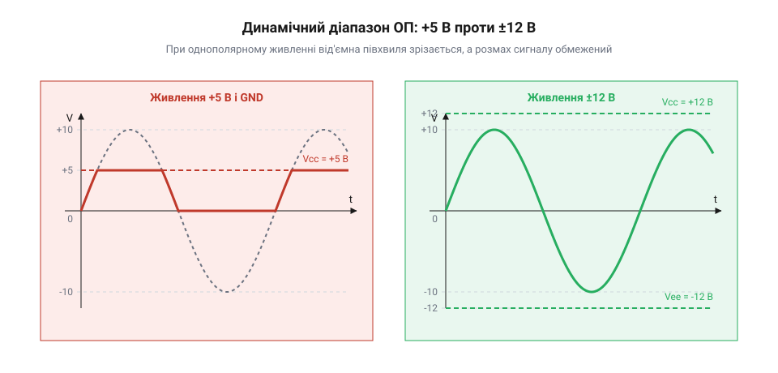
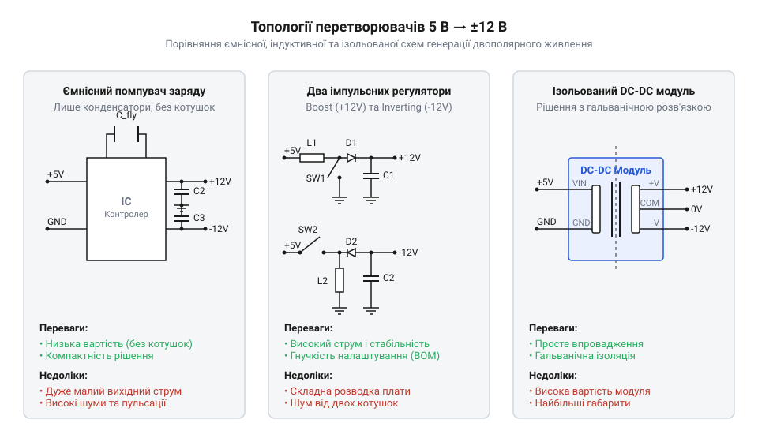
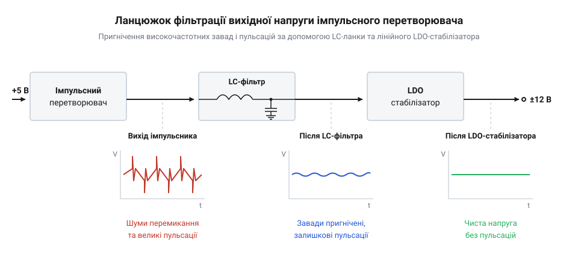

# Перетворювач 5 В → ±12 В (двополярне живлення)

<preknowlist>
- [MT3608 — підвищувач 2 А / 28 В](root:cat-hw-power/mt3608-boost) — принцип роботи підвищувальних імпульсних регуляторів та ключування індуктивності
- [B0505S-1W — ізольований DC-DC 5 В → 5 В](root:cat-hw-power/b0505s-isolated) — конструкція та застосування ізольованих трансформаторних модулів
</preknowlist>

## Чому аналоговим колам потрібні ±12 В

Аналогові сигнали, як-от звук або сигнали з датчиків, часто коливаються симетрично відносно нульового рівня — як у плюс, так і в мінус. Якщо живити операційний підсилювач лише від +5 В і землі, він фізично не зможе видати від'ємну напругу: нижня половина хвилі просто зріжеться. 

Можна створити «віртуальну землю» на рівні +2.5 В, змістивши сигнал вгору. Але тоді для коливань залишається лише по 2.5 В у кожний бік. Більшість класичних підсилювачів втрачають ще близько 1–1.5 В на внутрішніх транзисторах вихідного каскаду, тому від корисного діапазону майже нічого не залишається, і сигнал спотворюється.

*При живленні +5 В сигнал упирається в межі живлення і зрізається; двополярне живлення ±12 В дає достатньо простору для повного розмаху без спотворень.*

Двополярне живлення ±12 В вирішує цю проблему: воно дає величезний запас для розмаху сигналу і дозволяє опрацьовувати його відносно справжньої, «жорсткої» землі без хитрощів зі зміщенням.

## Топології створення двополярної напруги

Отримати від'ємну і вищу додатну напруги з базових 5 В можна кількома шляхами, залежно від того, який струм потрібен і чи потрібна розв'язка.

*Помпувач заряду найпростіший, але слабкий; імпульсні регулятори потужніші; ізольовані модулі дають гальванічну розв'язку.*

Перший варіант — помпувачі заряду на конденсаторах. Вони дешеві й не містять котушок, але підходять лише для дуже малих струмів (одиниці міліампер), оскільки напруга сильно просідає під навантаженням. Детальніше про принцип дії таких конденсаторних схем читайте у статті про [помпувачі заряду](root:sf-devices/charge-pump).

Другий шлях — імпульсні регулятори з індуктивністю. Для плюсового плеча використовують класичний підвищувач, як-от [MT3608](root:cat-hw-power/mt3608-boost), а для мінусового — інвертувальний перетворювач. Цей підхід забезпечує великі струми і стабільну напругу, але потребує більше деталей і правильного розведення плати. Механізм формування від'ємної напруги з додатної описано в матеріалі про [інвертувальні перетворювачі напруги](root:sf-devices/inverting-converter).

Третій підхід — готові ізольовані DC-DC модулі з трансформатором усередині (схожі за принципом на [B0505S-1W](root:cat-hw-power/b0505s-isolated), але з двома виходами). Вони генерують симетричні напруги й водночас відв'язують аналогову землю від шумної цифрової, що критично для точних вимірювань.

## Очищення живлення від завад

Імпульсні перетворювачі постійно перемикають струм, створюючи різкі пульсації та високочастотні голки напруги. Якщо подати таке живлення прямо на чутливий аналоговий підсилювач, ці завади пройдуть крізь нього і змішаються з корисним сигналом.

*Голки від імпульсного перемикання згладжуються LC-фільтром, а залишки пульсацій зрізає лінійний LDO-стабілізатор, видаючи чисту напругу.*

Щоб отримати чисте лабораторне живлення з імпульсного, застосовують каскадну фільтрацію. Спочатку ставлять LC-фільтр (дросель і конденсатор), який зрізає найгостріші високочастотні голки. Після нього ставлять лінійний @@en|LDO@@-стабілізатор. Лінійний стабілізатор сам не створює шумів, а лише гасить надлишок напруги в тепло. Наприклад, імпульсник підіймає напругу до ±13 В, а LDO зрізає її рівно до ±12 В, прибираючи останні пульсації.

## Асиметрія навантаження та перекіс напруг

Більшість простих схем або ізольованих модулів для двополярного живлення мають спільний трансформатор або одну котушку для обох плечей. Через це вони часто мають спільний зворотний зв'язок: мікросхема контролює сумарну напругу (наприклад, 24 В від плюса до мінуса) і підтримує її стабільною.

Проблема виникає, коли плечі навантажені нерівномірно. Якщо плюсове плече споживає великий струм, а мінусове працює вхолосту, напруга на мінусі може неконтрольовано зрости, тоді як на плюсі просяде. Це називається перекосом.

Щоб запобігти злету напруги, на виходи вішають баластні резистори, які забезпечують мінімальне постійне навантаження на обидва плечі. Надійнішим розв'язком є використання перетворювачів з незалежним зворотним зв'язком або двох окремих регуляторів, де кожен сам контролює свою напругу.