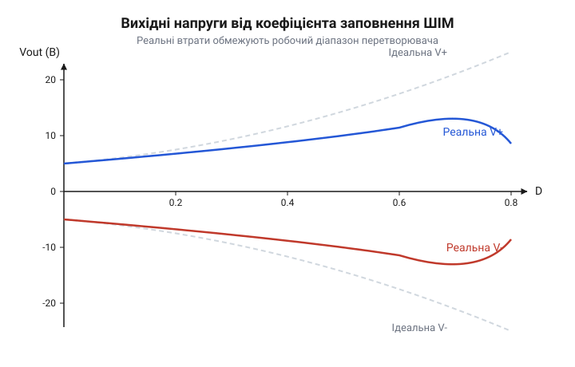
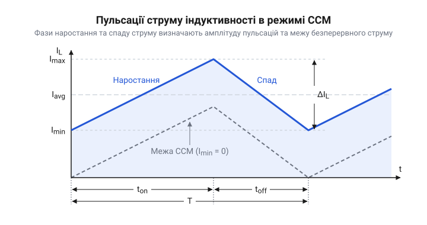

# Розрахунок силових параметрів, коефіцієнта заповнення та пульсацій двополярного перетворювача

<preknowlist>
- [MT3608 — підвищувач 2 А / 28 В](root:cat-hw-power/mt3608-boost) — Принцип роботи базового підвищувального перетворювача та поняття індуктивності як накопичувача енергії.
</preknowlist>

## Залежність напруг від шпаруватості ШІМ

Коли схема вимагає живлення для операційних підсилювачів або аналого-цифрових перетворювачів, самого лише позитивного напруги зазвичай недостатньо. Нам потрібне двополярне живлення — симетричні плюсова та мінусова гілки. Щоб не ставити два окремі перетворювачі, використовують один [підвищувальний перетворювач](root:cat-hw-power/mt3608-boost) (наприклад, на базі MT3608), до якого додають інвертувальну схему з топологією подвоєння заряду. Це дозволяє генерувати і плюсову, і мінусову напругу з одного вузла комутації.

Спочатку погляньмо на ідеальний випадок без втрат. Позитивне плече працює як звичайний підвищувач. Його напруга `V_{out+}` залежить від вхідної напруги `V_{in}` та коефіцієнта заповнення ШІМ `D` (шпаруватості):

        V_{out+}
        = V_{in} / (1 - D)      [класична формула ідеального підвищувача]

Мінусове плече формується завдяки зарядовому насосу, що підключений до того самого вузла комутації і працює на перекидному конденсаторі та двох діодах. Коли транзистор вимкнений і напруга на вузлі комутації підіймається до рівня позитивного плеча, конденсатор заряджається через перший діод. Коли ж транзистор вмикається і тягне вузол комутації до землі, потенціал на конденсаторі опускається нижче нуля, і він скидає енергію в мінусову гілку через другий діод. В ідеальних умовах, якщо не брати до уваги втрати на цих двох переходах, воно просто віддзеркалює позитивну напругу:

        V_{out-}
        = - V_{out+}            [симетрія ідеального зарядового насоса]
        = - V_{in} / (1 - D)    [підстановка виразу для позитивного плеча]

*Залежність вихідних напруг від шпаруватості ШІМ для ідеального та реального випадків. Видно, що зі збільшенням D напруги стрімко зростають за модулем, але реальні значення завжди менші за ідеальні.*

Однак у реальності ідеальної симетрії не буває. На кожному етапі передачі енергії є втрати: транзистор під час увімкнення має опір, а діоди — пряме падіння напруги `V_D`. Для позитивного плеча струм проходить через один діод:

        V_{out+}
        = (V_{in} / (1 - D)) - V_D      [врахування падіння напруги на вихідному діоді]

Мінусове плече зазнає більших втрат. Зарядовий насос використовує конденсатор, який заряджається і розряджається через два додаткові діоди. Тому вихідна мінусова напруга буде меншою за модулем, ніж позитивна:

        V_{out-}
        = - (V_{out+} - 2 · V_D)        [втрати на двох діодах зарядового насоса]
        = - (V_{in} / (1 - D)) + 3 · V_D [розгорнутий вираз із загальними втратами]

Цей перекіс означає, що при однаковому струмі навантаження мінусове плече завжди «просідатиме» сильніше за плюсове.

## Пульсації струму та мінімальна індуктивність

Індуктивність у цьому перетворювачі — головний накопичувач енергії. Без неї ми не змогли б передавати порції заряду ані на прямий вихід, ані в зарядовий насос для формування від'ємної напруги. Її завдання — перетворити постійну вхідну напругу на магнітне поле, поки транзисторний ключ замкнений, і віддати накопичену енергію у навантаження та зарядовий насос, коли ключ розімкнений. Оскільки ключ постійно і з великою частотою перемикається, струм через індуктивність ніколи не залишається сталим — він коливається вгору під час заряду і вниз під час розряду. Ці неперервні гойдалки струму називаються пульсаціями струму `ΔI_L`.

Щоб обчислити величину цих пульсацій, спершу розглянемо тривалість фази накопичення. Транзистор керується сигналом широтно-імпульсної модуляції з постійною частотою `f`. Час одного повного циклу перемикання — це період `T`. Шпаруватість `D` (@@en|duty cycle@@) показує, яку частку від усього періоду `T` транзистор залишається замкненим. Спочатку виразимо період через частоту, а потім знайдемо час увімкнення `t_on`:

        T
        = 1 / f                 [зв'язок періоду та частоти перемикання]

        t_on
        = D · T                 [означення шпаруватості як частки періоду]
        = D / f                 [підстановка періоду через частоту]

Коли транзистор замкнений протягом часу `t_on`, один кінець індуктивності підключений до вхідного джерела, а інший — закорочений на землю. Уся вхідна напруга `V_{in}` прикладається до котушки `L`. За законом електромагнітної індукції швидкість зміни струму визначається прикладеною напругою та самою індуктивністю. Струм зростає лінійно, і за час замкненого стану він набирає свою амплітуду пульсацій `ΔI_L`:

        ΔI_L
        = (V_{in} / L) · t_on   [швидкість зростання струму, помножена на час заряду]
        = (V_{in} · D) / (L · f) [вираження часу увімкнення через частоту та шпаруватість]

*Часові діаграми струму індуктивності. Струм коливається навколо середнього значення на величину ΔI_L, не торкаючись нульової позначки.*

З цієї формули видно дві пастки. Якщо ми зменшуємо індуктивність `L`, щоб зекономити місце на платі, пульсації струму стрімко зростають. Так само, якщо перетворювач працює на низькій частоті `f`, струм встигає сильно розігнатися за довший час `t_on`. Величезні пульсації означають високі пікові струми, які грітимуть ключ, дросель і різко збільшать навантаження на вихідні конденсатори.

Щоб перетворювач працював стабільно і за передбачуваними формулами, бажано утримувати його в [режимі безперервного струму](root:cat-hw-power/ccm) (@@en|Continuous Conduction Mode, CCM@@). У цьому режимі струм в індуктивності ніколи не спадає до нуля перед наступним циклом увімкнення ключа — магнітне поле не встигає повністю зникнути. Якщо ж струм впаде до нуля, котушка почне дзвонити з паразитними ємностями, перетворювач перейде в режим переривчастого струму, його математична модель повністю зміниться, а пульсації напруги на виходах різко підскочать.

Аби струм гарантовано не падав до нуля, середнє значення струму індуктивності (яке залежить від сумарного навантаження) має бути строго більшим за половину розмаху пульсацій `ΔI_L / 2`. Межа настає тоді, коли середній струм точно дорівнює цій половині. Звідси ми можемо знайти мінімально допустиму індуктивність `L_{min}` для заданого найменшого очікуваного струму навантаження, приведеного до входу `I_{in_min}`:

        L_{min}
        = (V_{in} · D) / (2 · f · I_{in_min})    [умова, коли струм торкається нуля, але не обривається]

Якщо в реальну схему поставити дросель з індуктивністю, меншою за розраховану `L_{min}`, то при падінні навантаження до `I_{in_min}` пульсації виявляться настільки великими відносно середнього струму, що нижній пік «проб'є» нуль. Струм обірветься, і стабільність двополярної напруги порушиться.

## Розрахунок конденсаторів та вплив ESR

Вихідна напруга перетворювача також не є ідеально рівною. Індуктивність «закидає» заряд у вихідні конденсатори порціями, тому напруга на них то зростає, то падає. Ці пульсації напруги `ΔV_{out}` напряму залежать від того, наскільки велику ємність `C` ми поставимо і як швидко вона здатна приймати та віддавати заряд.

В ідеальному конденсаторі пульсації виникають суто через зміну заряду:

        ΔV_C
        = (I_{out} · D) / (C · f)       [розряд конденсатора під час замкненого ключа]

Але реальний конденсатор має [ефективний послідовний опір](root:cat-hw-parts/esr) (@@en|Equivalent Series Resistance, ESR@@). Він працює як звичайний резистор, прихований усередині конденсатора. Коли імпульс струму `I_L` різко вривається в конденсатор, він створює на цьому опорі додатковий стрибок напруги:

        ΔV_{ESR}
        = I_{L_peak} · ESR              [закон Ома для паразитного опору конденсатора]

Повні пульсації напруги на виході — це сума цих двох явищ. Оскільки стрибок на ESR і зміна напруги від заряду збігаються в часі розімкненого ключа, найгірший випадок їх просто додає:

        ΔV_{out}
        = ΔV_C + ΔV_{ESR}               [повні пульсації напруги]
        = (I_{out} · D) / (C · f) + I_{L_peak} · ESR  [розгорнута формула]

Ця формула показує, чому просте збільшення ємності `C` часто не допомагає прибрати шум на виході. Якщо конденсатор має високий ESR, домінантними стають саме пульсації від ESR.

## Перекіс напруг при несиметричному навантаженні

Ідеальний двополярний перетворювач має однакові навантаження на обох плечах. На практиці ж струм, який споживає позитивне плече, рідко дорівнює струму негативного плеча. Якщо до позитивного виходу підключити мікроконтролер та операційні підсилювачі, а до негативного — лише операційні підсилювачі, струми навантаження відрізнятимуться. Ця різниця називається несиметричним навантаженням і призводить до того, що напруги на виходах перестають бути однаковими за модулем. Виникає перекіс напруг.

Зарядовий насос, який формує негативне плече, отримує енергію від тієї ж індуктивності, що й позитивне. Коли струми навантаження різні, енергія розподіляється нерівномірно. Різниця струмів тече через спільну точку — землю, порушуючи баланс зарядів на вихідних конденсаторах.

Позначимо струм позитивного плеча як `I₊`, а струм негативного плеча як `I₋`. Струм, що втікає у спільну точку, є їхньою різницею. Відповідно, падіння напруги на внутрішніх опорах схеми та діодах для кожного плеча стає різним. Якщо `I₊` значно перевищує `I₋`, позитивне плече просідає сильніше, оскільки контур зворотного зв'язку зазвичай контролює саме його. Водночас негативне плече, будучи менш навантаженим, зберігає вищу за модулем напругу. 

Перекіс можна описати через ефективний опір зарядового насоса `Rₑᶠᶠ`. Зміна напруги на негативному плечі `ΔV₋` залежить від струму `I₋` та цього опору:

    ΔV₋
    = I₋ · Rₑᶠᶠ                                  [закон Ома для ефективного опору насоса]
    = I₋ · (R_d + R_sw + 1 / (f_sw · C_fly))     [розкриття складових ефективного опору]

Тут `R_d` — опір діодів, `R_sw` — опір ключів, `f_sw` — частота перемикання, а `C_fly` — ємність конденсатора накачки. Видно, що що більший струм споживає негативне плече, то більше падає напруга на ньому, збільшуючи перекіс відносно стабілізованого позитивного плеча. Щоб зменшити цей ефект, збільшують частоту перемикання або ємність накачки, зменшуючи останній доданок в дужках.

## Розрахунок зрізу вихідного LC-фільтра

Імпульсні перетворювачі створюють високочастотні шуми, які неприпустимі для чутливої електроніки, як-от аналого-цифрові перетворювачі чи радіомодулі. Самих лише вихідних конденсаторів часто бракує, щоб згладити ці пульсації до потрібного рівня. Тому після перетворювача ставлять додатковий LC-фільтр, який зрізає високочастотну складову, пропускаючи лише постійний струм.

Цей фільтр складається з послідовної котушки індуктивності `L_f` та паралельного конденсатора `C_f`. Разом вони утворюють коливальний контур, який починає ефективно гасити шуми на частотах, вищих за його власну резонансну частоту, або частоту зрізу `f_c`. Щоб фільтр працював, його частота зрізу має бути принаймні вдесятеро нижчою за частоту перемикання перетворювача `f_sw`. Якщо наблизити частоту зрізу до частоти перемикання, фільтр не лише не придушить шум, а й може підсилити його через резонанс.

Частота зрізу LC-фільтра розраховується за формулою Томпсона:

    f_c
    = 1 / (2 · π · √(L_f · C_f))                 [формула резонансної частоти контуру]

Щоб підібрати компоненти, зручно зафіксувати один з них, наприклад ємність `C_f`, і виразити індуктивність. Якщо частота перемикання становить 500 кГц, ми хочемо частоту зрізу не більше 50 кГц. Беремо типовий керамічний конденсатор ємністю 10 мкФ.

    L_f
    = 1 / ((2 · π · f_c)² · C_f)                 [виведення індуктивності з формули вище]
    = 1 / ((2 · 3.14 · 50000)² · 10⁻⁵)           [підстановка значень для 50 кГц і 10 мкФ]
    ≈ 1 / (10¹¹ · 10⁻⁵)                          [оцінка квадрата циклічної частоти]
    = 1 / 10⁶                                    [множення знаменника]
    = 1 мкГн                                     [результат у мікрогенрі]

Вибрана індуктивність 1 мкГн разом із ємністю 10 мкФ забезпечить зріз на 50 кГц, надійно відфільтрувавши частоту перемикання. Однак котушка має власний активний опір `DCR`. На ньому виникатиме падіння напруги `V_drop = I_out · DCR`. Тому індуктивність вибирають не лише за частотою зрізу, а й з мінімальним опором, щоб не втратити стабільність напруги під навантаженням.