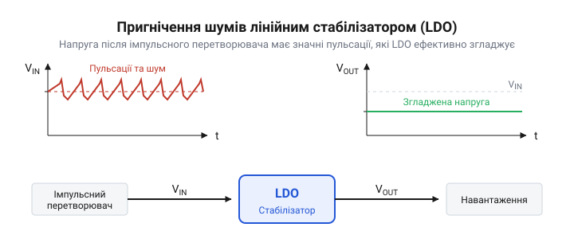
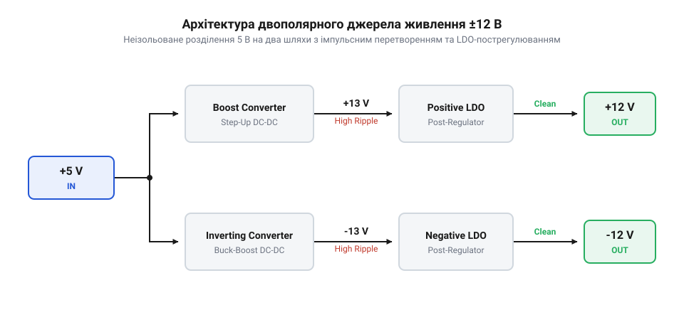

# Проєкт неізольованого перетворювача 5 В → ±12 В на імпульсному регуляторі з пост-LDO фільтрацією

<preknowlist>
- [MT3608 — підвищувач 2 А / 28 В](root:cat-hw-power/mt3608-boost) — принцип роботи неізольованого Boost-перетворювача та призначення його основних компонентів.
</preknowlist>

## Завдання живлення аналогових схем

Під час роботи з чутливою аналоговою електронікою часто виникає проблема отримання чистого двополярного живлення зі звичайної однополярної напруги. Наприклад, багато операційних підсилювачів та схем обробки сигналів потребують симетричного живлення ±12 В для забезпечення максимального динамічного діапазону та відсутності спотворень. Якщо ми маємо лише стандартні 5 В, нам потрібно не тільки згенерувати додаткові напруги, але й зробити їх максимально чистими.

Пряме живлення таких аналогових компонентів від імпульсних перетворювачів є поганою ідеєю. Імпульсні перетворювачі створюють високочастотні завади та пульсації напруги через постійне перемикання силових транзисторів. Якщо ці шуми потраплять на шини живлення операційного підсилювача, вони неминуче проникнуть у вихідний корисний сигнал. Це відбувається через те, що здатність операційного підсилювача пригнічувати завади з шини живлення (@@en|PSRR, Power Supply Rejection Ratio@@) різко падає на високих частотах: якщо низькочастотні коливання підсилювач ефективно блокує, то високочастотні імпульси від перемикання перетворювача проходять на вихід майже без перешкод. Тому виникає потреба в комбінованій схемі: спочатку імпульсні перетворювачі генерують потрібну напругу, а потім лінійні стабілізатори (@@en|LDO, Low Dropout Regulator@@) відфільтровують високочастотний шум.

*Пилкоподібні пульсації від перемикання імпульсного перетворювача ефективно згладжуються лінійним стабілізатором, що забезпечує чисту вихідну напругу.*

## Топологія перетворювача та генерація напруг

Аналогова електроніка часто потребує симетричного живлення — двох напруг однакового номіналу, але різної полярності відносно спільної землі. Коли на вході є лише однополярні 5 В (наприклад, від USB), цю напругу необхідно розщепити на два незалежні шляхи: один для формування позитивного плеча, інший — для негативного.

Щоб живлення було чистим і без шумів, кінцевим каскадом ставлять лінійні стабілізатори (@@en|LDO@@). Лінійний регулятор не вміє підвищувати напругу чи змінювати її полярність, він може лише знижувати її, перетворюючи надлишок на тепло. Тому для отримання цільових ±12 В імпульсна частина має згенерувати напруги з певним запасом, наприклад +13 В та -13 В.

Для формування позитивного плеча використовують підвищувальний перетворювач (@@en|Boost@@). У ньому енергія накопичується в дроселі, а потім віддається в навантаження послідовно із вхідним джерелом. Їхні потенціали додаються, і з 5 В утворюється +13 В.

Для негативного плеча звичайний Boost не підходить, оскільки потенціал має опуститися нижче рівня землі. Тут застосовують інвертувальний перетворювач (@@en|Inverting Buck-Boost@@). Його робота розділена на два такти. У першому такті ключ замикає дросель між вхідними 5 В і землею. Струм через дросель зростає, накопичуючи енергію у магнітному полі. Навантаження в цей час відключене зворотним діодом і живиться лише від власного вихідного конденсатора.

У другому такті ключ розмикається. За законом електромагнітної індукції дросель намагається зберегти напрямок і силу струму, тому змінює полярність напруги на своїх виводах. Оскільки його початковий кінець підключений до землі, інший кінець стає негативним відносно неї. Цей негативний потенціал відкриває діод і виштовхує струм у вихідний конденсатор, заряджаючи його до -13 В. Енергія з дроселя перетікає в навантаження в перевернутому вигляді.

*Вхідні 5 В розгалужуються на дві імпульсні схеми. Boost утворює +13 В, а Inverting Buck-Boost генерує -13 В. Наприкінці обидва рівні стабілізуються лінійними регуляторами до ±12 В.*

Після проходження імпульсних каскадів напруги +13 В та -13 В містять високочастотний шум від перемикання. Вони надходять на позитивний та негативний LDO відповідно. Регулятори зрізають зайвий вольт, поглинаючи імпульсні пульсації, і видають на виході ідеально рівні +12 В і -12 В.

:::code proj-dual-rail-boost-inverting-ldo/-----/readme.md

## Вибір компонентів імпульсної частини

Надійність роботи імпульсних перетворювачів прямо залежить від правильного розрахунку та вибору елементної бази. Головним компонентом є індуктивність (дросель). Під час вибору дроселя необхідно враховувати два параметри: значення індуктивності та струм насичення. Індуктивність визначає величину пульсацій струму (чим більша індуктивність, тим менші пульсації), а струм насичення має перевищувати максимальний піковий струм, який виникає в схемі під час перемикань. Якщо дросель увійде в насичення, його опір різко впаде, що призведе до перегріву або виходу з ладу мікросхеми перетворювача.

Наступним важливим елементом є діод. У таких схемах обов'язково застосовують діоди Шотткі (@@en|Schottky diode@@), оскільки вони мають низьке падіння напруги в прямому напрямку (зазвичай 0.3–0.4 В) і дуже високу швидкість перемикання. Це мінімізує втрати енергії під час передачі струму на вихід і підвищує загальний коефіцієнт корисної дії перетворювача.

Також слід приділити увагу вхідним та вихідним конденсаторам. Вони мають забезпечувати низький еквівалентний послідовний опір (@@en|ESR, Equivalent Series Resistance@@), щоб ефективно фільтрувати імпульсні струми та не перегріватися. Зазвичай для цього використовують керамічні конденсатори або поєднання керамічних і танталових.

## Пост-фільтрація лінійними стабілізаторами

Імпульсні перетворювачі завжди створюють високочастотні завади. Коли транзистори швидко перемикаються, струм у котушках різко змінюється, що породжує пульсації напруги та дзвін на виході. Аналогові схеми, такі як операційні підсилювачі, надзвичайно чутливі до цих завад. Якщо подати на них живлення прямо з імпульсних каскадів, увесь цей шум пройде в корисний сигнал. Тому проміжні напруги +13 В та -13 В, отримані з підвищувача та інвертуючого перетворювача, потрібно очистити перед тим, як вони стануть кінцевими ±12 В. 

Цю задачу виконують лінійні стабілізатори з низьким падінням напруги — @@en|LDO (Low Dropout Regulator)@@. На відміну від імпульсних схем, LDO працює в лінійному режимі і просто розсіює зайву напругу у вигляді тепла. Оскільки нам треба скинути лише 1 В (з 13 В до 12 В), втрати енергії будуть невеликими, а натомість ми отримаємо ідеально рівну напругу без імпульсних шумів.

Здатність лінійного стабілізатора пригнічувати пульсації з входу називається коефіцієнтом пригнічення пульсацій живлення — @@en|PSRR (Power Supply Rejection Ratio)@@. Він вимірюється в децибелах (дБ) і показує, у скільки разів пульсації на виході будуть меншими за пульсації на вході. Чим вищий PSRR, тим чистішим буде живлення. Проте PSRR сильно залежить від частоти: стабілізатор відмінно справляється з низькочастотними пульсаціями, але на частотах перемикання імпульсного перетворювача (сотні кілогерц або мегагерци) ефективність LDO стрімко падає через паразитні ємності та обмежену швидкодію внутрішнього підсилювача. Тому важливо обирати сучасні LDO, спеціально розроблені для фільтрації після імпульсних перетворювачів, які зберігають високий PSRR навіть на високих частотах. Крім того, перед LDO обов'язково ставлять керамічні конденсатори, щоб зрізати найвищі частоти, які стабілізатор уже не здатний обробити.

Щоб LDO видавав рівно 12 В (або -12 В для негативного плеча), його вихідну напругу задають за допомогою резистивного дільника. Усередині регулятора є підсилювач помилки, який порівнює напругу зворотного зв'язку з еталонним внутрішнім джерелом `V_ref`. Зовнішній дільник із двох резисторів `R₁` та `R₂` знижує вихідну напругу до рівня `V_ref`.

Вихідна напруга розраховується за формулою:

    V_out
    = V_ref · (1 + R₁ / R₂)      [формула вихідної напруги LDO]

де `R₁` — резистор між виходом стабілізатора і виводом зворотного зв'язку, а `R₂` — між виводом зворотного зв'язку і землею. Якщо, наприклад, `V_ref = 1.2 В`, то для отримання 12 В відношення `R₁ / R₂` має дорівнювати 9. Обираючи стандартні номінали резисторів (скажімо, 90 кОм і 10 кОм), ми встановлюємо точну напругу живлення. Для негативного плеча логіка залишається тією ж, але опорна напруга вимірюється відносно негативного виходу, а дільник підключається між виходом та землею.

## Вимірювання та оцінка вихідних шумів

Після того, як схема спроєктована і зібрана, її якість потрібно перевірити на практиці. Головний показник для джерела живлення аналогової схеми — рівень пульсацій та шумів на кінцевих шинах ±12 В під реальним навантаженням. 

Правильне вимірювання пульсацій осцилографом вимагає особливого підходу. Якщо просто підключити стандартний щуп із довгим земляним дротом («крокодилом»), цей дріт спрацює як антена. Він збере всі магнітні поля, які випромінює дросель імпульсного перетворювача, і на екрані ви побачите величезні голки та дзвін, яких насправді на виході немає. 

Щоб побачити справжній шум живлення, довгу земляну петлю треба прибрати. Замість дроту на щуп надягають коротку земляну пружинку, яка часто йде в комплекті до осцилографа, і торкаються нею земляної площини плати якомога ближче до точки вимірювання. Центральним жалом щупа торкаються безпосередньо вихідного конденсатора. Канал осцилографа перемикають у режим закритого входу (@@en|AC coupling@@) — це відтинає постійну напругу 12 В і дозволяє розтягнути вертикальну шкалу до кількох мілівольт на поділку, щоб роздивитися дрібні пульсації. Смугу пропускання осцилографа зазвичай програмно обмежують до 20 МГц, оскільки вищі частоти здебільшого є наводками з ефіру і лише заважають оцінити роботу регуляторів.

Вимірювання обов'язково проводять під реальним або еквівалентним навантаженням. Без навантаження імпульсний перетворювач може перейти в режим пропуску тактів, і пульсації матимуть зовсім інший характер, ніж під час нормальної роботи. Якщо осцилограма показує шум у межах кількох мілівольт від піку до піку, LDO впорався зі своєю задачею, і джерело готове живити чутливі аналогові кола.

Оскільки ми говоримо про готовий схемотехнічний приклад:

:::code proj-dual-rail-boost-inverting-ldo/-----/readme.md