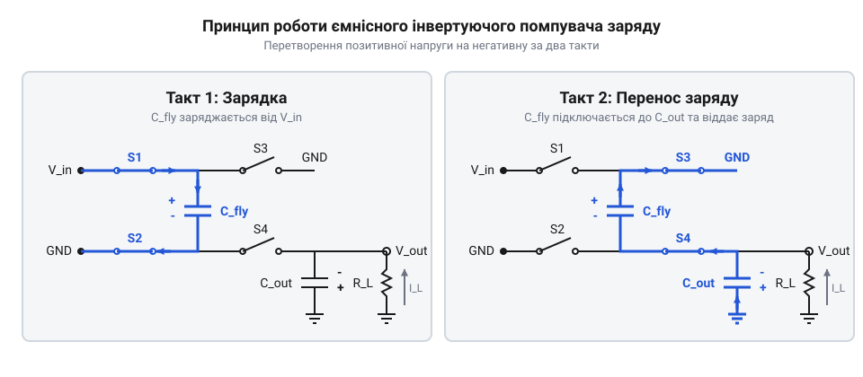
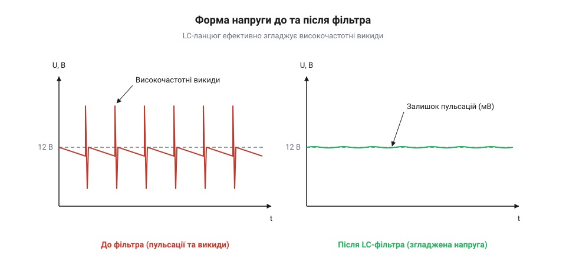

# Проєкт ємнісного подвоювача та інвертора напруги для малопотужних аналогових датчиків

## Проблема живлення аналогових схем

Точним вимірювальним колам, висококласним операційним підсилювачам та датчикам часто потрібне двополярне живлення (наприклад, ±5 В або ±12 В). Це необхідно для коректної обробки сигналів змінного струму, які коливаються відносно справжнього нуля, а не штучної «віртуальної землі», що обмежує динамічний діапазон і вносить додаткові похибки. Проблема полягає в тому, що більшість сучасних компактних пристроїв живиться від єдиного джерела позитивної напруги — звичайної літієвої батареї чи шини USB. Виникає потреба створити з цієї єдиної напруги від'ємну, щоб забезпечити повноцінну роботу аналогового тракту.

Традиційний спосіб змінити полярність напруги — використати класичний імпульсний перетворювач з індуктивністю. Однак для чутливої аналогової електроніки це створює серйозну проблему. Котушка індуктивності накопичує енергію в магнітному полі. Коли транзисторний ключ перериває струм через неї, магнітне поле різко спадає, спричиняючи викиди високої напруги. Ці швидкі зміни струму та напруги генерують інтенсивні електромагнітні завади. Магнітне поле котушки пронизує простір навколо неї, наводячи паразитні струми на сусідніх мідних провідниках плати. Високоімпедансні входи операційних підсилювачів миттєво підхоплюють ці наведення, і вони змішуються з корисним сигналом. У результаті замість точного вимірювання ми отримуємо сигнал, безнадійно зіпсований високочастотним шумом перетворювача. 

Щоб уникнути магнітних наведень, можна було б застосувати ізольовані джерела живлення, але трансформатори надто громіздкі та дорогі. Їх складно розмістити на мініатюрній платі сенсора, де економія місця є критичною.

Рішення лежить у площині споживаного струму. Аналогові каскади зазвичай є малопотужними й споживають струми в межах 10–20 мА. За таких малих навантажень ми можемо повністю відмовитися від індуктивностей і скористатися властивостями електричного поля. Замість того, щоб перекидати енергію через магнітне поле котушки, ми можемо накопичувати заряд у конденсаторі, відключати його від джерела і підключати до навантаження у зворотній полярності або послідовно, подвоюючи напругу. Такий механізм називається ємнісним помпувачем заряду (@@en|charge pump@@). Оскільки він будується виключно на напівпровідникових ключах та конденсаторах, він не випромінює магнітних завад, залишаючись надзвичайно компактним та надійним джерелом для прецизійної електроніки.

## Принцип роботи помпувача заряду

Помпувач заряду перетворює напругу за рахунок циклічного перемикання ключів і перенесення заряду за допомогою так званого «літаючого» конденсатора (@@en|flying capacitor@@). Робота такого перетворювача ділиться на два такти.

*Фаза заряду літаючого конденсатора від джерела напруги та наступна фаза розряду в інверсній чи послідовній конфігурації для передачі енергії на вихід.*

У першому такті (заряджання) ключі підключають літаючий конденсатор безпосередньо до вхідного джерела живлення, і він накопичує заряд до рівня вхідної напруги. У другому такті ключі перемикаються так, що цей конденсатор від'єднується від входу й підключається до вихідного конденсатора. Якщо літаючий конденсатор під'єднати послідовно з джерелом, ми отримаємо подвоєння напруги. Якщо ж його підключити паралельно виходу, але зі зміненою полярністю, напруга на виході стане негативною відносно землі. Завдяки високій частоті перемикання (від десятків до сотень кілогерц), вихідний конденсатор постійно підживлюється, підтримуючи стабільну напругу на навантаженні.

## Каскадування та вибір конденсаторів

Один ступінь помпувача заряду дозволяє лише подвоїти вхідну напругу або змінити її знак. Щоб отримати більші рівні (наприклад, ±12 В з початкових 5 В), ці перетворювачі можна з'єднувати послідовно (каскадувати). Перший каскад подвоює 5 В до 10 В, другий може знову подвоїти або інвертувати напругу для створення необхідної симетрії живлення.

Продуктивність та стабільність такого джерела прямо залежать від номіналів конденсаторів. Ємність літаючого конденсатора визначає, скільки заряду можна перенести за один такт. Якщо струм навантаження `I` зростає, а ємність `C` замала, напруга на виході почне суттєво просідати. Оскільки мікросхема перемикає ключі з певною частотою `f`, за кожен такт вона переносить порцію заряду, якої має вистачити для живлення навантаження, тому необхідну ємність під задане допустиме просідання напруги `ΔV` дістають із цього відношення:

    C
    = I / (f · ΔV)      [заряд за такт поділений на допустиме просідання]

Звідси видно, що для менших пульсацій або при низькій частоті генератора доведеться ставити більший конденсатор. Для струмів до 20 мА зазвичай вистачає конденсаторів від 1 до 10 мкФ.

*Форма напруги до фільтра має різкі піки від перемикання ключів, які успішно згладжуються вихідним фільтром.*

Однак сам процес дискретного перенесення порцій заряду неминуче викликає пульсації (@@en|ripple@@) вихідної напруги. Хоча вони менші, ніж в індуктивних перетворювачів, для точної аналогової схемотехніки їх потрібно додатково пригнічувати. Для цього на виході помпувача встановлюють RC- або LC-фільтри, які згладжують ці пульсації та забезпечують максимально «чисте» живлення для операційних підсилювачів і датчиків.

## Проєктування вихідних фільтрів

Вихідна напруга помпувача заряду ніколи не буває ідеально рівною. Через постійне перемикання ключів, які підключають і відключають «літаючі» конденсатори, на виході виникають сходинкові стрибки напруги. Ці стрибки відбуваються на частоті роботи вбудованого генератора мікросхеми, яка для сучасних перетворювачів зазвичай лежить у межах від десятків до сотень кілогерц. Безпосередньо живити від такої напруги чутливі вимірювальні кола, наприклад операційні підсилювачі або аналого-цифрові перетворювачі, не можна — пульсації проникнуть у корисний сигнал і спотворять його. 

Щоб згладити ці пульсації, між виходом помпувача та навантаженням ставлять фільтр низьких частот. Найпростішим варіантом є звичайний RC-фільтр, який складається з послідовного резистора та паралельного конденсатора. Такий фільтр дешевий і компактний, але має суттєвий недолік: на послідовному резисторі неминуче падає частина корисної напруги. Чим більший струм споживає навантаження, тим більшим буде це падіння, що додатково знижує вихідну напругу, яка і так просідає під навантаженням. Тому RC-фільтри застосовують лише тоді, коли струм навантаження дуже малий, зазвичай одиниці міліампер, і падіння напруги в кілька десятків мілівольтів є припустимим.

Коли струм сягає десятків міліампер, наприклад до 20 мА, RC-фільтр стає неприйнятним через надмірні втрати. Тоді замість резистора використовують котушку індуктивності, утворюючи LC-фільтр. Котушка має дуже малий опір постійному струму, тому падіння напруги на ній мінімальне, проте вона створює високий опір для високочастотних пульсацій, ефективно їх відсікаючи. Ємність конденсатора у такому фільтрі обирають достатньо великою, щоб забезпечити низький імпеданс для змінної складової. 

Щоб розрахувати LC-фільтр, потрібно знати частоту перемикання мікросхеми. Резонансна частота фільтра має бути значно нижчою за частоту перемикання — зазвичай принаймні вдесятеро, щоб забезпечити достатнє послаблення сигналу. 

        f_res = 1 / (2 · π · √(L · C))
        L · C = 1 / (4 · π² · f_res²)     [виразили добуток номіналів]
        C = 1 / (4 · π² · f_res² · L)     [знайшли ємність через індуктивність]

Обравши стандартне значення індуктивності, наприклад 10 мкГн, можна обчислити необхідну ємність. Варто враховувати, що керамічні конденсатори втрачають частину своєї ємності під постійною напругою, тому номінальне значення має бути із запасом. LC-фільтр додає невелику кількість компонентів, але кардинально покращує якість живлення, роблячи його придатним для точної аналогової обробки.

## Повний цикл реалізації модуля

Зібравши разом інвертор, подвоювач та вихідні фільтри, ми отримуємо повноцінний модуль двополярного живлення. Він приймає вхідну напругу 5 В і видає дві стабілізовані (в межах просідання під навантаженням) шини: позитивну близько +10 В та негативну близько -5 В, або інші рівні залежно від обраної архітектури каскадування. 

Щоб реалізувати такий модуль у «залізі», самої принципової схеми недостатньо. Високочастотні струми, що протікають через ключі та «літаючі» конденсатори, створюють електромагнітні завади. Якщо розвести плату недбало, ці завади наводитимуться на інші кола плати й навіть зводитимуть нанівець роботу вихідних фільтрів, проникаючи на вихід через паразитні ємності та індуктивності доріжок.

Перше правило трасування — мінімізувати площу контурів, якими протікають імпульсні струми. «Літаючі» конденсатори повинні стояти впритул до відповідних виводів мікросхеми. Чим коротша доріжка між виводом і конденсатором, тим менша її індуктивність, і тим менше вона випромінюватиме завад. Вхідні шунтувальні конденсатори також розміщуються безпосередньо біля виводів живлення мікросхеми.

Друге правило — цілісний полігон землі. Земля має бути суцільною під усією мікросхемою та її обв'язкою. Це забезпечує найкоротший шлях для зворотних струмів і слугує екраном. Якщо землю розривати або робити тонкою доріжкою, зворотний струм змушений буде шукати обхідний шлях, що збільшує площу контуру й рівень завад.

Вихідні фільтри слід розміщувати одразу після виходу помпувача, до того, як лінія живлення піде до навантаження. Компоненти фільтра також мають розташовуватися компактно, а їхній земляний вивід — підключатися до основного земляного полігона через перехідні отвори з мінімальною довжиною доріжки. Дотримання цих правил гарантує, що розраховані теоретичні параметри просідання та пульсацій відповідатимуть реальній поведінці зібраного модуля, а живлення аналогової частини буде по-справжньому чистим.