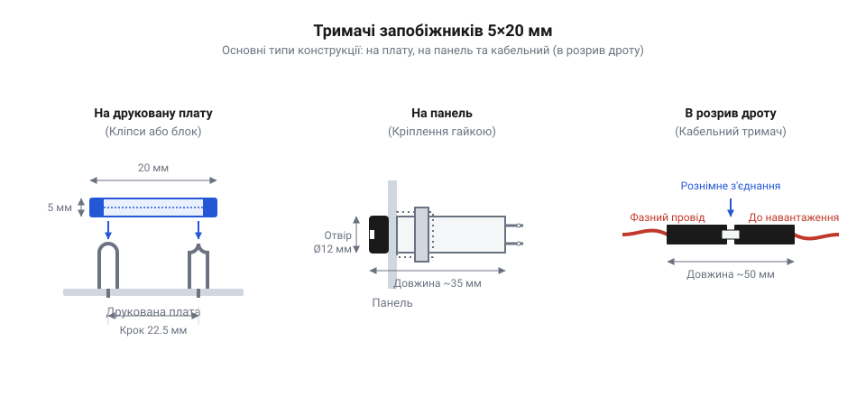
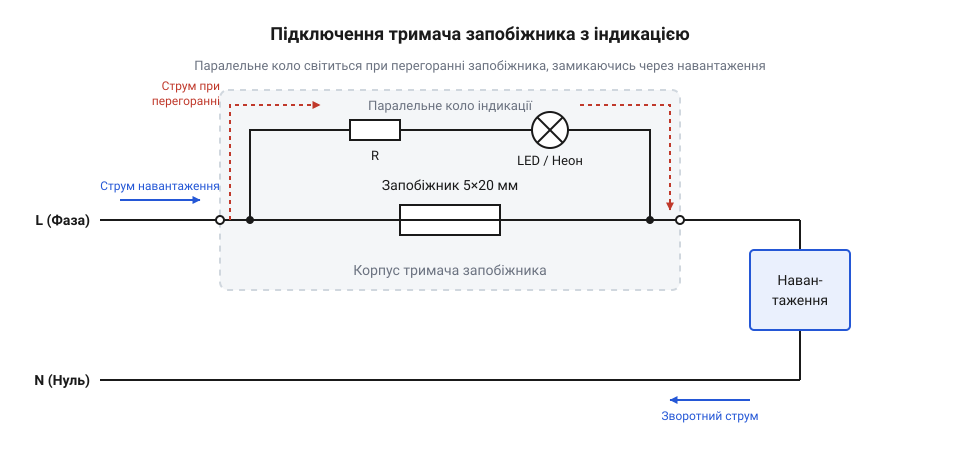

# Залізний інтерфейс тримачів запобіжників 5×20 мм: габаритні креслення, контактні клеми, електричні рівні та схема підключення

<preknowlist>
- [Плавкі запобіжники 5×20 (скляні й керамічні)](root:cat-hw-power/glass-ceramic-fuses) — розуміння габаритів самої колби та причини її нагрівання.
</preknowlist>

## Потреба у змінному фіксаторі

Запобіжник, виконаний у вигляді скляної чи керамічної колби, — це витратний елемент, який розриває електричне коло при перевантаженні. Оскільки після перегоряння його необхідно замінити, жорстке впаювання запобіжника безпосередньо в плату є вкрай непрактичним. Щоб забезпечити швидку і безпечну заміну, між колбою та електричною схемою встановлюють проміжну механічну деталь — тримач. Механічна фіксація запобіжника в ньому відбувається за рахунок пружних металевих затискачів, які щільно обтискають циліндричні ковпачки колби. Головна вимога до тримача полягає у забезпеченні надійного електричного контакту з цими ковпачками. Однак через механічну втому матеріалу та постійні цикли нагрівання й охолодження сила притиску з часом слабшає, а на відкритих поверхнях металу під дією вологи й повітря утворюється плівка оксидів. Будь-який такий слабкий або окислений контакт створює додатковий перехідний опір, який під дією робочого струму викликає локальне нагрівання і може розплавити корпус самого тримача ще до того, як перегорить запобіжник.

## Габарити та типи монтажу

Тримач запобіжника фіксує скляну чи керамічну колбу в колі живлення та притискає до її торців електричні контакти. Місце, де стоїть тримач, визначається конструкцією пристрою та тим, хто і як змінюватиме запобіжник. Якщо доступу для користувача не передбачено, запобіжник ставлять на плату; якщо він має бути доступний ззовні, тримач виносять на панель або в кабель; в електрощитах кріплять на рейку.

Для встановлення безпосередньо на друковану плату застосовують пружинні кліпси або закриті пластикові корпуси під пайку. Кліпси — це пара окремих пружних металевих контактів, які впаюються в отвори плати. Вони займають мінімум місця і відкриті для повітря, тому колба добре охолоджується. Однак запобіжник залишається незахищеним від пилу й випадкових замикань викруткою, а в разі руйнування скла при короткому замиканні уламки й плазма можуть пошкодити плату. Тому кліпси використовують лише всередині закритих корпусів. Щоб локалізувати наслідки аварії, застосовують закриті тримачі на плату: їхній пластиковий кожух із кришкою ізолює колбу, але такий вузол вищий і гірше відводить тепло.

Коли пристрій передбачає заміну запобіжника без розбирання корпусу, ставлять панельні тримачі. Це пластикові циліндри, які вставляються в отвір на панелі та притискаються зсередини гайкою чи защіпкою. Запобіжник вкладається у знімний ковпачок, який вставляється в основу ззовні. Ковпачок фіксується різьбою або байонетним (від @@fr|baïonnette@@ — штик) кріпленням, де штифти входять у пази і закріплюються поворотом. Панельні тримачі безпечні для користувача: контакти під напругою сховані глибоко в основі. Проте вони вимагають вільного місця за панеллю і надійного механічного кріплення, щоб основа не прокручувалася, коли ковпачок викручують. Підключають їх зсередини роз'ємами під пайку або ножовими клемами.

Якщо пристрій не має жорсткого корпусу або захист додають до наявного дроту, використовують дротові тримачі. Вони мають вигляд двох пластикових половинок, які з'єднуються різьбою чи защіпкою і утворюють закриту капсулу в розриві кабелю живлення. Такі тримачі часто комплектуються гумовими ущільнювачами для захисту від вологи, що робить їх надійними у вуличному обладнанні.

Для розподільчих щитів і промислової автоматики існують тримачі на стандартну DIN-рейку. Вони виконані у формі модульних клемних блоків із відкидною кареткою. Під час її відкривання ланцюг гарантовано розривається, що дозволяє безпечно міняти колбу без вимкнення рубильника.

Вибір форм-фактора залежить від умов експлуатації та вимог до обслуговування. Відкриті кліпси ставлять у масових пристроях, які після поломки несуть у сервіс. Панельні тримачі обирають для приладів, де заміна запобіжника є штатною дією. Дротові капсули — для герметичних рішень і гнучкої проводки. Тримачі на рейку — виключно для щитового монтажу.

*Креслення основних типів тримачів: кліпси на плату, панельного роз'єму та кабельного корпусу, що показує їхні габарити.*

## Електричні параметри та обмеження

Тримач є повноцінним компонентом кола, тому має власні ліміти, які не можна перевищувати незалежно від номіналу встановленої колби. Ключовим обмеженням є максимальний робочий струм, що визначається перерізом провідників та площею контакту клем. Перевищення цього струму призводить до перегріву контактів і руйнування тримача. Другий важливий параметр — максимальна робоча напруга, яка характеризує якість ізоляції пластикового корпусу. Вона визначає напругу, яку тримач здатний безпечно витримувати без ризику електричного пробою на сусідні деталі або на корпус пристрою. При виборі тримача також враховують очікуваний перехідний опір (зазвичай одиниці міліом), який прямо впливає на кількість тепла, що виділятиметься в місці кріплення при номінальному струмі.

## Схема включення у лінію

Запобіжник повинен захищати не лише саме обладнання від внутрішніх коротких замикань, але й користувача від ураження струмом. Тому тримач завжди встановлюють у розрив фазного провідника, а не нульового. Якщо розірвати нуль, пристрій перестане працювати, але вся його внутрішня схема залишиться під небезпечним потенціалом фази відносно землі. Правильне підключення контактів панельного тримача також важливе для безпеки: фазна напруга живлення від мережі завжди подається на центральний (нижній) контакт тримача, а навантаження знімається з бокового. Завдяки цьому при викручуванні ковпачка для заміни запобіжника бічний контакт, до якого найпростіше випадково доторкнутися, одразу знеструмлюється.

## Паралельне коло світлової індикації

Щоб користувач одразу бачив, що запобіжник спрацював, до тримача часто додають світлову індикацію. Таке коло підключається паралельно контактам самого тримача і складається з індикатора (наприклад, неонової лампи або світлодіода) та обмежувального резистора. Поки запобіжник цілий, струм іде через нього, оскільки його опір близький до нуля, а індикатор не світиться. Коли запобіжник перегоряє, коло розривається, і струм починає протікати через паралельне коло індикації далі на навантаження. Індикатор загоряється. Важливо розуміти, що при згорілому запобіжнику навантаження не знеструмлене повністю — через нього протікає слабкий струм індикації, що вимагає правильного розрахунку номіналів обмежувального резистора для безпеки кола.

*Принципова схема підключення тримача в розрив фази з опціональним паралельним колом індикації напруги, з якої видно напрямок струму.*