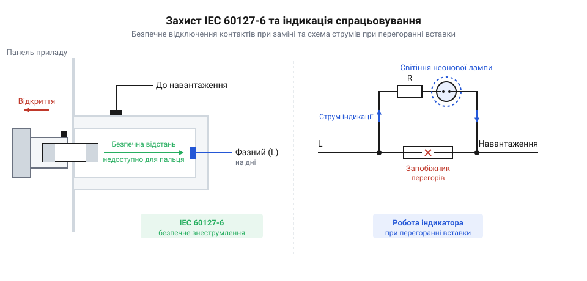
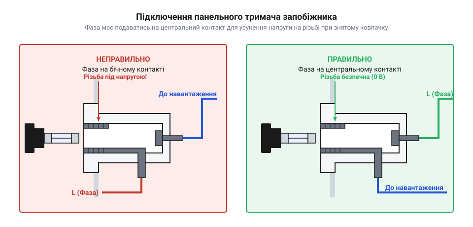
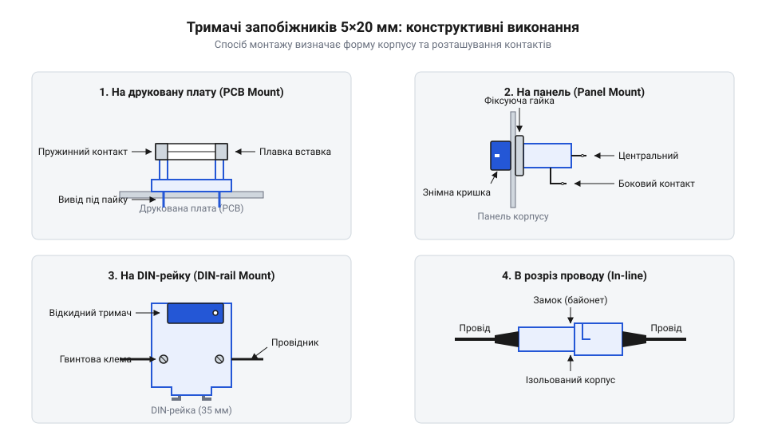

# Тримачі запобіжників 5×20

<preknowlist>
- [Плавкі запобіжники 5×20 (скляні й керамічні)](root:cat-hw-power/glass-ceramic-fuses) — Конструкція, номінальні струми, часо-струмові характеристики та геометричні розміри скляних і керамічних плавких вставок 5×20 мм.
</preknowlist>

## Небезпека незахищеного підключення плавкої вставки

Пряме впаювання металевих циліндричних ковпачків плавкого запобіжника безпосередньо у мідні контактні майданчики друкованої плати створює серйозні технологічні та експлуатаційні проблеми. При проходженні надструму короткого замикання та розплавленні внутрішньої нитки запобіжника пристрій повністю втрачає працездатність, а його відновлення вимагає демонтажу корпусу, наявності паяльного обладнання та спеціальних навичок. Більше того, у момент монтажу нової вставки виникає ризик перегріву її трубчатого корпусу та термодеструкції запаяного всередині легкоплавкого елемента. Коли мініатюрна [плавка вставка 5×20 мм](root:cat-hw-power/glass-ceramic-fuses) впаюється безпосередньо у мідні доріжки, будь-яке її спрацьовування перетворює банальну заміну елемента на складний та ризикований ремонт. Крім того, відкриті струмоведучі деталі під мережевою напругою 230 В становлять безпосередню смертельну небезпеку для сервісного персоналу під час проведення вимірювань чи візуального огляду @@en|друкована плата@@ (англ. *printed circuit board*).

Для усунення цих ризиків застосовують @@en|тримач запобіжника@@ (англ. *fuse holder*, від *fuse* — плавитися та *hold* — тримати) — спеціалізований електроустановчий вузол, який виконує функції механічного фіксатора, електричного з'єднувача та захисного ізолюючого корпусу. Головне завдання тримача полягає у створенні надійного пружинного притиску до токознімальних циліндричних ковпачків вставки без пошкодження її крихкої скляної або керамічної трубки, а також у гарантуванні безпечного розмикання та замкнення кола живлення при обслуговуванні. Конструкція корпусу забезпечує нормовані @@en|повітряні зазори@@ (англ. *clearance*) та @@en|шляхи витоку струму@@ (англ. *creepage distance*), запобігаючи поверхневому пробою між контактами при високій вологості.

Електробезпека при заміні плавкого елемента регламентується міжнародним стандартом @@en|стандарт IEC 60127-6@@. Цей документ нормалізує категорії захисту від ураження електричним струмом (категорії PC1, PC2 та PC3) та вимоги до конструкції ізолюючих частин. Сучасний @@en|панельний тримач@@ (англ. *panel mount holder*) проектується таким чином, щоб оператор під час зняття або встановлення вставки не мав жодної фізичної можливості торкнутися струмоведучих поверхонь пальцем чи металевим інструментом. Висувний або поворотний @@en|байонетний фіксатор@@ (франц. *baïonnette* — штик) утримує вставку всередині знімальної кришки, що дозволяє безпечно витягти згорілу деталь навіть при ввімкненому обладнанні.

Критично важливим аспектом монтажу панельного тримача є правильне розключення мережевих провідників. Будь-який панельний тримач має два виводи: внутрішній @@en|центральний контакт@@ (від латин. *centrum* — середина), розташований у глибині ізольованого каналу, та @@en|боковий контакт@@, що з'єднаний з нарізною або байонетною латунною гільзою. Фазний провідник живильної мережі обов'язково підключається до центрального контакту, тоді як навантаження приєднується до бокового виводу. При такій схемі в момент відкручування або витягання ковпачка коло живлення розривається на центральному контакті у глибині корпусу, а доступна для випадкового торкання бокова гільза залишається повністю знеструмленою.


*Конструктивна ізоляція струмоведучих частин за IEC 60127-6 і принципова схема індикації перегорання.*

Для оперативної візуальної діагностики стану захисного вузла у тримачі часто вбудовують @@en|світловий індикатор@@. Схема індикації складається з неонової лампи або світлодіода з струмообмежувальним резистором великого опору, які підключаються паралельно контактам плавкої вставки. У штатному режимі опір цілої плавкої вставки становить частки ома, тому весь струм навантаження протікає крізь неї, а напруга на індикаторі близька до нуля (індикатор згашений). Коли @@en|плавка вставка@@ (англ. *fuse link*, від *fuse* — плавити) розмикає коло через перевантаження чи коротке замикання, весь мережевий потенціал прикладається до відкритих контактів тримача, викликаючи проходження мікроструму крізь схему індикації та яскраве світіння лампи. Значення струму через індикатор обмежується на рівні менше 1 мА, що унеможливлює самовільний запуск навантаження або утворення небезпечного потенціалу на виході.


*Правильна комутація фази мережі до центрального контакту панельного тримача для забезпечення безпеки.*

Тривалий [розвиток безпечних корпусів](root:cat-hw-power/fuse-holders/hist-5x20-fuse-holders-evolution.md) показав, що відкриті пружинні ламелі минулого століття не здатні забезпечити потрібний рівень захисту в мережах 230 В. Застосування повністю закритих пластмасових або керамічних корпусів дозволило захистити внутрішній простір приладу від розбризкування розплавленого металу та кіптяви при вибуховому руйнуванні скляних трубок під дією струмів короткого замикання високої потужності.

## Конструктивні виконання тримачів за способом монтажу

Залежно від архітектури приладу, просторових обмежень та умов експлуатації тримачі запобіжників 5×20 мм поділяються на чотири основні конструктивні класи за способом монтажу: для друкованих плат, для встановлення на зовнішню панель, для монтажу на DIN-рейку та у розріз проводу (in-line).

1. **Монтаж на друковану плату (PCB Mount).** Використовується у внутрішніх блоках живлення та електронних модулях. Конструктивно ці тримачі виконуються у вигляді двох відкритих металевих пружинних стійок (кліпс) або суцільного пластикового корпусу з паяльними штирями для монтажу в отвори (THD) чи поверхневого монтажу (SMD). Відкриті кліпси мають мінімальні габарити та найнижчу вартість, але вимагають дотримання захисних зазорів на платі. Закриті корпусні тримачі для плат часто оснащуються знімною прозорою захисною кришкою, яка ізолює струмоведучі частини від випадкового торкання під час сервісного обслуговування. Для запобігання зсуву вставки при вібраціях пружинні губки кліпс мають профільні вигини, що охоплюють токознімальні ковпачки по всьому колу.

2. **Панельний монтаж (Panel Mount).** Призначений для пристроїв, де потрібний оперативний доступ до запобіжника з зовнішнього боку корпусу приладу без розбирання пристрою. Тримач монтується у круглий або D-подібний отвір панелі (типові діаметри 12.0 мм або 15.0 мм) і фіксується за допомогою задньої різьбової гайки або клямперових фіксаторів. D-подібний зріз отвору запобігає провертанню корпусу тримача при закручуванні ковпачка. Передня частина містить знімний ковпачок з байонетною або різьбовою фіксацією, у який вставляється @@en|плавка вставка@@. Виводи панельного тримача виконуються у вигляді петель для ручного паяння або пласких клем під ножові з'єднувачі Faston (4.8 мм або 6.3 мм).

3. **Монтаж на DIN-рейку (DIN-rail Mount).** Застосовується в промисловій автоматиці, шафах керування та розподільчих щитах. Пристрій встановлюється на стандартну 35-мм @@de|DIN-рейку@@ (нім. *DIN-Schiene*, абревіатура *Deutsches Institut für Normung*) і виконується в модульному захищеному корпусі стандартної ширини 17.5 мм (1 модуль). Для заміни запобіжника конструкція передбачає відкидний важільний тримач (фліпер), який при відкриванні механічно витягає та повністю знеструмлює вставку 5×20 мм, утворюючи видимий розрив кола. Затискач дротів здійснюється за допомогою гвинтових або пружинних клемних блоків Cage Clamp, що розраховані на багатожильні провідники перерізом до 4.0 мм².

4. **Проводне виконання (In-line Mount).** Використовується в автомобільній електроніці, зовнішніх кабельних збірках та портативних приладах. Вузол складається з двох напівкорпусів, що з'єднуються нарізним або засувним способом і врізаються безпосередньо у @@en|виконання in-line@@ (англ. *in-line*, в один ряд) живильного кабелю. Для забезпечення пило- та вологозахисту (стандарти IP65–IP67) такі тримачі комплектуються силіконовими ущільнювальними кільцями та еластичними сальниками на входах дротів, що запобігає проникненню вологи та корозії контактних пружин.


*Форм-фактори тримачів 5×20 мм: монтаж на плату, на панель, на DIN-рейку та в розріз проводу.*

Матеріалознавство корпусів тримачів прямо визначає їхню термічну стійкість та пожежну безпеку. Для виготовлення ізоляційних деталей застосовують високоякісні термопласти — полібутилентерефталат (PBT), поліамід (PA66), а також реактопласти (фенопласти). Корпуси обов'язково відповідають вимогам стандарту @@en|клас палаючості UL 94-V0@@, що означає самозгасання матеріалу протягом не більше ніж 10 секунд після зняття відкритого полум'я без утворення палаючих крапель. Ізоляційний матеріал має забезпечувати опір ізоляції понад 100 МОм та гарантувати, що @@en|пробійна напруга@@ (англ. *breakdown voltage*) між контактами й корпусом становить не менше 3000 В змінного струму.

Для розробників друкованих плат повні [креслення контактних виводів](root:cat-hw-power/fuse-holders/api-5x20-fuse-holder-hardware-interface.md) та посадочні розміри зібрані у відповідному технічному довіднику. Практичні рекомендації щодо монтажу та [метод діагностики контактів](root:cat-hw-power/fuse-holders/proj-5x20-fuse-holder-mounting-and-diagnostics.md) дозволяють завчасно виявити підгоряння або послаблення пружинних клем.

## Граничні електричні та теплові характеристики тримача

Вибір тримача запобіжника не обмежується лише геометричним способом його кріплення. Електрична надійність вузла визначається трьома основними параметрами: номінальною робочою напругою `U_nom`, номінальним струмом `I_nom` та електричною міцністю ізоляції. Для стандартних тримачів 5×20 мм номінальна напруга зазвичай становить 250 В змінного струму, а пробійна напруга між ізольованими струмоведучими частинами та доступними елементами кріплення перевищує 3000 В (AC, 50 Гц протягом 1 хвилини).

Проте наибольшу небезпеку під час тривалої експлуатації становить внутрішнє @@en|теплорозсіювання@@ (англ. *heat dissipation*, від латин. *dissipare* — розсіювати). Перехідний @@en|контактний опір@@ (англ. *contact resistance*) між металевими ковпачками плавкого елемента й пружинними ламелями тримача становить величину `R_contact` в діапазоні від 5 мОм до 15 мОм для нових чистих деталей. Під час проходження робочого струму `I_nom` на цьому опорі виділяється паразитна електрична потужність.

Загальна потужність тепловиділення `P_loss` всередині замкненого корпусу тримача складається з потужності, що виділяється самією плавкою вставкою `P_fuse`, та втрат на двох контактних переходах тримача `P_contact`:

```
P_contact = I_nom² × (2 × R_contact)
= (6.3 A)² × (2 × 0.010 Ом)       [підстановка струму 6.3 А та опору одного контакту 10 мОм]
= 39.69 × 0.020                   [обчислення квадрата струму та сумарного опору клем]
= 0.794 Вт                        [сумарна потужність втрат на двох контактних переходах]
```

Значна теплова потужність `P_loss` (яка для силового тримача може досягати 1.6–2.5 Вт при струмах 6.3–10 А за рахунок власного опору вставки та клем) викликає самонагрів корпусу. Температурний підйом `ΔT` залежить від виділеної потужності та теплового опору корпусу відносно навколишнього повітря `R_th`:

```
ΔT = P_loss × R_th
= (1.5 Вт) × (35 °C/Вт)           [підстановка сумарних теплових втрат 1.5 Вт та теплового опору 35 °C/Вт]
= 52.5 °C                         [перегрів внутрішньої камери тримача відносно навколишнього середовища]
```

Якщо тепло не встигає розсіюватися в навколишнє середовище, температура внутрішньої камери тримача зростає. Це призводить до двох негативних наслідків: по-перше, виникає термічна деградація та розм'якшення термопластикового корпусу; по-друге, підвищена температура прискорює прогрів самої плавкої нитки, через що @@en|плавка вставка@@ спрацьовує при струмах, нижчих за її паспортний номінал.

Для запобігання термічному руйнуванню застосовують @@en|температурний дерейтинг@@ (англ. *temperature derating*, від *de-* — зниження та *rate* — значення) — нормоване зниження допустимого робочого струму або потужності розсіювання при зростанні температури навколишнього середовища `T_amb`. Виробники тримачів надають графічні криві дерейтингу, які визначають граничну потужність `P_d_max` при певній температурі. Якщо температура всередині корпусу приладу досягає 70 °C, допустима потужність розсіювання тримача може знижуватися на 30–50% від номіналу при 25 °C.

Щоб детально розрахувати перегрів за підвищеної температури середовища, використовують [моделі теплового балансу](root:cat-hw-power/fuse-holders/math-5x20-fuse-holder-thermal-and-electrical-calculations.md), які описують тепловідведення крізь клеми й корпус.

На відміну від напівпровідникових [самовідновлюваних запобіжників PTC](root:cat-hw-power/polyswitch-ptc), тримач 5×20 розрахований на гасіння дуги при високих мережевих напругах. Послаблення притискної сили внутрішньої пружини (через температурний відпал або механічну втому) призводить до різкого зростання `R_contact` до сотих часток Ома. Це викликає дугоутворення, обгорання латунних клем та подальше розплавлення пластикового корпусу тримача. Для запобігання окисненню контактні ламелі виготовляють із фосфористої бронзи або берилієвої міді з покриттям шаром срібла чи олова, що забезпечує стабільність опору протягом усього терміну служби.

## Електробезпека, матеріали та світлова індикація

Заміна плавкої вставки у працюючому електроприладі або при випадково увімкненій мережі джерела живлення створює пряму загрозу ураження електричним струмом. Якщо людина намагається витягти перегорілу скляну чи керамічну трубку з відкритого затискача пальцями або металевим інструментом, існує високий ризик випадкового торкання струмоведучих поверхонь під напругою `230 В`. Розуміння ідеї [еволюції корпусних рішень](root:cat-hw-power/fuse-holders/hist-5x20-fuse-holders-evolution.md) показує, як розробники пройшли шлях від відкритих клем на друкованих платах до повністю захищених ізольованих гнізд.

Ключовим нормативним документом, який регламентує конструктивну безпеку тримачів, є міжнародний стандарт @@en|IEC 60127-6@@. Він поділяє всі тримачі за ступенем захисту від ураження струмом (лат. @@en|Protection Category@@, скорочено `PC`) на три основні категорії:
* `PC1`: Відсутній внутрішній або додатковий конструктивний захист від торкання під час заміни плавкої вставки. Запобіжник встановлюється у відкриті контактні стійки на друкованій платі. Струмоведучі частини залишаються повністю відкритими, тому використання тримачів класу `PC1` дозволяється виключно всередині закритих корпусів обладнання, доступ до яких мають лише кваліфіковані фахівці після повного знеструмлення пристрою. * `PC2`: Захист від ураження електричним струмом забезпечується безпосередньо конструкцією самого тримача. При знятті викручувальної кришки або витягуванні знімної голівки струмоведучі елементи всередині гнізда заглиблені так, що до них неможливо доторкнутися стандартним випробувальним щупом. Людина може безпечно замінювати плавку вставку навіть тоді, коли пристрій залишається підключеним до мережі живлення. * `PC3`: Підвищений рівень захисту від несанкціонованого чи випадкового доступу. Конструкція тримача вимагає застосування спеціального інструменту (наприклад, шліцьової викрутки для повороту байонетного фіксатора (англ. @@en|bayonet@@)) або містить захисну кришку із блокуванням. Специфікація `PC3` є обов'язковою для промислових установок і приладів побутового призначення, де заміну вставок можуть виконувати недосвідчені користувачі.

Окрім електричної ізоляції, корпус тримача повинен витримувати високі локальні температури, викликані тривалим проходженням номінального струму або спалахом електричної дуги під час розриву плавкого елемента. Для виготовлення корпусів застосовують інженерні полімери, зокрема PBT (полібутилентерефталат, англ. @@en|polybutylene terephthalate@@) або армований скловолокном поліамід.

Обов'язковою вимогою до матеріалу корпусу є відповідність стандарту пожежної безпеки @@en|UL 94-V0@@ (англ. @@en|Underwriters Laboratories@@). Позначення `V0` свідчить про те, що після займання від відкритого полум'я вертикально закріплений зразок пластику згасає самостійно протягом не більше ніж `10` секунд. При цьому матеріал не утворює палаючих крапель, здатних підпалити розташовані нижче компоненти. Це запобігає займанню плати та корпусу приладу при катастрофічному перегріві контактних клем.

Швидке знаходження спрацьованого захисного вузла у складному приладі забезпечується вбудованою світловою індикацією. У корпус тримача паралельно контактам плавкої вставки впаюють індикаторне коло: неонову лампу для мереж змінного струму `230 В` або світлодіод із послідовним обмежувальним резистором для низьковольтних кіл.

Фізичний механізм роботи індикації базується на перерозподілі електричного опору. Коли плавка вставка ціла, її опір становить міліоми. Основний струм навантаження тече крізь вставку, а спад напруги на контактах тримача є практично нульовим. Оскільки напруга на паралельному індикаторному колі нижча за поріг запалювання неонової лампи чи відкривання світлодіода, індикатор залишається вимкненим.

При перегоранні плавкого елемента коло навантаження розмикається, і вся напруга джерела живлення опиняється на контактах тримача. Струм починає протікати через паралельний індикаторний ланцюг і резистор великого опору (сотні кілоом). Цей мікрострум (менше ніж `1 мА`) безпечний для приладу, але цілком достатній для яскравого світіння індикатора. Електричні рівні спрацьовування індикаторних ланцюгів та [габаритні креслення клем](root:cat-hw-power/fuse-holders/api-5x20-fuse-holder-hardware-interface.md) дають змогу точно підібрати індикаторний тримач під робочу напругу схеми.

## Правила монтажу, підключення фази та діагностика

Навіть тримач із високим рівнем безпеки `PC2` стане джерелом підвищеного ризику або прихованої відмови, якщо під час його монтажу порушено правила розводки провідників чи технологію з'єднання клем. Вузол тримача є точкою високої концентрації струму, де електрична й механічна надійність однаково критичні.

Фундаментальне правило підключення панельних тримачів із викручувальною або байонетною кришкою полягає у суворому дотриманні полярності фазного провідника мережі. Панельний тримач має два електричні контакти: центральний (донний, англ. @@en|bottom contact@@), розміщений у найглибшій точці ізольованого гнізда, та бічний (бічна ламель чи різьбова гільза, англ. @@en|side contact@@), розташований ближче до вихідного отвору.


*Схема безпечного розключення фазного джерела живлення на центральний контакт та навантаження на бічний контакт панельного тримача.*

Фазний провідник (англ. @@en|Live@@, `L`) мережі живлення обов'язково підключають до **центрального (донного)** контакту, а провідник, що прямує до схеми навантаження (англ. @@en|Load@@), — до **бічного** контакту.

Фізична причина цього правила полягає у забезпеченні електробезпеки під час обслуговування. Коли викручують кришку для заміни запобіжника, плавка вставка виходить із зачеплення з донним контактом у першу чергу. Якщо фазу підключено до центрального контакту, то у момент демонтажу бічний контакт і сама вставка у кришці миттєво знеструмлюються. Якщо ж помилково подати фазу на бічний контакт, різьбова гільза горловини залишатиметься під потенціалом `230 В` протягом усього викручування, створюючи ризик ураження струмом при випадковому торканні пальцем горловини.

З'єднання зовнішніх провідників із виводами тримача виконують трьома основними способами залежно від конструктивного виконання та умов експлуатації:
* Пайка (англ. @@en|solder lugs@@): застосовується для тримачів на друковану плату та панельних моделей малої потужності. Під час пайки дротів до виводів необхідно уникати довготривалого нагріву паяльником (температура не більше `260 °C`, тривалість до `3–5` секунд). Перегрів призводить до розм'якшення пластикового корпусу, перекосу контактної стійки та порушення співвісності пружини. * Обтискання та швидкорознімні клеми (англ. @@en|Faston / quick-connect@@): стандартні розміри `4.8 мм` або `2.8 мм`. Це найкраще рішення для силових кіл і умов підвищеної вібрації. Обтискання ізольованих наконечників спеціальним інструментом забезпечує газощільний контакт без загрози термічної деформації корпусів. * Гвинтові затискачі (англ. @@en|screw terminals@@): типові для тримачів на DIN-рейку та окремих in-line виконань у розріз проводу. Вони вимагають дотримання моменту затягування гвинтів, щоб уникнути зрізання різьби чи недотиску багатожильного провідника.

Під час тривалої експлуатації вузол тримача піддається циклічному нагріванню струмом навантаження та охолодженню, що провокує два основні механізми деградації:
1. Послаблення пружинного притиску (англ. @@en|spring relaxation@@). Внутрішня спіральна пружина створює нормальне зусилля притиску контакту (зазвичай `5–10 Н`). Під впливом постійного нагріву відбувається термічний відпуск сталі пружини. Зусилля стискання меншає, перехідний опір контакту зростає, викликаючи додатковий перегрів. Запускається лавиноподібний процес, який закінчується розплавленням корпусу тримача. 2. Окиснення та підгоряння контактних поверхонь (англ. @@en|fretting corrosion & arcing@@). Атмосферна волога та мікроіскріння під час витягування запобіжника уміканого кола вкривають латунні контакти плівкою оксидів та нагару.

Діагностика стану захисного вузла включає регулярний візуальний огляд (перевірка відсутності потемніння пластику, тріщин і нагару) та вимірювання спаду напруги під навантаженням. Комплексну перевірку проводять за алгоритмами, описаними у інструкціях про [практичний монтаж і діагностику](root:cat-hw-power/fuse-holders/proj-5x20-fuse-holder-mounting-and-diagnostics.md) контактних груп. При виборі тримача слід також враховувати тип [скляних або керамічних вставок](root:cat-hw-power/glass-ceramic-fuses), які мають різні показники тепловиділення. Якщо перехідний опір тримача перевищує `20–30 мОм` або виявлено осаду пружини, тримач підлягає обов'язковій заміні.