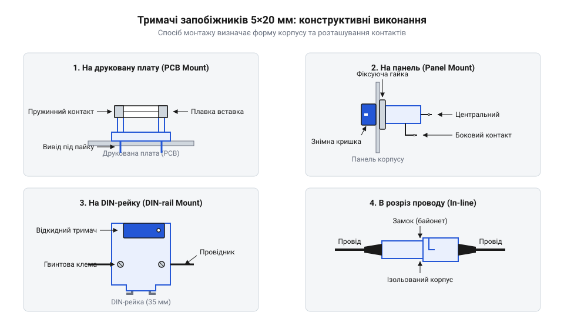

# Тримачі запобіжників 5×20

<preknowlist>
- [Плавкі запобіжники 5×20 (скляні й керамічні)](root:cat-hw-power/glass-ceramic-fuses) — розуміння конструкції скляної трубки з металевими ковпачками та принципу розриву кола при надструмі.
</preknowlist>

## Небезпека впаювання плавкої вставки
Пряме припаювання виводів до скляної трубки захисного елемента перетворює його заміну зі звичайної експлуатаційної дії на складну ремонтну процедуру. Коли [запобіжник](root:cat-hw-power/glass-ceramic-fuses) спрацьовує, для відновлення роботи пристрою доводиться розбирати корпус, випаювати перегорілий компонент і впаювати новий. Це не тільки вимагає паяльника та навичок, але й створює ризик пошкодити сусідні деталі або саму плату через перегрів. Крім того, втручання в електричне коло під напругою або навіть просто робота з відкритою платою небезпечні для користувача, оскільки завжди є ризик ураження струмом. Щоб уникнути цього, використовують механічний фіксатор — тримач. Він забезпечує надійний контакт із ковпачками запобіжника, дозволяючи вийняти його та вставити новий голими руками, безпечно і без жодного паяння.

## Конструктивні виконання за способом монтажу
Залежно від архітектури пристрою та того, наскільки часто очікується перегорання захисного елемента, тримачі монтують по-різному. Найпростіший варіант — тримач на друковану плату, який припаюється безпосередньо до доріжок. Він підходить для пристроїв, де запобіжник спрацьовує рідко, і його заміна виконується під час обслуговування з відкриттям корпусу. Якщо ж потрібен швидкий зовнішній доступ, використовують тримач на панель. Його корпус вставляється в отвір на стінці пристрою, а запобіжник ховається всередині під кришкою, що відкручується; для заміни навіть не треба розбирати сам прилад.

*Форм-фактори тримачів: на плату (для внутрішнього монтажу), на панель (із зовнішнім доступом), на DIN-рейку (для щитового обладнання) та в розріз проводу (для автомобільної чи портативної техніки).*
У промисловій автоматиці поширені тримачі на DIN-рейку, які монтуються в розподільному щитку поруч з автоматами захисту. Для автомобільної електроніки або систем живлення, де немає жорсткого корпусу чи плати, застосовують тримачі на провід (@@en|inline fuse holder@@) — пластикову капсулу з двома проводами, яку просто врізають у живильний кабель.

## Контактний опір та проблема перегріву
Будь-яке рознімне з'єднання має перехідний контактний опір. У тримачі струм проходить через металеві губки чи пружини, які стискають ковпачки запобіжника. Якщо пружини з часом слабшають або поверхні окислюються, площа контакту зменшується, а опір на цьому переході зростає. Оскільки через тримач протікає весь струм навантаження, на цьому підвищеному опорі виділяється тепло. У крайніх випадках нагрівання стає настільки сильним, що пластиковий корпус тримача починає плавитися або деформуватися, хоча сам запобіжник може залишатися цілим. Такий перегрів також здатен змінити тепловий баланс усередині трубки, що призводить до хибного спрацьовування захисного елемента при струмах, менших за його номінал. Тому надійне механічне стискання є критичним для стабільної роботи без зайвого виділення тепла.

## Безпечне підключення та світлова індикація
При монтажі панельних тримачів існує обов'язкове правило безпеки, яке запобігає ураженню електричним струмом. Фазний провід (лінія, яка приходить від джерела) завжди підключається до внутрішнього, або центрального, контакту тримача. Відповідно, провід, що йде до навантаження, підключається до бічного контакту, який з'єднаний із зовнішньою різьбою чи гільзою.

*Схема підключення: фаза йде на центральний контакт, щоб при відкручуванні ковпачка користувач не торкнувся деталей під напругою.*
Якщо підключити фазу навпаки — на зовнішню гільзу — то при відкручуванні кришечки і витягуванні запобіжника ця гільза, якої легко торкнутися пальцями, залишиться під небезпечною напругою. 
Деякі тримачі мають вбудовану світлову індикацію, зазвичай неонову лампочку або світлодіод з резистором. Цей індикатор підключений паралельно до контактів тримача. Поки запобіжник цілий, він працює як провідник і замикає індикатор накоротко. Коли запобіжник перегоряє і розриває коло, струм починає протікати через паралельний індикатор, змушуючи його світитися. Цей струм індикації дуже малий (міліампери), тому він цілком безпечний для вимкненого навантаження, але достатній, щоб чітко сигналізувати про спрацювання захисту.