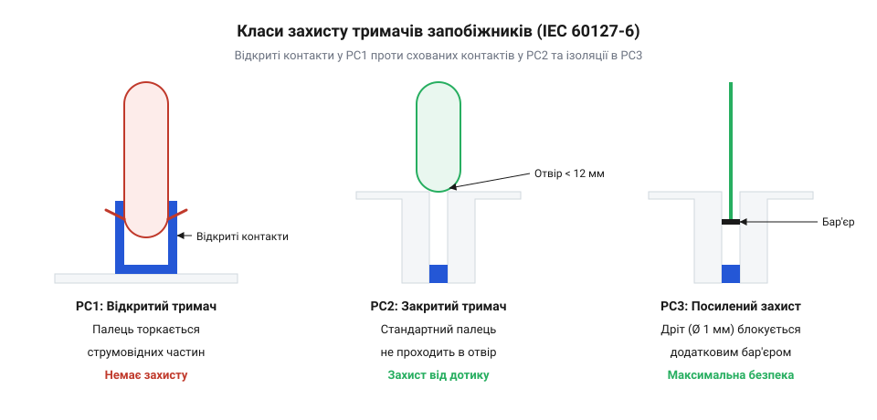

# Еволюція тримачів плавких вставок 5×20 мм: від відкритих клемних затискачів до безпечних корпусних рішень IEC 60127-6

<preknowlist>
- [Плавкі запобіжники 5×20 (скляні й керамічні)](root:cat-hw-power/glass-ceramic-fuses) — конструктивна будова, габарити та принцип нагрівання вставки під час роботи
</preknowlist>

## Відкриті кліпси та термічна втома

Перші тримачі для мініатюрних запобіжників були максимально простими: пара відкритих пружинних кліпс, змонтованих на ізоляційній основі чи шасі. Ця конструкція, хоч і дешева у виробництві, швидко показала свою ненадійність у силових колах через явище термічної втоми. Під час нормальної роботи плавка вставка нагрівається, передаючи тепло на контакти кліпс. Метал кліпс розширюється при нагріванні і стискається при охолодженні. Постійні цикли ввімкнення та вимкнення пристрою призводили до того, що пружинний матеріал з часом втрачав свою пружність і притискну силу. Ослаблений контакт створював підвищений перехідний опір, що викликало ще сильніше локальне нагрівання, іскріння та, зрештою, деградацію з'єднання. Стало очевидним, що суто механічної пружинної фіксації недостатньо для стабільної довгострокової роботи під струмовим навантаженням.

Щоб подолати втрату пружності, інженери змінили підхід до матеріалів і конструкції затискачів. Замість звичайної латуні, яка швидко деградувала від нагрівання, виробники перейшли на фосфористу бронзу або берилієву мідь — сплави, здатні зберігати механічну пам'ять форми навіть за підвищених температур. У більш відповідальних вузлах функції проведення струму та фіксації взагалі розділили: струм ішов через мідний контакт, а потрібне зусилля створювала окрема сталева пружина, винесена за межі зони найбільшого нагріву. Таке рішення гарантувало, що контакт залишатиметься щільним незалежно від кількості теплових циклів, зупиняючи ланцюгову реакцію іскріння й перегріву.

## Небезпека дотику та поява корпусів

Зростання потужності побутової та промислової апаратури загострило фундаментальну проблему відкритих кліпс — небезпеку ураження електричним струмом. Заміна запобіжника на платі вимагала фізичного захоплення скляної трубки пальцями. Оскільки довжина вставки 5×20 мм дуже мала, користувач ризикував торкнутися її металевих ковпачків. Якщо пристрій залишався підключеним до мережі, один із ковпачків неминуче перебував під фазною напругою. Цей ризик змусив інженерів відмовитися від концепції простої електричної фіксації та створити закритий механізм, який фізично ізолював би струмопровідні частини від людини.

Так з'явилися перші корпусні тримачі для монтажу на панель приладу. Вони дозволили винести вузол захисту назовні: користувач міг замінити вставку, взагалі не відкриваючи кришку пристрою. Корпус складався з двох частин — нерухомої бази, закріпленої в панелі, та рухомого ковпачка.

Головна інновація полягала в зміні послідовності контакту. Запобіжник більше не вставляли напряму в клеми під напругою. Натомість його спочатку закладали в порожнину пластикового ковпачка. Ковпачок мав внутрішню пружинну фіксацію, яка надійно утримувала один кінець запобіжника. Далі користувач вставляв ковпачок разом із запобіжником у циліндричну шахту бази і фіксував його різьбовим або байонетним з'єднанням. Під час закручування протилежний кінець запобіжника впирався в нижній підпружинений контакт бази, замикаючи коло.

Така геометрія гарантувала розрив кола до можливості фізичного дотику. Коли ковпачок починали викручувати, пружина на дні бази розтискалася, але електричний контакт із нею розривався ще тоді, коли ковпачок залишався глибоко в різьбі. Запобіжник знеструмлювався всередині ізольованої шахти. На момент, коли ковпачок звільнявся від кріплення і користувач міг витягнути його назовні, обидва контакти вставки гарантовано не мали зв'язку з джерелом живлення. Сам фазний контакт бази розташовувався на самому дні глибокого вузького отвору, куди не міг дістати палець.

Перші такі тримачі виготовлялися з @@en|бакеліту@@ — твердого, термостійкого, але крихкого пластику. Бакеліт дозволяв відливати точні різьбові з'єднання та глибокі шахти, що не деформувалися під час нагрівання контактів. Це стало ключовим кроком: безпека користувача тепер залежала не від його обережності чи інструкцій, а була фізично вбудована в механіку розриву кола.

## Стандарт IEC 60127-6 та класи

Масова поява різноманітних конструкцій тримачів вимагала уніфікації вимог до їхньої безпеки, що призвело до створення міжнародного стандарту IEC 60127-6. Цей стандарт чітко формалізував конструктивну безпеку корпусних тримачів мініатюрних плавких вставок, розділивши їх на три класи захисту від ураження електричним струмом під час ручної заміни: PC1, PC2 та PC3.

*Конструктивні відмінності класів захисту IEC 60127-6 щодо доступності струмопровідних частин.*

Клас PC1 (без вбудованого захисту) допускає можливість дотику до струмопровідних частин після зняття ковпачка, вимагаючи відключення приладу від мережі перед обслуговуванням. Клас PC2 гарантує захист від дотику стандартним випробувальним пальцем під час і після вилучення ковпачка. Найвищий клас PC3 забезпечує повну ізоляцію навіть від дотику тонким випробувальним дротом, роблячи заміну безпечною за будь-яких умов. Завдяки стандарту інженери отримали можливість однозначно вибирати тримач залежно від необхідного рівня безпеки кінцевого пристрою.

## Перехід до термостійких полімерів

Історичний бакеліт, хоч і забезпечував ізоляцію, мав суттєві недоліки: він був крихким, схильним до розтріскування під дією вібрацій та механічних навантажень під час закручування ковпачка. Крім того, при сильному перегріві, викликаному поганим контактом або перевантаженням, бакеліт міг обвуглюватися, втрачаючи ізоляційні властивості. Еволюція матеріалознавства дозволила замінити його на сучасні інженерні термопластики. Нові полімери не лише вирішили проблему механічної міцності, але й забезпечили високу стійкість до займання (самозгасання за стандартом UL 94 V-0). Сучасний полімерний корпус зберігає свою форму та ізолюючі властивості навіть при значному локальному нагріванні контактів, що радикально підвищило термічну надійність тримачів і знизило ризик пожежі при аварійних режимах роботи пристрою.