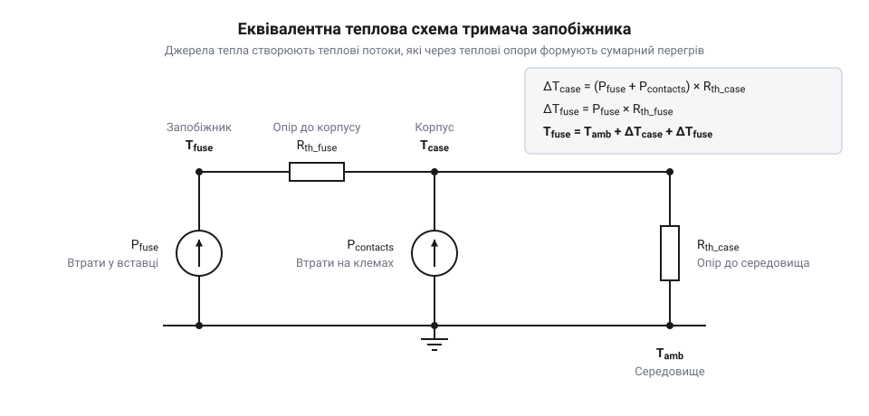

# Розрахунок теплового розсіювання, контактного опору та температурного дерейтингу тримачів запобіжників 5×20

<preknowlist>
- [Плавкі запобіжники 5×20 (скляні й керамічні)](root:cat-hw-power/glass-ceramic-fuses) — розуміння параметра номінального тепловиділення плавкої вставки під час роботи.
</preknowlist>

## Чому тримачі запобіжників плавляться

Плавкий запобіжник захищає коло живлення від надструмів, розриваючи його за рахунок розплавлення власної внутрішньої вставки. Але в реальних пристроях часто стається так, що плавиться не металева нитка всередині запобіжника, а пластиковий корпус самого тримача, причому в нормальному робочому режимі, без коротких замикань. Це відбувається через хронічний перегрів вузла.

Тримач запобіжника не є ідеальним провідником. Коли струм протікає через вузол, тепло виділяється у двох основних місцях. По-перше, сама плавка вставка має певний опір, необхідний для її правильного спрацьовування, і розсіює потужність. По-друге, метал контактів тримача стикається з металевими ковпачками запобіжника. У місцях дотику виникає перехідний опір. Навіть якщо він здається мізерним, при протіканні струму на ньому також виділяється тепло.

Якщо сумарне тепло не встигає відводитися в навколишнє середовище, температура вузла зростає. Висока температура прискорює рух атомів, дозволяючи кисню з повітря активніше реагувати з поверхнею металу. Утворена оксидна плівка не проводить струм, тож електричний контакт залишається лише на окремих чистих мікроплямах, площа яких постійно зменшується. Це невідворотно збільшує перехідний опір, що змушує виділятися ще більше тепла при тому ж струмі. Водночас пружинні контакти від постійного нагріву починають втрачати пружність і притискають запобіжник слабше. Слабший притиск додатково збільшує опір. Цей процес перетворюється на тепловий розгін: опір росте, температура росте, пружність падає, опір росте ще більше. У результаті температура перевищує точку плавлення пластику, і тримач деформується або руйнується, залишаючи саме коло живлення в небезпеці.

## Розрахунок сумарного тепловиділення вузла

Щоб уникнути перегріву, треба знати, скільки саме тепла генерує весь вузол під час роботи. Загальна потужність тепловиділення дорівнює сумі потужності, розсіяної на плавкій вставці, та потужності, розсіяної на контактах тримача.

Потужність на самій вставці P_fuseзалежить від робочого струму Iта внутрішнього опору запобіжника R_fuse:

    P_fuse
    = I² · R_fuse      [закон Джоуля — Ленца]

Однак в технічній документації на запобіжники часто вказують номінальне тепловиділення `P_n` при номінальному струмі `I_n`. Оскільки внутрішній опір вставки `R_fuse` можна вважати сталим, його легко виразити через ці номінальні параметри: `R_fuse = P_n / I_n²`. Підставивши це значення опору у формулу Джоуля — Ленца для фактичного робочого струму `I`, отримаємо вираз `I² · (P_n / I_n²)`. Завдяки цьому для робочого струму тепловтрати перераховують пропорційно квадрату струму:

    P_fuse
    = P_n · (I / I_n)²      [пропорційність розсіяної потужності до квадрата струму]

Потужність, що виділяється на контактах P_contact, визначається сумарним перехідним опором обох клем R_contact:

    P_contact
    = I² · R_contact      [закон Джоуля — Ленца]

Загальне тепловиділення вузла P_totalє простою сумою цих двох складників:

    P_total
    = P_fuse + P_contact      [додавання теплових потоків]

Зазвичай початковий опір якісних контактів становить кілька міліом. Наприклад, якщо R_contactдорівнює 5 мОм, а струм становить 10 А, то на контактах виділятиметься 0.5 Вт тепла. Якщо ж через деградацію опір зросте до 20 мОм, тепловиділення підскочить до 2 Вт. Зважаючи на те, що сам запобіжник також може розсіювати 2–4 Вт, загальна потужність стає значною і її потрібно ефективно відвести від невеликого за розміром пластикового корпусу.

## Тепловий опір та перегрів корпуса

*Спрощена модель, що показує шлях тепла від контактів та запобіжника через пластик тримача у навколишнє повітря.*

Знаючи загальну потужність тепловтрат P_total, можна визначити, до якої температури нагріється тримач. Для цього використовують параметр, який називається тепловим опором R_th. Він показує, на скільки градусів підвищиться температура деталі відносно навколишнього середовища при розсіюванні одного вата потужності. Вимірюється у °C/Вт або К/Вт.

Температура тримача T_holderрозраховується так:

    T_holder
    = T_ambient + P_total · R_th      [закон теплопровідності для зосереджених параметрів]

Тут T_ambient— це температура навколишнього повітря поблизу тримача. Важливо розуміти, що це не температура в кімнаті, а температура всередині корпусу вашого пристрою, яка часто буває суттєво вищою через нагрів від інших компонентів (наприклад, трансформаторів або радіаторів).

Тепловий опір тримача залежить від його конструкції, площі поверхні та умов охолодження. Тримач на панелі, обдуваний вентилятором, матиме набагато менший R_th, ніж закритий тримач, напаяний на плату в тісному пластиковому корпусі. Якщо розрахункова T_holderнаближається до максимальної робочої температури пластику (зазвичай 85 °C або 125 °C залежно від матеріалу), це означає, що вузол приречений на деградацію, і потрібно або покращувати охолодження, або зменшувати робочий струм.

## Температурний дерейтинг за стандартами

Виробники вказують номінальний струм тримача для ідеальних умов, зазвичай при температурі навколишнього середовища 23 °C. Якщо тримач працює в гарячому середовищі, він не зможе витримати той самий струм без перевищення критичної температури пластику й контактів. Тому необхідно застосовувати температурний дерейтинг (@@en|derating@@) — зниження дозволеного робочого струму.

Стандарти, такі як IEC 60127-6, вимагають будувати криву дерейтингу. На практиці це означає, що при підвищенні T_ambientробочий струм потрібно множити на поправковий коефіцієнт, менший за одиницю. Для багатьох тримачів струмова здатність падає майже лінійно від номінальної температури до максимальної робочої.

Наприклад, якщо тримач розрахований на 10 А при 23 °C, а максимальна температура його матеріалу становить 85 °C, то при роботі всередині пристрою, де температура повітря сягає 60 °C, він фізично не зможе розсіяти тепло від 10 А без перегріву. За графіком дерейтингу виробника його допустимий струм у цих умовах може становити лише 5 А. Ігнорування цього правила є головною причиною оплавлення тримачів у потужних блоках живлення.

## Електричне падіння напруги на контактах

Окрім теплових проблем, опір вузла запобіжника викликає електричні наслідки — падіння напруги. Струм, проходячи через сумарний опір запобіжника R_fuseта контактів R_contact, створює спад напруги ΔV:

    ΔV
    = I · (R_fuse + R_contact)      [закон Ома для ділянки кола]

У високовольтних колах (наприклад, 230 В змінного струму) падіння на 0.2–0.5 В є непомітним. Проте ситуація кардинально змінюється в низьковольтних колах із великим струмом, наприклад, на виході блоку живлення 5 В. Якщо опір вузла становить 50 мОм, то при струмі 5 А на ньому впаде 0.25 В. Це означає, що навантаження отримає 4.75 В замість 5 В. 

Для чутливої цифрової електроніки таке зниження напруги може бути критичним і призводити до нестабільної роботи чи перезавантажень. Крім того, опір контактів зростає з часом, тому падіння напруги збільшуватиметься. Отже, при проєктуванні живлення необхідно завжди закладати очікуване падіння напруги на тримачі в загальний бюджет напруги і, за потреби, компенсувати його на джерелі.