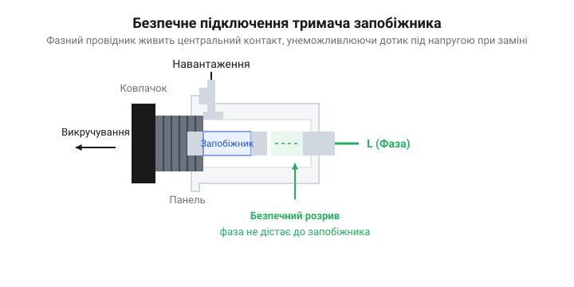

# Практичний монтаж, правильне розключення фази та діагностика вузла захисту з тримачем 5×20

<preknowlist>
- [Плавкі запобіжники 5×20](root:cat-hw-power/glass-ceramic-fuses) — розуміння принципу дії плавкої вставки та причин її перегоряння, щоб правильно інтерпретувати результати діагностики тримача.
</preknowlist>

## Небезпека заміни під напругою

Коли прилад раптово згасає, перше, що перевіряють, — запобіжник. Якщо це скляна трубка формату 5×20 мм, вона зазвичай ховається у панельному тримачі на задній стінці корпусу. Людина підходить до приладу, викручує пластиковий ковпачок і дістає перегорілий [запобіжник](root:cat-hw-power/glass-ceramic-fuses). Саме в цю мить її пальці можуть випадково торкнутися металевого кінцевика трубки або внутрішньої пружини ковпачка. Якщо тримач розключено неправильно, людина отримає небезпечний удар струмом, навіть якщо сам прилад вимкнено тумблером на передній панелі.

Панельний тримач складається з двох частин: нерухомого корпусу з контактами, захованого всередині пристрою, та знімного ковпачка, який утримує запобіжник. Нерухомий корпус має дві клеми. Одна веде до глибокого центрального контакту на самому дні колодязя. Друга клема з'єднана з боковим циліндричним контактом або металевою різьбою біля самого входу.

*Схема тримача в розрізі, що показує безпечне підключення фази до центрального контакту та ізольованість ковпачка під час його викручування.*

Коли ковпачок викручують, бокове з'єднання розривається першим. Якщо фазний провідник від мережі підключити саме до бокової клеми, то весь металевий ковпачок, внутрішня пружина та сам запобіжник залишаться під небезпечним потенціалом 230 В, щойно їх трохи викрутять. Людина торкається запобіжника, щоб його замінити, і стає провідником струму на землю.

Тому критичне правило монтажу вузла захисту — підводити фазний провідник виключно до центрального, найглибшого контакту тримача. Боковий контакт з'єднують із навантаженням. За такого розключення, щойно ковпачок трохи викручується, запобіжник відривається від центрального контакту і миттєво знеструмлюється. Користувач дістає повністю безпечний елемент. Небезпечна напруга залишається глибоко всередині вузького пластикового каналу, куди палець не дістане.

## Монтаж панельного тримача

Панельний тримач мусить зберігати жорсткість роками, витримуючи десятки викручувань ковпачка та температурні коливання. Розбовтаний тримач не лише дратує, а й створює пожежну небезпеку: поганий контакт призводить до локального нагріву, який плавить пластиковий корпус і обвуглює ізоляцію дротів.

Монтаж починається з підготовки отвору в панелі корпусу. Корпус тримача найчастіше має плоский зріз на своїй різьбовій частині. Отвір у панелі має повторювати цю форму, а не бути ідеально круглим. Цей зріз запобігає прокручуванню корпусу, коли користувач із зусиллям викручує ковпачок. Якщо просвердлити звичайний круглий отвір, фіксувальна гайка з часом ослабне, і весь тримач почне обертатися разом із підключеними всередині дротами, скручуючи й відриваючи їх.

Фіксація тримача виконується гайкою з внутрішнього боку корпусу. Закручувати її просто пальцями недостатньо. Пластикова різьба деформується під постійним тиском, а вібрації послаблюють хват. Гайку потрібно затягнути ключем до відчутного опору, бажано використовуючи зубчасту шайбу.

Приєднання дротів до клем вимагає механічної надійності. Клеми на панельних тримачах зазвичай мають форму плоских пелюсток, призначених для ножових роз'ємів (@@en|faston@@) або для паяння. Якщо використовуються роз'єми, вони повинні сідати туго і зніматися лише зі значним зусиллям. Розбовтаний роз'єм збільшує перехідний опір. Коли через такий контакт постійно тече струм у кілька ампер, локальний нагрів відпускає метал пружини, контакт погіршується ще більше, починає іскрити і зрештою випалює тримач.

Якщо обрано паяння, дріт має бути механічно закріплений на клемі до того, як його торкнеться припій. Зачищений кінець дроту слід протягнути крізь отвір у пелюстці та загнути. Припій має лише забезпечувати електричний контакт і захищати від окислення, а не працювати як механічний клей. Якщо дріт просто лежить на клемі, утримуваний лише краплею олова, сильний ривок або інтенсивний нагрів можуть розплавити припій, і фазний дріт впаде на металеве шасі приладу.

## Розводка на друкованій платі

Тримач, змонтований безпосередньо на друкованій платі, працює в інших умовах. Замість дротів струм тече через тонкі мідні доріжки, а замість масивної панелі корпусу механічні навантаження від вставлення запобіжника приймають на себе паяні з'єднання.

Під час трасування плати під тримач 5×20 головною турботою стає ширина мідних доріжок. Запобіжник розрахований на тривале пропускання номінального струму. Якщо ставиться запобіжник на 10 А, доріжки до його тримача мають безпечно пропускати понад 10 А без перегріву. Вузькі доріжки працюватимуть як паразитні нагрівачі. Для стандартних плат із товщиною міді 35 мкм струм у 10 А вимагає ширини доріжки щонайменше 6–8 мм.

Крім того, виводи тримача працюють як радіатори для самого запобіжника. Плавка вставка виділяє тепло під час нормальної роботи. Якщо доріжки на платі занадто тонкі, вони не здатні відвести це тепло. Локальна температура всередині тримача зростає, через що запобіжник передчасно старіє і перегоряє при струмах, значно менших за номінал. Щоб покращити відведення тепла, варто використовувати широкі полігони навколо виводів тримача.

Механічна міцність — друге правило. Вставлення та витягування запобіжника вимагає зусилля, особливо для тримачів у вигляді відкритих пружинних кліпс. Це зусилля передається прямо на паяні з'єднання та мідні контактні площадки, до яких вони припаяні. Якщо площадки малі, регулярні навантаження зрештою відірвуть мідну фольгу від текстоліту, розірвавши коло. Контактні площадки мають бути значно більшими за діаметр виводів, щоб забезпечити велику площу зчеплення. Отвори мають бути металізованими, щоб припій заповнив увесь циліндричний об'єм отвору, створивши міцний якір, а не просто поверхневу краплю.

## Діагностика зібраного вузла

Навіть правильно змонтований тримач з часом деградує. Срібне або нікелеве покриття на кліпсах окислюється, пружини втрачають пружність через температурні цикли, а в паяних з'єднаннях з'являються мікротріщини. Зношений тримач вносить у коло паразитний опір, який спричиняє падіння напруги, генерує локальне тепло і зрештою руйнує вузол захисту, хоча сам запобіжник може лишатися цілим.

Найнадійніший спосіб перевірити стан тримача — виміряти падіння напруги на ньому під навантаженням. Для цього потрібне навантаження, яке споживає відомий, значний струм — бажано близько половини номіналу запобіжника. Мультиметр перемикають у режим вимірювання мілівольтів змінного чи постійного струму. Щупи ставлять безпосередньо на вхідну та вихідну клеми тримача, а не на дроти, що до нього ведуть.

У справному вузлі падіння напруги має бути мінімальним і визначатися здебільшого внутрішнім опором самого запобіжника плюс кілька мілівольтів на контакти. Наприклад, типовий скляний запобіжник на 5 А може давати падіння близько 100–150 мВ. Якщо мультиметр показує значно більше значення, наприклад 500 мВ або більше, це означає, що контакти тримача деградували. Таке падіння означає розсіювання потужності. Падіння 0.5 В при струмі 5 А означає, що 2.5 Вт тепла виділяється всередині маленького пластикового корпусу, що неминуче призведе до його розплавлення.

Якщо тримач має вбудований неоновий або світлодіодний індикатор перегоряння, він додає нюансів у діагностику. Індикатор підключений паралельно до запобіжника. Коли запобіжник цілий, струм іде через нього, оскільки його опір майже нульовий, і індикатор не світиться. Коли запобіжник перегоряє, коло замикається через високоомний індикатор, і той засвічується. Однак, якщо прилад не працює, але індикатор тьмяно світиться або мерехтить, хоча візуально запобіжник здається цілим, це вказує на сильно окислений або ослаблений контакт усередині тримача. Опір поганого контакту став настільки великим, що частина струму почала протікати через паралельний контур індикатора, сигналізуючи про критичну несправність самого тримача.