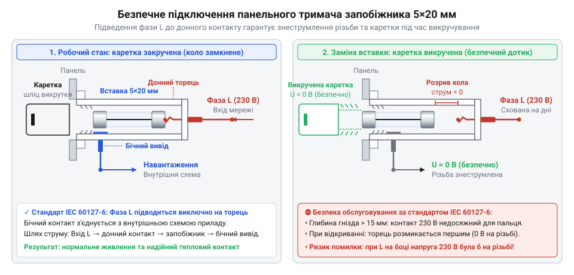
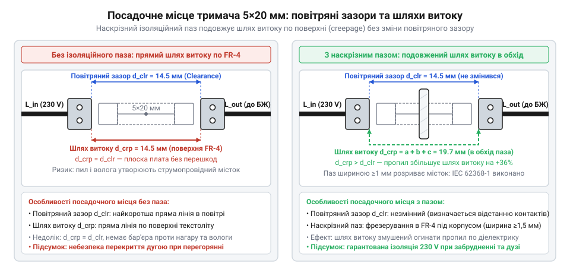

# Залізний API: конструкції тримачів запобіжників 5×20 мм, посадочні місця та способи монтажу

<preknowlist>
- [Тримачі запобіжників 5×20](root:cat-hw-power/fuse-holders) — розуміння загального призначення тримачів та їхнього поділу за типами монтажу
</preknowlist>

## Потреба у тримачі запобіжника

Будь-який електронний пристрій, підключений до електромережі, ризикує вийти з ладу через коротке замикання або перевантаження. Якщо струм перевищує розрахункові межі, компоненти перегріваються, плавляться, а іноді й спалахують. Щоб захистити прилад і користувача, у коло живлення ставлять плавкий запобіжник — слабку ланку, яка свідомо перегоряє першою і розриває електричне коло. Оскільки після спрацьовування запобіжник руйнується, він є витратним елементом. 

Замінювати перегорілий елемент щоразу перепаюючи його — незручно, довго і вимагає кваліфікації. Прилад має повертатися до роботи швидко, а процес заміни має бути доступним без паяльника. Саме цю проблему розв'язує тримач запобіжника. Він виконує дві критичні функції: надійно фіксує скляну або керамічну трубку формату 5×20 мм механічно та забезпечує міцний електричний контакт без паяння. [Тримачі запобіжників 5×20](root:cat-hw-power/fuse-holders) дозволяють перетворити заміну витратного елемента на просту операцію, яку можна виконати за кілька секунд. 

Тримач — це не просто механічне гніздо, а повноцінний вузол кола живлення, через який протікає весь струм пристрою. Поганий контакт у тримачі означає падіння напруги та сильний нагрів, що може розплавити корпус приладу ще до того, як згорить сам запобіжник. Тому вибір конструкції тримача визначає надійність захисту не менше, ніж номінал плавкої вставки. Від того, чи це відкриті пружинні контакти на платі, чи ізольований блок на панелі, залежить безпека користувача, який полізе міняти запобіжник.

## Відкриті кліпси для друкованої плати

Найпростіший спосіб закріпити запобіжник на платі — використати відкриті пружинні кліпси. Вони являють собою пару металевих скоб, які припаюються безпосередньо до мідних майданчиків друкованої плати. Запобіжник просто втискається між їхніми пелюстками, які щільно обхоплюють його металеві ковпачки. 

Перевага відкритих кліпс полягає в їхній мініатюрності та низькій вартості. Вони майже не займають місця на платі понад габарити самої скляної трубки, а також забезпечують чудове охолодження, оскільки елемент повністю відкритий повітрю. Однак саме ця відкритість є їхнім головним недоліком. Металеві контакти перебувають під робочою напругою пристрою, яка може сягати 230 В змінного струму. Якщо користувач випадково торкнеться їх пальцем під час заміни під напругою, він отримає удар струмом. Тому відкриті кліпси ніколи не ставлять там, куди має доступ звичайний користувач. Їх використовують виключно всередині закритих корпусів, де передбачається, що обслуговування проводить майстер, який попередньо знеструмив прилад.

При проєктуванні посадочного місця для кліпс критично важливо точно витримати відстань між ними. Для стандарту 5×20 мм відстань між центрами отворів зазвичай становить близько 22,5 мм, але точне значення залежить від конкретної моделі кліпс і товщини їхнього металу. Якщо рознести кліпси надто далеко, запобіжник ледь триматиметься і може випасти від вібрації. Якщо поставити їх надто близько, вставити трубку буде неможливо без деформації контактів. Крім того, кліпси вимагають жорсткої фіксації на платі: вони повинні мати достатньо широкі контактні майданчики для паяння, щоб механічне зусилля при втисканні та витяганні запобіжника не відірвало мідні доріжки від текстоліту.

## Закриті ізольовані тримачі на плату

Коли пристрій вимагає безпечнішого обслуговування, але запобіжник все одно розташовується на друкованій платі, застосовують закриті ізольовані тримачі. Вони складаються з пластикового корпусу, всередині якого сховані металеві контакти, та знімної кришечки або каретки.

Пластиковий корпус повністю закриває струмопровідні частини від випадкового дотику. Коли кришка закрита, доторкнутися до металу пальцем неможливо. Заміна запобіжника в такому тримачі відбувається безпечніше: користувач або відкидає кришку на петлі, або витягає каретку разом із плавкою вставкою. Це дозволяє використовувати такі тримачі в обладнанні, де плата закрита лише частково або де заміна передбачена без розбирання глибоких нутрощів.

Проте закритий корпус змінює геометрію вузла та його тепловий режим. По-перше, габарити такого тримача суттєво більші за саму трубку 5×20 мм, що вимагає більше місця на платі. По-друге, розробник повинен закласти додатковий простір навколо тримача для доступу руки. Якщо щільно обставити його високими конденсаторами чи радіаторами, витягти каретку буде фізично неможливо. По-третє, глухий пластик перешкоджає циркуляції повітря. Запобіжник під навантаженням гріється, і в закритому тримачі це тепло гірше відводиться, що змушує уважніше ставитися до теплових розрахунків і номіналів, про що ми поговоримо нижче.

## Панельні тримачі та безпека підключення

Якщо заміна запобіжника має бути максимально швидкою і доступною для будь-якого користувача без відкривання корпусу приладу, використовують тримачі для монтажу на панель. Це циліндричні конструкції, які вставляються в отвір на зовнішній стінці корпусу і фіксуються гайкою. Ззовні видно лише каретку під викрутку або для захоплення пальцями, а вся електрична частина ховається всередині.

Панельний тримач має два виводи під паяння або клеми типу Faston, які розташовані по-різному: один на самому торці циліндра, а другий — збоку на різьбовій або бічній частині корпусу. Ця асиметрія існує не просто так, вона лежить в основі безпеки підключення мережевої напруги. 

*Зображено розріз панельного тримача; видно, що фазний провідник підключено до нижнього торцевого контакту, а бічний контакт з'єднується з колом приладу, що гарантує відсутність напруги на різьбі при відкритій каретці.*

Правило безпечного підключення панельного тримача є жорстким: фаза від мережі повинна подаватися виключно на нижній торцевий контакт. Бічний контакт, розташований ближче до кришки, підключається до внутрішнього кола пристрою. Чому саме так? Коли користувач викручує каретку, щоб перевірити запобіжник, бічний контакт каретки розриває з'єднання з нижнім торцем ще до того, як повністю вийде з корпусу. Якщо фаза подана на нижній торець, він залишається під напругою, але він глибоко на дні вузького каналу — дотягнутися до нього пальцем неможливо. Натомість бічні контакти і різьба каретки, які стають доступними, вже знеструмлені. Якби підключення було зворотним, під напругою залишалася б бічна стінка тримача. Торкнувшись її при викручуванні, користувач отримав би удар фазою.

## Теплове розсіювання та перехідний опір

Будь-який запобіжник захищає коло завдяки тому, що нагрівається протікаючим струмом і плавиться. Це означає, що він неминуче виділяє тепло під час нормальної роботи, особливо якщо струм близький до номіналу. Але окрім самого провідника запобіжника, тепло генерує і місце контакту між металевим ковпачком трубки та пружиною тримача.

Реальний контакт ніколи не буває ідеальним — він має власний перехідний опір, який залежить від сили притискання, чистоти поверхонь і площі стикання. Відповідно до закону Джоуля-Ленца, потужність тепловиділення пропорційна квадрату струму та опору: `P = I²R`. Якщо перехідний опір контактів великий (наприклад, через окислення або слабку пружину), при значних струмах на них виділятиметься значна потужність.

Пластикові корпуси закритих і панельних тримачів мають обмежену термостійкість. Виробники вказують у документації максимально допустиму потужність розсіювання (зазвичай у межах 2.5–4 Вт для формату 5×20 мм). Якщо сумарне тепло від запобіжника і контактів перевищить цю межу, пластик почне деформуватися або плавитися. Запобіжник може не перегоріти, але тримач зруйнується, контакти змістяться, і може виникнути коротке замикання всередині самого вузла. Тому при проєктуванні важливо розраховувати тепловий баланс: якщо струми великі і постійні, необхідно вибирати тримачі з якісними посрібленими або лудженими контактами з потужною пружиною, а також забезпечувати конвекцію повітря, щоб не перевищити межу розсіювання. Якщо ж пристрій страждає від постійних перегрівів у вузлі захисту, можливо, варто розглянути [самовідновлювані запобіжники (PTC) PolySwitch](root:cat-hw-power/polyswitch-ptc), які мають інший тепловий профіль і монтуються паянням.

## Ізоляційні зазори та топологія плати

Тримач запобіжника часто стоїть на самому вході пристрою, де напруга мережі ще не понижена. Це означає, що контакти тримача перебувають під потенціалом 230 В відносно землі або інших частин плати. Щоб гарантувати безпеку і запобігти електричному пробою, розробник повинен дотримуватися суворих вимог до ізоляційних зазорів на друкованій платі.

Ізоляція визначається двома параметрами: повітряним зазором (@@en|clearance@@) та шляхом витоку струму по поверхні (@@en|creepage@@). Повітряний зазор — це найкоротша відстань між двома провідниками по повітрю, яка запобігає дуговому пробою при стрибку напруги. Шлях витоку — це найкоротша відстань між провідниками по поверхні ізоляційного матеріалу (текстоліту). На поверхні плати може накопичуватися пил, волога або флюс, що створює провідну плівку, тому шлях витоку завжди має бути більшим за повітряний зазор.

*Зображено розведення мідних полігонів під тримачем; видно, як дистанція між контактами фази та найближчими провідниками витримується для забезпечення необхідного шляху витоку.*

При розведенні посадочного місця під кліпси або закритий тримач, мідні доріжки та полігони високої напруги мають бути відсунуті від решти кола. Мінімальний шлях витоку для мережі 230 В зазвичай становить не менше 2.5–3 мм, залежно від класу пристрою і ступеня забруднення середовища. Якщо на платі фізично бракує місця, щоб рознести доріжки на таку відстань, під тримачем або між його контактами часто роблять наскрізний пропил (фрезерування) у текстоліті. Пропил перетворює шлях по поверхні на повітряний зазор, що дозволяє безпечно зменшити фізичну дистанцію. Ігнорування цих правил може призвести до того, що під час стрибка напруги в мережі виникне іскра, яка обійде запобіжник, випалить плату і спричинить пожежу.