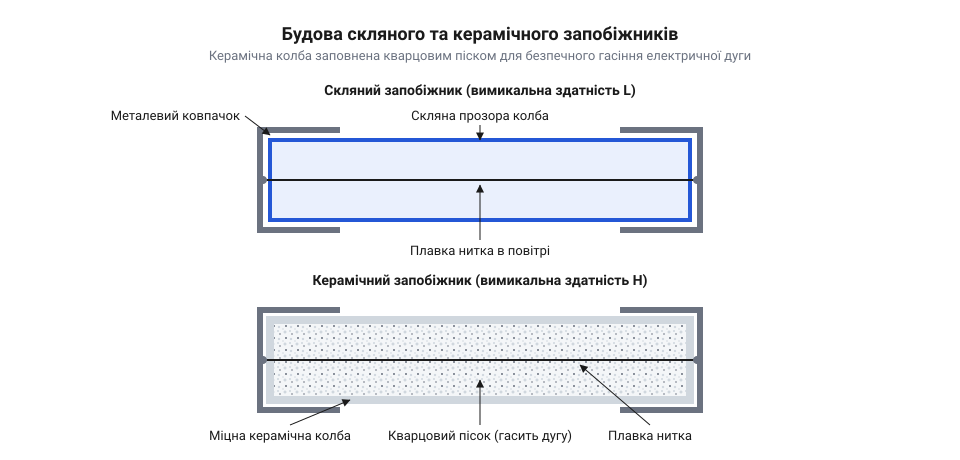
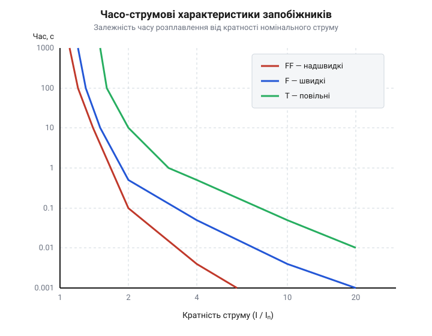
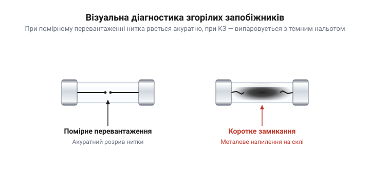
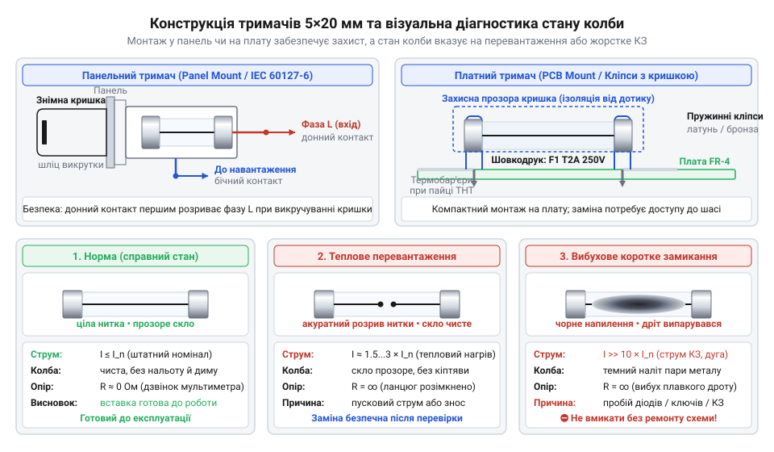

# Плавкі запобіжники 5×20 (скляні й керамічні)

<preknowlist>
- [Тримачі запобіжників 5×20](root:cat-hw-power/fuse-holders) — принципи механічної фіксації картриджних запобіжників та створення надійного електричного контакту
</preknowlist>

## Неконтрольований надструм і руйнування приладу

Раптовий електричний пробій (англ. @@en|breakdown@@) напівпровідникового компонента у первинній лінії живлення — це одна з найгостріших аварійних ситуацій у сучасній електронній апаратурі. Коли у силовому діодному мості, мостовому перетворювачі або перемикальному транзисторі виникає лавинний чи термічний пробій @@en|p-n junction@@ переходу, опір деталі миттєво падає від кількох мегаомів до часток ома. Вхідне коло приладу, підключене до мережі змінного струму (англ. @@en|AC@@, скорочення від @@en|alternating current@@) напругою 230 В, умить опиняється в стані короткого замикання. Струм у колі стрибкоподібно зростає від номінальних часток ампера до очікуваного струму короткого замикання (англ. @@en|prospective short-circuit current@@), який у реальних побутових та промислових мережах сягає від сотень до кількох тисяч амперів і обмежується лише власнісним імпедансом (англ. @@en|impedance@@, від лат. @@la|impedire@@ — «перешкоджати») силового трансформатора підстанції та опором підвідних ліній.

Згідно з законом Джоуля — Ленца, теплова потужність, що виділяється у кожному елементі провідного тракту, зростає пропорційно квадрату струму:

```
P = I² × R
```

За неконтрольованого надструму виділення тепла відбувається зі швидкістю, яка в тисячі разів перевищує спроможність конструкції до природного теплорозсіювання. Мідні доріжки друкованої плати та сполучні провідники за лічені мілісекунди нагріваються до температур, що перевищують точку склування епоксидного ламінату FR-4. Це спричиняє незворотний термічний розгін (англ. @@en|thermal runaway@@), обвуглювання та розшарування текстоліту, випаровування міді, виділення густого отруйного диму та спалахування компонентів плати. Без локалізованого захисного бар'єра пробій одного дешевого напівпровідникового діода неминуче перетворюється на масовану пожежну аварію з повним знищенням приладу.

Щоб запобігти катастрофічному руйнуванню апаратури, в електричне коло вбудовують калібровану ослаблену ділянку — плавкий запобіжник (англ. @@en|fuse@@, від лат. @@la|fundere@@ — «плавити»). Цей елемент працює як точний пасивний тепловий перетворювач. У режимі нормального навантаження його власний електричний опір є мізерним і не впливає на функціонування схеми. Однак коли струм перевищує граничне безпечне значення протягом нормованого часу, щільність струму всередині вузької каліброваної нитки викликає накопичення тепла, яке перевищує швидкість його відведення в навколишнє середовище. Металевий провідник розплавляється та випаровується, створюючи фізичний розрив кола до того, як температура дротів чи силового трансформатора досягне точки займання. На відміну від активних електронних кіл захисту, плавкий елемент спирається на непорушні фізичні закони термодинаміки та фазових переходів металів, гарантуючи розрив кола без залежності від спроможності керувальних мікроконтролерів чи допоміжних джерел живлення.

Історія захисних елементів сягає перших патентів Томаса Едісона (англ. @@en|Thomas Edison@@), який наприкінці XIX століття запропонував використовувати свинцево-олов'яні дроти для захисту освітлювальних мереж від короткого замикання. Зі швидким розвитком побутової електроніки та радіоапаратури в середині XX століття виникла гостра потреба у стандартизації та мініатюризації захисних пристроїв. Масове впровадження імпульсних джерел живлення та бестрансформаторних вхідних кіл вимагало єдиного конструктивного фактора, який би поєднував компактні габарити, надійний механічний контакт та безпечну заміну. Результатом цієї еволюції стала розробка міжнародного стандарту IEC 60127 (англ. @@en|IEC 60127@@), який зафіксував трубчастий картриджний запобіжник (англ. @@en|cartridge fuse@@, від фр. @@fr|cartouche@@ — «згорток») розміром 5×20 мм як базовий світовий стандарт для малопотужної та середньопотужної електроніки. У міру зростання потужності енергомереж та збільшення можливих струмів короткого замикання виявилося, що проста скляна колба вже не здатна безпечно витримувати енергію дуги у високоенергетичних колах. Це спричинило розділення типорозміру 5×20 мм на два класи: скляні колби для низькоенергетичних кіл та керамічні колби (грецьк. @@el|keramos@@ — «глина»), заповнені кварцовим піском, для силових кіл з високим потенційним струмом замикання.

Для захисту низьковольтних сигнальних ліній або кіл із частими тимчасовими перевантаженнями розробники іноді застосовують альтернативні рішення на основі [самовідновлюваних PTC-елементів](root:cat-hw-power/polyswitch-ptc). Проте для силових мереж первинної напруги змінного струму класичний одноразовий картридж 5×20 мм лишається непорушним стандартом безпеки. Щоб забезпечити швидку заміну та зручний інспекційний доступ без паяння, такі запобіжники встановлюють у спеціалізовані [тримачі картриджних запобіжників](root:cat-hw-power/fuse-holders). Правильний вибір конкретного запобіжника 5×20 мм вимагає глибокого розуміння його номінальних електричних параметрів, нормованих міжнародним [стандартом IEC 60127](root:cat-hw-power/glass-ceramic-fuses/api-5x20-fuse-specifications-hardware.md), а також урахування умов навколишнього середовища з відповідним [температурним дерейтингом](root:cat-hw-power/glass-ceramic-fuses/math-fuse-rating-derating.md).

## Фізика розплавлення та дугогасіння в колбі

Процес спрацьовування плавкого запобіжника 5×20 мм лише на перший погляд здається простим механічним обривом нитки. Коли через плавкий елемент протікає струм `I`, виділення джоулевого тепла в металевому провіднику опором `R` викликає нагрівання нитки. Опір металу зростає з температурою за лінійним законом з огляду на температурний коефіцієнт опору (англ. @@en|temperature coefficient of resistance@@, `α`):

```
R(T) = R₀ × [1 + α × (T - T₀)]
```

За номінального струму `Iₙ` виділене тепло повністю відводиться через металеві ковпачки та корпус у навколишнє середовище шляхом теплопровідності й конвекції. У колі встановлюється теплова рівновага, за якої температура нитки зі срібла, міді чи сплавів лишається значно нижчою за точку розплавлення `T☵` (для срібла `961.8 °C`, для міді `1085 °C`).

Однак у разі виникнення короткого замикання баланс між виділенням та відведенням тепла катастрофічно порушується. Оскільки потужність нагрівання зростає квадратично щодо струму (`I²`), а опір металу додатково підвищується при нагріванні, температура нитки стрімко досягає точки плавлення. Поглинувши питому теплоту фазового переходу, метал переходить у рідкий стан. Далі рідкий струмопровідний місток під дією поверхневого натягу та стискальних магнітних сил (англ. @@en|pinch effect@@) розпадається на окремі краплі, створюючи первинний фізичний зазор.

Проте фізичний розрив металевого провідника під напругою мережі не означає миттєвого припинення струму. У момент випаровування металу в мікроскопічному зазорі створюється колосальна напруженість електричного поля. Вільні електрони прискорюються в цьому полі та інтенсивно бомбардують атоми металевої пари та повітря, викликаючи їхню ударну іонізацію (грецьк. @@el|ion@@ — «той, що йде»). У місці випаруваної нитки виникає стійкий високотемпературний канал іонізованого газу — електрична дуга (англ. @@en|electric arc@@, від лат. @@la|arcus@@ — «дуга»).


*Розріз скляного та керамічного запобіжників 5×20 мм: скляний корпус має відкритий плавкий дріт для візуального огляду, тоді як керамічний корпус заповнений кварцовим піском для поглинання енергії дуги та гасіння плазми.*

Температура в стовпі електричної дуги досягає від `3000 °C` до `10000 °C`. Іонізована плазма (грецьк. @@el|plasma@@ — «виліплене», «сформоване») володіє високою електропровідністю, тому струм короткого замикання продовжує безперешкодно протікати через розрядний канал. Загальне падіння напруги на дузі складається з прикатодного, прианодного падінь та падіння напруги в стовпі плазми:

```
U_arc = U_c + E_column × l + U_a
```

Якщо дугу негайно не згасити, виділення енергії в обмеженому об'ємі колби викликає стрімке зростання тиску газу та неконтрольоване термічне випромінювання, що загрожує вибуховим руйнуванням корпусу.

Саме на етапі дугогасіння виявляється фундаментальна фізична відмінність між скляними та керамічними запобіжниками типорозміру 5×20 мм, яка визначає їхню вимикальну здатність (англ. @@en|breaking capacity@@, або електричний параметр `I<sub>bc</sub>`):

1. **Скляна колба (низька вимикальна здатність L)**: Скляний запобіжник складається з прозорої циліндричної трубки з боросилікатного скла, заповненої повітрям за атмосферного тиску. Повітря має низьку теплоємність та низьку теплопровідність. Згідно зі стандартом IEC 60127, скляні запобіжники мають маркування **L** (англ. @@en|low breaking capacity@@) і нормовану вимикальну здатність всього `35 A` або `10 × Iₙ` (залежно від того, що більше) при напрузі `250 V AC`. Якщо такий запобіжник виявиться в колі з можливим струмом короткого замикання в `500 A` чи `1500 A`, внутрішній об'єм повітря миттєво розжарюється, тиск плазми за мікросекунди зростає до критичних меж, і скляна колба вибухає з розльотом осколків скла та струмопровідної плазми на сусідні елементи плати.

2. **Керамічна колба з кварцовим піском (висока вимикальна здатність H)**: Керамічний запобіжник має корпус із високоміцної оксидної кераміки (алюмооксидної кераміки), здатної витримувати колосальний механічний тиск і температури понад `1500 °C`. Внутрішній об'єм навколо нитки щільно заповнений очищеним дрібнодисперсним кварцовим піском (англ. @@en|quartz sand@@, хімічна формула `SiO₂`).

Коли в керамічному запобіжнику виникає дуга, вона змушена розвиватися у вузьких мікроскопічних канальцях між гранулами піску. Фізичний механізм гасіння розрядного каналу піском розгортається у три етапи:

- **Інтенсивний відбір тепла**: Гранули кварцу володіють високою питомою теплоємністю. Вони миттєво поглинають колосальну термічну енергію з плазмового стовпа дуги, різко знижуючи її температуру. - **Деіонізація плазми**: При стрімкому охолодженні інтенсивність ударної іонізації падає, і електрони рекомбінують із позитивними іонами назад у нейтральні атоми. Електропровідність каналу падає на кілька порядків. - **Оплавлення та утворення ізолятора**: Накопичуючи тепло, поверхня гранул кварцового піску розплавляється за температури близько `1700 °C` і спікається з парами металу нитки. Утворюється твердий непроводовий склянистий матеріал — фульгурит (від лат. @@la|fulgur@@ — «блискавка»). Цей спечений діелектричний корк фізично перекриває простір і унеможливлює повторний пробій та відновлення дуги.

Завдяки кварцовому піску керамічні запобіжники 5×20 мм отримують маркування **H** (англ. @@en|high breaking capacity@@) і здатні безпечно та беззвучно гасити струми короткого замикання до `1500 A` за напруги `250 V AC` (а окремі спеціалізовані серії — до `10 kA`). При роботі в колах постійного струму (англ. @@en|DC@@, скорочення від @@en|direct current@@) гасіння дуги ускладнюється відсутністю природного переходу напруги через нуль (на відміну від мереж AC з частотою 50/60 Гц), тому допустима напруга запобіжника в колах DC зазвичай є значно нижчою за номінал AC.

Усі ці фізичні процеси створюють критичне правило інженерної безпеки: **категорично заборонено замінювати керамічний запобіжник з маркуванням H на скляний запобіжник з маркуванням L**, навіть якщо їхні номінальні струми `Iₙ` та робочі напруги `Uₙ` є абсолютно однаковими (наприклад, замінювати `H5AL250V` на `L5AL250V`). У разі прямого пробою у вхідному колі імпульсного джерела живлення мережа змінного струму видасть короткочасний струм у сотні амперів. Керамічний запобіжник безгомінно локалізує дугу всередині піщаного заповнювача, тоді як скляний запобіжник розлетиться на осколки, перетворивши аварію на відкриту пожежу з розбризкуванням плазми.

Динаміку нагрівання та фазового переходу плавкого елемента під час швидких струмових сплесків описує математична модель [плавкого інтеграла](root:cat-hw-power/glass-ceramic-fuses/math-i2t-melting-integral.md) `I²t`:

```
I²t = ∫ i²(t) dt
```

Цей параметр визначає кількість енергії, необхідну для розплавлення нитки до моменту виникнення дуги. Розрахунок цього параметра є вирішальним при розробці вхідних кіл [імпульсних джерел живлення](root:cat-hw-power/glass-ceramic-fuses/proj-fuse-selection-power-supply.md), де виникають значні пускові струми (англ. @@en|inrush current@@) заряджання згладжувальних конденсаторів. Після спрацьовування запобіжника інженер може провести аналіз причин аварії за методиками [діагностики вимикання](root:cat-hw-power/glass-ceramic-fuses/proj-fuse-diagnostics-and-mount.md), а також розрахувати правильний тип трасування та монтажу на [друковані плати](root:cat-hw-power/glass-ceramic-fuses/api-5x20-holders-and-footprints-hardware.md).

## Селективність і затримка спрацьовування за характеристиками

Під час розробки джерел живлення та електронних приладів інженери часто стикаються з розчаровуваним явищем: щойно змонтована схема вибиває плавкий запобіжник у момент першого вмикання тумблера живлення, хоча в усталеному режимі споживання струму пристроєм у кілька разів нижче за номінал запобіжника. Причина полягає у фізиці перехідних процесів. Під час подачі мережевої напруги порожні електролітичні конденсатори вхідного фільтра поводяться як віртуальне коротке замикання, викликаючи потужний сплеск споживання — пусковий струм (від англ. @@en|inrush current@@ — пусковий струм). Аналогічно первинні обмотки силових трансформаторів у момент увімкнення потребують короткочасного кидка струму для створення магнітного потоку в сердечнику. Якщо обрати запобіжник зі звичайною швидкістю спрацьовування за номінальним робочим струмом схеми, він згоратиме під час кожного пуску. Якщо ж збільшити номінал запобіжника в п'ять разів, щоб він витримував пусковий сплеск, пристрій втратить захист від реального тривалого перевантаження, що призведе до перегріву й пожежі.

Для розв'язання цієї суперечності розроблено класифікацію плавких елементів за часо-струмовими характеристиками (від англ. @@en|time-current characteristic@@ — часо-струмова характеристика), які визначають залежність часу розплавлення нитки від кратності перевищення номінального струму. Відповідно до міжнародного стандарту @@en|IEC 60127@@, мініатюрні картриджні запобіжники типорозміру 5×20 мм поділяються на п'ять основних категорій:

1. `FF` — надшвидкі (від англ. @@en|very fast-acting fuse@@ — надшвидкодіючий запобіжник). Призначені для захисту чутливих напівпровідникових компонентів (польових транзисторів, симисторів, випрямляльних діодів), які виходять з ладу за лічені мікросекунди. 2. `F` — швидкі (від англ. @@en|fast-acting fuse@@ — швидкодіючий запобіжник). Стандартний захист для резистивних навантажень, вимірювальних приладів та електронних плат без високих пускових ємностей. 3. `M` — середньоповільні (від англ. @@en|medium time-lag fuse@@). Проміжна категорія для пристроїв із помірними перехідними струмами. 4. `T` — повільні із затримкою (від англ. @@en|time-delay fuse@@ — запобіжник із часовою затримкою). Конструктивно розраховані на витримування короткочасних сплесків струму без пошкодження плавкого елемента. 5. `TT` — надповільні (від англ. @@en|long time-delay fuse@@). Застосовуються у кола з тривалими та важкими пусковими процесами, наприклад під час запуску електродвигунів.

Графічні межі та стандартизовані діапазони часу вимикання детально зібрано у [специфікаціях запобіжників 5x20](root:cat-hw-power/glass-ceramic-fuses/api-5x20-fuse-specifications-hardware.md).


*Часо-струмові криві запобіжників типів FF, F та T у логарифмічних координатах: повільні запобіжники T витримують короткочасні перевантаження струму значно довше за швидкі F та надшвидкі FF.*

Конструктивна реалізація часової затримки у форматі 5×20 мм спирається на два фізичних принципи: геометрію плавкого елемента та термохімічний М-ефект (від англ. @@en|M-effect@@ — ефект Меткалфа, названий на честь дослідника @@en|A. W. Metcalf@@). Замість прямого тонкого провідника у повільних запобіжниках `T` застосовують спіральне навивання дрітової нитки на керамічне або скловолоконне осердя, що збільшує фізичну довжину й теплоємність елемента. На поверхню мідного чи срібного провідника наносять мікроскопічну краплю низькоплавкого сплаву (зазвичай на основі олова). Під час тривалого помірного перевантаження провідник розігрівається до температури розплавлення олова (близько 232 °C). Рідке олово починає активно дифундувати в тверду мідь, утворюючи інтерметалічну евтектичну суміш із набагато нижчою температурою плавлення (близько 300–400 °C замість 1085 °C для чистої міді). Плавкий елемент перегорає за відносно низьких температур, захищаючи корпусні деталі від перегріву.

Однак під час короткочасного високого пускового сплеску олово просто не встигає здифундувати вглиб міді за кілька мілісекунд. Провідник поглинає імпульс енергії за рахунок своєї теплоємності й залишається неушкодженим. 

Здатність запобіжника витримувати енергетичні кидки струму описується математичною концепцією, яку називають плавким інтегралом (від англ. @@en|melting integral@@ — плавкий інтеграл) і позначають як `I²t`. За коротких проміжків часу (менше 10 мілісекунд) теплообмін між плавким елементом та навколишнім середовищем (повітрям, скловолокном або кварцовим піском) є нехтовно малим. Цей режим називається адіабатичною фазою нагрівання (від англ. @@en|adiabatic heating phase@@ — адіабатична фаза нагрівання). Увесь джоулів тепловий потік залишається всередині металевого провідника, викликаючи його розплавлення:

```
I²t = ∫ [i(t)]² dt
```
Де:
`i(t)` — миттєве значення пускового струму як функція часу `t`;
`I²t` — плавкий інтеграл запобіжника, що вимірюється в ампер-квадрат-секундах (А²с).

Плавкий інтеграл `I²t` є константою для конкретної конструкції запобіжника і характеризує обсяг енергії, необхідний для переходу металу плавкої нитки з твердого стану в рідкий. Для розрахунку впливу реального пускового сплеску схеми обчислюють інтеграл струму для конкретної форми імпульсу:

* Для прямокутного імпульсу струму амплітудою `I_p` тривалістю `Δt`:
```
I²t_pulse = (I_p)² · Δt
```
* Для експоненційного згасаючого імпульсу (зарядження вхідного конденсатора через опір мережі з постійною часу `τ`):
```
I²t_pulse = 0.5 · (I_p)² · τ
```
* Для синусоїдального напівхвильового сплеску (намагнічування трансформатора):
```
I²t_pulse = 0.5 · (I_p)² · t_half
```

Щоб запобіжник працював надійно протягом багатьох років і не зазнавав передчасного старіння від мікроструктурних деформацій металу, значення плавкого інтеграла пускового сплеску `I²t_pulse` не повинно перевищувати допустиму частку від номінального плавкого інтеграла запобіжника `I²t_fuse`. Для швидкодіючих запобіжників `F` ця частка становить не більше 10–20 %, тоді як для повільних запобіжників `T` із затримкою допустимий рівень сягає 30–50 %. Покрокові формули розрахунку теплового руйнування нитки та адаптації до довільних форм імпульсів викладено у [розрахунку плавкого інтеграла](root:cat-hw-power/glass-ceramic-fuses/math-i2t-melting-integral.md).

Принцип селективності (від англ. @@en|selectivity@@ — селективність) вимагає узгодження часо-струмових характеристик між послідовно увімкненими захисними пристроями в системі живлення. У випадку локального короткого замикання у вторинному колі або на окремій платі повинен спрацьовувати лише низьконівневий захист (наприклад, локальний запобіжник або [самовідновлювані елементи захисту](root:cat-hw-power/polyswitch-ptc)), тоді як головний вхідний запобіжник 5×20 мм має залишатися цілим. Для забезпечення селективності повний інтеграл вимикання вторинного запобіжника повинен бути меншим за плавкий інтеграл первинного вхідного запобіжника.

## Розрахунок струмового номіналу та температурного дерейтингу

Процес вибору плавкого запобіжника 5×20 мм для конкретного пристрою полягає не просто у зіставленні споживаного струму з паспортом деталі. Якщо обрати запобіжник із номіналом, який точно дорівнює робочому струму схеми, розробник гарантовано отримає хибні спрацьовування в процесі експлуатації. Практичний розрахунок вимагає врахування номінальної напруги, довготривалого навантажувального запасу, температурного середовища та циклічної втоми нитки.

Першою критичною величиною є номінальна напруга (від англ. @@en|rated voltage@@ — номінальна напруга) запобіжника `V_n`. Вона визначає максимальну напругу кола, за якої корпус і гасильне середовище здатні надійно розірвати електричну дугу без повторного пробою чи руйнування колби. Головне правило вибору напруги є абсолютним: номінальна напруга запобіжника повинна дорівнювати або перевищувати максимальну робочу напругу схеми (`V_n ≥ V_max`). Стандартні запобіжники 5×20 мм випускаються на напругу 250 В змінного струму (від англ. @@en|AC@@). При використанні запобіжника у колах постійного струму (від англ. @@en|DC@@) слід враховувати, що дуга постійного струму не має природного переходу напруги через нуль (як це відбувається 100 разів на секунду в мережі 50 Гц), тому дугогасіння вимагає більшого проміжку або наявності дугогасильного піску. Запобіжник 250 В AC без спеціального DC-маркування зазвичай розрахований лише на 32–125 В DC.

Для визначення необхідного струмового номіналу (від англ. @@en|rated current@@ — номінальний струм) `I_n` вихідною точкою слугує максимальний усталений струм (від англ. @@en|steady-state current@@ — усталений струм) схеми `I_op` у найважчих режимах роботи. На цей струм накладають три основні розрахункові коефіцієнти:

1. Коефіцієнт довготривалого навантаження `K_safety`. Стандарт @@en|IEC 60127@@ передбачає, що запобіжник може безперервно пропускати 100 % номінального струму без спрацьовування при температурі 25 °C. Проте для запобігання термічній втомі нитки та компенсації технологічних відхилень рекомендується використовувати коефіцієнт запасу `K_safety = 0.75` (за американським стандартом @@en|UL 248-14@@ цей коефіцієнт становить `0.80`). 2. Коефіцієнт температурного дерейтингу `K_temp` (від англ. @@en|ambient temperature derating@@ — температурний дерейтинг). Плавкий запобіжник є суто тепловим пристроєм. Якщо температура повітря всередині корпусу приладу перевищує базові 25 °C, відведення тепла від нитки погіршується, а власний опір металу зростає. У результаті нитка досягає температури розплавлення при значно меншому струмі. При температурі 60 °C коефіцієнт `K_temp` знижується орієнтовно до 0.85–0.90. 3. Коефіцієнт циклічного навантаження `K_pulse`. Враховує кількість повторюваних вмикань пристрою та амплітуду пускових кидків для відвернення втома металу нитки (`K_pulse = 0.80…0.90`).

Узагальнена формула для обчислення мінімально припустимого струмового номіналу запобіжника має вигляд:

```
In_min = I_op / (K_safety · K_temp · K_pulse)
```
Де:
`I_op` — максимальний тривалий робочий струм схеми (А);
`K_safety` — коефіцієнт довготривалого навантаження (0.75 за IEC 60127);
`K_temp` — коефіцієнт температурного дерейтингу при максимальній робочій температурі;
`K_pulse` — коефіцієнт циклічної стійкості до вхідних кидків струму;
`In_min` — обчислений мінімальний струмовий номінал запобіжника (А).

Після обчислення `In_min` обирають найближчий більший номінал із решітки стандартних значень IEC 60127 (наприклад: 100 мА, 125 мА, 160 мА, 200 мА, 250 мА, 315 мА, 400 мА, 500 мА, 630 мА, 800 мА, 1 А, 1.25 А, 1.6 А, 2 А, 2.5 А, 3.15 А, 4 А, 5 А, 6.3 А, 8 А, 10 А).

**Обчислення на прикладі:** Розрахунок струмового номіналу запобіжника для джерела живлення з робочим струмом 0.45 А при максимальній температурі всередині корпусу 55 °C та періодичному вмиканні пристрою.

```
I_op = 0.45 A                    [робочий струм пристрою в усталеному режимі]
K_safety = 0.75                  [коефіцієнт довготривалого навантаження за IEC 60127]
K_temp = 0.88                    [температурний дерейтинг при 55 °C за даташитом]
K_pulse = 0.90                   [коефіцієнт циклічної стійкості до вхідних кидків]

In_min = 0.45 / (0.75 · 0.88 · 0.90)
= 0.45 / 0.5940                 [обчислення комбінованого коефіцієнта дерейтингу]
= 0.7576 A                      [мінімально припустимий струмовий номінал]
```

Висновок: обираємо найближчий більший стандартний номінал запобіжника 5×20 мм із ряду IEC 60127, тобто **0.8 А** (800 мА).

Повний практичний приклад підбору компонентів для AC/DC перетворювача на 100 Вт наведено у [виборі запобіжника для джерела живлення](root:cat-hw-power/glass-ceramic-fuses/proj-fuse-selection-power-supply.md).

Типовою помилкою початківців є ігнорування власного внутрішнього опору запобіжника. Для малих струмових номіналів (менше 500 мА) опір холодної нитки може сягати від 2 до 15 Ом. Це створює помітне падіння напруги на запобіжнику у низьковольтних колах та спричиняє додаткове виділення тепла. Потужність теплорозсіювання розраховується як добуток квадрата робочого струму на опір нитки в гарячому стані. Детальні формули розрахунку теплових втрат та побудови температурних кривих зведено в [математичний розрахунок дерейтингу](root:cat-hw-power/glass-ceramic-fuses/math-fuse-rating-derating.md).

Надійність контакту та безпека заміни елементів 5×20 мм залежать від вибору тримача. Різноманітні конструктивні типи картриджних кріплень детально розглянуто у статті про [тримачі запобіжників 5x20](root:cat-hw-power/fuse-holders). Специфікації посадочних місць та контактних груп наведено у довіднику [конструкції тримачів 5x20](root:cat-hw-power/glass-ceramic-fuses/api-5x20-holders-and-footprints-hardware.md).

Аналіз стану згорілої скляної колби дає важливу діагностичну інформацію про характер аварії в схемі:


*Зовнішній вигляд скляного запобіжника після спрацьовування: локальний розрив нитки вказує на тривале помірне перевантаження, тоді як повна металізація колби свідчить про жорстке коротке замикання.*

* Якщо скляна колба залишається прозорою, а нитка має лише акуратний розрив або розплавлену кульку в центрі — це ознака м'якого тривалого перевантаження (струм перевищував номінал у 1.35–2 рази). * Якщо скло всередині колби повністю покрите темним металевим нальотом або розбите на шматки — відбулося жорстке коротке замикання з високим струмом пробою. Заміна запобіжника в цьому випадку без усунення пробою напівпровідників призведе до повторного вибуху колби.

Покрокову методику пошуку несправностей та вимірювання опору після аварії описано в інструкції про [діагностику згоряння запобіжників](root:cat-hw-power/glass-ceramic-fuses/proj-fuse-diagnostics-and-mount.md).

## Тримачі запобіжників і діагностика відмов

Навіть найточніше розрахований плавкий запобіжник типорозміру 5×20 мм не зможе захистити електронний блок, якщо його не під'єднати до електричної схеми з мінімальним розсіюванням паразитної енергії. Металеві ковпачки картриджа самі по собі є лише провідними терміналами, тому для їх надійної механічної фіксації та створення електричного контакту використовують @@en|fuse holder@@ (від англійського *fuse holder* — тримач запобіжника). Проте точка механічного стискання між ковпачком та затискачем тримача не є ідеальним провідником: вона володіє величиною, що називається @@en|contact resistance@@ (від латинського *contactus* — дотик, контактний опір). Якщо притискне зусилля пружини слабшає або поверхня металу покривається оксидною плівкою, цей опір зростає, перетворюючи тримач на додаткове джерело тепла.

Паразитне тепловиділення на контактах розраховують за базовим законом Джоуля-Ленца, де робочий струм схеми протікає крізь послідовно ввімкнений контактний опір двох ковпачків:

```
P_loss = I_rated² × R_contact
= (10 A)² × 0.008 Ω           [підстановка струму 10 A та опору двох контактів 8 мОм]
= 0.8 Вт                      [обчислення втрати потужності у вигляді тепла]
```

Оскільки розміри корпусу 5×20 мм украй малі, теплова потужність у 0.8 Вт локально розігріває повітря всередині тримача та саму скляну або керамічну колбу. Це спричиняє додатковий @@en|temperature derating@@ (від англійського *temperature derating* — температурне зниження номіналу), через який плавкий елемент розігрівається до температури плавлення при струмах, значно менших за розрахований номінал. У гіршому разі виникає @@en|thermal runaway@@ (від англійського *thermal runaway* — термічний розгін), коли нагрів збільшує опір контакту, що ще дужче розігріває пластиковий корпус тримача й призводить до його оплавлення.

За способом монтажу та конструктивним виконанням тримачі для запобіжників 5×20 мм поділяють на дві основні категорії:
1. **Тримачі для друкованих плат (PCB Mount)**. Поставляються у вигляді відкритих затискачів — @@en|fuse clip@@ (від англійського *fuse clip* — кліпса запобіжника), виготовлених із фосфористої або берилієвої бронзи з гальванічним покриттям нікелем або сріблом. Вони забезпечують найнижчий опір з'єднання (зазвичай від 1 до 3 мОм) та ефективне природне охолодження колби потоками повітря. Для захисту від випадкового торкання оператора до високовольтних провідників використовують закриті корпусній тримачі зі знімною кришкою. 2. **Панельні тримачі (Panel Mount)**. Встановлюються в отвір передньої або задньої панелі приладу, дозволяючи виконувати заміну запобіжника із зовнішнього боку без розбирання корпусу. Вони використовують @@en|bayonet mount@@ (від французького *baïonnette* — байонетне кріплення) або ґвинтову кришку зі вбудованою токознімною пружиною. Пружина стискає ковпачки запобіжника із зусиллям у кілька ньютонів, але через велику кількість послідовних механічних меж опір панельних тримачів вищий і становить від 5 до 12 мОм.

Детальні креслення посадочних місць, габарити та геометричні футпринти подано в [довіднику тримачів 5×20 мм](root:cat-hw-power/glass-ceramic-fuses/api-5x20-holders-and-footprints-hardware.md), а різноманітні варіанти механічних фіксаторів можна переглянути в [огляді тримачів запобіжників](root:cat-hw-power/fuse-holders).


*Зліва — контактна група панельного тримача із позначенням контактного опору R_contact; справа — візуальний стан скляної колби при тепловому перевантаженні (крапля на нитці) та короткому замиканні (металеве напилення).*

Після спрацьовування запобіжника його зовнішній стан слугує первинним індикатором фізичного процесу, що відбувся в електронній схемі. Прозора скляна колба 5×20 мм дозволяє провести швидку візуальну діагностику без використання складного обладнання:
- **Переплавлення нитки з утворенням краплі (прозора колба)**. Свідчить про тривале незначне перевантаження за струмом (від 130% до 200% від номіналу). Ниточка розігрівалася повільно, розплавилася у найгарячішій точці, і під дією поверхневого натягу рідкий метал стік у кульку. Енергія згаслої дуги була низькою. Причини у схемі: перевантаження вихідних кіл живлення, висихання електролітичних конденсаторів або хибний вибір часу спрацьовування T замість F без урахування пускового струму. - **Повне випаровування нитки та металеве дзеркальне напилення на стінках колби**. Напилення металу @@en|sputtering@@ (від англійського *sputtering* — розбризкування, випаровування) свідчить про жорстке коротке замикання. Струм у колі перевищив номінал у десятки або сотні разів. Металевий провідник миттєво випарувався, створивши високовольтну плазмову @@en|electric arc@@ (від грецького *elektron* та латинського *arcus* — дуга, електрична дуга). Температура плазми випарувала метал нитки, який випав дзеркальним шаром на скляну стінку. - **Тріснута або зруйнована скляна колба**. Виникає тоді, коли у силовому колі зі скляним запобіжником низької вимикальної здатності (L, 35 А або 100 А) виникає струм короткого замикання в тисячу ампер. Гази від палаючої дуги створюють надлишковий тиск, який розриває скло. Це демонструє критичну небезпеку встановлення скляних запобіжників замість керамічних з кварцовим піском, чия @@en|breaking capacity@@ (від німецького *Ausschaltvermögen* — вимикальна здатність) становить 1500 А.

Покрокову інструкцію перевірки кіл та вимірювання опору ізоляції викладено в [практикумі з діагностики](root:cat-hw-power/glass-ceramic-fuses/proj-fuse-diagnostics-and-mount.md).

При відновленні працездатності приладу необхідно дотримуватися правил безпечної експлуатації. Головне правило інженерної діагностики: згорілий запобіжник є наслідком, а не причиною аварії. Забороняється встановлювати новий плавкий картридж до з'ясування та усунення несправності первинного кола. Категорично заборонено використовувати тимчасові металеві перемички ("жучки") — вони позбавлені каліброваного плавкого інтеграла та дугогасильних властивостей, що призводить до пожежі та вибуху напівпровідникових компонентів. Якщо у слабкострумових низьковольтних схемах вимагається автоматичне відновлення після аварії, слід встановлювати [самовідновлювані PTC-запобіжники](root:cat-hw-power/polyswitch-ptc), проте вони не здатні замінити керамічний картридж 5×20 мм у високовольтних мережах змінного струму через обмеження робочої напруги.