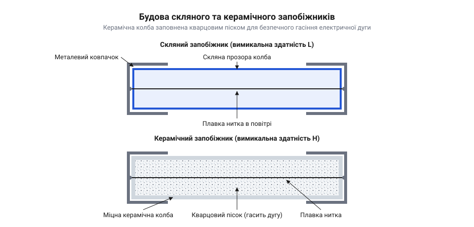
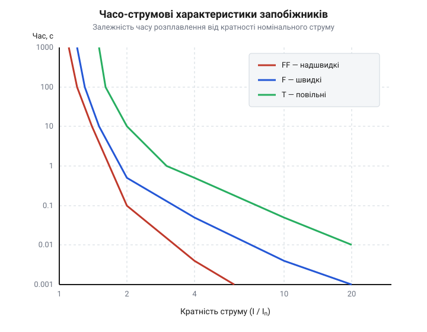
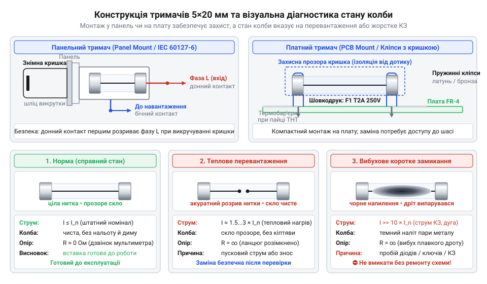

# Плавкі запобіжники 5×20 (скляні й керамічні)

<preknowlist>
- [Тримачі запобіжників 5×20](root:cat-hw-power/fuse-holders) — принципи механічної фіксації картриджних запобіжників та створення надійного електричного контакту
</preknowlist>

## Неконтрольований надструм і руйнування приладу

Пробій напівпровідника у вхідному колі живлення 230 В перетворює компонент на перемичку. Опір зникає, і струм стрибає до сотень амперів: виникає струм короткого замикання (англ. @@en|short circuit@@, від англ. *short* — короткий, та лат. *circuitus* — обхід).

Теплову енергію `Q`, яку виділяє провідник з опором `R` під час протікання струму `I` за час `t`, описує закон Джоуля — Ленца:

```
Q = I² · R · t
```

Квадратична залежність від струму перетворює опір мідних доріжок плати на кіловатний нагрівач. За мілісекунди температура перевищує точку займання текстоліту (понад 300 °C), плата спалахує.

Коло захищає калібрована ослаблена ділянка — картриджний плавкий запобіжник (англ. @@en|cartridge fuse@@, від фр. *cartouche* — патрон, та англ. *fuse* — ґніт) розміру 5×20 мм. Його тонка нитка має вищий опір, ніж доріжки, тому плавиться першою й розриває контур до початку пожежі.

## Фізика розплавлення та дугогасіння в колбі

Розрив нитки під напругою іонізує проміжок, утворюючи плазмовий канал — електричну дугу (англ. @@en|electric arc@@, від лат. *arcus* — дуга). У змінному струмі (англ. @@en|AC@@) дуга гасне при переході через нуль, а в постійному (англ. @@en|DC@@) горить безперервно, вимагаючи спеціальних @@en|DC@@-запобіжників.

Здатність колби розірвати струм без вибуху визначає вимикальна здатність (англ. @@en|breaking capacity@@, від англ. *break* — розривати, та *capacity* — здатність). Скляні колби мають індекс `L` (низька @@en|breaking capacity@@, до 35 А): при короткому замиканні в мережі тиск пари підриває скло.

Керамічні картриджі мають маркування `H` (висока @@en|breaking capacity@@, до 1500 А) і заповнені кварцовим піском. Пісок охолоджує плазму, деіонізує газ і спікається з металом у непровідний фульгурит (від лат. @@la|fulgur@@ — блискавка). Заміна кераміки на скло у вхідному колі загрожує вибухом колби.


*Скляна колба залишає нитку відкритою, а пісок у кераміці гасить дугу й тримає тиск.*

## Пускові струми та часо-струмові характеристики

Заряджання конденсаторів фільтра та намагнічування трансформатора спричиняють пусковий струм (англ. @@en|inrush current@@, від англ. *inrush* — наплив, та *current* — струм), що в 10–30 разів перевищує робочу норму й спалює звичайні швидкі запобіжники.

Стандарт @@en|IEC 60127@@ виділяє категорії швидкодії: надшвидкі `FF`, швидкі `F` та повільні `T` (англ. @@en|time-lag@@, від англ. *lag* — затримка) з часовою затримкою для реактивних кіл.

Затримку реалізує ефект Меткалфа (англ. @@en|M-effect@@, від прізвища британського інженера А. В. Меткалфа, англ. *Metcalf*): крапля олова на мідній нитці не прогрівається за короткий імпульс, але при тривалому перевантаженні плавиться при 232 °C і дифузією розчиняє мідь задовго до її точки плавлення (1085 °C).

Стійкість до імпульсів визначає плавкий інтеграл (англ. @@en|melting integral@@, від лат. *integer* — цілий) `I²t` через струм `i(t)` та тривалість сплеску `t`:

```
I²t = ∫ i(t)² dt
```

Він задає енергію в `А²·с`, потрібну для руйнування нитки. Номінал `I²t` обирають із запасом до імпульсу, враховуючи нагрів — температурний дерейтинг (англ. @@en|temperature derating@@, від англ. *rate* — номінал, та префікса *de-* — зниження).


*Повільні елементи T витримують пусковий імпульс, зберігаючи захист від тривалого перевантаження.*

## Контактний опір тримачів і візуальна діагностика

Картридж 5×20 мм одноразовий. На відміну від [самовідновлюваних полімерних компонентів](root:cat-hw-power/polyswitch-ptc), для його заміни використовують [монтажні тримачі запобіжників](root:cat-hw-power/fuse-holders): пружинні кліпси на плату або закриті панельні гнізда.

Окиснення контактів чи слабкий притиск створюють перехідний контактний опір (англ. @@en|contact resistance@@, від лат. *contactus* — дотик). Струм нагріває стик, прискорюючи окиснення металу: опір лавиноподібно зростає — виникає термічний розгін (англ. @@en|thermal runaway@@). Нагрів передається нитці, викликаючи @@en|temperature derating@@: запобіжник хибно перегорає за нормального струму.

Стан колби розкриває причину аварії:
- Крапля на розірваній нитці при чистому склі свідчить про плавне перевантаження в 1.5–2 рази від номіналу. - Дзеркальне напилення випаруваного металу на склі вказує на жорсткий @@en|short circuit@@ зі струмом у сотні амперів.

Запобіжник замінюють на новий з ідентичними параметрами. Ставити дротяні перемички («жучки») неприпустимо: випадковий дріт не має каліброваного `I²t` і не гасить дугу, що спричинить вигорання плати та пожежу.


*Контактний опір тримача викликає перегрів, а крапля або металеве напилення вказують на причину аварії.*