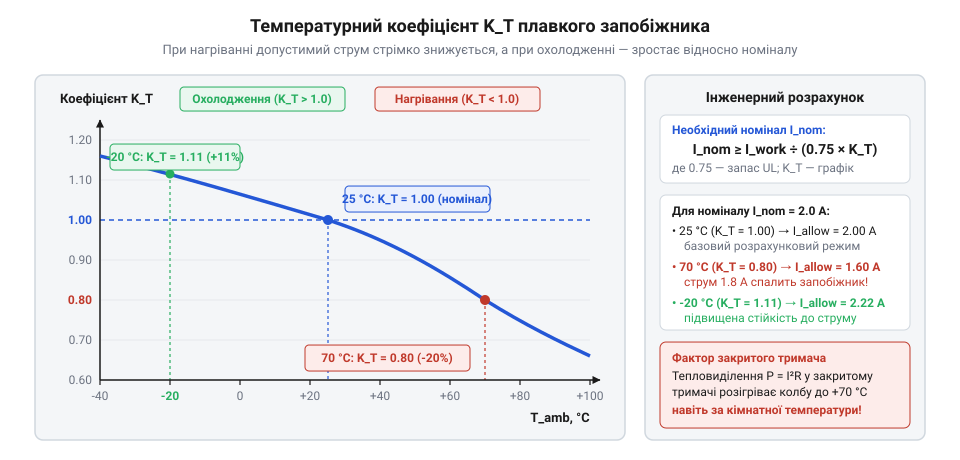

# Математичний розрахунок струмового номіналу та температурного дерейтингу

<preknowlist>
- [Тримачі запобіжників 5×20](root:cat-hw-power/fuse-holders) — Як закритий тримач обмежує відвід тепла і створює власне мікросередовище.
</preknowlist>

## Чому наївний вибір не працює

Коли пристрій споживає певний стабільний струм, найпростішим рішенням здається взяти запобіжник точно на цей самий номінал. Проте такий прямий вибір часто призводить до хибних спрацювань. Запобіжник — це тепловий прилад: він перегоряє, коли його провідник нагрівається до температури плавлення. На цей нагрів впливає не лише струм, який через нього тече, а й те, наскільки легко чи важко відводиться тепло в навколишнє середовище. У відкритому просторі баланс підтримується завдяки вільній конвекції повітря та теплопровідності металевих контактів, які відводять тепло на плату. Якщо ж пристрій працює в теплому приміщенні або запобіжник схований у [закритий тримач](root:cat-hw-power/fuse-holders), конвекція повітря майже зупиняється, і цей тепловий баланс критично порушується. Пластиковий корпус працює як ізолятор, що утримує нагріте повітря і створює власне гаряче мікросередовище, де тепло накопичується швидше. Відповідно, запобіжник може розплавитися навіть при струмі, який нижчий за його номінальний. Тому номінал запобіжника не можна прирівнювати до робочого струму ланцюга. Його потрібно розраховувати математично, спираючись на температуру середовища, умови охолодження та коефіцієнти запасу.

## Розрахунок необхідного номінального струму

Запобіжник працює за рахунок нагрівання: струм, що протікає через плавке тіло, виділяє тепло. Якщо через компонент постійно пропускати струм, що дорівнює його номіналу, вставка перебуватиме на межі плавлення. За такої високої температури метал поступово окислюється, його кристалічна структура руйнується, а електричний опір зростає. Через більший опір вставка починає виділяти ще більше тепла за того ж самого струму, нагрів прискорюється, і зрештою запобіжник перегоряє під час нормальної роботи пристрою. Цей процес називається термічною деградацією.

Щоб запобіжник працював роками і не давав хибних спрацьовувань, його номінал вибирають із запасом. Розмір запасу залежить від стандарту, за яким компонент виготовлено. Більшість запобіжників на ринку маркуються за американським стандартом @@en|UL (Underwriters Laboratories)@@, який вимагає, щоб безперервний робочий струм ланцюга не перевищував 75 % від номіналу запобіжника. Стандарт UL перевіряє запобіжники за 100 % струму на відкритому повітрі, але в реальних пристроях із закритими корпусами тепловідвід значно гірший, тому тепловий запас у 25 % стає неминучим.

Європейський стандарт @@en|IEC (International Electrotechnical Commission)@@ підходить до номіналу інакше: запобіжники IEC проектуються так, щоб роками проводити 100 % свого номіналу без деградації. Проте на практиці не завжди відомо, за яким стандартом виготовлено запобіжник, що стоїть у пристрої, тому інженери використовують правило 75 % як безпечну базу.

Знаючи максимальний стабільний струм `I_work`, який пристрій споживає у нормальному тривалому режимі, ми обчислюємо базовий необхідний номінал запобіжника `I_nom`:

        I_nom
        = I_work ÷ 0.75      [введення коефіцієнта запасу 25 % за правилом UL]

Ділення на 0.75 збільшує розрахункове значення так, щоб робочий струм складав рівно три чверті від знайденого номіналу. Цей запас дає металу достатній тепловий проміжок для стабільної роботи без руйнування. Отримане значення є лише відправною точкою, яка істинна для ідеальних кімнатних умов (25 °C). Щойно навколишня температура відхиляється, цей базовий номінал стає хибним, і подальший розрахунок вимагає температурної поправки.

## Графік температурної компенсації

Температура повітря навколо запобіжника змінює його чутливість. Якщо середовище гаряче, для плавлення дроту знадобиться менше додаткового тепла від струму; якщо холодне — більше. Щоб врахувати цей вплив, виробники надають графік температурної компенсації.

*Графік залежності температурного коефіцієнта від температури навколишнього середовища: зі зростанням температури коефіцієнт падає нижче одиниці, зменшуючи ефективний номінал.*

З графіка визначається температурний коефіцієнт `K_T`, який показує частку номіналу, доступну за певної температури. Наприклад, для 25 °C коефіцієнт дорівнює 1.0, а при 70 °C він може знизитися до 0.8. Ввівши його у вихідне правило, маємо уточнену формулу для номіналу:

        I_nom
        = I_work ÷ (0.75 × K_T)      [врахування температурного коефіцієнта]

Завдяки цьому коефіцієнту отримуємо значення номіналу, яке дійсно витримає робочий струм за конкретної температури. За таким же принципом працюють і [самовідновлювані запобіжники (PTC)](root:cat-hw-power/polyswitch-ptc), для яких температура середовища також зміщує точку переходу у високоомний стан.

## Падіння напруги та розсіювана потужність

Запобіжник має власний внутрішній опір `R`, який спричиняє падіння напруги на ньому. Коли фактичний струм у ланцюзі `I_work` протікає через цей опір, виділяється тепло. Знати розсіювану потужність `P` необхідно, щоб оцінити, наскільки компонент підігріватиме сам себе і своє оточення. Це особливо важливо, коли застосовуються закриті [тримачі запобіжників 5×20](root:cat-hw-power/fuse-holders), які блокують відвід тепла.

Потужність розраховується за законом Джоуля-Ленца:

        P
        = I_work² × R      [визначення розсіюваної теплової потужності]

Виділене тепло не зникає миттєво: якщо запобіжник ізольований від потоків повітря, температура його мікросередовища починає зростати. Це зростання знижує коефіцієнт `K_T`, що знову вимагає перегляду номіналу. Тому під час проектування потрібно перевіряти, чи зможе конструкція розсіяти виділену потужність без небезпечного перегріву.