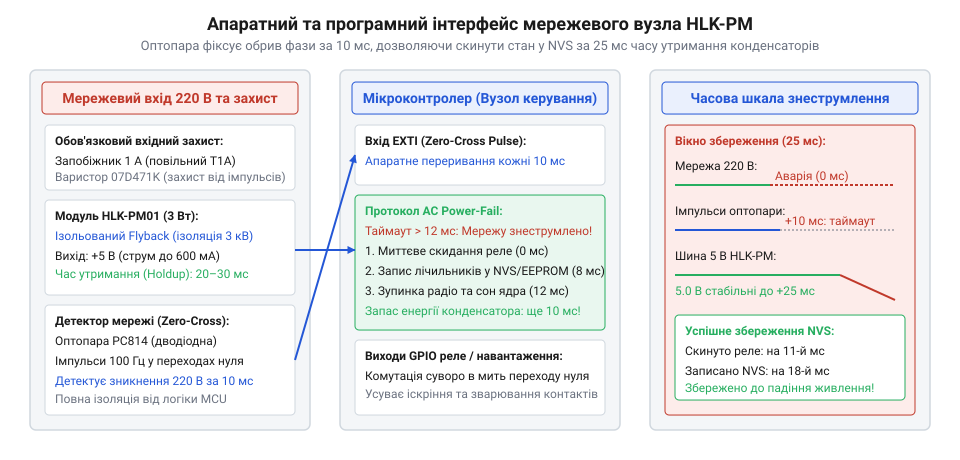

# 🔌 Програмно-апаратний інтерфейс вузла живлення 220 В: детекція нуля, аварійне збереження (Dying Gasp) та комутація реле

Модулі серії HLK-PM (HLK-PM01 на 5 В, HLK-PM03 на 3.3 В, HLK-PM12 на 12 В) — це мініатюрні імпульсні AC-DC перетворювачі з гальванічною розв'язкою 3000 В, призначені для живлення розумних реле, настінних вимикачів та мікроконтролерних контролерів безпосередньо від побутової електромережі 220 В.

Більшість початківців сприймають такий модуль як звичайну «чорну коробочку», що просто видає постійну напругу. Проте в професійному приладі надійність та ресурс системи визначаються тим, як прошивка взаємодіє з фізичним станом мережі. Це формує повноцінний **програмно-апаратний інтерфейс (API) вузла мережевого живлення**:
1. **Детекція фазового нуля (Zero-Cross) та наявності 220 В** через ізольовану двоспрямовану оптопару PC814.
2. **Протокол аварійного завершення (Dying Gasp):** використання накопиченої енергії вихідних конденсаторів модуля (вікно утримання напруги 20–30 мс) для скидання потужного навантаження та екстреного запису критичного стану в NVS/Flash перед апаратним скидом (Brown-Out Reset).
3. **Фазосинхронне керування реле:** комутація силових контактів точно в момент переходу синусоїди напруги через нуль, що усуває іскріння, запобігає зварюванню контактів та подовжує ресурс реле в 10 разів.

> 🔧 **Навіщо це.** Якщо вимкнути світло в будинку в момент, коли мікроконтролер записував конфігурацію в Flash-пам'ять, без системи завчасного виявлення знеструмлення ядро зависне на півслові, пошкодивши файлову систему або сектор пам'яті. Детектор нуля попередить про зникнення 220 В за 15 мс до падіння вихідної напруги модуля HLK-PM, надаючи процесору достатній запас часу на безпечну консервацію.

## Апаратний контракт HLK-PM: межі, ізоляція та час утримання (Holdup Time)

Модуль має пару високовольтних входів `AC` (L, N) та пару низьковольтних виходів `+Vo` та `-Vo` (GND).

```
Мережа 220 В (L, N) ──►[ Запобіжник 1 А ]──┬──►[ HLK-PM AC-DC ]──┬──► Вихід +Vo (3.3В / 5В / 12В)
                                            │      (3000 VAC)     │
                                            ▼                     ▼
                                    [ Оптопара PC814 ]    [ Буферні конденсатори ]
                                            │                     │
                                            └──────► GPIO_ZC ─────┴──► До мікроконтролера
```

### Електричні параметри та граничні умови (Contract Invariants)

| Параметр інтерфейсу | Номінальне значення | Гранично допустиме | Наслідок порушення |
| :--- | :--- | :--- | :--- |
| **Вхідна напруга AC** | 100–240 В змінного струму | 90–264 В (47–63 Гц) | При &lt; 90 В просідання виходу; при &gt; 264 В пробій ключа flyback |
| **Напруга ізоляції** | 3000 В змінного струму | 3000 VAC протягом 1 хв | Пробій між мережею та вторинною електронікою, загроза життю |
| **Струм витоку** | &lt; 0.1 мА | 0.25 мА (максимум) | Помилкове спрацьовування ПЗВ (диференційного реле) |
| **Пульсації виходу** | 50–70 мВ пік-пік | 100 мВ (максимум) | Збої АЦП та погіршення зв'язку радіотракту Wi-Fi/Zigbee |
| **Час утримання (Holdup Time)** | 20–30 мс (повний струм) | 80–120 мс (без Wi-Fi) | Вікно життя процесора після зникнення напруги в розетці |
| **Струм холостого ходу** | &lt; 0.15 Вт | 0.2 Вт | Постійний підігрів герметичної монтажної коробки |

### Фізика вікна утримання живлення (Holdup Time)

HLK-PM містить первинний електролітичний конденсатор високої напруги (зазвичай 4.7–10 мкФ на 400 В) та вторинний накопичувальний конденсатор низької напруги (470–1000 мкФ). Коли напруга 220 В зникає:
1. Заряджений до 310 В первинний конденсатор продовжує живити імпульсний перетворювач ще 10–15 мс.
2. Вторинні конденсатори утримують стабільні 3.3 В або 5 В ще 10–15 мс при номінальному струмі навантаження.
3. **Загальний запас часу становить близько 20–30 мс.**

Енергія, накопичена у вихідній ємності модуля та зовнішньому фільтрі:

    E = 0.5 · C · (U_start^2 - U_stop^2)

Якщо сумарне навантаження вузла становить 300 мА (ESP32 з увімкненим Wi-Fi + увімкнена котушка реле на 70 мА), напруга 3.3 В просяде нижче порогу скиду процесора (2.7 В) менш ніж за 15 мс. Проте якщо **в перші 2 мс після виявлення аварії вимкнути реле та зупинити радіомодуль**, струм споживання впаде до базових 15–20 мА. Завдяки цьому час утримання напруги зростає до 80–120 мс, що гарантує надійний запис десятків кілобайтів критичних даних.


*Архітектура взаємодії: детектор нуля на PC814 формує переривання 100 Гц; супервізор фіксує аварію мережі за 15 мс та запускає протокол Dying Gasp.*

## Крок 1. Виявлення зникнення 220 В (Zero-Cross монітор)

Для контролю наявності напруги паралельно входу HLK-PM підключається оптопара зі зустрічно-паралельними світлодіодами (PC814) через струмообмежувальні резистори (два послідовні резистори 100 кОм потужністю 0.5 Вт або типорозміру 1206):
- Кожні 10 мс (для частоти 50 Гц) синусоїда проходить через нульову напругу. Світлодіод оптопари на короткий час гасне, а фототранзистор формує короткий логічний імпульс на вході мікроконтролера.
- Якщо мікроконтролер не отримує імпульсу протягом 15 мс — це гарантована ознака знеструмлення мережі.

:::tabs
:::code api-mains-power-node/c/esp-idf/krok-1-ac-loss-detector.c
:::code api-mains-power-node/c/stm32/krok-1-ac-loss-detector.c
:::code api-mains-power-node/c/arduino/krok-1-ac-loss-detector.ino
:::

## Крок 2. Аварійний скид та протокол Dying Gasp (Збереження в NVS/Flash)

Отримавши сигнал про втрату 220 В, супервізор живлення миттєво виконує три послідовні операції:
1. **Знеструмлення котушки реле:** миттєво економить 60–80 мА струму.
2. **Зупинка радіотракту Wi-Fi/Bluetooth:** усуває струмові сплески до 250 мА, запобігаючи достроковому просіданню напруги.
3. **Атомарний запис у пам'ять:** запис лічильників циклів комутації, накопиченої енергії або положення штор у захищений сектор Flash чи NVS. Запис триває всього 2–4 мс, що вкладається в доступний інтервал holdup time із 5-кратним запасом.

:::tabs
:::code api-mains-power-node/c/esp-idf/krok-2-emergency-nvs-flush.c
:::code api-mains-power-node/c/stm32/krok-2-emergency-nvs-flush.c
:::code api-mains-power-node/c/arduino/krok-2-emergency-nvs-flush.ino
:::

## Крок 3. Синхронне перемикання реле в фазовому нулі (Zero-Cross Switching)

Якщо увімкнути електромеханічне реле в момент амплітудного піку синусоїди (310 В), виникає потужна електрична дуга, яка підплавляє срібні контакти. Особливо руйнівним є підключення ємнісного навантаження (імпульсних блоків живлення LED-стрічок), де струм заряджання розряджених конденсаторів у піку сягає 30–50 А.

Фазосинхронне керування вирішує цю проблему:
1. Мікроконтролер знає момент проходження нуля напруги від оптопари PC814.
2. Якір типового реле спрацьовує за 5–8 мс (механічний лаг t_lag).
3. Після чергового імпульсу нуля таймер відраховує затримку t_delay = 10 мс - t_lag і подає напругу на котушку. Контакти фізично стикаються саме в момент, коли миттєва напруга в мережі близька до 0 В!

:::tabs
:::code api-mains-power-node/c/esp-idf/krok-3-zero-cross-relay.c
:::code api-mains-power-node/c/stm32/krok-3-zero-cross-relay.c
:::code api-mains-power-node/c/arduino/krok-3-zero-cross-relay.ino
:::code api-mains-power-node/cpp/mains_supervisor.hpp
:::

## Складність і типові пастки при роботі з HLK-PM

### 1. Відсутність апаратного захисту на вході 220 В

Модуль HLK-PM всередині **не містить повноцінного запобіжника та варистора**. Якщо підключити його до мережі безпосередньо:
- Будь-який грозовий сплеск або імпульс комутації зварювального апарата призведе до пробою вхідного випрямляча.
- У разі пробою ключ перетворюється на коротке замикання, і тонкі доріжки друкованої плати спалахують, наповнюючи монтажну коробку кіптявою.

**Інженерна вимога:** Перед виводами AC модуля HLK-PM обов'язково встановлюються:
1. Плавкий запобіжник (Fuse) на 1.0 А (краще повільний, з індексом T).
2. Варистор (MOV) діаметром 10 мм на 470 В (типорозмір 10D471K), який зрізає високовольтні імпульси понад 300 В.
3. NTC-термістор на 5–10 Ом (наприклад, NTC 5D-9) для обмеження пускового струму заряду первинних конденсаторів.

Детальні інженерні схеми захисту описано в статті [Безпечне мережеве обв'язування HLK-PM](root:cat-hw-power/hlk-pm-mains).

### 2. Порушення ізоляційних зазорів (Creepage & Clearance)

Корпус модуля компактний, а відстань між його високовольтними штирями AC та низьковольтними штирями Vo становить менше 10 мм.
- Якщо провести доріжку сигнальної землі GND мікроконтролера занадто близько до доріжки Phase/Neutral, через накопичення пилу та вологи всередині стіни виникає поверхневий пробій.
- **Правило:** Під корпусом модуля між зонами високої та низької напруги на платі обов'язково робиться **фрезерований наскрізний паз завширшки 1.5–2.0 мм**, як показано в розділі [Проєктування плат: ізоляційні проміжки](root:hw-pcb/creepage-clearance).

### 3. Пошкодження Flash-пам'яті при повільному розряді (Brownout Glitch)

Якщо живлення зникає плавно, напруга на процесорі опускається з 3.3 В до 2.0 В протягом 100 мс. У зоні нижче 2.5 В цифрові вузли процесора починають генерувати хаотичні команди (інструкції NOP замінюються випадковими кодами). Якщо в цей момент активний контролер Flash-пам'яті, відбувається спотворення випадкових секторів. Протокол Dying Gasp унеможливлює таку ситуацію, примусово переводячи ядро в режим глибокого сну до настання критичного порогу.

## Що забрати з собою

1. **Модуль HLK-PM надає вікно утримання 20–30 мс.** Використовуйте цей інтервал для гарантованого збереження даних перед знеструмленням.
2. **Першим ділом знімайте силове навантаження.** Вимкнення реле та Wi-Fi подовжує час утримання напруги в 4 рази.
3. **Оптопара PC814 забезпечує подвійну користь:** детекцію аварії мережі за 15 мс та синхронізацію вмикання реле в нулі синусоїди.
4. **Запобіжник 1 А + варистор 10D471K є безальтернативними.** HLK-PM ніколи не підключається до 220 В без зовнішнього захисту.
