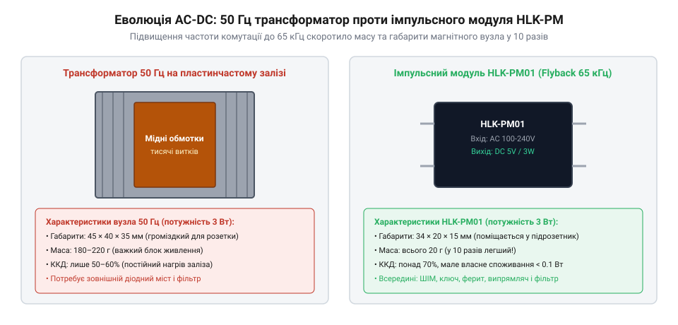

# HLK-PM01/PM03/PM12 — живлення від 220 В

<preknowlist>
- [Модуль живлення для макетної плати](root:cat-hw-power/breadboard-power-module) — розуміння рівнів напруги живлення та ролі стабілізаторів у радіоелектроніці
</preknowlist>

## Доба низькочастотного трансформаторного заліза (1950–1970-ті)

У середині XX століття будь-яка спроба отримати низьковольтну постійну напругу 5 В або 12 В від побутової розетки неминуче починалася з масивного шматка заліза. Класична схема лінійного блока живлення складалася з мережевого знижувального трансформатора на частоту 50 або 60 Гц, діодного моста, важкого згладжувального електролітичного конденсатора та лінійного стабілізатора.

Габарити й маса електромагнітного трансформатора підпорядковуються фундаментальному закону електромагнітної індукції Фарадея. Необхідна площа перерізу магнітного осердя S_c та число витків первинної обмотки N_pri обернено пропорційні робочій частоті f та максимальній робочій магнітній індукції B_max:

`
S_c · N_pri ≈ V_in / (4.44 · f · B_max)
`

Оскільки частота промислової електромережі фіксована на рівні f = 50 Гц, а трансформаторна електротехнічна сталь входить у магнітне насичення вже при індукції B_max ≈ 1.2–1.5 Тл, залізний сердечник навіть для скромного блока живлення потужністю 3–5 Вт мусив мати об'єм у десятки кубічних сантиметрів і важити від 300 до 500 грамів.

*Порівняння габаритів та конструкції: трансформатор 50 Гц на пластинчастому залізі проти імпульсного модуля на фериті.*

Ситуацію погіршував лінійний стабілізатор, який гасив усю зайву напругу в чисте тепло за тим же принципом, що й на лабораторній платі [Модуль живлення для макетної плати](root:cat-hw-power/breadboard-power-module). Підсумковий коефіцієнт корисної дії рідко перевищував 30–40%. Такий блок живлення був у рази більшим і важчим за саму мікросхему чи приймач, які він живив, а розміщення його в стінному підрозетнику було фізично неможливим.

> 🔧 **Навіщо це.**
> Розуміння обмежень класичного трансформатора показує, чому неможливо створити мініатюрний блок живлення на низькій частоті: закон Фарадея диктує або величезну залізну котушку на 50 Гц, або перехід на ультрависоку частоту комутації.

## Стрибок частоти та становлення топології flyback (1970–1980-ті)

Єдиним шляхом подолання залізного глухого кута було багаторазове підвищення робочої частоти перетворення. Якщо підвищити частоту з 50 Гц до 100 кГц (у 2000 разів), необхідна енергоємність магнітного осердя та його фізичні габарити скорочуються на порядки. Проте в 1960-х роках не існувало силових напівпровідникових ключів, здатних надійно й без величезних динамічних втрат перемикати напругу 300–400 В із такою швидкістю. Звичайні біполярні транзистори того часу мали значний час розсмоктування неосновних носіїв заряду в базі та вимагали великого струму керування.

Справжній інженерний прорив стався наприкінці 1970-х років із винаходом польових транзисторів із вертикальною структурою (технологія VMOS, а згодом кремнієві MOSFET серії HEXFET, представлені компанією International Rectifier у 1979 році під керівництвом Алекса Лідіва). Польовий транзистор керується напругою на ізольованому затворі, практично не споживає енергії в статичному стані та перемикається за лічені десятки наносекунд.

Це відкрило шлях для широкого впровадження зворотноходової топології — @@en|flyback converter@@. Спочатку цей принцип виник у схемах рядкової розгортки електронно-променевих трубок телевізорів, де зворотний хід променя використовувався для генерації кіловольтних потенціалів. Інженери імпульсної техніки перетворили цей принцип на самостійний метод передачі енергії:
1. Під час прямого ходу силовий MOSFET-ключ відкритий: струм наростає в первинній обмотці трансформатора, накопичуючи магнітну енергію в немагнітному зазорі феритового осердя, а вихідний діод запертий.
2. Під час зворотного ходу ключ закривається: полярність ЕРС на обмотках змінюється на протилежну, вихідний діод відкривається, і накопичена магнітна енергія лавиною скидається у вихідний згладжувальний конденсатор і навантаження.

> 🔧 **Навіщо це.**
> Топологія flyback стала ідеальним кандидатом для малопотужних мережевих джерел живлення, оскільки вимагає мінімальної кількості деталей: усього один магнітний компонент (поєднаний дросель-трансформатор), один високовольтний ключ і один вихідний випрямний діод.

## Монолітна кремнієва інтеграція: TOPSwitch та TinySwitch (1990-ті)

Навіть після утвердження зворотноходової топології flyback наприкінці 1980-х років імпульсні блоки живлення залишалися складними у виробництві пристроями. Типова схема вимагала від 30 до 50 дискретних радіодеталей: окрему мікросхему ШІМ-контролера (як-от популярну UC3842), зовнішній високовольтний польовий транзистор, ланцюг запуску з масивних резисторів, допоміжну обмотку саможивлення на трансформаторі, схему драйвера затвора та вимірювальний резистор струму. Така кількість компонентів займала значну площу друкованої плати, вимагала ретельного налаштування паразитної ємності монтажу й робила створення блока живлення меншим за сірникову коробку неможливим.

Справжній технологічний злам здійснила американська компанія Power Integrations (заснована в Кремнієвій долині, штат Каліфорнія, 1988 року). У 1994 році її інженери представили революційне сімейство монолітних мікросхем @@en|TOPSwitch@@, а в 1998 році — лінійку @@en|TinySwitch@@. Суть винаходу полягала в поєднанні двох несумісних раніше технологій на єдиному кремнієвому кристалі:
1. Потужного високовольтного транзистора з поперечною структурою на напругу до 700 В (технологія VDMOS).
2. Чутливої низьковольтної логіки керування (КМОН-генератор фіксованої частоти 100–132 кГц, схема пропуску циклів регулювання, тепловий захист кристала на 135–142 °C та високовольтне джерело початкового струму).

Вбудоване високовольтне джерело дозволило мікросхемі живитися безпосередньо від виводу стоку польового транзистора під час початкового пуску, що повністю ліквідувало потребу в окремій обмотці саможивлення та високовольтних пускових резисторах. Кількість зовнішніх деталей перетворювача скоротилася з 40 до менш ніж 15. Усі вузли розмістилися у стандартному 8-вивідному корпусі DIP-8 або SMD, причому один із виводів з високовольтного боку інженери навмисно видалили, щоб забезпечити безпечний діелектричний зазор на текстоліті понад 3 мм.

> 🔧 **Навіщо це.**
> Монолітна інтеграція ключа 700 В і логіки керування в один чип перетворила проектування імпульсного джерела на тривіальну задачу: інженеру більше не потрібно було розраховувати стійкість драйвера затвора до паразитних наведень.

## Залиті герметичні модулі Hi-Link (2010-ті)

На початку 2010-х років індустрія електроніки зіткнулася з вибуховим розвитком інтернету речей (IoT) та домашньої автоматизації. Поява доступних мікроконтролерів із підтримкою Wi-Fi (ESP8266, а згодом ESP32) створила попит на компактні розумні вимикачі, реле, лічильники та датчики, що монтуються безпосередньо в круглі стінні підрозетники діаметром 68 мм і глибиною лише 40–60 мм.

У цьому замкненому просторі розміщення традиційної відкритої плати імпульсного живлення поруч із реле й силовими клемами несло смертельну загрозу. Відкриті високовольтні доріжки 220 В могли замкнути на металеву коробку або каркас стіни, пил і волога спричиняли поверхневий пробій, а відсутність конвекції повітря призводила до локального перегріву трансформатора. Використання лінійних стабілізаторів на зразок [Модуль живлення для макетної плати](root:cat-hw-power/breadboard-power-module) було неприпустимим через їхній низький ККД і розсіювання величезного тепла.

У 2014 році китайська компанія Shenzhen Hi-Link (заснована у Шеньчжені в 2009 році) запропонувала принципово новий формфактор — серію залитих модулів **HLK-PM** (HLK-PM01 на 5 В, HLK-PM03 на 3.3 В та HLK-PM12 на 12 В). Інженери об'єднали на мініатюрній друкованій платі монолітну мікросхему зворотноходового перетворювача, планарний або компактний Ш-подібний феритовий трансформатор та поверхневі пасивні компоненти, помістили їх у корпус із вогнетривкого пластику габаритами лише 34.0×20.2×15.0 мм і залили внутрішній об'єм теплопровідним силікон-епоксидним компаундом.

Герметичне монолітне заливання вирішило три ключові інженерні проблеми підрозетного монтажу:
1. **Електробезпека:** модуль отримав сертифіковану електричну міцність ізоляції 3000 В змінного струму між високовольтним входом 220 В та низьковольтним виходом DC без ризику випадкового дотику людини до відкритих струмопровідних частин.
2. **Тепловідведення без конвекції:** теплопровідний компаунд ефективно збирає тепло від кристала мікросхеми й осердя трансформатора і рівномірно розподіляє його по всій зовнішній поверхні корпусу, виключаючи виникнення локальних теплових точок перегріву всередині глухої монтажної коробки.
3. **Стійкість до агресивного середовища:** повна ізоляція від будівельного пилу, конденсату та вібрацій комутації силових контактів реле.

Завдяки модулям HLK-PM підключення мережі 220 В перетворилося з небезпечного та громіздкого вузла на надійний чотириконтактний компонент друкованої плати, доступний кожному розробнику автоматики.

> 🔧 **Навіщо це.**
> Герметичні модулі HLK-PM зробили безпечним розміщення джерела живлення 220 В безпосередньо всередині стін, забезпечивши ізоляцію промислового рівня в габаритах сірникової коробки.
