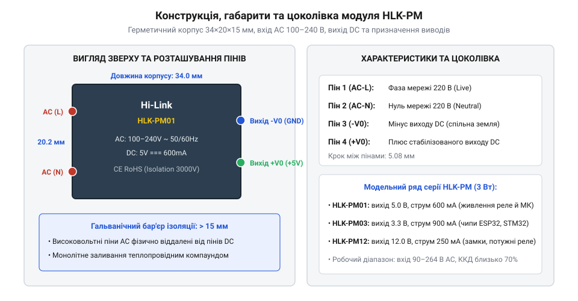
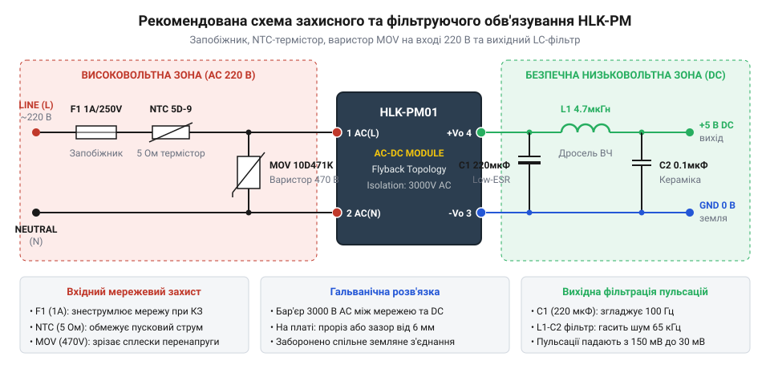
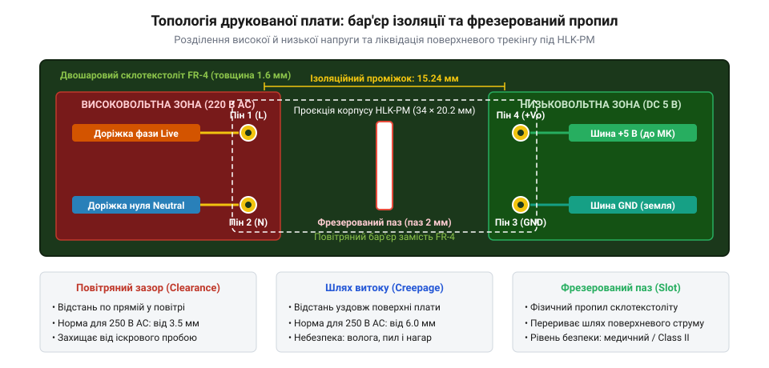

# HLK-PM01/PM03/PM12 — живлення від 220 В

<preknowlist>
- [LM2596 — регульований понижувач (і версія CC/CV)](root:cat-hw-power/lm2596-buck) — Загальні принципи імпульсного перетворення та згладжування пульсацій.
</preknowlist>

## Захід із проблеми: як заживити мікроконтролер від мережі 220 В у замкненому просторі

При проектуванні пристроїв домашньої автоматики — розумних настінних вимикачів, термостатів, релейних модулів керування освітленням чи датчиків протікання — розробник стикається з жорстким геометричним викликом. Плату керування на базі мікроконтролера ESP32, ESP8266 або STM32 потрібно помістити у стандартний круглий підрозетник діаметром 68 мм або в компактну монтажну коробку за вимикачем. У цьому тісному просторі доступна лише побутова електромережа змінного струму 220–230 В, а схема керування потребує стабільних і чистих 5 В або 3.3 В постійного струму.

Використати стандартний блочок живлення з мережевою вилкою неможливо — він занадто громіздкий. Спокуслива спроба зробити дешевий безтрансформаторний блок живлення з гасячим баластним конденсатором (@@en|capacitive dropper@@) та стабілітроном тут смертельно небезпечна: така схема не має гальванічної розв'язки. У разі пробою або дотику до кнопок користувач опиняється під фазною мережевою напругою 220 В, а низький вихідний струм (рідко більше 30–50 мА) призводить до глибокого просідання живлення під час роботи Wi-Fi передавача.

Особливо катастрофічний сценарій розгортається у разі аварійного обриву або комутації нульового провідника електромережі. У безтрансформаторній схемі із гасячим конденсатором «земляний» мінус низьковольтної частини обов'язково прив'язується до одного з мережевих проводів (зазвичай до нейтралі N). Якщо в розподільчому щитку, підрозетнику або в автоматичному вимикачі виникає поганий контакт чи обрив нульового дроту, коло розмикається. Через баластний конденсатор, випрямний діод та підтягувальні резистори схеми фазний потенціал 230 В змінного струму миттєво поширюється на весь низьковольтний мікроконтролерний контур.

У цей момент уся низьковольтна плата, включаючи шини живлення 3.3 В, земляні полігони, виводи підключених датчиків, сенсорні клавіші або металеві штоки потенціометрів, опиняється під фазною напругою з амплітудою до 325 В відносно реальної фізичної землі (підлоги чи стін приміщення). Будь-який випадковий дотик людини під час прибирання, потрапляння вологи чи спроба перепрошити модуль через незахищений роз'єм програматора гарантовано призводить до важкого ураження електричним струмом. Крім того, при відновленні контакту в мережі виникає колосальний резонансний перепад напруги, що вибухом розриває стабілітрон і випалює процесор.

> 🔧 **Навіщо це.**
> Серія мініатюрних мережевих модулів HLK-PM розв'язує задачу живлення компактної автоматики без компромісів у безпеці. Це повноцінний ізольований імпульсний AC-DC блок живлення промислового класу, упакований у пластиковий кубик розміром трохи більше сірникової коробки.

Історія мініатюризації мережевих джерел живлення та еволюція високовольтних flyback-контролерів описана у вставці [Історія мініатюризації імпульсних AC-DC джерел](root:cat-hw-power/hlk-pm-mains/hist-ac-dc-miniaturization-flyback.md).

## Конструкція та електричні параметри модулів серії HLK-PM

Модулі серії **HLK-PM** виробництва китайської компанії Hi-Link стали фактичним стандартом живлення для розробників розумного дому та DIY-пристроїв [Понижувач LM2596](root:cat-hw-power/lm2596-buck). Зовні модуль являє собою монолітний пластиковий паралелепіпед чорного кольору з габаритами всього 34.0×20.2×15.0 мм і масою близько 20 грамів. Корпус виготовлено з самозатухаючого вогнестійкого пластику (стандарт UL94V-0) і повністю залито всередині спеціальним епоксидним компаундом. Це забезпечує герметичність, захист від пилу, вологи, механічних вібрацій та ефективне рівномірне відведення тепла від внутрішніх силових елементів на поверхню корпусу.

Плата має 4 жорстких виводи для наскрізного монтажу (THT) у друковану плату: два високовольтні входи з одного торця і два низьковольтні виходи з протилежного торця.

*Герметичний корпус модуля HLK-PM: розміщення високовольтних входів AC та низьковольтних виходів DC з широким бар'єром ізоляції.*

Модельний ряд серії поділяється за вихідною стабілізованою напругою при номінальній потужності 3 Вт:
- **HLK-PM01:** вихід 5 В постійного струму, номінальний тривалий струм 600 мА (піковий до 1000 мА). Найпопулярніший модуль для живлення класичних плат розробника та релейних модулів 5 В.
- **HLK-PM03:** вихід 3.3 В постійного струму, номінальний струм 900 мА (піковий до 1200 мА). Ідеальний вибір для безпосереднього живлення мікроконтролерів ESP8266, ESP32 та бездротових сенсорів без додаткових проміжних LDO.
- **HLK-PM12:** вихід 12 В постійного струму, номінальний струм 250 мА. Застосовується для живлення 12-вольтових реле, електромагнітних замків та світлодіодного підсвічування.

Ключові технічні характеристики модулів серії HLK-PM:
1. **Діапазон вхідної напруги:** ультраширокий вхід 90–264 В змінного струму (AC) з частотою 50/60 Гц або 100–370 В постійного струму (DC).
2. **Електрична міцність ізоляції:** пробивна напруга між входом та виходом становить не менше 3000 В змінного струму (ізоляція входу від виходу для гарантії захисту користувача).
3. **Коефіцієнт корисної дії (ККД):** досягає 70–75% при повному навантаженні.
4. **Споживання на холостому ході:** менше 0.1 Вт, що відповідає суворим вимогам енергоефективності в режимі очікування (@@en|standby mode@@).

Математичний розрахунок накопичення енергії в індуктивності первинного контуру та тривалості імпульсів наведено у вставці [Розрахунок параметрів flyback-перетворювача](root:cat-hw-power/hlk-pm-mains/math-flyback-converter-parameters.md).

## Внутрішня схемотехніка: мініатюрний ізольований flyback-перетворювач

Під пластиковим кожухом модулів серії HLK-PM змонтовано повноцінний високочастотний мережевий імпульсний перетворювач, виконаний за класичною однотактною зворотноходовою топологією (від англ. @@en|flyback converter@@).

На вході модуля змінна мережева напруга 220 В надходить на інтегрований діодний міст і згладжувальний електролітичний конденсатор. Після випрямлення на шині формується постійна напруга величиною:

    U_dc = U_rms × √2
         = 230 × 1.414
         ≈ 325 В

Ця висока напруга комутується інтегральним ШІМ-контролером із вбудованим силовим польовим транзистором (MOSFET), розрахованим на робочу напругу стік-витік до 650–700 В.

Найбільш вразливим елементом первинного силового кола є сам польовий транзистор у момент його миттєвого закривання. Окрім корисної індуктивності намагнічування сердечника, будь-який реальний імпульсний трансформатор неминуче має паразитну індуктивність розсіювання (від англ. @@en|leakage inductance@@, L_leak). Магнітний потік розсіювання не зчеплений із вторинною обмоткою, тому накопичена в ньому енергія не може бути передана на вихідний конденсатор після замикання вторинного діода.

Відповідно до закону Фарадея, швидкий обрив струму ключа викликає надзвичайно крутий викид ЕРС самоіндукції:

    V_spike = L_leak × (di ÷ dt)

Цей імпульсний сплеск додається до випрямленої напруги шини 325 В і легко сягає 750–900 В, що перевищує напругу лавинного пробою стоку польового транзистора і призвело б до його миттєвого руйнування в першому ж циклі комутації.

Для поглинання паразитного викиду паралельно до первинної обмотки всередині модуля HLK-PM впаяно демпфувальний захисний клампер (від англ. @@en|snubber@@ або @@en|RCD clamp@@). Він складається зі надшвидкого високовольтного діода (FR107 або US1M), плівкового чи керамічного конденсатора на кілька сотень пікофарад і паралельного розрядного резистора (або комбінації з високовольтним супресором TVS). У момент закриття транзистора діод клампера відкривається, і небезпечна енергія індуктивності розсіювання плавно заряджає конденсатор демпфера, обмежуючи пікову напругу на стоці ключа на безпечному рівні близько 550 В. Запасені джоулі потім спокійно розсіюються резистором у тепло до початку наступного такту.

Ключовим вузлом перетворювача є мініатюрний імпульсний трансформатор на феритовому осерді. Трансформатор працює у два такти:
1. Під час відкритого стану силового ключа струм первинної обмотки наростає, і енергія накопичується в магнітному зазорі сердечника (при цьому вторинний діод замкнений зворотною напругою).
2. Коли ключ закривається, ЕРС самоіндукції змінює знак, вторинний діод відкривається, і накопичена магнітна енергія скидається у вторинний вихідний конденсатор.

Обмотки трансформатора рознесені на каркасі та розділені багатошаровою ізоляційною стрічкою або проводом із потрійною ізоляцією (від англ. @@en|triple insulated wire@@, TIW). Завдяки цьому досягається електрична міцність діелектричного бар'єра до 3000 В змінного струму (AC), що унеможливлює потрапляння фази мережі на низьковольтний вихід контролера.

Для точної стабілізації вихідної напруги використовується оптичний зворотний зв'язок: на вторинній стороні встановлено прецизійний паралельний стабілізатор (аналог TL431), який керує струмом через світлодіод мініатюрного оптрона. Фототранзистор оптрона передає керуючий сигнал на первинний ШІМ-чип, коригуючи ширину імпульсів комутації без порушення гальванічної ізоляції. Завдяки такій петлі зворотного зв'язку стабільність напруги утримується в межах ±2% при коливаннях навантаження від нуля до максимуму. Формули накопичення енергії та розрахунок шпаруватості імпульсів наведено у вставці [Параметри та розрахунок зворотноходового перетворювача](root:cat-hw-power/hlk-pm-mains/math-flyback-converter-parameters.md).

> 🔧 **Навіщо це.** На відміну від неізольованих бестрансформаторних конденсаторних схем, модуль із трансформаторним flyback-перетворювачем та оптроном гарантує, що торкання до датчика, кнопок чи корпусу пристрою на виході 5 В є цілком безпечним для людини.

## Обов'язкове зовнішнє захисне обв'язування та фільтрація

Виробник постачає модуль HLK-PM як готовий «чорний ящик», проте вмикати його у звичайну розетку безпосередньо суворо заборонено. Сам по собі модуль є джерелом живлення, але не містить повноцінних вузлів захисту від важких мережевих аномалій та пускових перевантажень.

Головних небезпек дві. По-перше, у момент подачі живлення розряджений вхідний конденсатор модуля створює колосальний пусковий струм (від англ. @@en|inrush current@@), здатний випалити вхідний випрямляч чи контакти реле. По-друге, у побутовій електромережі постійно виникають високовольтні імпульсні викиди амплітудою від 500 до 2000 В (внаслідок комутації холодильників, зварювальних апаратів чи грозових розрядів).

Для безпечної та довговічної експлуатації перед модулем формують захисний мережевий каскад.

*Схема зовнішнього обв'язування модуля HLK-PM: інерційний запобіжник F1 на 1 А, варистор RV1 (10D471K), NTC-терморезистор обмеження пускового струму та вихідний фільтр.*

Схема захисту та фільтрації містить такі критичні компоненти:
1. **Плавкий запобіжник (F1):** обов'язковий інерційний запобіжник зі сповільненим спрацьовуванням (тип «slow-blow», маркування T1A / 250V або T2A / 250V). Звичайний швидкий скляний запобіжник миттєво перегоратиме від штатного пускового струму заряду конденсатора, тоді як інерційний витримує короткочасний сплеск, але надійно розриває коло у разі пробою ключів.
2. **Варистор (RV1):** оксидно-цинковий захисний варистор (від англ. @@en|metal oxide varistor@@, MOV) типорозміру 10D471K або 14D471K. Його класифікаційна напруга становить 470 В. У нормальному режимі його опір вимірюється гігаомами, але при появі мережевого викиду понад 380 В варистор за частки наносекунд відкривається, замикає надлишкову енергію на себе і викликає перегорання запобіжника F1, рятуючи модуль від вибуху.
3. **Обмежувач пускового струму (NTC1):** терморезистор з негативним температурним коефіцієнтом (наприклад, 5D-9 або 10D-7). У холодному стані його опір 5–10 Ом обмежує амплітуду пускового струму, а під час роботи він розігрівається робочим струмом до спаду опору до часток ома.
4. **Вихідні фільтри (Cout, L1):** паралельно до вихідних контактів ставлять електролітичний конденсатор ємністю 100–220 мкФ із низьким ESR, зашунтований керамічним SMD-конденсатором 0.1 мкФ. Для живлення бездротових модулів (ESP32, Wi-Fi) бажано додати дросель на 2.2–4.7 мкГн, що усуває високочастотні просідання при ввімкненні передавача.

Під час розведення плати критично дотримуватися правил проектування трас, про що детально йдеться в статті [Ізоляційні проміжки на платах (Creepage & Clearance)](root:hw-pcb/creepage-clearance).

> 🔧 **Навіщо це.** Варистор 10D471K вартістю кілька гривень захищає вбудований у стіну модуль розумного будинку: якщо сусід по фазі увімкне циркулярну пилку і створить сплеск напруги 1000 В, варистор зріже імпульс, врятувавши модуль від пожежі.

## Правила проектування друкованої плати та електробезпека

Монтаж компактного мережевого модуля HLK-PM на друковану плату вимагає суворого дотримання стандартів високовольтної електробезпеки (зокрема IPC-2221 та IEC 60950/62368).

Головна небезпека на платі — електричний пробій між високовольтним первинним боком (фаза `AC(L)` і нуль `AC(N)`) та низьковольтним виходом (`+Vo`, `-Vo`), до якого торкаються користувачі через кнопки чи датчики. Для запобігання пробою інженер розраховує два геометричні параметри:
1. **Повітряний зазор (від англ. @@en|clearance@@):** найкоротша відстань між двома провідниками через повітря по прямій лінії. Для мережі 220 В із запасом на перенапруги він має бути не менше 3.5–4.0 мм.
2. **Шлях витоку по поверхні (від англ. @@en|creepage distance@@):** найкоротша відстань між провідниками вздовж твердої поверхні склотекстоліту. За стандартом для робочої напруги до 250 В діелектричний шлях витоку повинен становити не менше 5.0–6.0 мм.

У реальних умовах герметичного підрозетника на плату осідають пил, волога або залишки некоррозійного флюсу. З часом під дією високої змінної напруги мікрочастинки пилу іонізуються, утворюючи струмопровідні вуглецеві доріжки (трекінг), що призводить до поверхневого дугового пробою.

*Правильне зонування друкованої плати: ліворуч високовольтна зона мережі AC, праворуч низьковольтний вихід DC, а під модулем HLK-PM виконано наскрізний фрезерований пропил завширшки 1.5–2 мм.*

Найефективніший спосіб гарантувати безпеку — виконати на платі наскрізний фрезерований ізоляційний пропил (від англ. @@en|air isolation slot@@) завширшки 1.5–2.0 мм безпосередньо під корпусом модуля HLK-PM у зоні між його високовольтними та низьковольтними виводами. Пропил фізично усуває поверхню діелектрика, змушуючи шлях витоку йти через повітряний зазор, що унеможливлює утворення струмопровідного нагару. Детальні інженерні норми наведено в статті [Ізоляційні проміжки на платах (Creepage & Clearance)](root:hw-pcb/creepage-clearance).

Окремої уваги вимагають конструкції, де пристрій розумного будинку або автоматики розміщується в металевому корпусі, має зовнішні металеві кнопки чи сенсорні рамки. У таких виробах відповідно до норм електробезпеки першого класу захисту (Class I) обов'язково застосовується третій захисний провідник заземлення PE (від англ. @@en|Protective Earth@@, жовто-зелений дріт).

Трасування лінії PE на друкованій платі підпорядковується суворим інженерним правилам:
1. **Заборона змішування із сигнальною землею:** захисна лінія PE ніколи не повинна прямо з'єднуватися з вторинною землею мікроконтролера `-Vo` (GND) безпосередньо на платі. Мікроконтролерний контур є плаваючим і захищеним гальванічним бар'єром модуля HLK-PM. Якщо об'єднати PE з `-Vo`, будь-який імпульсний перекіс напруги або струм витоку стороннього сусіднього приладу в будинковій мережі заземлення потече крізь сигнальні ланцюги датчиків.
2. **Ширина струмопровідної шини PE:** провідник PE розводять максимально широким полігоном або масивною доріжкою завширшки не менше 2.5–3.0 мм (із товщиною міді 35 мкм), здатною без перегорання витримати струм короткого замикання до 16–25 А до моменту спрацьовування вхідного автомата в щитку.
3. **Підключення до шасі:** лінію PE підводять до окремого кріпильного отвору з зубчастою шайбою або болтового з'єднання, надійно притиснутого до металевої кришки чи корпусу. Усі металеві елементи, до яких може доторкнутися людина, повинні мати перехідний опір до лінії PE не більше 0.1 Ом.
4. **Використання Y-конденсатора для ЕМС:** для ефективного зливу високочастотних синфазних завад імпульсного перетворювача між «плаваючою» землею `-Vo` та шиною захисного заземлення PE допустимо встановити спеціалізований безпечний керамічний конденсатор класу Y1 або Y2 ємністю 1–2.2 нФ із робочою напругою ізоляції не менше 250 В змінного струму.

Практичний приклад проєктування надійної плати для підрозетника з модулем HLK-PM01 та реле дивіться у проєкті [Вузол безпечного реле для підрозетника](root:cat-hw-power/hlk-pm-mains/proj-safe-mains-relay-node.md). Детекцію зникнення мережі, протокол аварійного завершення Dying Gasp та фазосинхронну комутацію реле детально розглянуто в [API вузла живлення 220 В](root:cat-hw-power/hlk-pm-mains/api-mains-power-node.md).

> 🔧 **Навіщо це.** Фрезерований паз на платі коштує нуль гривень при замовленні у виробника, проте він гарантує, що волога в сирій стіні не викличе пробою 220 В на корпус вимикача чи доторкуваний екран приладу.

## Електромагнітні завади, температурний режим і ресурс

Працюючи всередині герметичної монтажної коробки підрозетника або в корпусі датчика, модуль HLK-PM функціонує у важких кліматичних та теплових умовах.

Перший виклик — високочастотний комутаційний шум. Внутрішній ШІМ-перетворювач створює на виході пульсації амплітудою близько 50–100 мВ. Для більшості мікроконтролерів із власною розв'язкою це безпечно. Проте якщо модуль живить бездротовий чип ESP32 під час приймання слабких радіосигналів або аналоговий термодатчик DS18B20, такий рівень пульсацій викликає помилки вимірювання чи падіння чутливості антени. У таких випадках після модуля HLK-PM встановлюють додатковий фільтр або низькошумний LDO, подібно до того, як це робиться в лабораторному модулі [Модуль живлення для макетної плати](root:cat-hw-power/breadboard-power-module).

Другий критичний фактор — тепловий баланс у замкненому просторі:
1. При вихідній потужності 3 Вт і типовому ККД близько 70% модуль розсіює у вигляді тепла приблизно 0.9–1.0 Вт.
2. У глухій монтажній коробці за розеткою природна конвекція повітря відсутня. При кімнатній температурі 22 °C температура поверхні модуля за кілька годин безперервної роботи під повним навантаженням сягає 55–65 °C.
3. Якщо поруч проходять труби опалення або навантаження розташоване на сонячному боці будівлі, температура всередині коробки може піднятися до 70–80 °C.

Тепловий режим прямо впливає на термін служби виробу. Усередині модуля встановлено мініатюрні електролітичні конденсатори. Згідно з емпіричним правилом Арреніуса, кожні 10 °C підвищення робочої температури скорочують ресурс висихання електроліту вдвічі. Працюючи при температурі корпусу 70 °C безперервно 24/7, електролітичний конденсатор може втратити ємність уже через 2–3 роки, що викличе наростання пульсацій і відмову контролера.

Для забезпечення довговічності розумного дому (термін служби від 7–10 років) рекомендується закладати **інженерний запас за потужністю не менше 40–50%**. Якщо схема споживає 250 мА, слід обирати модуль на 600 мА (HLK-PM01), завдяки чому він працюватиме в теплому, а не гарячому режимі.

Про те, як технологічний прогрес дозволив зменшити мережеві блоки живлення до габаритів запальнички, читайте у вставці [Історія мініатюризації AC-DC джерел](root:cat-hw-power/hlk-pm-mains/hist-ac-dc-miniaturization-flyback.md).

> 🔧 **Навіщо це.** Не завантажуйте модуль HLK-PM більше ніж наполовину його номінального струму в замурованих у бетон коробках — це врятує конденсатори від висихання та усуне потребу видовбувати стіну для заміни живлення через пару років.
