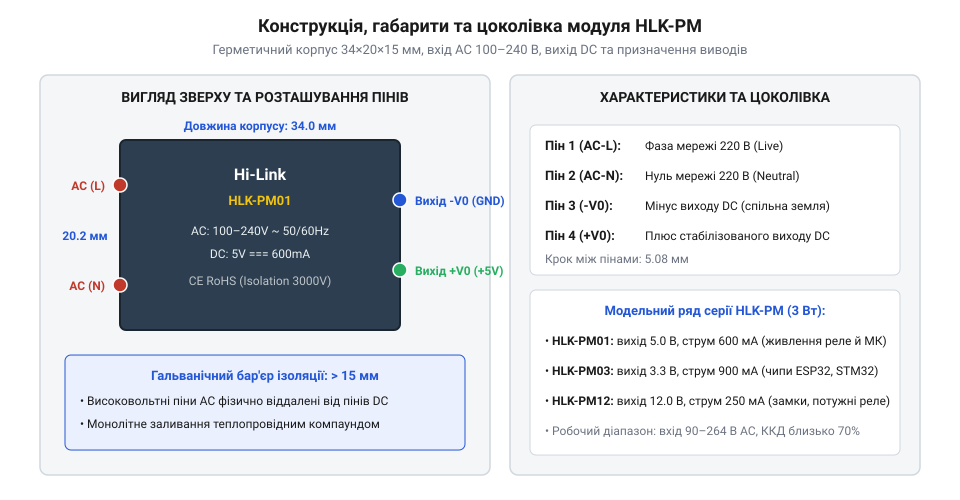
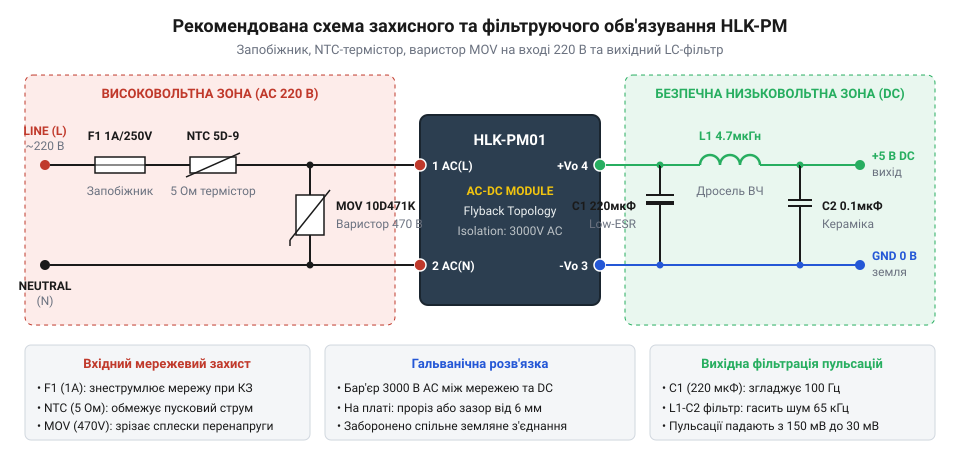
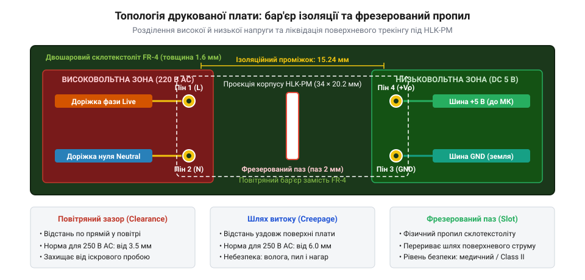

# HLK-PM01/PM03/PM12 — живлення від 220 В

<preknowlist>
- [Модуль живлення для макетної плати](root:cat-hw-power/breadboard-power-module) — розуміння рівнів напруги постійного струму та ролі стабілізаторів живлення
</preknowlist>

## Захід із проблеми: небезпека 220 В у тісному підрозетнику

При створенні пристроїв домашньої автоматики — настінних розумних вимикачів, релейних модулів керування освітленням, термостатів чи датчиків протікання — розробник стикається з жорстким обмеженням простору. Електронну плату на базі мікроконтролера ESP32, ESP8266 або STM32 необхідно помістити у стандартний круглий стінний підрозетник діаметром 68 мм і глибиною лише 40–60 мм безпосередньо за механічним клавішним вимикачем. У цьому замкненому просторі доступна виключно побутова електромережа змінного струму 220–230 В, тоді як цифрова схема вимагає безпечних і стабільних 5 В або 3.3 В постійного струму.

Використати стандартний блочок живлення з вилкою неможливо через його габарити. Спроба зібрати дешевий безтрансформаторний блок живлення з гасячим баластним конденсатором (@@en|capacitive dropper@@) та стабілітроном є смертельно небезпечною. Така схема не має гальванічної розв'язки, і її нульова шина прямо пов'язана з мережевим проводом. Якщо в розподільчому щитку або вимикачі виникає поганий контакт нейтралі, фазний потенціал 230 В змінного струму з амплітудою до 325 В миттєво поширюється на весь низьковольтний контур. Будь-який дотик людини до сенсорної панелі чи контактів датчика призводить до важкого ураження електричним струмом. Крім того, баластний конденсатор видає не більше 30–50 мА струму, що викликає циклічне перезавантаження Wi-Fi чипа в момент виходу передавача в ефір зі сплеском споживання до 300–400 мА.

Єдиним безпечним інженерним розв'язком є використання повноцінного імпульсного джерела живлення з високовольтною гальванічною розв'язкою промислового класу.

> 🔧 **Навіщо це.**
> Серія мініатюрних мережевих модулів HLK-PM розв'язує задачу живлення вбудованої автоматики без компромісів у безпеці: повноцінний ізольований перетворювач на 3000 В уміщено в пластиковий кубик розміром із сірникову коробку.

## Конструкція, параметри та модельний ряд HLK-PM

Модулі серії **HLK-PM** виробництва компанії Hi-Link стали світовим стандартом автономного живлення для розумного дому. Модуль виконано у вигляді монолітного прямокутного пластикового блока розмірами лише 34.0×20.2×15.0 мм і масою близько 20 грамів. Корпус виготовлено з вогнетривкого самозатухаючого пластику (стандарт UL94V-0) і повністю герметично залито зсередини теплопровідним епоксидно-силіконовим компаундом. Заливання захищає внутрішні деталі від будівельного пилу, вологи в сирих стінах, вібрацій та забезпечує рівномірне відведення тепла без потреби у вентиляційних отворах чи радіаторах.

Для монтажу в друковану плату модуль має чотири жорстких виводи під наскрізне паяння (THT):
- **Пін 1 (AC-L):** вхід фази побутової електромережі 220 В (Live).
- **Пін 2 (AC-N):** вхід нейтралі електромережі 220 В (Neutral).
- **Пін 3 (-Vo):** мінусовий контакт виходу постійного струму (загальна земля GND низьковольтної частини).
- **Пін 4 (+Vo):** плюсовий контакт стабілізованої вихідної напруги постійного струму.

Високовольтні піни 1 і 2 розташовані на одному торці модуля, а низьковольтні 3 і 4 — на протилежному, що гарантує велику конструктивну відстань ізоляції понад 15 мм.

*Герметичний корпус модуля HLK-PM: розміщення високовольтних входів AC та низьковольтних виходів DC з широким бар'єром ізоляції.*

Модельний ряд серії поділяється за фіксованою вихідною напругою при номінальній потужності 3 Вт:
- **HLK-PM01:** вихід 5.0 В, номінальний струм 600 мА (піковий до 1000 мА). Основний модуль для живлення мікроконтролерів Arduino, релейних модулів та більшості цифрових датчиків.
- **HLK-PM03:** вихід 3.3 В, номінальний струм 900 мА (піковий до 1200 мА). Призначений для прямого живлення бездротових модулів ESP32, ESP8266 та STM32 без необхідності встановлювати додатковий проміжний регулятор напруги, як на [Модуль живлення для макетної плати](root:cat-hw-power/breadboard-power-module).
- **HLK-PM12:** вихід 12.0 В, номінальний струм 250 мА. Застосовується для живлення 12-вольтових електромагнітних реле, приводів клапанів та світлодіодної індикації.

Основні технічні параметри серії HLK-PM:
1. **Ультраширокий вхід:** від 90 В до 264 В змінного струму (AC) частотою 50/60 Гц або від 100 В до 370 В постійного струму (DC), що забезпечує стабільну роботу навіть при критичних просіданнях мережі.
2. **Гальванічна міцність ізоляції:** пробивна напруга діелектричного бар'єра між входом і виходом становить не менше 3000 В змінного струму.
3. **Енергоефективність:** ККД при повному навантаженні досягає 70–75%, а споживання в режимі очікування без навантаження становить менше 0.1 Вт.

> 🔧 **Навіщо це.**
> Чітке просторове рознесення високовольтних і низьковольтних виводів унеможливлює випадкову помилку трасування та забезпечує захист людини від контакту з мережею 220 В.

## Рекомендована схема зовнішнього захисту

Хоча модуль серії HLK-PM містить базові внутрішні кола стабілізації, пряме вмикання його контактів у розетку без зовнішніх захисних компонентів становить серйозну загрозу пожежної безпеки. У побутовій мережі 220 В регулярно виникають імпульсні перенапруги амплітудою в кілька кіловольт — від комутації потужних індуктивних навантажень (холодильників, насосів, зварювальних апаратів) або віддалених грозових розрядів. Без зовнішнього захисту такий високовольтний сплеск миттєво пробиває вхідний діодний міст модуля, викликаючи внутрішнє коротке замикання.

Для надійної та безпечної експлуатації перед входом модуля встановлюють три обов'язкові компоненти:
1. **Інерційний плавкий запобіжник (англ. @@en|slow-blow fuse@@):** Номінал 1 А / 250 В (типу T1A). Звичайний швидкий запобіжник перегорає під час першого ж увімкнення через зарядний струм внутрішнього конденсатора, тоді як інерційний витримує короткочасний стартовий сплеск і надійно розмикає коло лише в разі аварійного пробою.
2. **Варистор (англ. @@en|metal oxide varistor@@, MOV):** Встановлюється паралельно лініям живлення після запобіжника. Типовий номінал — 10D471K (класифікаційна напруга 470 В). У нормальному стані опір варистора становить сотні мегаомів. Коли імпульс у мережі перевищує допустимий поріг, опір варистора за частки наносекунд падає до часток ома, закорочуючи сплеск на себе та змушуючи запобіжник безпечно перегоріти.
3. **Термістор обмеження пускового струму (англ. @@en|negative temperature coefficient@@, NTC):** Наприклад, NTC 5D-9 або 10D-9, увімкнений послідовно у фазний провід. У холодному стані він має опір 5–10 Ом, обмежуючи стартовий струм (англ. @@en|inrush current@@) під час заряджання високовольтного вхідного конденсатора модуля.

*Принципова схема зовнішнього обв'язування HLK-PM: захисний каскад на вході 220 В та додатковий вихідний LC-фільтр для зменшення високочастотних пульсацій.*

> 🔧 **Навіщо це.**
> Плавкий запобіжник і варистор є обов'язковою парою пожежної безпеки. Якщо встановити варистор без запобіжника, під час потужного сплеску напруги варистор розігріється до температури займання або розлетиться на уламки, не знеструмивши пристрій.

## Правила монтажу на платі та температурний режим

Під час трасування друкованої плати для модуля HLK-PM головним завданням є збереження гальванічної ізоляції 3000 В між високовольтною мережею та чутливими низьковольтними колами мікроконтролера чи сенсорів, на відміну від низьковольтних макетних плат, де використовують звичайний [Модуль живлення для макетної плати](root:cat-hw-power/breadboard-power-module). Пробій між доріжками може статися не лише через повітря, а й по поверхні склотекстоліту внаслідок осідання пилу чи конденсації вологи.

Стандарти електробезпеки визначають дві критичні відстані:
- **Повітряний зазор (англ. @@en|clearance@@):** Найкоротша відстань між провідниками по прямій лінії в повітрі. Для напруги 220–250 В змінного струму цей проміжок повинен становити щонайменше 3.5–4.0 мм.
- **Шлях витоку (англ. @@en|creepage@@):** Відстань між провідниками, виміряна вздовж поверхні діелектрика. Через забруднення поверхні шлях струму витоку має бути не менше 6.0 мм.

Найкращою практикою проектування є створення фізичного фрезерованого паза (англ. @@en|milling slot@@) завширшки 1.5–2 мм у текстоліті безпосередньо під корпусом модуля між його високовольтними та низьковольтними виводами. Проріз у платі перериває суцільну поверхню діелектрика, повністю усуваючи ризик виникнення вуглецевого струмопровідного містка.

*Розміщення модуля HLK-PM на друкованій платі: повне просторове розділення високовольтної та низьковольтної мідних зон і захисний фрезерований пропил під корпусом.*

Не менш важливим є врахування теплового режиму. У замкненому просторі стандартного підрозетника (діаметром 65 мм) природна конвекція повітря практично відсутня. Якщо модуль HLK-PM01 номінальною потужністю 3 Вт навантажити на максимальний струм 600 мА, температура всередині герметичного пластикового корпусу швидко досягає 70–80 °C, що скорочує термін служби внутрішніх компонентів. Для цілодобової безперебійної роботи в підрозетниках тривале навантаження не повинно перевищувати 50–60 % від номіналу (до 300–350 мА для версії 5 В).

> 🔧 **Навіщо це.**
> Фрезерований пропил у друкованій платі під модулем HLK-PM гарантує збереження захисної ізоляції навіть при тривалій роботі у вологих приміщеннях — підвалах, ванних кімнатах чи неопалюваних розподільних щитах.
