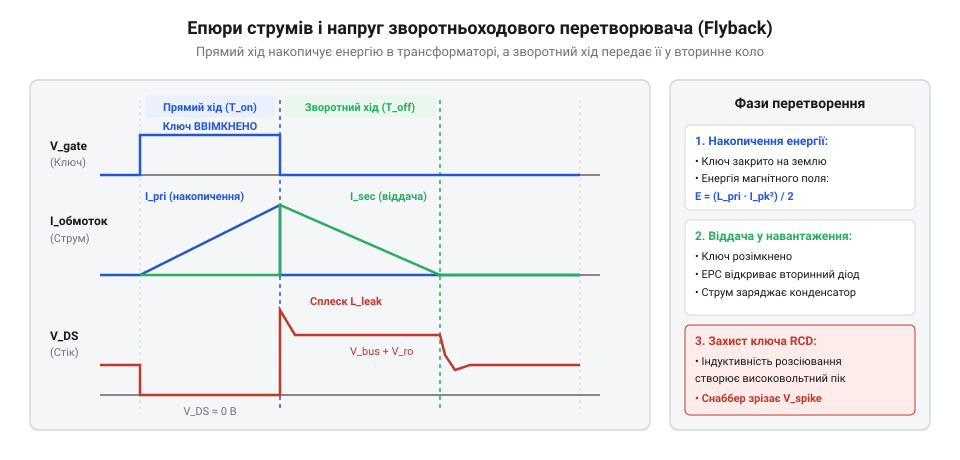
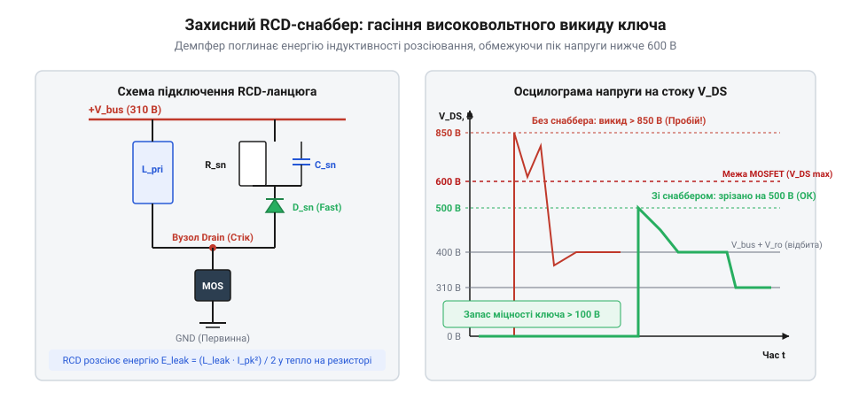

# HLK-PM01/PM03/PM12 — живлення від 220 В

<preknowlist>
- [Модуль живлення для макетної плати](root:cat-hw-power/breadboard-power-module) — базові формули електричної потужності та стабілізації напруги
</preknowlist>

## Фізика накопичення енергії та немагнітний зазор

Мережевий імпульсний перетворювач серії HLK-PM починається з випрямлення побутової змінної напруги. Вхідна мережева напруга V_ac має середньоквадратичне значення 220–230 В (за стандартом допустимі коливання становлять від 90 В до 264 В). Після проходження діодного моста та згладжувального електролітичного конденсатора на внутрішній високовольтній шині формується постійна напруга V_bus:

    V_bus = V_ac · √2

Для номінальної напруги української електромережі 230 В значення на шині становить:

    V_bus_nom = 230 · 1.414
              ≈ 325 В

При аварійному або верхньому граничному значенні мережі 264 В напруга на шині сягає:

    V_bus_max = 264 · 1.414
              ≈ 373 В

Отримана постійна напруга понад 300 В комутується силовим ключем на первинну обмотку. Проте електромагнітний вузол топології flyback докорінно відрізняється від класичного трансформатора. У звичайному трансформаторі енергія передається у вторинну обмотку безпосередньо в момент її протікання в первинній: струми в обмотках протікають одночасно, а їхні магнітні поля взаємно компенсуються, завдяки чому осердя майже не накопичує енергії.

У зворотноходовому перетворювачі обмотки працюють розділено в часі:
1. Під час прямого ходу (інтервал T_on) силовий польовий транзистор відкритий. Струм наростає виключно в первинній обмотці. Вторинний випрямний діод увімкнений зустрічно і запертий зворотною напругою, тому струм у вторинному колі дорівнює нулю. Вся електрична енергія трансформується в магнітне поле.
2. Під час зворотного ходу (інтервал T_off) транзистор закривається. ЕРС самоіндукції змінює полярність на всіх обмотках, вторинний діод відкривається, і накопичена магнітна енергія лавиною скидається у вихідний конденсатор і навантаження.

*Епюри струмів і напруг: на прямому ході струм лінійно зростає в первинній обмотці, на зворотному — передається у вторинне коло.*

Трансформатор flyback фактично є зв'язаним дроселем. Але високопроникний ферит (марганець-цинковий або нікель-цинковий із відносною проникністю μ_r ≈ 2000–3000) має вкрай низьку коерцитивну силу і насичується вже при індукції B_sat ≈ 0.35–0.4 Тл. Густина магнітної енергії в об'ємі матеріалу визначається формулою:

    w_m = B² / (2 · μ₀ · μ_r)

Через величезну величину μ_r феритове осердя без зазору накопичує мізерну кількість джоулів і миттєво входить у магнітне насичення, викликаючи коротке замикання первинної обмотки. Щоб зробити накопичення енергії можливим, у центральному керні феритового осердя роблять мікроскопічний немагнітний зазор (від англ. @@en|air gap@@) завтовшки l_g ≈ 0.1–0.4 мм. Оскільки магнітна проникність повітряного проміжку в тисячі разів нижча за ферит, магнітний опір кола зосереджується саме в ньому. Понад 95% усієї корисної енергії циклу концентрується безпосередньо в магнітному полі зазору.

Кількість енергії E, накопиченої в котушці з індуктивністю L_pri при піковому струмі I_pk, визначається інтегруванням миттєвої потужності:

    E = ∫ (v · i) dt
      = ∫ (L_pri · (di / dt) · i) dt    [підстановка напруги самоіндукції]
      = L_pri · ∫ i di                   [інтегрування струму від 0 до I_pk]
      = (L_pri · I_pk²) / 2              [енергія одного циклу комутації]

> 🔧 **Навіщо це.**
> Немагнітний зазор у сердечнику є накопичувальним баком енергії: саме він дозволяє передавати потужність імпульсами, запобігаючи руйнівному насиченню фериту струмом високовольтної шини.

## Розрахунок вихідної потужності, індуктивності та пікового струму

У малопотужних джерелах живлення, таких як HLK-PM потужністю 3 Вт, зворотноходовий перетворювач проектується для роботи в режимі розривних струмів (від англ. @@en|Discontinuous Conduction Mode@@, DCM). Це означає, що за інтервал закритого стану транзистора T_off магнітний потік у сердечнику встигає повністю спасти до нуля до початку наступного такту вмикання.

Якщо за один цикл комутації в зазорі запасається енергія E, а процес повторюється з частотою перемикання f_sw разів на секунду, то вхідна електрична потужність P_in дорівнює:

    P_in = f_sw · E
         = f_sw · (L_pri · I_pk²) / 2

Корисна потужність на низьковольтному виході P_out менша за вхідну на величину втрат у кристалі польового транзистора, сердечнику, діодах та мідному дроті. Ці втрати враховує коефіцієнт корисної дії η, що усуває потребу розсіювати вати зайвого тепла, на відміну від лінійних регуляторів у [Модуль живлення для макетної плати](root:cat-hw-power/breadboard-power-module):

    P_out = η · P_in
          = η · f_sw · (L_pri · I_pk²) / 2

Розглянемо практичний інженерний розрахунок параметрів первинного кола для найпопулярнішого модуля **HLK-PM01** з номінальними характеристиками:
- Вихідна напруга: V_out = 5.0 В.
- Номінальний струм: I_out = 0.6 А (вихідна потужність P_out = 3.0 Вт).
- Робоча частота комутації мікросхеми: f_sw = 65 кГц (період перемикання T_sw = 1 / 65 000 ≈ 15.38 мкс).
- Розрахунковий ККД: η = 0.72 (72%).

**Крок 1. Необхідна накопичувана енергія одного циклу**

Вхідна потужність перетворювача становить:

    P_in = P_out / η
         = 3.0 / 0.72
         ≈ 4.17 Вт

За один такт комутації магнітний зазор мусить накопичувати енергію:

    E = P_in / f_sw
      = 4.17 / 65 000
      ≈ 64.1 · 10⁻⁶ Дж  (64.1 мкДж)

**Крок 2. Розрахунок часу прямого ходу T_on**

Для забезпечення розривного режиму струму (DCM) максимальний коефіцієнт заповнення імпульсів D обирають на рівні D_max = 0.45 при мінімальній робочій напрузі мережі V_ac_min = 90 В. З урахуванням просідання на згладжувальному конденсаторі мінімальна постійна напруга шини дорівнює V_bus_min ≈ 100 В:

    T_on = D_max · T_sw
         = 0.45 · 15.38 · 10⁻⁶
         ≈ 6.92 мкс

**Крок 3. Визначення амплітуди пікового струму I_pk**

При постійній напрузі на первинній обмотці струм через індуктивність наростає лінійно зі швидкістю di/dt = V_bus_min / L_pri:

    I_pk = (V_bus_min · T_on) / L_pri

Підставляючи це співвідношення у формулу енергії E = (L_pri · I_pk²) / 2 = (V_bus_min · T_on · I_pk) / 2, знаходимо піковий струм:

    I_pk = (2 · E) / (V_bus_min · T_on)
         = (2 · 64.1 · 10⁻⁶) / (100 · 6.92 · 10⁻⁶)
         = 128.2 · 10⁻⁶ / 692 · 10⁻⁶
         ≈ 0.185 А  (185 мА)

Піковий струм первинної обмотки становить лише 185 мА, що легко витримує навіть мініатюрний вбудований MOSFET транзистор.

**Крок 4. Розрахунок необхідної індуктивності первинної обмотки L_pri**

    L_pri = (V_bus_min · T_on) / I_pk
          = (100 · 6.92 · 10⁻⁶) / 0.185
          ≈ 3.74 · 10⁻³ Гн  (3.74 мГн)

Для передачі потужності 3 Вт при частоті 65 кГц первинна обмотка трансформатора HLK-PM повинна мати індуктивність близько 3.74 мГн.

> 🔧 **Навіщо це.**
> Точний розрахунок індуктивності L_pri гарантує, що модуль віддасть повні 3 Вт навіть при просіданні мережі до 90 В, не виходячи з розривного режиму комутації.

## Коефіцієнт заповнення, відбита напруга та вольт-секундний баланс

Для передачі енергії з високовольтної первинної мережі в низьковольтне навантаження вторинної обмотки вирішальне значення має співвідношення витків трансформатора flyback. Передавальне відношення n визначається як частка числа витків первинної обмотки N_pri до вторинної N_sec:

    n = N_pri / N_sec

Під час зворотного ходу (транзистор закритий) вторинний діод відкривається, фіксуючи на вторинній обмотці напругу V_sec, яка дорівнює вихідній стабілізованій напрузі V_out плюс пряме спадання напруги на діоді Шотткі V_d (типово V_d ≈ 0.5–0.7 В):

    V_sec = V_out + V_d

Оскільки обмотки розташовані на спільному феритовому осерді, ця вторинна напруга трансформується назад у первинну обмотку відповідно до коефіцієнта трансформації n. Ця напруга називається відбитою вихідною напругою (від англ. @@en|reflected output voltage@@, V_ro):

    V_ro = V_sec · n
         = (V_out + V_d) · (N_pri / N_sec)

У стаціонарному режимі роботи магнітний потік в осерді за повний період перемикання T_sw мусить повертатися до початкового стану. Згідно з фундаментальним законом електромагнітної індукції Фарадея, інтеграл напруги на індуктивності за період повинен дорівнювати нулю — це правило відоме як вольт-секундний баланс:

    ∫ v_L(t) dt = 0

На прямому ході тривалістю T_on до первинної обмотки прикладена постійна напруга шини V_bus. Приріст магнітного потоку становить:

    ΔΦ_on = (V_bus · T_on) / N_pri

На зворотному ході під час розряджання енергії в навантаження тривалістю T_rst до первинної обмотки прикладена відбита напруга протилежного знака -V_ro. Спад магнітного потоку дорівнює:

    ΔΦ_off = (V_ro · T_rst) / N_pri

Прирівнюючи приріст і спад магнітного потоку, отримуємо точний баланс вольт-секундних площ:

    V_bus · T_on = V_ro · T_rst

Позначивши коефіцієнт заповнення прямого ходу D = T_on / T_sw та коефіцієнт часу розряду вторинного струму D_rst = T_rst / T_sw, співвідношення записується у вигляді:

    V_bus · D = V_ro · D_rst

Оскільки модуль HLK-PM спроектовано для роботи в режимі розривного струму (DCM), струм у вторинній обмотці спадає до нуля раніше, ніж розпочнеться новий такт комутації. Тобто D + D_rst < 1. Проміжок часу T_dead = T_sw - (T_on + T_rst) є паузою нульового струму, під час якої перетворювач очікує наступного імпульсу генератора.

Розглянемо вибір параметрів для модуля **HLK-PM01** (V_out = 5.0 В, V_d = 0.6 В):
Сумарна вторинна напруга становить V_sec = 5.0 + 0.6 = 5.6 В.
Щоб урівноважити електричне навантаження між первинним транзистором і вторинним діодом, відбиту напругу V_ro зазвичай обирають у діапазоні 60–80 В (приймемо V_ro = 70 В). Тоді необхідне передавальне відношення витків дорівнює:

    n = V_ro / V_sec
      = 70 / 5.6
      = 12.5

Якщо вторинна обмотка має 8 витків товстого проводу, то первинна обмотка намотується 100 витками тонкого емальованого проводу (12.5 × 8 = 100).

> 🔧 **Навіщо це.**
> Вольт-секундний баланс гарантує, що трансформатор не накопичує залишкового магнітного потоку між імпульсами. Правильний вибір коефіцієнта n утримує відбиту напругу V_ro на безпечному рівні для силового транзистора.

## Розрахунок напруги на силовому ключі та параметрів RCD-снаббера

Найбільш критичний момент у роботі зворотноходового перетворювача — миттєве закриття силового польового транзистора. У цей момент напруга на його стоці відносно витоку (V_ds) стрибкоподібно зростає. Вона складається з трьох доданків:

    V_ds_max = V_bus_max + V_ro + V_spike

При максимальній робочій напрузі мережі 264 В постійна складова шини досягає V_bus_max = 264 · √2 ≈ 373 В. Разом із відбитою напругою V_ro = 70 В базова напруга на стоці становить:

    V_base = 373 + 70
           = 443 В

Проте жоден реальний трансформатор не є ідеальним. Частина магнітного потоку первинної обмотки замикається через повітря і не зчеплюється з вторинною обмоткою. Ця незчеплена частка утворює паразитну індуктивність розсіювання L_leak (від англ. @@en|leakage inductance@@). Зазвичай L_leak становить 1.5–3% від повної індуктивності первинної обмотки L_pri. Для нашого розрахунку індуктивності L_pri = 3.74 мГн паразитна величина дорівнює:

    L_leak = 0.02 · 3.74 · 10⁻³
           ≈ 75 мкГн

Оскільки енергія, запасена в індуктивності розсіювання, не може передатися у вторинне коло через відсутність магнітного зв'язку, під час різкого закриття транзистора за час dt ≈ 20–40 нс виникає колосальний сплеск ЕРС самоіндукції V_spike = L_leak · (di / dt). Без захисних кіл цей індуктивний викид перевищує 400–600 В, додається до напруги 443 В і миттєво руйнує кристал транзистора лавинним пробоєм (перевищуючи граничні 650–700 В).

Для поглинання та розсіювання цієї енергії паралельно первинній обмотці встановлюють демпфувальний захисний RCD-клампер (снаббер), що складається з надшвидкого діода D_sn, конденсатора C_sn та розрядного резистора R_sn.

*Схема RCD-демпфера та форма напруги: надшвидкий діод спрямовує енергію розсіювання в конденсатор, обмежуючи викид на безпечному рівні.*

Розрахуємо елементи демпфера так, щоб обмежити викид перенапруги на рівні V_spike ≤ 60 В. Тоді напруга на конденсаторі демпфера V_sn складе:

    V_sn = V_ro + V_spike
         = 70 + 60
         = 130 В

Максимальна напруга стік-витік транзистора буде надійно обмежена величиною:

    V_ds_max = V_bus_max + V_sn
             = 373 + 130
             = 503 В

Запас надійності для польового транзистора на 650 В перевищує 22%.

**Крок 1. Енергія індуктивності розсіювання одного циклу**

    E_leak = (L_leak · I_pk²) / 2
           = (75 · 10⁻⁶ · 0.185²) / 2
           = (75 · 10⁻⁶ · 0.0342) / 2
           ≈ 1.28 · 10⁻⁶ Дж  (1.28 мкДж)

**Крок 2. Потужність, що розсіюється на демпферному резисторі R_sn**

Під час заряду конденсатора енергія розсіювання поглинається разом із часткою енергії відбитої напруги, тому середня розсіювана теплова потужність становить:

    P_sn = E_leak · f_sw · (V_sn / (V_sn - V_ro))
         = 1.28 · 10⁻⁶ · 65 000 · (130 / (130 - 70))
         = 0.0832 · (130 / 60)
         ≈ 0.18 Вт

**Крок 3. Розрахунок номіналу резистора R_sn**

    R_sn = V_sn² / P_sn
         = 130² / 0.18
         = 16 900 / 0.18
         ≈ 93.9 кОм

Обираємо стандартний номінал резистора 91 кОм або 100 кОм із номінальною розсіюваною потужністю не менше 0.5 Вт.

**Крок 4. Розрахунок ємності конденсатора демпфера C_sn**

Щоб напруга на демпфері не коливалася надмірно, пульсації ΔV_sn обирають на рівні не більше 10% (ΔV_sn ≈ 13 В):

    C_sn = V_sn / (ΔV_sn · R_sn · f_sw)
         = 130 / (13 · 91 000 · 65 000)
         ≈ 1.69 · 10⁻⁹ Ф  (1.69 нФ)

Обираємо високовольтний керамічний або плівковий конденсатор ємністю 1.5–2.2 нФ із робочою напругою не менше 630 В чи 1000 В.

На відміну від низьковольтних схем лабораторного [Модуль живлення для макетної плати](root:cat-hw-power/breadboard-power-module), де напруги не перевищують 12 В, у мережевому flyback коректний інженерний розрахунок RCD-снаббера є питанням збереження цілісності транзистора від миттєвого теплового або лавинного вибуху.

> 🔧 **Навіщо це.**
> RCD-снаббер поглинає паразитно накопичену в повітрі енергію індуктивності розсіювання, утримуючи напругу на ключі нижче 505 В і гарантуючи довговічну безаварійну роботу модуля в мережах 220 В.
