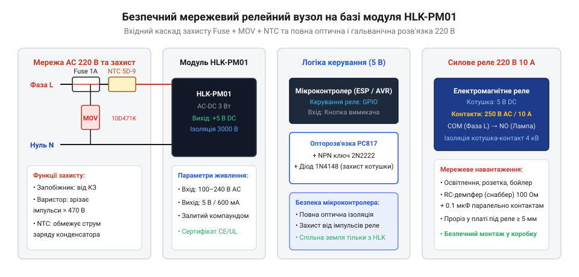
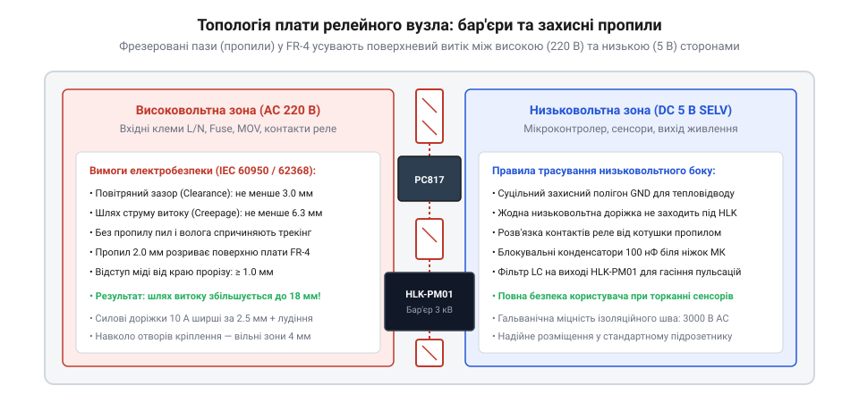

# HLK-PM01/PM03/PM12 — живлення від 220 В

<preknowlist>
- [Модуль живлення для макетної плати](root:cat-hw-power/breadboard-power-module) — базові принципи організації живлення схем мікроконтролерів
</preknowlist>

## Небезпека комутації 220 В у замкненому просторі

Встановлення мікроконтролерної автоматики безпосередньо у круглий монтажний підрозетник діаметром 68 мм — одне з найскладніших завдань побутової схемотехніки. Усередині пластикової коробки за стіною практично відсутня конвекція повітря, а температура під час роботи освітлення або нагрівачів легко сягає +50...+60 °C.

За таких умов комутація мережевої напруги 220 В приховує низку смертельних загроз:
1. **Ризик займання та термічного пробою**: пил, конденсат та мікротріщини у склотекстоліті під тривалою дією мережевої напруги спричиняють утворення струмопровідних вуглецевих доріжок. Без надійного захисту виникає тліючий дуговий розряд, здатний підпалити пластик підрозетника та ізоляцію кабелів.
2. **Пробій фази на низьковольтну частину**: якщо провідники фази 220 В розташовані надто близько до цифрових доріжок мікроконтролера, будь-який високовольтний сплеск у мережі (наприклад, від близької грози або комутації зварювального апарата) призводить до електричного пробою. У результаті небезпечний потенціал 220 В потрапляє на сенсорні клавіші або клеми датчиків, створюючи загрозу ураження людини струмом.
3. **Зварювання контактів пусковим струмом**: сучасні світлодіодні лампи та імпульсні блоки живлення мають ємнісний вхід. У момент замикання контактів реле виникає колосальний кидок струму до 30–50 А тривалістю 1–2 мілісекунди. Без захисних заходів електрична мікродуга миттєво зварює срібні контакти реле, блокуючи його в увімкненому стані.

Головним прихованим деструктивним фактором у монтажній коробці є комбінований тепловий баланс. У закритому підрозетнику з корисним об'ємом близько 160–180 см³, замурованому в гіпс або бетон, природна циркуляція повітря повністю заблокована. Тепловідведення відбувається виключно шляхом повільної теплопровідності крізь пластикові стінки корпусу коробки та декоративну лицьову панель вимикача. Еквівалентний тепловий опір такого замкненого об'єму становить від 18 до 25 °C/Вт, що перетворює кожен ват розсіяної енергії на суттєве зростання внутрішньої температури.

Сумарне тепловиділення всередині вузла складається з чотирьох незалежних джерел:
- **Втрати перетворення HLK-PM01**: при віддачі номінальної вихідної потужності 3 Вт за ККД близько 70% перетворювач перетворює на чисте тепло приблизно 0.9 Вт енергії (навіть у режимі очікування власне споживання становить 0.2–0.3 Вт).
- **Нагрівання обмотки реле**: котушка стандартного електромеханічного реле на 5 В зі струмом утримання 75–80 мА безперервно генерує близько 0.38–0.40 Вт тепла впродовж усього часу, доки навантаження залишається увімкненим.
- **Джоулеве тепло контактної групи**: за початкового перехідного опору контактів 50 мОм комутація струму навантаження 5 А виділяє 1.25 Вт тепла (P = I² × R), а при струмі 10 А потужність нагрівання контактів зростає до 5 Вт. Окиснення та мікроерозія контактних п'ятаків з часом збільшують їхній опір удвічі, катастрофічно підвищуючи тепловиділення.
- **Споживання мікроконтролера**: радіомодуль Wi-Fi або Bluetooth у моменти активного прийому-передачі додає ще 0.3–0.6 Вт тепла.

Сумарна теплова потужність у 2.5–3.5 Вт за умов замкненого термоізольованого простору викликає перегрів повітря всередині підрозетника на +45...+60 °C відносно кімнатної температури. Якщо температура в кімнаті становить +25 °C, деталі плати розігріваються вище +80...+85 °C. Це насамперед скорочує життєвий цикл вхідних електролітичних конденсаторів блока живлення (за правилом Арреніуса кожні 10 °C перегріву зменшують ресурс конденсатора вдвічі) і загрожує термічним розм'якшенням пластику підрозетника.

Інженерна задача проєкту — створити повноцінний, компактний і безпечний релейний вузол керування навантаженням на базі герметичного перетворювача HLK-PM01, що гарантує надійний вхідний захист, ізоляцію ланцюгів та безвідмовну роботу в замкненому об'ємі.

## Принципова електрична схема та вхідний захист

Схема розбита на три функціональні блоки: ланцюг багаторівневого захисту від перенапруг, гальванічно розв'язане вторинне живлення та сиfilterровий ключ комутації.

*Принципова електрична схема вузла 220 В: вхідний мережевий захист (Fuse, MOV, NTC), герметичний блок живлення HLK-PM01 та опторозв'язане керування силовим реле.*

### Багаторівневий вхідний захист від перенапруг

Живлення від електромережі підключається до плати через комплекс захисних компонентів:
1. **Плавкий запобіжник (Fuse)**: повільнодіючий запобіжник номіналом 1 А / 250 В (типу @@en|Time-lag / Slow-blow@@) встановлюється у розрив фазного провідника (L). Він витримує короткочасні пускові кидки струму заряду конденсаторів, проте надійно перегорає при внутрішньому короткому замиканні компонентів або тривалому перевантаженні, запобігаючи загорянню.
2. **Варистор (MOV)**: металооксидний варистор 10D471K підключається паралельно мережевим входам після запобіжника. Його класифікаційна напруга становить 470 В (відповідає діючій змінній напрузі ~300 В). Під час високовольтних імпульсів у мережі (до кількох кіловольт) варистор за наносекунди знижує свій опір, шунтуючи перенапругу та викликаючи перегорання запобіжника при критичній загрозі.
3. **Термістор обмеження пускового струму (NTC)**: дисковий термістор номіналом 5–10 Ом (наприклад, NTC 5D-7) обмежує зарядний струм вхідного електролітичного конденсатора модуля HLK-PM01 при першому вмиканні приладу в розетку.

### Модуль вторинного живлення HLK-PM01

Серцем живлення є заводський герметичний модуль HLK-PM01:
- Він перетворює вхідну змінну напругу 85–264 В частотою 50/60 Гц у стабільні постійні 5.0 В зі струмом до 600 мА (потужність 3 Вт).
- Модуль залитий компаундом, що забезпечує електричну міцність внутрішньої ізоляції 3000 В змінного струму та захищає компоненти від пилу й конденсату всередині стіни.

### Опторозв'язка та керування силовим реле

Для комутації навантаження застосовано мініатюрне електромеханічне реле з котушкою на 5 В і струмом комутації до 10 А (наприклад, Omron G5Q або Songle SRD-05VDC):
- **Оптопара PC817**: повністю ізолює чутливі виводи мікроконтролера від електромагнітних завад котушки реле. Світлодіод оптопари живиться від GPIO через струмообмежувальний резистор 330 Ом.
- **Транзисторний ключ**: фототранзистор оптопари керує базою біполярного NPN-транзистора (S8050 або 2N3904), який безпосередньо подає живлення на обмотку реле.
- **Захисний діод зворотного струму (@@en|flyback diode@@)**: паралельно котушці реле в зворотному напрямку запаяно швидкодіючий діод 1N4148 (або 1N4007). Він гасить високовольтний викид самоіндукції, який виникає в момент знеструмлення індуктивної котушки, рятуючи транзисторний ключ від лавинного пробою.

### Розрахунок демпферного RC-снубера для контактів реле

Комутація індуктивних навантажень (обмоток двигунів витяжних вентиляторів, циркуляційних насосів або трансформаторів) створює критичну загрозу руйнування контактної групи реле. У момент розмикання контактів струм в індуктивності не може зникнути миттєво, викликаючи сплеск ЕРС самоіндукції амплітудою 1500–2500 В. Повітряний проміжок між контактами пробивається потужною електричною дугою, яка випалює срібне покриття і спричиняє електромагнітний імпульс, здатний перезавантажити мікроконтролер.

Для гасіння дуги паралельно силовим перемикальним контактам (NO та COM) встановлюють послідовний RC-ланцюг (демпферний снубер):
- **Розрахунок опору резистора (R_s)**: резистор обмежує струм розряду конденсатора через контакти реле в момент їхнього повторного замикання. Якщо конденсатор був заряджений до амплітудної напруги мережі (325 В), то без резистора контакти закоротили б його з кидком струму в десятки ампер. Номінал обирають рівним R_s = 100 Ом. За такого опору піковий струм замикання становить лише 325 В / 100 Ом = 3.25 А, що є цілком безпечним для контактів на 10 А. Потужність, яка розсіюється на резисторі на частоті мережі 50 Гц, обчислюється як P = C_s × U_rms² × f = 100e-9 × 230² × 50 ≈ 0.26 Вт, тому обирають вогнетривкий резистор потужністю 1 або 2 Вт.
- **Вибір ємності конденсатора (C_s)**: конденсатор поглинає магнітну енергію індуктивності в момент розмикання. Для побутових електродвигунів потужністю до 100–300 Вт оптимальною є ємність C_s = 0.047–0.1 мкФ (47–100 нФ). Конденсатор обов'язково повинен мати клас безпеки X2 та робочу змінну напругу не менше 275 В.
- **Врахування реактивного струму витоку**: через конденсатор ємністю 0.1 мкФ за розімкнених контактів протікає невеликий реактивний струм I_leak = 2 × π × f × C_s × U_rms ≈ 7.2 мА. Для двигунів вентиляторів цей мікрострум є непомітним, проте для чутливих світлодіодних ламп потужністю 3–5 Вт він може викликати періодичне тління або спалахування в темряві; у таких випадках снубер встановлюють не на контакти реле, а паралельно клемам самого навантаження.

> 🔧 **Навіщо це.**
> Повний вхідний каскад із запобіжника, варистора та термістора перетворює звичайну саморобку на надійний промисловий прилад, який переживе будь-які грозові сплески в мережі та не призведе до пожежі в будинку.

## Проєктування та трасування друкованої плати

Трасування плати для монтажу в підрозетник підпорядковується жорстким вимогам електробезпеки стандарту IEC 60950 / IEC 62368. Головне правило — фізичний і просторовий поділ плати на дві незалежні зони: високовольтну («гарячу») та низьковольтну («холодну»).

*Топологія плати релейного вузла: суцільний бар'єр ізоляції між мережевими провідниками 220 В та низьковольтними колами мікроконтролера з фрезерованими повітряними пазами.*

### Зонування та зазори ізоляції

Мережеві вхідні провідники, запобіжник, варистор, термістор, вхід модуля HLK-PM01 та вихідні контакти реле зосереджуються в одній половині плати. Друга половина відведена під мікроконтролер, оптопару, датчики та логічні ланцюги. На відміну від типових плат низьковольтної автоматики, таких як [модуль живлення для макетної плати](root:cat-hw-power/breadboard-power-module), тут не припустиме створення спільного полігону землі:
- **Повітряний зазор (@@en|clearance@@)**: найкоротша відстань між провідниками через повітря по прямій лінії. Між високовольтними доріжками 220 В і будь-якими низьковольтними ланцюгами вона повинна становити щонайменше 3.0–4.0 мм для запобігання дуговому іскровому пробою.
- **Шлях витоку по поверхні (@@en|creepage@@)**: найкоротша відстань між двома провідниками вздовж діелектричної поверхні текстоліту. Для посиленої ізоляції побутових приладів (робоча напруга 250 В діючого значення, ступінь забруднення 2) стандарт вимагає відстань не менше 5.0–6.0 мм.

### Фрезерування ізоляційних пропилів

У компактному просторі підрозетника важко рознести виводи на 6 мм через стандартний крок пінів мікросхем та реле:
- **Пропил під оптопарою**: корпус PC817 має ширину між рядами виводів близько 7.62 мм, проте контактні площадки SMD або отвори THT зменшують поверхневу відстань до 4.5–5.0 мм. Фрезерування наскрізного паза завширшки 1.5–2.0 мм усуває поверхню діелектрика, перетворюючи шлях струму витоку на повітряний бар'єр.
- **Пропил під контактами реле**: між виводами обмотки керування (5 В) та силовими контактами перемикання (220 В) усередині реле існує ізоляційний екран, проте на друкованій платі доріжки зближуються. Наскрізний ізоляційний пропил під корпусом реле повністю виключає пробій навіть при попаданні всередину будівельного пилу та вологи.

> 🔧 **Навіщо це.**
> Фрезерований пропил замінює довгий шлях по брудному текстоліту на повітряний розрив: електрична дуга в чистому повітрі вимагає напруженості поля понад 3 кВ/мм, що надійно захищає низьковольтну електроніку від пробою мережі.

## Практична збірка та стендове випробування

Збирання високовольтного вузла автоматики виконується з дотриманням спеціальної технологічної послідовності, де кожен етап завершується перевіркою безпеки до подачі мережевої напруги.

### Монтаж та контроль міцності ізоляції

1. **Монтаж компонентів**: спершу запаюють пасивні низьковольтні елементи та оптопару, потім блок HLK-PM01, силові клеми та захисну вхідну обв'язку (запобіжник, варистор, термістор). Виводи високовольтних деталей зі зворотного боку плати обрізають урівень із припоєм і ретельно змивають залишки флюсу ізопропіловим спиртом — активний або брудний флюс знижує опір поверхні та створює мікроструми витоку.
2. **Перевірка мегомметром**: перед першим підключенням до розетки проводять випробування електричної міцності. Між короткозамкненими входами 220 В (L і N) та спільним дротом GND низьковольтної частини прикладають тестову напругу 500 В або 1000 В за допомогою мегомметра. Опір ізоляції повинен перевищувати 50–100 МОм.

### Випробування під різними типами навантаження

- **Активне навантаження (лампа розжарювання, ТЕН)**: перевіряється відсутність падіння напруги на контактах реле при номінальному струмі комутації. Модуль працює безшумно, контактні площадки не нагріваються понад +40 °C.
- **Індуктивне навантаження (витяжний вентилятор, циркуляційний насос)**: розмикання ланцюга двигуна супроводжується індуктивним викидом ЕРС самоіндукції, що провокує електричну дугу між контактами реле. Для гасіння іскри паралельно контактам реле або на клеми двигуна обов'язково встановлюють RC-снубер (резистор 100 Ом 1 Вт послідовно з плівковим конденсатором 0.1 мкФ 275 В класу X2).
- **Тепловий контроль у закритому підрозетнику**: зібраний пристрій розміщують у тестовому пластиковому підрозетнику, закривають кришкою та залишають під безперервним навантаженням на 2 години. Модуль HLK-PM01 за власного споживання 0.5–1 Вт нагрівається не вище +45...+50 °C за кімнатної температури, що гарантує надійність компонентів із робочим діапазоном до +85 °C.

> 🔧 **Навіщо це.**
> Стендове тестування під індуктивним навантаженням рятує від раптового виходу реле з ладу: без RC-снубера контакти згоряють або зварюються вже після кількох сотень циклів комутації двигуна вентилятора.

## Програмне керування та алгоритми надійності

Керування мережевим реле вимагає спеціальних програмних алгоритмів захисту. Звичайний алгоритм перемикання GPIO за натисканням кнопки не годиться: брязкання контактів вимикача створює пачку мікроперемикань, а швидке повторне ввімкнення двигуна чи компресора призводить до гідроудару або виходу з ладу пускових конденсаторів.

### Алгоритми безпеки: антибрязкання та мертвий час

1. **Фільтрація брязкання контактів (@@en|debounce@@)**: стан кнопки вважається зміненим лише після того, як новий логічний рівень утримується незмінним протягом заданого часу (зазвичай 30–50 мс). Це усуває паразитні імпульси під час механічного спрацьовування клавіші настінного вимикача.
2. **Мертвий час (@@en|dead-time / anti-cycling@@)**: після будь-якого розмикання контактів реле вмикається примусовий захисний інтервал тривалістю 3–5 секунд (для компресорів холодильників і кондиціонерів — до 180–300 секунд). Якщо користувач або автоматика надсилає команду повторного ввімкнення під час паузи, запит блокується або ставиться у чергу відкладеного пуску.
3. **Захисний ліміт безперервної роботи**: пристрій містить сторожовий таймер, який автоматично знеструмлює навантаження, якщо воно безперервно залишається увімкненим понад критичний час (наприклад, вентилятор витяжки понад 30 хвилин).

### Модульний драйвер на мові C

Драйвер побудовано на базі кінцевого автомата (FSM) без блокуючих затримок delay(), що дозволяє легко інтегрувати його в планувальник завдань або операційну систему реального часу:

:::code proj-safe-mains-relay-node/c/relay.h

:::code proj-safe-mains-relay-node/c/relay.c

:::code proj-safe-mains-relay-node/c/main.c

### Об'єктний контролер на C++

Для систем на ESP32 або платформах Arduino реалізовано клас SmartRelay, що підтримує зворотні виклики через лямбда-функції (шаблон Observer) та автоматичне відключення за тайм-аутом:

:::code proj-safe-mains-relay-node/cpp/SmartRelay.h

:::code proj-safe-mains-relay-node/cpp/SmartRelay.cpp

:::code proj-safe-mains-relay-node/cpp/main.cpp

> 🔧 **Навіщо це.**
> Програмний мертвий час рятує підключену побутову техніку: двигуни насосів та компресори холодильників виходять з ладу за миттєвого повторного пуску проти тиску холодоагенту, якщо між вимкненням і ввімкненням не витримано паузу вирівнювання тиску.
