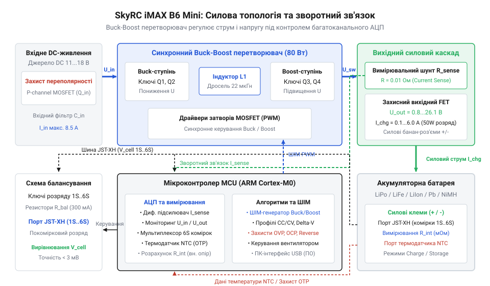
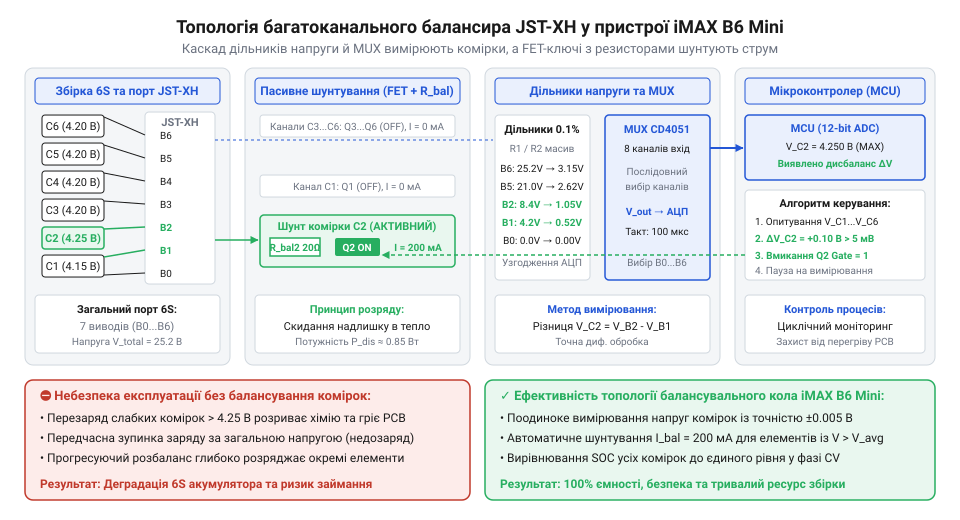
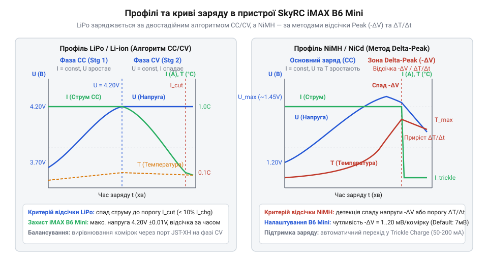
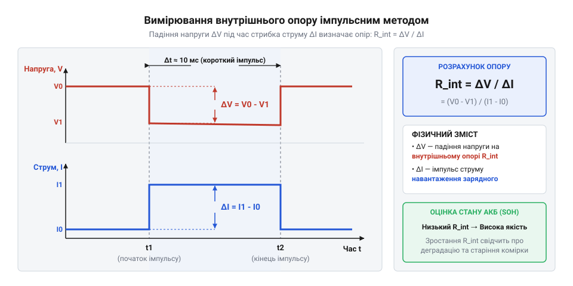
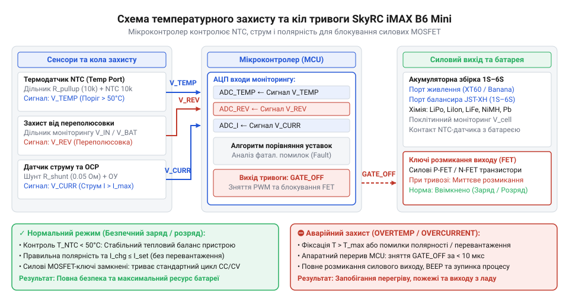

# SkyRC iMAX B6 Mini — зарядний пристрій-балансир

<preknowlist>
- [TP4056](root:cat-hw-power/tp4056) — Базові принципи фаз заряду CC/CV для літієвих елементів та функціонування струмового шунта.
- [TP5100 — заряд 1S/2S](root:cat-hw-power/tp5100-charger) — Особливості імпульсної топології Buck-зарядників та автоперемикання режимів заряду послідовних комірок.
- [BMS 2S/3S/4S із балансуванням](root:cat-hw-power/bms-multicell) — Концепцію пасивного шунтування струму балансувальними резисторами та небезпеки міжкоміркового дисбалансу.
</preknowlist>

## Проблема розбалансу збірок та енергетична топологія

Експлуатація багатокоміркових акумуляторних блоків завжди спирається на принципову технічну проблему: виготовлення ідеально ідентичних гальванічних елементів фізично неможливе. Навіть у межах однієї виробничої партії акумуляторні (англ. @@en|accumulator@@, від лат. *accumulare* — накопичувати) комірки мають неминучі технологічні відхилення у фактичній ємності, внутрішньому опорі та швидкості саморозряду. Під час послідовного з'єднання кількох елементів у збірку (від 2S до 6S) крізь кожен із них протікає один і той самий силовий струм. Проте через відмінності внутрішніх параметрів швидкість зростання напруги на окремих комірках виявляється неоднаковою.

Якщо заряджати подібний акумуляторний блок за допомогою простішого двополюсного джерела живлення, яке контролює лише підсумкову напругу на зовнішніх силових виводах, виникає небезпечний міжкомірковий розбаланс. Елемент із найменшою фактичною ємністю або вищим внутрішнім опором досягає граничного порогу напруги першим. Оскільки загальна сумарна напруга всієї збірки ще не досягла ліміту закінчення заряду, силовий контролер продовжує подавати повний струм. У результаті ця «слабка» комірка виходить у режим глибокого перезаряду, що супроводжується інтенсивним розкладом електроліту, виділенням газу, деформацією корпусу та загрозою термічного розгону з подальшим займанням. Натомість більш ємні елементи збірки залишаються недозарядженими, що призводить до швидкої деградації всієї батареї.

Додатковим деструктивним чинником є внутрішній опір комірок (англ. @@en|internal resistance@@). Під час проходження сильного струму заряду `I` на внутрішньому опорі `R_int` кожної комірки створюється додаткове падіння напруги `ΔV_IR = I · R_int`. Зношена комірка з підвищеним внутрішнім опором під навантаженням демонструє штучно завищену напругу, спонукаючи прості зарядні пристрої передчасно зменшувати струм або завершувати заряд. Після зняття струму напруга на такій комірці миттєво просідає, залишаючи її суттєво недозарядженою.

На відміну від спеціалізованих однокоміркових контролерів на кшталт [популярної плати TP4056](root:cat-hw-power/tp4056), призначених виключно для поодиноких 1S літієвих елементів, чи двохкоміркових модулів типу [імпульсного зарядного модуля TP5100](root:cat-hw-power/tp5100-charger), які реалізують автоперемикання між 1S та 2S без індивідуального контролю напруг кожної секції, універсальний зарядний пристрій-балансир @@en|SkyRC iMAX B6 Mini@@ розрахований на гнучке обслуговування широкого спектра конфігурацій. Він здатний працювати як з поодинокими комірками, так і з послідовними батареями складної хімії (LiPo, LiIon, LiFe, NiMH, NiCd, Pb) у діапазоні від 1S до 6S.

Центральним вузлом живлення пристрою є силовий імпульсний DC-DC конвертер (англ. @@en|converter@@, від лат. *convertere* — перетворювати). Складність його проектування зумовлена тим, що напруга зовнішнього джерела живлення підключається до гнізда DC 5.5/2.5 мм і становить від 11 В до 18 В постійного струму, тоді як вихідна напруга акумуляторної збірки може варіюватися в набагато ширших межах — від 1.2 В (для поодинокого NiMH елемента) до 25.2 В (для повністю зарядженої 6S LiPo батареї). Для забезпечення стабільної роботи в усьому діапазоні напруг у силовому тракті пристрою застосовано понижувально-підвищувальний перетворювач топології @@en|Buck-Boost@@. Принципи побудови та функціонування імпульсних схем цієї категорії детально розглянуто у матеріалі про [понижувально-підвищувальні перетворювачі живлення](root:hw-power/buck-boost).

Функціонування перетворювача ділиться на два основних режими. Коли напруга акумулятора нижча за вхідну напругу джерела живлення (наприклад, при зарядці 2S LiPo збірки з максимальною напругою 8.4 В від мережевого адаптера 12 В), мікроконтролер переводить силові ключі в режим пониження напруги (англ. @@en|Buck mode@@). У цьому режимі верхній силовий транзистор (англ. @@en|transistor@@, від *transfer* + *resistor* — перехідний опір) типу @@en|MOSFET@@ працює в режимі високочастотної широтно-імпульсної модуляції (англ. @@en|PWM@@, від *Pulse-Width Modulation*), дозовано накопичуючи енергію у силовому дроселі.

Якщо ж підключено багатокоміркову збірку, підсумкова напруга якої перевищує вхідну (наприклад, 6S LiPo з напругою 25.2 В при вхідних 12 В), перетворювач автоматично переходить у режим підвищення напруги (англ. @@en|Boost mode@@). У даному разі дросель накопичує енергію при відкритті нижнього ключа на землю, а при його закритті віддає накопичений магнітний потік через випрямлячий діод або синхронний ключ у вихідну ємність, сумуючи вихідну напругу з напругою джерела. У перехідній зоні, коли вхідна напруга практично дорівнює вихідній (наприклад, при зарядці 3S збірки з напругою 12.6 В від джерела 12 В), силовий контролер реалізує безшовну синхронну модуляцію всіх чотирьох ключів, запобігаючи пульсаціям струму.

Силова частина @@en|SkyRC iMAX B6 Mini@@ має жорстко обмежену максимальну вихідну потужність 60 Вт при максимальному струмі заряду 6 А. Слід чітко розрізняти ці два ліміти: пристрій видає максимальний струм 6 А лише доти, доки підсумкова вихідна потужність не досягає 60 Вт. Для високовольтних збірок струм заряду автоматично масштабується у менший бік згідно з базовим співвідношенням `P = U · I`. Математичний апарат розрахунку режимів заряду та обмежень потужності викладено у спеціалізованому керівництві з [розрахунків потужності та балансування](root:cat-hw-power/imax-b6-charger/math-imax-b6-charging-and-balancing-calculations.md).

Наведемо покроковий приклад обчислення граничного струму заряду та оцінки споживання енергії від вхідного джерела.

**Умова розрахунку:**
Розрахувати максимально можливий струм заряду `I_charge_max` для 6S LiPo акумулятора в кінці фази заряду (напруга `U_out = 25.2 В`) при вихідній потужності пристрою `P_out = 60 Вт`. Також визначити струм `I_in`, який зарядний пристрій споживатиме від блока живлення з напругою `U_in = 12 В`, враховуючи коефіцієнт корисної дії перетворювача `η = 0.85` (85%).

Позначимо змінні:
- `P_out` — гранична вихідна потужність зарядного пристрою (60 Вт)
- `U_out` — максимальна вихідна напруга 6S акумуляторної збірки (25.2 В)
- `I_charge_max` — шуканий граничний струм заряду (А)
- `U_in` — вхідна напруга постійного струму від джерела живлення (12 В)
- `η` — коефіцієнт корисної дії DC-DC перетворювача (0.85)
- `P_in` — повна вхідна потужність, що споживається від мережевого джерела (Вт)
- `I_in` — струм, що споживається від вхідного джерела живлення (А)

```
I_charge_max = P_out / U_out
             = 60 / 25.2             [ділення вихідної потужності на напругу збірки]
             = 2.381 А               [граничний струм заряду 6S батареї]

P_in = P_out / η
     = 60 / 0.85                     [врахування енергетичних втрат перетворення]
     = 70.588 Вт                     [потужність, необхідна від блока живлення]

I_in = P_in / U_in
     = 70.588 / 12                   [ділення вхідної потужності на вхідну напругу]
     = 5.882 А                       [мінімальний струм вхідного джерела]
```

З проведеного розрахунку чітко видно, що при роботі з 6S батареєю пристрій фізично не зможе забезпечити струм 6 А, а автоматично обмежить його на позначці близько 2.38 А. Для забезпечення такої роботи вхідне джерело живлення повинне витримувати навантаження не менше 6 А при напрузі 12 В (потужність понад 70 Вт), інакше через просідання вхідної напруги нижче 11 В спрацює внутрішній захист пристрою від просідання живлення.

Архітектурне оснащення зарядника пройшло тривалий шлях інженерного вдосконалення. Як свідчить [історія еволюції серії iMAX B6](root:cat-hw-power/imax-b6-charger/hist-imax-b6-evolution.md), перше покоління класичного B6 будувалося на 8-бітному мікроконтролері @@en|ATmega32@@, мало граничну потужність 50 Вт і працювало на відносно низькій частоті модуляції. У сучасній версії @@en|SkyRC iMAX B6 Mini@@ розробники перейшли на 32-бітне ядро @@en|ARM Cortex-M0@@. Це дало змогу не лише зменшити об'єм корпусу на 20%, а й підвищити ККД силового тракту, збільшити межу потужності до 60 Вт, реалізувати високошвидкісний опита датчиків та додати прямого зв'язку з комп'ютером через роз'єм micro-USB.

Для реалізації високострумового заряду без втрати точності вимірювань у @@en|SkyRC iMAX B6 Mini@@ використовується принципова двопровідна система підключення акумулятора. Силовий струм (до 6 А) подається через товсті силіконові провідники, підключені до бананових гнізд 4 мм на торці пристрою. Подача великого струму викликає падіння напруги на опорі самих провідників та контактних з'єднань (`ΔV = I · R_cable`). Якби пристрій вимірював напругу комірок безпосередньо на цих клемах, похибка вимірювання при струмі 6 А сягала б сотень мілівольт. Тому контроль напруги кожної окремої комірки винесено в ізольований малострумовий вимірювальний тракт, що підключається через багатоконтактний балансувальний роз'єм.


*Структурна схема силової частини iMAX B6 Mini, що показує шлях напруги від вхідного DC-роз'єму через Buck-Boost перетворювач до силових клем акумулятора та мікроконтролера.*

На наведеній структурній схемі показано розподіл силових та контрольних потоків. Мікроконтролер керує драйверами ключів @@en|MOSFET@@, спираючись на покази вимірювального підсилювача, підключеного до прецизійного струмового шунта (англ. @@en|shunt@@, від сер.-англ. *schunten* — відхиляти) у негативній шині. Така побудова забезпечує точне дотримання двох основних фаз заряду літієвих батарей — фази постійного струму (англ. @@en|Constant Current@@, @@en|CC@@) та фази постійної напруги (англ. @@en|Constant Voltage@@, @@en|CV@@), що складають основу загальних [алгоритмів заряду літієвих акумуляторів](root:hw-power/cc-cv-bms).

## Архітектура балансування комірок через роз'єм JST-XH

Розуміння необхідності розділення силового струму та контрольних ліній лідує до детального розбору аналогового балансувального тракту. Для підключення вимірювальних провідників від кожної міжкоміркової точки акумуляторної збірки в @@en|SkyRC iMAX B6 Mini@@ використано групу роз'ємів стандарту @@en|JST-XH@@ з фіксованим кроком контактів 2.54 мм. На бічній панелі пристрою розташовано п'ять окремих гнізд для збірок від 2S до 6S, що запобігає помилкам підключення батарей різної серійності. Повний довідник розпінування та технічні параметри контактних груп описано в інструкції про [залізний інтерфейс та розвідку роз'ємів](root:cat-hw-power/imax-b6-charger/api-imax-b6-hardware-interface.md).

Кількість контактів у балансувальному шлейфі акумулятора з `N` послідовно з'єднаних комірок завжди дорівнює `N + 1`. Для 6S батареї шлейф містить 7 провідників: перший з'єднаний із загальним мінусом (землею) збірки, а кожні наступні — з проміжними з'єднаннями комірок аж до плюсового виводу шостої комірки. Усі ці потенціали надходять у внутрішню схему балансира (англ. @@en|balance@@, від лат. *bilanx* — той, що має дві шальки ваг).

Основою вимірювального тракту балансира є система зняття потенціалів з кожного міжкоміркового вузла. Мікроконтролер @@en|ARM Cortex-M0@@ містить аналогово-цифровий перетворювач (англ. @@en|ADC@@, від *Analog-to-Digital Converter*) з робочим діапазоном напруг від 0 В до 3.3 В. Напруга шостого вузла 6S збірки відносно загальної землі може сягати 25.2 В, тому її пряме подання на вхід процесора викличе миттєвий пробій мікроконтролера.

Для узгодження рівнів напруги кожен вимірювальний канал оснащено прецизійним резистивним дільником напруги з допуском опору не гірше 0.1% та низьким температурним коефіцієнтом опору. Ослаблені сигнали з усіх вузлів надходять на багатоканальний аналоговий мультиплексор (англ. @@en|multiplexer@@, від лат. *multiplex* — складений з багатьох частин). Мультиплексор за командами процесора поодинці коммутує напруги вузлів на диференційний операційний підсилювач.

Щоб виключити вплив пульсацій імпульсного силового перетворювача на точність вимірювання, мікроконтролер короткочасно призупиняє силова шім-модуляцію (на частки мілісекунди) перед кожною серією вимірювань. Це дозволяє АЦП оцифровувати справжню напругу розімкненого кола (англ. @@en|Open Circuit Voltage@@, @@en|OCV@@) кожної комірки без накладання силових завад та падіння напруги на внутрішніх опорах. Процесор обчислює абсолютне значення напруги кожної окремої комірки `V_cell_k` шляхом віднімання потенціалу нижчого вузла `V_node_(k-1)` від потенціалу вищого вузла `V_node_k`:

```
V_cell_k = V_node_k - V_node_(k-1)
```

Після оцифрування напруг усіх комірок мікроконтролер оцінює ступінь їхнього розбалансу. У заряднику @@en|SkyRC iMAX B6 Mini@@ реалізовано топологію пасивного шунтування. На відміну від активного балансування, де енергія перерозподіляється між елементами через імпульсні перетворювачі, пасивний балансир просто розряджає більш заряджені комірки, перетворюючи надлишкову електричну енергію на теплову за допомогою розрядних керамічних резисторів.

Кожен із 6 балансувальних каналів містить послідовне коло з розрядного резистора (опором близько 14 Ом) та керуючого транзистора @@en|MOSFET@@. Коли під час заряду одна з комірок досягає порогового значення напруги фази @@en|CV@@ (наприклад, 4.20 В для LiPo), тоді як інші комірки мають лише 4.12 В, мікроконтролер відкриває ключ @@en|MOSFET@@ відповідного каналу. Відкритий ключ підключає балансувальний резистор паралельно даній комірці, створюючи обхідний шунтувальний канал для струму.

Максимальний струм балансування в @@en|SkyRC iMAX B6 Mini@@ становить 300 мА (0.3 А). Це створює фізичне обмеження на швидкість вирівнювання збірок із високим ступенем розбалансу. Виконаймо розрахунок струму шунтування та тепловідведення балансувального блоку.

**Умова розрахунку:**
Розрахувати струм балансування `I_bal` та теплову потужність розсіювання `P_bal_cell` для однієї LiPo комірки при напрузі `U_cell = 4.20 В` та опорі розрядного резистора `R_bal = 14 Ом`. Визначити загальне тепловиділення `P_bal_total` при одночасному шунтуванні 5 комірок у 6S батареї.

Позначимо змінні:
- `U_cell` — напруга на шунтованій комірці (4.20 В)
- `R_bal` — опір балансувального шунтувального резистора (14 Ом)
- `I_bal` — струм балансування через розрядний ключ (А)
- `P_bal_cell` — потужність розсіювання на одному балансувальному резисторі (Вт)
- `N_shunted` — кількість одночасно активних балансувальних каналів (5)
- `P_bal_total` — сумарна теплова потужність, виділювана балансиром (Вт)

```
I_bal = U_cell / R_bal
      = 4.20 / 14                    [закон Ома для ділянки кола]
      = 0.300 А                      [струм балансування 300 мА]

P_bal_cell = U_cell · I_bal
           = 4.20 · 0.300            [обчислення теплової потужності]
           = 1.260 Вт                [потужність розсіювання однієї комірки]

P_bal_total = N_shunted · P_bal_cell
            = 5 · 1.260              [сумування потужності по 5 каналах]
            = 6.300 Вт               [сумарне тепловиділення розрядних резисторів]
```

З обчислень випливає важливий практичний висновок: при одночасному вирівнюванні 5 комірок всередині корпусу виділяється додатково 6.3 Вт тепла. Оскільки @@en|SkyRC iMAX B6 Mini@@ має пасивне корпусне охолодження без вбудованого кулера, тривале розсіювання такої потужності викликає відчутне нагрівання друкованої плати.


*Принципова схема багатоканального балансира JST-XH, яка показує підключення кожної комірки 6S збірки до аналогового мультиплексора, вимірювальних дільників та розрядних резисторів з FET-ключами.*

Схема балансира детально ілюструє шлях струму шунтування. Якщо розбаланс між комірками батареї становить понад 0.3 В, балансиру зі струмом 300 мА знадобиться тривалий час для вирівнювання потенціалів. У таких умовах мікроконтролер пристрою застосовує алгоритм адаптивного зниження основного струму заряду: загальний струм зменшується до 100–300 мА, щоб розрядні ключі встигали компенсувати приплив енергії у найбільш заряджені елементи.

На відміну від вбудованих захисних плат, які розглянуто в матеріалі про [багатокоміркові плати BMS](root:cat-hw-power/bms-multicell), внутрішній балансир зарядного пристрою не просто відключає батарею при досягненні аварійних меж, а здійснює динамічний моніторинг кожного елемента протягом усього циклу. Якщо в процесі балансування внутрішній термодатчик фіксує перегрів плати понад 60 °C, мікроконтролер тимчасово вимикає розрядні ключі та призупиняє заряд. Математичні деталі та формули аналізу часу балансування викладено у спеціальному розділі про [розрахунки параметрів балансування](root:cat-hw-power/imax-b6-charger/math-imax-b6-charging-and-balancing-calculations.md).

При користуванні роз'ємами @@en|JST-XH@@ критично важливо дотримуватися правильної орієнтації та сумісності ключів. Помилкове включення роз'єму зі зсувом на один контакт створює коротке замикання між сусідніми висунутими секціями батареї через вимірювальні дільники. Це призводить до вигорання аналогового мультиплексора та вимірювальних резисторів. Правильне підключення та прецизійне калібрування дільників дозволяє @@en|SkyRC iMAX B6 Mini@@ утримувати розбаланс комірок у межах ±0.01 В, що забезпечує максимальну термінову безпеку та подовжує термін служби літієвих акумуляторних збірок.

## Алгоритми заряду різних хімічних типів акумуляторів

Наявність потужного понижувально-підвищувального перетворювача та багатоканального аналогового балансира створює лише апаратну основу. Щоб безпечно наповнити акумулятор енергією, керуючий мікроконтролер повинен реалізувати точний алгоритм (англ. @@en|algorithm@@, від араб. *Al-Khwarizmi* — прізвище середньоазійського науковця) заряду, адаптований до електрохімічних властивостей конкретної батареї. Помилка у виборі режиму або напруги відсічки для літієвого елемента призводить до термічного розгону, а для нікелевого — до швидкої втрати ємності через перезаряд. У прошивці мікроконтролера @@en|ARM Cortex-M0@@ зарядного пристрою @@en|SkyRC iMAX B6 Mini@@ закладено спеціалізовані робочі профілі (англ. @@en|profile@@, від італ. *profilo* — обрис, контур) для шести основних хімічних типів: @@en|LiPo@@, @@en|LiIon@@, @@en|LiFePO4@@, @@en|NiMH@@, @@en|NiCd@@ та @@en|Pb@@.

Для літієвої групи акумуляторів (Lithium-Ion Polymer @@en|LiPo@@, Lithium-Ion @@en|LiIon@@ та Lithium Iron Phosphate @@en|LiFePO4@@) пристрій застосовує двофазний двопровідний алгоритм заряду @@en|CC/CV@@. Фізика процесу полягає у послідовній зміні двох режимів контролю силового перетворювача. У першій фазі постійного струму (англ. @@en|Constant Current@@, @@en|CC@@) пристрій подає в акумулятор фіксований струм заряду `I_charge`, який користувач вибирає залежно від ємності `C` (зазвичай у діапазоні від `0.5C` до `1C`). У міру накопичення заряду напруга на виводах акумулятора поступово зростає. 

Щойно напруга комірки досягає верхньої критичної межі, мікроконтролер безшовно переводить DC-DC перетворювач у фазу постійної напруги (англ. @@en|Constant Voltage@@, @@en|CV@@). Поріг відсічки суворо визначається хімією: для @@en|LiPo@@ він становить 4.20 В на комірку, для класичних @@en|LiIon@@ — 4.10 В (або 4.20 В у сучасних модифікаціях), а для стійких @@en|LiFePO4@@ — 3.60 В. У фазі @@en|CV@@ силовий тракт підтримує напругу із точністю до декількох мілівольт, тоді як споживаний акумулятором струм спадає за експоненційним законом. Заряд вважається повністю завершеним, коли струм просідає до порогового значення відсічки (англ. @@en|termination current@@), яке в @@en|SkyRC iMAX B6 Mini@@ за замовчуванням становить 10% від початкового значення струму фази @@en|CC@@. Детальний аналіз часових фаз та електрохімічних процесів наведено у матеріалі про [алгоритми заряду літієвих акумуляторів](root:hw-power/cc-cv-bms).

Крім стандартного заряду, для літієвих батарей передбачено критично важливий сервісний режим зберігання (англ. @@en|Storage@@, від давн.-франц. *estor* — запас, зберігання). Тривале перебування літієвого елемента у повністю зарядженому (4.20 В) або повністю розрядженому (нижче 3.00 В) стані спричиняє деградацію катодного матеріалу, окислення електроліту та небезпеку утворення літієвих дендритів. У режимі @@en|Storage@@ пристрій автоматично приводить напругу кожної комірки до безпечного середнього рівня 3.80–3.85 В (що відповідає приблизно 40–50% енергетичної ємності). Якщо підключена збірка заряджена сильніше, пристрій вмикає внутрішній розрядник потужністю до 5 Вт; якщо напруга нижча — вмикається заряд струмом до порогової позначки.


*Часові діаграми фаз заряду CC/CV для літієвих хімій та графік від'ємного спаду напруги Delta-Peak при наповненні NiMH акумуляторів.*

Принципово інший підхід застосовується для нікель-металогідридних (@@en|NiMH@@) та нікель-кадмієвих (@@en|NiCd@@) акумуляторів. На відміну від літієвих елементів, нікелеві батареї не мають чітко вираженої порогової напруги насичення, а їхня напруга під час заряду може перевищувати номінальні 1.2 В і сягати 1.45–1.55 В на комірку. Тому заряд здійснюється безперервним постійним струмом (фаза @@en|CC@@) аж до моменту повного насичення.

Завершення заряду нікелевих елементів визначається за фізичним ефектом від'ємного перепаду напруги (англ. @@en|Delta-Peak@@, від грец. *delta* — четверта літера абетки, символ різниці + англ. *peak* — верхівка), позначуваному як `-ΔV`. Коли нікелева комірка досягає 100% ємності, подальша електрична енергія більше не може зв'язуватися хімічно й починає виділятися у вигляді тепла. Внутрішній розігрів акумулятора спричиняє зростання рухливості іонів та тимчасову зміну внутрішнього опору, що виражається у незначному просіданні напруги на виводах батареї.

Мікроконтролер @@en|SkyRC iMAX B6 Mini@@ безперервно зчитує напругу через АЦП, відфільтровує імпульсні завади та шукає максимум напруги. Щойно фіксується спад на величину `-ΔV` (налаштовується у меню в межах 3–15 мВ на комірку для @@en|NiMH@@ та 5–20 мВ для @@en|NiCd@@), заряд миттєво вимикається. Фізика виникнення цього ефекту та порівняльний аналіз методів контролю описані в інструкції про [визначення закінчення заряду NiMH та NiCd](root:hw-power/zariad-svyntsiu-i-nimh). Для свинцево-кислотних (@@en|Pb@@) акумуляторів з номінальною напругою 2.0 В на комірку пристрій реалізує тристадійний алгоритм із кінцевою напругою 2.40–2.45 В та подальшим переходом у режим підтримувального заряду (англ. @@en|float charge@@).

Для діагностики фізичного стану акумуляторів у @@en|SkyRC iMAX B6 Mini@@ інтегровано функцію вимірювання внутрішнього опору (англ. @@en|internal resistance@@, від лат. *resistere* — чинити опір). Показник внутрішнього опору `R_int` безпосередньо відображає ступінь зносу батареї: високий опір свідчить про деградацію пластин, висихання електроліту або корозію струмознімачів.

Вимірювання здійснюється імпульсним методом прямого струму (англ. @@en|DC pulse method@@). Мікроконтролер спочатку вимірює напругу розімкненого кола `V1` без навантаження. Потім силовий перетворювач короткочасно подає калібрований імпульс струму `ΔI` (наприклад, 2.0 А) тривалістю в кілька мілісекунд і фіксує напругу під навантаженням `V2`. Падіння напруги `ΔV = V1 - V2` виникає виключно на внутрішньому опорі елемента.

Проілюструємо покроковий розрахунок внутрішнього опору комірки за результатами імпульсного заміру.

**Умова розрахунку:**
Під час тестового імпульсу струму `ΔI = 2.0 А` напруга на комірці просіла з початкового значення `V1 = 4.150 В` до значення під навантаженням `V2 = 4.106 В`. Обчислити внутрішній опір `R_int` даної комірки в міліомах.

Позначимо змінні:
- `V1` — напруга розімкненого кола до імпульсу (4.150 В)
- `V2` — напруга на комірці під підключеним навантаженням (4.106 В)
- `ΔV` — величина падіння напруги на внутрішньому опорі (В)
- `ΔI` — амплітуда вимірювального імпульсу струму (2.0 А)
- `R_int` — шуканий внутрішній опір комірки (Ом)

```
ΔV = V1 - V2
   = 4.150 - 4.106                   [обчислення різниці напруг до і під час імпульсу]
   = 0.044 В                         [падіння напруги 44 мВ]

R_int = ΔV / ΔI
      = 0.044 / 2.0                  [закон Ома для внутрішнього опору]
      = 0.022 Ом                     [абсолютне значення опору]
      = 22 мОм                       [переведення у міліоми]
```

Для багатокоміркових збірок пристрій почергово вимірює `R_int` для кожної секції через балансувальні дільники роз'єму @@en|JST-XH@@, дозволяючи виявити одну зношену комірку у збірці. Різні підходи та вимірювальні топології детально розглянуто у статті про [методи вимірювання внутрішнього опору](root:hw-sensing/battery-internal-resistance-measurement).


*Діаграма вимірювального імпульсу струму ΔI та просідання напруги ΔV на внутрішньому опорі комірки під час обчислення R_int.*

Для забезпечення безпеки екстремальних режимів роботи пристрій оснащено комплексною системою апаратного та програмного захисту. На бічній грані @@en|SkyRC iMAX B6 Mini@@ розташовано 3-контактний роз'єм для підключення зовнішнього температурного датчика на базі напівпровідникового терморезистора (англ. @@en|NTC thermistor@@, від *Negative Temperature Coefficient* — від'ємний температурний коефіцієнт + англ. *thermal* + *resistor*). Терморезистор з номінальним опором 10 кОм закріплюється на корпусі акумуляторної збірки. 

Аналоговий сигнал з датчика надходить на вхід АЦП мікроконтролера. Якщо під час заряду температура батареї перевищує встановлений у меню поріг (за замовчуванням 50 °C), мікроконтролер негайно перериває силову ШІМ-модуляцію, відключає вихідні реле або MOSFET-ключі та подає звуковий сигнал тривоги. Крім того, силовий тракт містить вбудований захист від переполюсовки на базі потужного польового транзистора, захист від короткого замикання клем та відсічку за мінімальною вхідною напругою (нижче 11 В), що захищає автомобільний акумулятор-джерело від глибокого розряду.


*Схема з'єднання зовнішнього NTC термодатчика з аналоговим входом мікроконтролера ARM та ланцюги захисту від зворотної полярності та перегріву.*

Максимальний контроль та точність досягаються при підключенні пристрою до ПК через порт micro-USB. За допомогою фірмового програмного забезпечення @@en|SkyRC Charge Master@@ користувач отримує доступ до розширеного моніторингу в реальному часі. Передача телеметричних даних здійснюється через [протокол телеметрії USB](root:cat-hw-power/imax-b6-charger/api-imax-b6-usb-telemetry-protocol.md), що дозволяє будувати графіки напруги, струму, спожитої ємності та температури. 

Також через комп'ютерний інтерфейс реалізується сервісне калібрування (англ. @@en|calibration@@, від араб. *qalib* — форма для виливання) напруги: зіставивши покази АЦП пристрою з повіреним еталонним мультиметром, користувач може внести коректувальні коефіцієнти в енергонезалежну пам'ять мікроконтролера. Покроковий порядок налаштування програмного комплексу викладено в посібнику про [практичний аудит та калібрування iMAX B6 Mini](root:cat-hw-power/imax-b6-charger/proj-imax-b6-pc-monitoring-and-calibration.md).

Загальні закономірності розвитку серії, починаючи від класичних моделей на базі 8-бітових контролерів, висвітлює розбір [еволюції зарядних пристроїв iMAX B6](root:cat-hw-power/imax-b6-charger/hist-imax-b6-evolution.md), а повні розрахункові формули та обмеження режимів підсумовано у матеріалі про [розрахунки потужності та параметрів заряду](root:cat-hw-power/imax-b6-charger/math-imax-b6-charging-and-balancing-calculations.md). Для ознайомлення з залізною розводкою сигналів та роз'ємами можна звернутися до опису [залізного інтерфейсу та роз'ємів](root:cat-hw-power/imax-b6-charger/api-imax-b6-hardware-interface.md), а порівняти модель з іншими представниками лінійки допоможе [огляд родини iMAX B6](root:cat-hw-power/skyrc-imax-b6-charger-family).

## Вимірювання внутрішнього опору та діагностика деградації

Навіть повністю заряджена літієва батарея з напругою 4.20 В на комірку може виявитися абсолютно непридатною для реальної роботи: під підключеним силовим навантаженням квадрокоптера, моделі чи електроінструмента її напруга миттєво просідає нижче критичної межі, викликаючи спрацювання системи відсічки регулятора. Поверхневий замір вольтметром без навантаження показує повну готовність акумулятора, однак його внутрішня хімічна структура виявляється дегродіршою. Причина цього явища полягає у зростанні внутрішнього опору комірок, який слугує головним фізичним індикатором старіння, хімічної пасивації електродів та деградації будь-якого хімічного джерела струму.

Будь-який акумулятор у замінній еквівалентній схемі можна подати як ідеальне джерело електрорушійної сили (ЕРС) із напругою холостого ходу та послідовно ввімкнений @@en|Internal Resistance@@ (англ. *internal* — внутрішній, *resistere* — чинити опір). Напруга холостого ходу, відома як @@en|Open Circuit Voltage@@ (англ. *open* — відкритий, *circuit* — коло, *voltage* — напруга), характеризує термодинамічний потенціал активних речовин електродів за відсутності струму. Проте під час проходження робочого струму на внутрішній структурі елемента виникає омічне та поляризаційне падіння напруги, у результаті чого на вихідних силових клемах залишається лише різниця між ЕРС та втратами. Для оцінки фізичних процесів усередині джерела живлення застосовують загальні [методи вимірювання внутрішнього опору](root:hw-sensing/battery-internal-resistance-measurement), які описують розділення омічного опору електроліту та опору переносу заряду на межі розділу фаз. Втрачена напруга перетворюється на тепло безпосередньо у корпусі акумулятора, виділяючи теплову потужність, пропорційну квадрату струму:

P_loss = I² · R_int

Важливо розрізняти вимірювання опору на змінному струмі частотою 1 кГц (позначуване як R_ac) та вимірювання на постійному струмі (R_dc). Метод змінного струму вимірює переважно чисто омічну складову електроліту, тоді як вимірювання на постійному струмі враховує також поляризаційні ефекти й реальний опір переносу іонів. Звичайний цифровий мультиметр взагалі не здатний виміряти внутрішній опір, оскільки у режимі вольтметра він має високий вхідний опір і не створює струмового навантаження. Зарядний пристрій @@en|SkyRC@@ @@en|iMAX B6 Mini@@ реалізує вимірювання на постійному струмі за алгоритмом імпульсного тестового навантаження — @@en|DC pulse method@@ (англ. *direct current* — постійний струм, *pulse* — імпульс). Для цього пристрій задіяє власні внутрішні розрядні ключі на @@en|MOSFET@@-транзисторах (англ. *Metal-Oxide-Semiconductor Field-Effect Transistor*) та вимірювальний канал АЦП мікроконтролера @@en|ARM Cortex@@. Процедура вимірювання виконується у декілька послідовних етапів. Спочатку мікроконтролер фіксує напругу холостого ходу U₁ за відсутності струму. Потім пристрій на короткий проміжок часу (тривалістю у декілька мілісекунд) вмикає розрядне навантаження, створюючи каліброване значення тестового струму I_test, і одночасно вимірює напругу U₂ під навантаженням. Коротка тривалість імпульсу критично важлива: вона запобігає розігріву комірки та зміні її стану заряду під час тесту.

Розрахунок внутрішнього опору виконується мікроконтролером автоматично за законом Ома для ділянки кола шляхом ділення виміряного падіння напруги на тестовий струм:

ΔU = U₁ - U₂                      [падіння напруги під підключеним навантаженням]
R_int = ΔU ÷ I_test                [обчислення внутрішнього опору за законом Ома]

Якщо обчислення проводиться для багатокомірковій збірці від 2S до 6S, @@en|iMAX B6 Mini@@ опитує кожну комірку окремо через балансувальний порт @@en|JST-XH@@ та внутрішній аналоговий мультиплексор. Завдяки використанню чотирипровідної схеми Кельвіна вимірювання напруги проводиться безпосередньо на виводах акумулятора через вимірювальні провідники балансувального роз'єму, що повністю усуває похибку від падіння напруги на силових проводах та бананових штекерах. Докладний розрахунок параметрів силового перетворювача та розрядного тракту наведено у довіднику [розрахунки потужності та балансування](root:cat-hw-power/imax-b6-charger/math-imax-b6-charging-and-balancing-calculations.md), де зібрано математичні моделі режимів роботи пристрою.


*Принципова схема імпульсного заміру внутрішнього опору R_int за допомогою розрядного FET-ключа та 4-провідної лінії Кельвіна через порт JST-XH.*

Отримані значення внутрішнього опору відображаються на дисплеї пристрою в міліомах (mΩ) для кожної комірки окремо та для всієї збірки загалом. Інтерпретація цих даних дає змогу точно визначити стан акумулятора:
- Для нових високострумових LiPo-акумуляторів силового призначення значення внутрішнього опору становить від 1 до 5 мОм на комірку. - Для якісних нових елементів формату 18650 нормальним є опір у межах 15–30 мОм. - Якщо ж виміряне значення перевищує 50–100 мОм, елемент вважається деградованим: його віддача струму суттєво обмежена, а використання у силових збірках стає небезпечним через високий ризик перегріву. Знаючи опір, можна розрахувати реальний струм віддачі акумулятора та оцінити його @@en|C-rating@@ (англ. *capacity rating* — коефіцієнт ємності) без ризику пошкодження обладнання.

Особливо цінним вимірювання внутрішнього опору є під час діагностики міжкоміркового дисбалансу у збірках. Розглянемо приклад 4S LiPo акумулятора під струмовим навантаженням 30 А, у якому три комірки мають опір по 3 мОм, а четверта дегродірша комірка — 25 мОм:

U_drop_good = 30 × 0.003 = 0.09 V    [падіння напруги на якісній комірці]
U_drop_bad  = 30 × 0.025 = 0.75 V    [падіння напруги на дегродіршій комірці]
P_loss_bad  = 30² × 0.025 = 22.5 W   [теплові втрати всередині дегродіршої комірки]

Під час роботи робоча напруга якісних комірок знизиться лише на 0.09 В, тоді як напруга проблемної комірки впаде на 0.75 В (до 3.45 В при початкових 4.20 В). Більше того, усередині герметичного пакета дегродіршої комірки виділятиметься 22.5 Вт теплової потужності, що призведе до її локального закипання, здуття та руйнування. З часом у процесі циклування шар SEI (Solid Electrolyte Interphase) товстішає, виникають дендрити та руйнується кристалічна ґратка катода. Подібний дисбаланс робить неефективним пасивне шунтування, про що детально розповідає матеріал про [BMS з балансуванням](root:cat-hw-power/bms-multicell), де описано межі струмів пасивного вирівнювання.

На точність вимірювання внутрішнього опору суттєво впливають зовнішні фактори, першим з яких є температура. Зі зниженням температури в'язкість електроліту зростає, рухливість іонів падає, а внутрішній опір стрімко підвищується. Тому вимірювання слід проводити за кімнатної температури в межах +20...+25 °C. Другим фактором є @@en|State of Charge@@ (англ. *state of charge* — стан заряду) — стан заряду акумулятора: найстабільніші й найповторюваніші результати досягаються при рівні заряду 50–70% або при повністю зарядженій батареї. Для систематичного спостереження за динамікою старіння акумуляторних батарей доцільно підключати зарядний пристрій до комп'ютера. Детальний покроковий алгоритм тестування та побудови графіків розкриває [практичний аудит стану акумуляторів](root:cat-hw-power/imax-b6-charger/proj-imax-b6-pc-monitoring-and-calibration.md), де описано процедуру аналізу телеметрії. Структуру цифрових даних та опитування параметрів через USB роз'яснює [програмний інтерфейс телеметрії](root:cat-hw-power/imax-b6-charger/api-imax-b6-usb-telemetry-protocol.md), що деталізує кадри передачі даних.

## Апаратний захист, термоконтроль та калібрування напруги

Підключення силових бананових роз'ємів із переплутаною полярністю або випадкове коротке замикання клем 6S LiPo батареї здатні за частку секунди викликати потужну електричну дугу, випалити силові транзистори зарядного пристрою та спричинити термічний розгін акумулятора. Багатохімічний зарядний пристрій працює з високими струмами та значною енергоємністю, тому найменший збій у системі керування чи помилка оператора загрожують пожежею. Щоб гарантувати безпеку експлуатації та тривалу стабільність роботи, в @@en|SkyRC@@ @@en|iMAX B6 Mini@@ інтегровано багаторівневу систему апаратного захисту, теплового моніторингу та прецизійного калібрування вимірювальних трактів.

Вхідний та вихідний силові каскади пристрою захищені від найпоширеніших помилок комутації. Захист від помилкового підключення живлення — @@en|Reverse Polarity Protection@@ (англ. *reverse* — зворотний, *polarity* — полярність) — реалізовано на вхідному силовому P-канальному @@en|MOSFET@@-транзисторі, який залишається закритим при подачі зворотної полярності на вхідні клеми 11–18 В. На вихідному силовому тракті захист від зворотного підключення батареї забезпечується зустрічно ввімкненими діодами та контрольними ключами мікроконтролера: при переполюсовці пристрій блокує запуск перетворювача і видає аварійний сигнал `REVERSE POLARITY`. Вбудована система @@en|Short Circuit Protection@@ (англ. *short circuit* — коротке замикання) відстежує струм через вимірювальний шунт у реальному часі й при виявленні короткого замикання вимикає ШІМ-сигнал силового @@en|Buck-Boost@@ (англ. *buck* — понижувати, *boost* — підвищувати) перетворювача за кілька мікросекунд. Захист вхідного джерела живлення (Input Voltage Cutoff) автоматично вимикає процес, якщо напруга автомобільного акумулятора чи мережевого блоку живлення просідає нижче налаштованої межі (наприклад, 11.0 В), запобігаючи глибокому розряду буферної батареї. При роботі з портативними 1S-елементами автономним захистом виступає [плата захисту 1S Li-Ion](root:cat-hw-power/pcb-1s-protection), яка вимикає коло при перевищенні порогів струму.

Окрім прямих аварійних замикань, пристрій жорстко контролює граничні режими роботи за потужністю та часом. Максимальна вихідна потужність силового перетворювача @@en|iMAX B6 Mini@@ обмежена значенням 60 Вт у режимі заряду та 5 Вт у режимі розряду. Мікроконтролером реалізовано динамічне переобчислення максимально допустимого струму залежно від напруги підключеної батареї:

I_max = P_limit ÷ U_pack
= 60 ÷ 25.2                     [розрахунок для повністю зарядженої збірки 6S]
= 2.38                          [максимально допустимий струм заряду в амперах]

При намаганні користувача встановити струм 6.0 А для 6S LiPo батареї мікроконтролер автоматично обмежить струм на рівні 2.38 А, не допускаючи перегріву дроселя та силових ключів. Аналогічно для 3S та 6S збірок межі струмів розрахують граничне значення потужності розряду. Для додаткового підстрахування діють алгоритми відсічки за гранично переданою ємністю — @@en|Capacity Cut-off@@ (англ. *capacity* — ємність, *cut-off* — відсічка) — та максимальним часом роботи — @@en|Safety Timer@@ (англ. *safety* — безпека, *timer* — таймер). Якщо батарея не досягає фази відсічки через дефект або внутрішній витік струму, таймер вимикає заряд після закінчення встановленого ліміту часу (наприклад, 120 хвилин), запобігаючи нескінченній подачі струму. Апаратний сторожовий таймер (Watchdog) мікроконтролера негайно скидає пристрій у разі зависання прошивки від електромагнітних завад. Загальні принципи побудови таких імпульсних каскадів розкрито у матеріалі про [понижувально-підвищувальні імпульсні перетворювачі](root:hw-power/buck-boost), де розібрано топологію керування ключами.


*Сруктурна схема захисних MOSFET-ключів, температурного аналогового тракту NTC та прецизійних дільників АЦП.*

Тепловий захист у @@en|iMAX B6 Mini@@ ділиться на внутрішній та зовнішній. Внутрішній захист контролює температуру силових транзисторів та розрядних резисторів за допомогою терморезисторів на друкованій платі, автоматично вмикаючи кулер при нагріванні вище 45 °C або аварійно вимикаючи пристрій при досягненні 80 °C. Зовнішній термоконтроль реалізовано через підключення зовнішнього датчика температури на основі термістора з від'ємним температурним коефіцієнтом — @@en|NTC@@ (англ. *Negative Temperature Coefficient*, від латин. *negativus* — заперечний, *temperatura* — помірність, *resistere* — чинити опір). Опір @@en|NTC@@-датчика зменшується при підвищенні температури корпусу акумулятора. Вимірювальний дільник формує напругу, яку зчитує АЦП мікроконтролера. Якщо температура батареї досягає налаштованого порогу (зазвичай +50 °C), пристрій миттєво зупиняє заряд із помилкою `OVER TEMP`. Під час заряду NiMH/NiCd елементів зовнішній термодатчик дозволяє контролювати швидкість наростання температури dT/dt, що доповнює [визначення закінчення заряду NiMH](root:hw-power/zariad-svyntsiu-i-nimh) і підвищує надійність відсічки. Розводку виводів підключення термодатчика та його сумісність із цифровими портами описує [залізний інтерфейс роз'ємів](root:cat-hw-power/imax-b6-charger/api-imax-b6-hardware-interface.md), де наведено схему контактів.

Навіть найдосконаліші алгоритми безпеки втрачають сенс, якщо пристрій має похибку у вимірюванні напруги. Якщо вимірювальний канал АЦП помиляється на +0.05 В, зарядний пристрій продовжуватиме заряджати LiPo комірку до реальної напруги 4.25 В замість безпечних 4.20 В, що викликає прискорений розклад електроліту, здуття елемента та загрозу займання. Опис правил відсічки фаз наведено у матеріалі про [алгоритми заряду літієвих акумуляторів](root:hw-power/cc-cv-bms), де деталізовано фази CC/CV. Похибки вимірювання в @@en|iMAX B6 Mini@@ виникають через розкид параметрів резисторів дільників напруги (технологічна точність 1%) та дрейф опорної напруги. Для усунення похибок у прошивці передбачено процедуру калібрування напруги.

Калібрування здійснюється через приховане сервісне меню пристрою. Для входу в меню калібрування зарядний пристрій вмикають при затиснутих клавішах керування, після чого до силового виходу або вимірювальних каналів підключають еталонний мультиметр високої точності (розрядністю не менше 4.5 знаків). Користувач порівнює показання на дисплеї пристрою з реальним значенням мультиметра та вносить коригувальний зсув у мілівольтах. Мікроконтролер зберігає поправкові коефіцієнти в енергонезалежну пам'ять @@en|EEPROM@@ (англ. *Electrically Erasable Programmable Read-Only Memory*), після чого АЦП враховує їх при кожному вимірюванні напруги балансувальних каналів. Процес вдосконалення апаратної точності від перших версій до сучасних ARM-моделей розглядає [еволюція зарядних пристроїв iMAX](root:cat-hw-power/imax-b6-charger/hist-imax-b6-evolution.md), показуючи шлях розвитку вимірювальних систем. Порівняти технічні характеристики з іншими моделями серії дає змогу огляд [зарядні пристрої серії SkyRC iMAX B6](root:cat-hw-power/skyrc-imax-b6-charger-family), де наведено зіставні параметри точності.