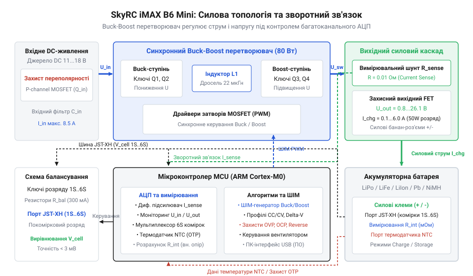
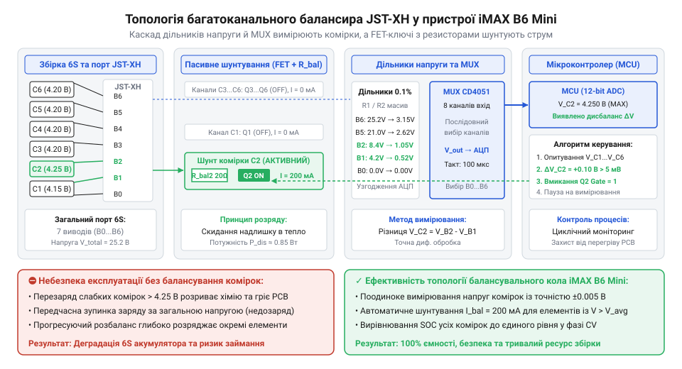
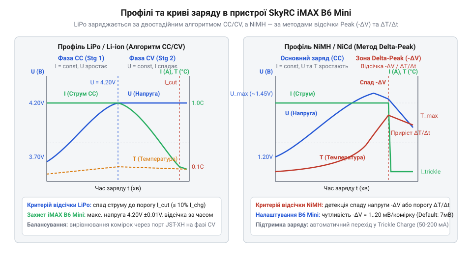
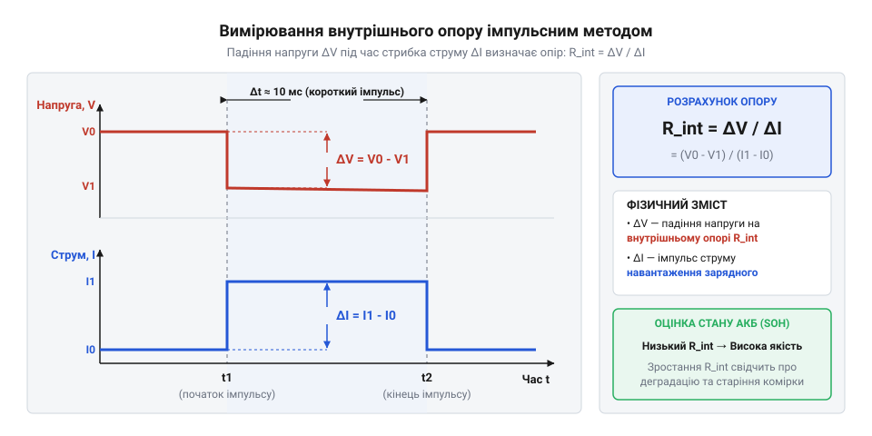

# SkyRC iMAX B6 Mini — зарядний пристрій-балансир

<preknowlist>
- [TP4056](root:cat-hw-power/tp4056) — базові принципи фаз заряду @@en|CC/CV@@ для літієвих елементів та функціонування струмового шунта
- [TP5100 — заряд 1S/2S](root:cat-hw-power/tp5100-charger) — особливості імпульсної топології @@en|Buck@@-зарядників та перемикання режимів для послідовних комірок
- [BMS 2S/3S/4S із балансуванням](root:cat-hw-power/bms-multicell) — концепція пасивного шунтування струму балансувальними резисторами та виникнення міжкоміркового дисбалансу
- [Плата захисту 1S Li-Ion](root:cat-hw-power/pcb-1s-protection) — параметри аварійної відсічки напруги та струмового захисту поодиноких літієвих елементів
</preknowlist>

## Проблема розбалансу та імпульсна топологія

Через розкид ємності та внутрішнього опору @@en|internal resistance@@ (лат. @@en|resistentia@@ — опір) послідовні комірки заряджаються нерівномірно, що призводить до перезаряду окремих елементів. Прості [однокоміркові зарядні модулі](root:cat-hw-power/tp4056) @@en|TP4056@@ та [двохкоміркові плати живлення](root:cat-hw-power/tp5100-charger) @@en|TP5100@@ не вимірюють міжкоміркові потенціали.


*Функціональні блоки понижувально-підвищувального перетворювача із вхідними фільтрами та контуром керування МК.*

Для розв'язання цієї задачі пристрій @@en|SkyRC iMAX B6 Mini@@ має імпульсний перетворювач топології @@en|Buck-Boost@@ (англ. @@en|buck-boost converter@@ — понижувально-підвищувальний перетворювач). При вхідних 11–18 В він формує напругу 1.2–25.2 В для збірок 1S–6S різної хімії (@@en|LiPo@@, @@en|LiIon@@, @@en|LiFePO4@@, @@en|NiMH@@, @@en|NiCd@@, @@en|Pb@@). Силовими ключами керує мікроконтролер @@en|ARM Cortex-M0@@ через широтно-імпульсну модуляцію @@en|PWM@@ (англ. @@en|pulse-width modulation@@ — широтно-імпульсна модуляція), обмежуючи потужність до 60 Вт при струмах 0.1–6.0 А.

## Архітектура пасивного балансування JST-XH

Великий струм на силових провідниках створює падіння напруги, що спотворює моніторинг елементів. Для усунення похибки @@en|SkyRC iMAX B6 Mini@@ має окремий роз'єм стандарту @@en|JST-XH@@ (англ. @@en|JST-XH connector@@), через який мікроконтролер вимірює потенціал кожної комірки.


*Топологія вимірювальних каналів АЦП та розрядних керамічних резисторів пасивного балансира.*

Якщо комірка досягає межі напруги раніше за інші, мікроконтролер відкриває ключ @@en|MOSFET@@ (англ. @@en|metal-oxide-semiconductor field-effect transistor@@ — польовий транзистор з ізольованим затвором), спрямовуючи надлишковий струм до 300 мА через керамічний резистор. На відміну від того, як працюють [багатокоміркові модулі BMS](root:cat-hw-power/bms-multicell), що повністю вимикають батарею, пасивне шунтування дозволяє дозаряджати інші елементи без зупинки основного тракту.

## Алгоритми заряду різних хімічних типів

Для літієвих акумуляторів (@@en|LiPo@@, @@en|LiIon@@, @@en|LiFePO4@@) мікроконтролер @@en|ARM Cortex-M0@@ реалізує [алгоритми заряду літієвих акумуляторів](root:hw-power/cc-cv-bms) за двофазним профілем @@en|CC/CV@@: стабілізація постійного струму змінюється його спадом при постійній напрузі до відсічки. Довготривале консервування забезпечує режим @@en|Storage@@ з доведенням комірок до 3.80–3.85 В.


*Часові діаграми зміни напруги й струму під час заряджання літієвих та нікелевих акумуляторів.*

Заряд елементів @@en|NiMH@@ та @@en|NiCd@@ спирається на [закінчення заряду NiMH](root:hw-power/zariad-svyntsiu-i-nimh) за методом @@en|Delta-Peak@@ (-ΔV). Фіксація спаду напруги при повній ємності дозволяє своєчасно вимкнути струм і запобігти тепловому розгону.

## Вимірювання внутрішнього опору DC-імпульсом

Для оцінки зносу елементів пристрій @@en|SkyRC iMAX B6 Mini@@ вимірює внутрішній опір методом імпульсів постійного струму @@en|DC pulse method@@ без схеми Кельвіна.


*Формування тестового струмового імпульсу та вимірювання просідання напруги на комірці.*

Силовою лінією подається імпульс струму `ΔI`, а через роз'єм @@en|JST-XH@@ контролер зчитує просідання напруги `ΔV` на комірці. Опір `R_int` обчислюється за формулою:

```
R_int = ΔV / ΔI
```

Розділення силового й вимірювального кіл усуває вплив опору провідників. На відміну від [плат захисту 1S](root:cat-hw-power/pcb-1s-protection), вимірювання `R_int` дозволяє виявити деградовані елементи до аварії.

## Комплексний апаратний захист та калібрування

Для безпечної роботи кола @@en|SkyRC iMAX B6 Mini@@ містять апаратний захист від зворотної полярності @@en|Reverse Polarity Protection@@ (англ. @@en|reverse polarity protection@@ — захист від зворотної полярності) на силових ключах та швидкодіючий захист від короткого замикання @@en|Short Circuit Protection@@ (англ. @@en|short circuit protection@@ — захист від короткого замикання). Окрім цього, мікроконтролер вимикає пристрій при просіданні вхідної напруги нижче 11 В.


*Взаємодія захисних ключів, термістора NTC та ПК-інтерфейсу з мікроконтролером пристрою.*

Тепловий стан акумулятора контролює зовнішній термістор @@en|NTC thermistor@@ (грец. @@en|therme@@ — тепло, лат. @@en|resistere@@ — чинити опір), який зупиняє процес при перегріві. Для системного моніторингу в програмі @@en|SkyRC Charge Master@@ використовується [протокол телеметрії USB](root:cat-hw-power/imax-b6-charger/api-imax-b6-usb-telemetry-protocol.md), а точність АЦП підтримує [практичний аудит та калібрування](root:cat-hw-power/imax-b6-charger/proj-imax-b6-pc-monitoring-and-calibration.md).