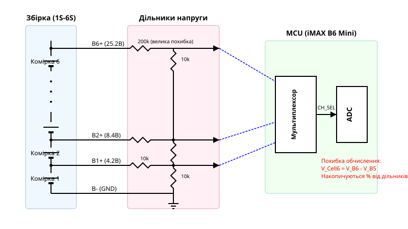
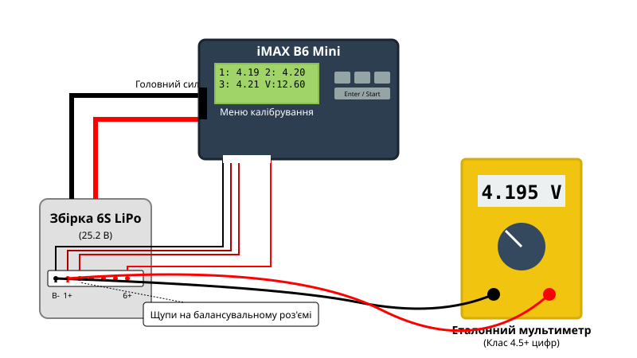

# Практичний аудит стану акумуляторів та калібрування iMAX B6 Mini через ПК

## Ризики викривлення напруги багатокоміркових батарей

Під час експлуатації багатокоміркових літієвих збірок (LiPo, LiIon) користувачі часто покладаються на загальну напругу батареї як на індикатор її заряду та здоров'я. Наприклад, якщо 6S батарея показує 25.2 В, здається, що вона повністю заряджена й готова до роботи. Однак за цією загальною цифрою може ховатися критичний розбаланс: одна з комірок може мати 4.35 В (небезпечний перезаряд), а інша — 4.05 В. Якщо таку збірку навантажити потужним споживачем, розряджена комірка миттєво просяде нижче допустимого порогу (2.5 В) і зазнає незворотної деградації, тоді як загальна напруга ще здаватиметься "нормальною" (наприклад, 20 В).

Саме тому для безпечної роботи необхідно контролювати напругу кожної комірки окремо за допомогою балансувального порту. Проте виникає нова проблема: вимірювальний тракт самого зарядного пристрою не є ідеальним. Внутрішні компоненти, які зчитують ці напруги, мають власні похибки. Якщо зарядний пристрій неправильно вимірює напругу комірок, він сам може стати причиною розбалансування під час зарядки, "вирівнюючи" комірки до хибних значень. Розуміння природи цих похибок вимагає заглиблення у схемотехніку вимірювального тракту пристрою.

## Схемотехніка балансира та дільників ADC

Щоб зрозуміти, звідки беруться помилки, розглянемо, як мікроконтролер iMAX B6 Mini вимірює напруги на комірках. Мікроконтролер (MCU) має вбудований аналого-цифровий перетворювач (ADC), який може вимірювати напруги лише в діапазоні від 0 до 3.3 В (або 5 В, залежно від опорної напруги). Акумуляторна збірка 6S має потенціали 4.2 В, 8.4 В, 12.6 В і аж до 25.2 В відносно загального мінуса. Щоб подати ці високі напруги на входи ADC, використовуються резистивні дільники напруги.

Схема дільників напруги балансувального порту показує, що потенціал кожної лінії (B1+, B2+, ..., B6+) відносно "землі" (B-) знижується відповідним резистивним дільником перед подачею на мультиплексор і далі на ADC. Проблема полягає у двох аспектах:
1. **Накопичувальна похибка:** Напруга окремої комірки обчислюється як різниця між двома сусідніми каналами. Наприклад, напруга 6-ї комірки — це $V_{B6} - V_{B5}$. Якщо вимірювання $V_{B6}$ (25.2 В) має похибку +0.5%, це дає відхилення у +0.126 В. Якщо $V_{B5}$ (21.0 В) має похибку -0.5%, відхилення становить -0.105 В. Тоді обчислена напруга 6-ї комірки матиме похибку $0.126 - (-0.105) = 0.231$ В, що є критичним для літієвої хімії.
2. **Допуски резисторів:** У дільниках використовуються прецизійні резистори, але навіть вони мають допуск 0.1% або 1%. З часом їхній опір "дрейфує" через температурні коливання та старіння.

Через ці фактори iMAX B6 Mini "з коробки" або після тривалої експлуатації може брехати на 0.05–0.1 В на канал. Щоб нівелювати цей апаратний зсув, потрібне підключення до ПК для точного моніторингу та подальше еталонне калібрування.

## Налаштування USB телеметрії в Charge Master

Для детального аналізу стану батарей можливостей вбудованого дворядкового дисплея недостатньо. iMAX B6 Mini підтримує передачу телеметрії через порт micro-USB. Для цього використовується протокол USB-HID, який не потребує встановлення віртуальних COM-портів чи специфічних драйверів — комп'ютер розпізнає зарядний пристрій автоматично.

Для розгортання вимірювального стенду потрібно:
1. Завантажити та встановити фірмове програмне забезпечення **SkyRC Charge Master**.
2. Підключити iMAX B6 Mini до ПК за допомогою якісного кабелю micro-USB (кабелі "тільки для зарядки" не підійдуть, потрібні лінії D+ та D-).
3. Якщо використовується температурний контроль, підключити виносний датчик NTC (10 кОм) у відповідний порт пристрою та притиснути його до корпусу батареї.
4. Запустити Charge Master. У лівому верхньому куті програма повинна розпізнати пристрій і показати статус `Connected`.

Після запуску процесу заряду чи розряду, програма починає малювати GUI-графіки у реальному часі. Тут можна відстежувати не лише загальну криву напруги та струму, але й подивитися на вкладку "Cell", де відображається напруга кожної з комірок (від 1S до 6S) із точністю до тисячних часток вольта. Цей безперервний потік телеметрії є безцінним інструментом для фіксації моментів відсікання, динаміки тепловиділення та виявлення проблемних комірок. Завдяки налагодженому обміну даними ми можемо переходити до найвідповідальнішого кроку — калібрування.

## Методика еталонного калібрування балансувальних каналів

Щоб змусити iMAX B6 Mini заряджати та балансувати батареї з точністю лабораторного приладу, необхідно ввести програмні поправки (зсуви) для кожного каналу ADC, спираючись на показання зовнішнього еталона. Для цього знадобиться високоточний контрольний мультиметр (DMM) з розрядністю не гірше 4.5 або 5.5 цифр (наприклад, Fluke, Brymen або Uni-T високого класу), який гарантовано показує точні значення.

Схема калібрувального підключення виглядає наступним чином: повністю заряджена та стабілізована 6S батарея (або лабораторне джерело живлення з резистивним дільником) підключається до головного силового кабелю та балансувального роз'єму. Процедура калібрування:
1. Вимкніть живлення iMAX B6 Mini.
2. Затисніть одночасно кнопки **Start** та **Dec** (або іншу комбінацію, залежно від версії прошивки) і подайте живлення. Пристрій увійде в сервісне меню калібрування.
3. На екрані з'являться показання напруги для перших трьох комірок (1-3) та загальної напруги.
4. Щупами еталонного мультиметра обережно виміряйте напругу першої комірки безпосередньо на контактах балансувального роз'єму батареї (між контактами B- та B1+).
5. Порівняйте значення на мультиметрі з тим, що показує iMAX B6 Mini. Кнопками **Inc** / **Dec** відрегулюйте значення на екрані зарядного пристрою так, щоб воно збігалося з еталонним.
6. Повторіть вимірювання для кожної наступної комірки (між B1+ і B2+, потім між B2+ і B3+ і т.д.). Для перемикання на екран комірок 4-6 використовуйте відповідну кнопку навігації.
7. Після налаштування всіх 6 каналів натисніть **Start** / **Enter** для збереження значень у незалежну пам'ять (EEPROM).

Ця процедура дозволяє мікроконтролеру врахувати фактичний опір резисторів дільника, повністю нівелюючи їх допуски та апаратний зсув опорної напруги.

## Циклічний аудит ємності та опору

Маючи відкалібрований пристрій та працюючу телеметрію в Charge Master, можна проводити професійний аудит будь-яких акумуляторних збірок. Стандартна процедура перевірки стану батареї складається з повного циклу: заряд — пауза — розряд — пауза — заряд (циклування).

1. **Вимірювання внутрішнього опору (ESR):** Завдяки точним балансувальним каналам, iMAX B6 Mini розраховує внутрішній опір кожної комірки за падінням напруги під час імпульсів струму. У Charge Master на вкладці "Resistance" відображаються ці значення в міліомах (мОм). Якщо в збірці п'ять комірок мають опір 5 мОм, а одна — 15 мОм, ця комірка є деградованою. Під час навантаження вона буде перегріватися і просідати по напрузі першою.
2. **Аудит реальної ємності:** Проводиться під час процесу розряду нормованим струмом. Графік напруги в Charge Master дозволяє побачити "полицю" розряду. Якщо лінія напруги однієї з комірок падає значно крутіше за інші, це свідчить про втрату її ємності (ефект слабкої ланки). Загальна ємність батареї завжди визначається ємністю найслабшої комірки.
3. **Температурний контроль:** Показання NTC сенсора записуються в телеметрії. Якщо під час штатного заряду або розряду температура збірки лінійно зростає вище 45-50°C, це сигнал про високий загальний внутрішній опір і наближення батареї до кінця терміну служби.

Таким чином, комбінація апаратного калібрування iMAX B6 Mini за еталонним мультиметром та програмного моніторингу дозволяє завчасно виявляти приховані дефекти, продовжувати термін служби дорогих акумуляторних збірок та забезпечувати їхню безпечну експлуатацію.

:::code proj-imax-b6-pc-monitoring-and-calibration/c/imax-b6-telemetry.c
:::code proj-imax-b6-pc-monitoring-and-calibration/cpp/imax-b6-telemetry.cpp
:::code proj-imax-b6-pc-monitoring-and-calibration/python/skyrc_monitor.py
