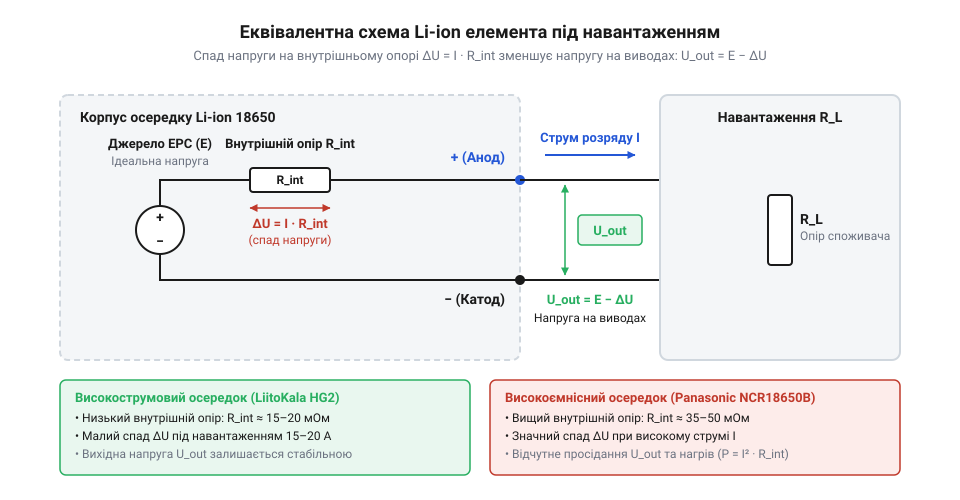
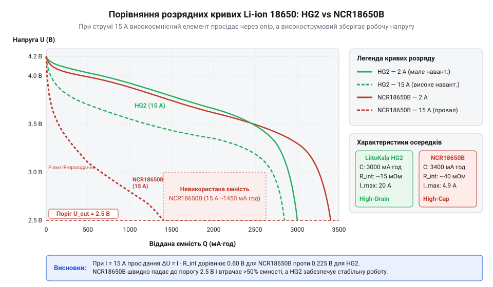
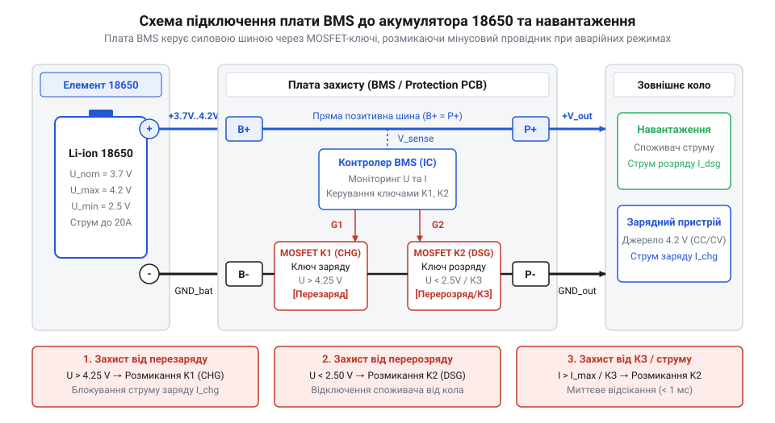

# Li-ion 18650 (LiitoKala HG2, NCR18650B)

<preknowlist>
- [Videx 14500 — Li-ion 3.7V](root:cat-hw-power/videx-14500) — Базовий принцип хімії Li-ion, діапазони робочих напруг (3.0–4.2 В) та поняття електричної ємності акумулятора.
</preknowlist>

## Просідання напруги під високим навантаженням

Уявіть ситуацію: ви вставляєте повністю заряджений літій-іонний акумулятор (англ. @@en|Li-ion@@) у потужний світлодіодний ліхтар або бездротовий електроінструмент. Мультиметр на клемах без навантаження показує 4.2 В, що свідчить про стовідсотковий рівень заряду. Однак щойно ви вмикаєте максимальний режим споживання, пристрій миттєво вимикається або сигналізує про критично розряджену батарею. Якщо ж зняти навантаження, виміряна напруга знову повертається майже до початкового значення. Таке раптове падіння напруги виникає через те, що хімічний акумулятор (лат. @@la|accumulare@@ — накопичувати) не є ідеальним джерелом напруги. Усередині будь-якої реальної електрохімічної комірки протікають фізичні процеси переносу зарядів, які чинять опір проходженню струму. Цю властивість описують як внутрішній опір (англ. @@en|internal resistance@@) елемента.

Опір осередку складається з трьох ключових компонентів: омічного опору металевих струмознімачів і рідкого електроліту, опору переносу заряду на межі розділу фаз та дифільтраційного опору переміщення іонів усередині активного матеріалу. Щоб зрозуміти електричну поведінку акумулятора під навантаженням, розглянемо його еквівалентну схему заміщення. У цій моделі комірка складається з двох послідовно з'єднаних компонентів: ідеального джерела електрорушійної сили (ЕРС, лат. @@la|electromotio@@ — рух під дією електрики) та внутрішнього опору `R_вн`.


*Еквівалентна електрична схема елемента 18650 із джерелом ЕРС, внутрішнім опором та підключеним навантаженням.*

Коли до зовнішніх виводів акумулятора підключають споживач із опором `R_нав`, в електричному колі виникає струм `I`. За законом Ома цей самий струм протікає не лише через зовнішнє навантаження, а й крізь внутрішній опір `R_вн` самого осередку. У результаті частина потенціалу джерела втрачається безпосередньо всередині акумулятора у вигляді внутрішнього падіння напруги `U_вн = I × R_вн`. Напруга `U_вив`, яка реально залишається на виводах елемента й живить підключений пристрій, розраховується за формулою:

`U_вив = E - I × R_вн`

Різниця між номінальною ЕРС та реальною напругою під навантаженням називається просіданням напруги. Чим більший струм споживає навантаження або чим вищий внутрішній опір акумулятора, тим дужче просідає напруга на клемах. Для наочності порівняємо поведінку двох елементів одинакового габариту під однаковим струмовим навантаженням.

**Обчислення падіння напруги під навантаженням 10 А для осередків із різним внутрішнім опором:**
```
U_вив_1 = E - I × R_вн1
= 4.2 - 10 × 0.015      [підстановка опору високострумового елемента 15 мОм]
= 4.05 В                [напруга на виводах осередка HG2 під навантаженням]

U_вив_2 = E - I × R_вн2
= 4.2 - 10 × 0.060      [підстановка опору високоємнісного елемента 60 мОм]
= 3.60 В                [напруга на виводах осередка NCR18650B під навантаженням]
```

З обчислень видно, що при струмі 10 А високоємнісний елемент із опором 60 мОм втрачає на власному опорі 0.6 В. Якщо такий акумулятор розряджений наполовину і його ЕРС становить 3.5 В, то під навантаженням 10 А напруга на клемах впаде до 2.9 В. Більшість плат захисту та електронних контролерів сприймуть рівень 2.9 В як гранично припустимий розряд і миттєво відсічуть живлення. У результаті пристрій припинить роботу, хоча всередині осередку ще залишатиметься понад 40% невикористаної хімічної енергії. Крім того, за законом Джоуля (англ. @@en|Joule@@) вся втрачена на внутрішньому опорі потужність `P_втрат = I² × R_вн` перетворюється на тепло, що викликає інтенсивний розігрів елемента.

Формат @@en|18650@@ має багату історію вдосконалення внутрішньої структури. У 1991 році компанія @@en|Sony@@ вивела на ринок перший масовий елемент @@en|18650@@ для живлення портативної електроніки, де застосовувалася кобальтова хімія (LCO, англ. @@en|LCO@@, @@en|Lithium Cobalt Oxide@@). З часом зростання потужності споживачів змусило розробників перейти до нікель-марганець-кобальтових (NMC, англ. @@en|NMC@@, @@en|Nickel Manganese Cobalt Oxide@@) та нікель-кобальт-алюмінієвих (NCA, англ. @@en|NCA@@, @@en|Nickel Cobalt Aluminum Oxide@@) компоновок. Це спричинило технологічне розділення ринку на дві категорії: високоємнісні елементи на кшталт @@en|Panasonic NCR18650B@@ для долготривалого живлення низьким струмом та високострумові осередки на зразок @@en|LiitoKala HG2@@ (аналог @@en|LG HG2@@) для силового обладнання. Вимоги електроінструментів, безпілотників та електротранспорту змусили виробників оптимізувати конструктиви струмознімачів для зниження внутрішнього опору.

Кожен циліндричний осередок має суворі [габаритні специфікації осередків](root:cat-hw-power/li-ion-18650-cells/api-18650-hardware-specs.md), де чітко нормовано геометричні розміри 18.0 мм на 65.0 мм. Попри однакові зовнішні виміри, внутрішня електрохімічна будова високострумових і високоємнісних моделей суттєво відрізняється. Це виражається у відмінностях їхнього C-рейтингу та розрядних характеристик порівняно з меншими елементами, такими як [характеристики елемента Videx 14500](root:cat-hw-power/videx-14500).

## Внутрішній опір та C-рейтинг елементів

Електрохімічна різниця між високострумовими та високоємнісними елементами розкривається в будові їхнього рулону (англ. @@en|jelly roll@@), що складається з катода (грец. @@el|káthodos@@ — шлях донизу), анода (грец. @@el|ánodos@@ — шлях вгору), сепаратора (лат. @@la|separator@@ — розділювач) та електроліту (грец. @@el|lytos@@ — розчинний). Щоб досягти максимальної ємності 3400 мА·год в елементі @@en|Panasonic NCR18650B@@ (хімія @@en|NCA@@), виробник наносить товсті шари активного матеріалу на мідну та алюмінієву фольгу. Оскільки об'єм циліндра обмежений, для струмознімачів залишається мінімум місця: фольга робиться тонкою, а струмові виводи (таби) приварюються лише в одному або двох місцях. Це забезпечує високу щільність енергії, проте підвищує внутрішній опір `R_вн` до 40–60 мОм через довгий шлях проходження електронів уздовж фольги.

У високострумових елементах, таких як @@en|LiitoKala HG2@@ (ємність 3000 мА·год, хімія @@en|NMC@@), пріоритетом є мінімізація втрат. Виробники використовують тонші шари активної маси, але значно товщу фольгу та приварюють декілька струмознімальних табів по всій довжині електродної стрічки. Завдяки цьому електрони вирушають до клем короткими паралельними шляхами, знижуючи внутрішній опір до 13–20 мОм. Щоб оцінити здатність акумулятора віддавати струм без небезпечного перегріву, використовують поняття C-рейтинг (англ. @@en|C-rate@@ від @@en|capacity@@ — ємність).

Одиниця `1C` відповідає струму розряду в амперах, чисельно рівному номінальній ємності `C_ном` в ампер-годинах. Наприклад, для елемента ємністю 3.0 А·год струм `1C` дорівнює 3.0 А, а `5C` становить 15.0 А. Максимально припустимий тривалий струм розряду `I_макс` розраховують за формулою:

`I_макс = C_ном × C_рейт`

Елемент @@en|Panasonic NCR18650B@@ має розрядний C-рейтинг близько `2C`, що відповідає максимальному тривалому струму `3.4 × 2 = 6.8 А`. Натомість осередок @@en|LiitoKala HG2@@ розрахований на C-рейтинг `6.67C`, що дозволяє йому безперервно віддавати струм до 20 А. Комплексний [математичний розрахунок параметрів](root:cat-hw-power/li-ion-18650-cells/math-18650-electrical-char-calc.md) дозволяє точно моделювати роботу обох типів хімії в різних режимах навантаження. Головний наслідок перевищення припустимого C-рейтингу — експоненційне зростання теплових втрат.

**Розрахунок теплової потужності втрат для LiitoKala HG2 та Panasonic NCR18650B при розряді струмом 15 А:**
```
P_HG2 = I² × R_вн_HG2
= 15² × 0.015          [підстановка струму 15 А та опору 15 мОм]
= 225 × 0.015          [обчислення квадрата струму]
= 3.375 Вт             [теплові втрати осередка HG2]

P_NCR = I² × R_вн_NCR
= 15² × 0.050          [підстановка струму 15 А та опору 50 мОм]
= 225 × 0.050          [обчислення квадрата струму]
= 11.25 Вт             [теплові втрати осередка NCR18650B]
```

Зіставляючи результати обчислень, бачимо, що під навантаженням 15 А високоємнісний осередок @@en|Panasonic NCR18650B@@ виділяє 11.25 Вт теплової потужності. Усередині невеликого закритого корпусу масою 45 грамів це викликає розігрів зі швидкістю понад 1 °C за секунду, що швидко призводить до деградації електроліту та спрацьовування захисного клапана. Натомість високострумовий елемент @@en|LiitoKala HG2@@ виділяє лише 3.375 Вт, що легко розсіюється природною або примусовою конвекцією повітря.


*Графік розрядних кривих (напруга від відданої ємності) для LiitoKala HG2 та Panasonic NCR18650B при струмах 2 А та 15 А.*

На знятих розрядних кривих чітко видно різницю між двома хіміями. При низькому струмі 2 А елемент @@en|Panasonic NCR18650B@@ демонструє свою перевагу, віддаючи більше енергії завдяки високій початковій ємності. Проте при зростанні струму до 15 А крива @@en|NCR18650B@@ різко падає донизу через великий внутрішній опір, і корисна віддана ємність падає майже до нуля. У той же час розрядна крива @@en|LiitoKala HG2@@ при 15 А проходить значно вище й утримує стабільну робочу напругу протягом більшої частини циклу. Щоб точно оцінювати стан осередків, застосовують інструментальне [вимірювання внутрішнього опору](root:hw-sensing/battery-internal-resistance-measurement).

## Характеристики розряду та термічні обмеження

При виборі акумулятора важливо розрізняти віддавану електричну ємність, вимірювану в ампер-годинах (А·год), та корисну енергію, вимірювану у ват-годинах (Вт·год). Корисна енергія є інтегралом миттєвої потужності за часом розряду `W = ∫ U(t) × I dt`. Оскільки під високим струмом напруга `U(t)` на виводах елемента просідає через внутрішній опір, загальна віддана енергія зменшується значно швидше, ніж чисельна ємність в А·год.

Значний вплив на безпеку та ефективність роботи акумуляторних елементів справляє температура навколишнього середовища. Нормальний температурний діапазон розряду становить від -20 °C до +60 °C, а заряду — від 0 °C до +45 °C. При від'ємних температурах в'язкість рідкого електроліту зростає, а дифузія іонів літію (грец. @@el|ion@@ — той, що йде) в графітовому аноді сповільнюється. Спроба заряджати елемент при температурі нижче 0 °C призводить до дендритного осадження металевого літію на поверхні анода, що створює ризик проколу сепаратора та внутрішнього короткого замикання.

При підвищенні температури понад +60...++70 °C починає руйнуватися пасивний шар на аноді — твердоелектролітна інтерфаза (SEI, англ. @@en|SEI@@, @@en|Solid Electrolyte Interphase@@). Це запускає незворотні екзотермічні реакції окислення електроліту, виділення газів і призводить до катастрофічного явища, відомого як термічний розгін (англ. @@en|thermal runaway@@). Детальніше молекулярні процеси руйнування електродів описують [процеси деградації осередків](root:hw-power/battery-aging).

Для запобігання виходу елементів за безпечні межі напруги, струму та температури обов'язково застосовують плату управління та захисту (BMS, англ. @@en|BMS@@, @@en|Battery Management System@@).


*Схема включення плати BMS між елементом 18650 та навантаженням із позначенням ключів MOSFET для відсічки перезаряду, перерозряду та короткого замикання.*

Плата @@en|BMS@@ вмикається в розрив між від'ємним виводом елемента та навантаженням. Основними виконавчими елементами схеми є силові польові транзистори (MOSFET, англ. @@en|MOSFET@@, @@en|Metal-Oxide-Semiconductor Field-Effect Transistor@@). Керуюча мікросхема постійно контролює напругу на осередку: при перевищенні 4.25 В розмикається ключ заряду, а при падінні нижче 2.5 В або виникненні короткого замикання замикається захист розряду. При побудові багатоелементних систем професійний підхід базується на [використанні плати BMS](root:hw-power/bms), а для безпечного заряджання поодиноких елементів застосовують плати на базі [контролерів заряду TP4056](root:hw-power/li-ion-charger).

Для точної оцінки фактичних параметрів акумуляторів виконують лабораторний [стендовий аналіз розряду](root:cat-hw-power/li-ion-18650-cells/proj-18650-discharge-bench-test.md), що дозволяє будувати реальні розрядні характеристики під контрольованим навантаженням. Отримані дані дають змогу розраховувати та виготовляти надійні акумуляторні блоки, для чого проводиться [збірка акумуляторної батареї](root:cat-hw-power/li-ion-18650-cells/proj-18650-battery-pack-design.md) методом точкового зварювання. Для додаткового підвищення автономності в сучасній техніці замість 18650 нерідко обирають великогабаритніші [елементів формату 21700](root:cat-hw-power/li-ion-21700-cells) або плоскопрофільні [модулів живлення LiPo](root:cat-hw-power/lipo-3s), а в автономних системах зарядку може здійснювати [малопотужна сонячна панель](root:cat-hw-power/solar-panel-6v).

## Захист і балансування у базі BMS

Уявіть автономний прилад або батарейний блок, у якому один із літій-іонних (англ. @@en|Li-ion@@) осередків через незначний заводський розкид параметрів розряджається трохи швидше за інші. Якщо система позбавлена індивідуального контролю, споживач продовжуватиме відбирати струм доти, доки загальна напруга збірки здаватиметься достатньою. У цей момент найслабший елемент опуститься нижче критичного порогу і зазнає незворотного хімічного руйнування. А під час наступного заряджання той самий осередок першим досягне верхньої межі й почне перегріватися, створюючи ризик займання. Окремий елемент формату @@en|18650@@ має суворі електрохімічні межі безпечної роботи: верхній поріг напруги становить від 4.20 В до 4.25 В, нижній — від 2.50 В до 2.80 В, а максимальний струм обмежений його внутрішньою конструкцією. Для автоматичного утримання акумулятора в цих межах застосовують плату управління та захисту (BMS, англ. @@en|BMS@@, @@en|Battery Management System@@ — система управління батареєю).

Головне завдання плати @@en|BMS@@ — виявлення критичних режимів експлуатації за допомогою безперервного моніторингу електричних і термічних параметрів. Ключовим виконавчим елементом системи є силові польові транзистори (MOSFET, англ. @@en|MOSFET@@, @@en|Metal-Oxide-Semiconductor Field-Effect Transistor@@ — польовий транзистор із ізольованим затвором), увімкнені в розрив силової лінії живлення. Мікросхема контролера аналізує напругу на кожній комірці та порівнює її з закладеними електрохімічними порогами.

При виході напруги за верхній поріг (захист від перезаряду, зазвичай `4.25...4.30 В`) контролер негайно розмикає ключ заряду. Перевищення напруги понад 4.20 В на осередок викликає інтенсивне виділення кисню з катодного матеріалу та окислення рідкого електроліту. Це призводить до підвищення внутрішнього тиску, здуття корпусу та осадження металевого літію на аноді, що здатне спровокувати термічний розгін.

Якщо ж напруга падає нижче нижнього порогу (захист від перерозряду, зазвичай `2.50...2.80 В`), розмикається ключ розряду. Глибокий розряд нижче 2.50 В викликає розчинення мідної фольги анодного струмознімача в електроліті. Іони міді `Cu²⁺` переходять у розчин, а при наступній спробі зарядити акумулятор відновлюються у вигляді металевих мікроскопічних дендритів. Ці мідні нитки проростають крізь сепаратор, створюючи стійке внутрішнє коротке замикання, через яке осередок повністю втрачає здатність утримувати заряд або займається під час заряджання.

Окремим контуром безпеки є захист від струмового перевантаження та короткого замикання. Коли струм навантаження перевищує максимально припустимий поріг `I_захисту`, керуюча мікросхема BMS вимірює падіння напруги на каналі ключів @@en|MOSFET@@ або спеціальному вимірювальному шунті (англ. @@en|shunt@@ — відгалуження). Якщо струм виходить за межі норми, захист спрацьовує з затримкою в кілька мілісекунд, а при короткому замиканні — за мікросекунди. При розробці високонавантажених батарей важливо спиратися на [математичні розрахунки навантаження](root:cat-hw-power/li-ion-18650-cells/math-18650-electrical-char-calc.md), щоб опір відкритих каналів транзисторів `R_ds(on)` не створював додаткового паразитного нагріву самої плати.

Коли кілька осередків з'єднують послідовно для отримання вищої напруги, виникає проблема дисбалансу (франц. @@fr|déséquilibre@@ — порушення рівноваги). Навіть елементи з однієї партії мають мінімальні відмінності в ємності та внутрішньому опорі. Під час циклів заряду й розряду ці відмінності накопичуються: осередок із меншою ємністю розряджається першим і заряджається швидше за інші. У результаті загальна корисна ємність всієї батареї обмежується найслабшим елементом. Для усунення цього явища використовують модулі балансування.


*Порівняльна схема функціонування пасивного балансира на базі розрядних резисторів та активного балансира на базі імпульсного переносу заряду.*

У пасивному балансуванні (лат. @@la|passivus@@ — той, що піддається впливу) надлишок енергії з більш заряджених осередків просто перетворюється на тепло. Коли напруга на комірці досягає порогу початку балансування (наприклад, `4.18...4.20 В`), паралельно до неї через ключ умикається розрядний резистор. Струм балансування `I_бал` (зазвичай від 30 мА до 100 мА) розряджає цей осередок, дозволяючи іншим, повільнішим коміркам підтягнутися до того ж рівня напруги. 

**Обчислення теплової потужності розсіювання пасивного балансира та часу вирівнювання осередків:**
```
P_баланс = U_поріг × I_бал
= 4.20 × 0.050      [підстановка напруги 4.20 В та струму балансування 50 мА]
= 0.21 Вт           [теплова потужність розсіювання на одному балансувальному резисторі]

t_вирівнювання = ΔQ ÷ I_бал
= 0.15 ÷ 0.050      [підстановка дисбалансу ємності 150 мА·год та струму 50 мА]
= 3.0 години        [час для відновлення балансу між осередками]
```

Як видно з розрахунку, пасивне балансування розсіює 0.21 Вт тепла на кожному каналі й вимагає суттєвого часу для усунення розбіжностей. При великому розкиді ємностей пасивні резистори сильно розігрівають плату. У потужних акумуляторних блоках застосовують активне балансування (лат. @@la|activus@@ — дієвий). Активний балансир не спалює енергію, а перекачує її з більш заряджених осередків у менш заряджені за допомогою дроселів або конденсаторних ключів із ККД понад 90%. Для глибокого розуміння побудови систем живлення варто ознайомитися з [архітектурою плат BMS](root:hw-power/bms), а для безпечної зарядки окремих елементів використовувати [модулі заряду TP4056](root:hw-power/li-ion-charger). Усі ці принципи є фундаментальними при [проектуванні акумуляторних збірок](root:cat-hw-power/li-ion-18650-cells/proj-18650-battery-pack-design.md) із елементів 18650.

## Фактори деградації та вибір акумулятора

Купуючи два абсолютно одинакових нових елементи @@en|18650@@, користувач може отримати від одного 300 циклів роботи, а від іншого — понад 1500 циклів. Різниця полягає не у відсотку заводського браку, а в умовах експлуатації та відповідності типу осередку конкретному профілю споживання. Незворотна деградація (лат. @@la|degradatio@@ — зниження ступеня, занепад) літій-іонного акумулятора обумовлена складними фізико-хімічними перебудовами всередині його електродного блоку.

Основним хімічним чинником старіння є ріст пасивуючої плівки на поверхні графітового анода — твердоелектролітної інтерфази (SEI, англ. @@en|SEI@@, @@en|Solid Electrolyte Interphase@@). Під час перших запусків акумулятора шар @@en|SEI@@ формується природно та захищає анод від подальшого руйнування електролітом. Проте при високих робочих напругах (понад 4.10 В) та підвищеній температурі (понад 45 °C) цей шар безперервно потовщується. На його ріст незворотно витрачаються активні іони літію та молекули рідкого електроліту, що призводить до поступової втрати ємності та підвищення внутрішнього опору `R_вн`.

Другий важливий механізм — механічна деструкція активної маси. Під час заряджання іони літію впроваджуються у кристалічну ґратку анода — цей процес називається інтеркаляцією (лат. @@la|intercalatio@@ — вставка). При розряджанні відбується зворотний процес — деінтеркаляція (вилучення іонів). Постійна зміна об'єму матеріалу електродів (до 10% під час кожного циклу) викликає механічні напруження, мікротріщини в активному шарі та поступове відшарування частинок від мідної й алюмінієвої фольги струмознімачів.

Суттєвий вплив на швидкість цього руйнування має глибина розряду (DoD, англ. @@en|DoD@@, @@en|Depth of Discharge@@ — глибина розряду). Експлуатація акумулятора в режимі 100% DoD (повний заряд до 4.20 В і розряд до 2.50 В) викликає максимальні механічні деформації та прискорений ріст плівки @@en|SEI@@. Якщо ж звузити робочий діапазон напруг до 20–80% (режим 60% DoD з робочим вікном 3.30–4.05 В), циклічний ресурс елемента зростає в кілька разів.


*Залежність залишкової ємності осередка 18650 від кількості циклів при різній глибині розряду (DoD) та робочій температурі.*

Окрім глибини розряду, вирішальне значення мають температура та струми роботи. Високі струми розряду викликають інтенсивний нагрів за законом Джоуля-Ленца `P = I² × R_вн`. Робота при температурі понад 50 °C прискорює хімічні побічні реакції вдвічі на кожні 10 °C підвищення. А заряджання при від'ємних температурах спричиняє осадження металевого літію замість інтеркаляції. Більш детально хімію руйнування висвітлюють [механізми старіння акумуляторів](root:hw-power/battery-aging).

**Обчислення циклічного ресурсу та залишкової ємності осередка залежно від глибини розряду:**
```
W_сумарна_100 = N_циклів_100 × C_ном × U_сер
= 400 × 3.0 × 3.7        [підстановка 400 циклів при 100% DoD для ємності 3.0 А·год]
= 4440 Вт·год            [сумарна віддана енергія за термін служби]

W_сумарна_80 = N_циклів_80 × (C_ном × 0.80) × U_сер
= 1500 × (3.0 × 0.80) × 3.7   [підстановка 1500 циклів при обмеженні DoD до 80%]
= 1500 × 2.4 × 3.7       [обчислення корисної ємності за цикл]
= 13320 Вт·год           [сумарна віддана енергія при обмеженій глибині розряду]
```

Обчислення наочно доводять: обмеження глибини розряду лише на 20% дозволяє отримати втричі більше загальної корисній енергії за весь термін служби осередка.

Для досягнення максимального ресурсу та ефективності необхідно свідомо підбирати модель акумулятора під специфіку споживача:

1. **Високострумовий профіль (струм понад 10–20 А на осередок)**: електроінструмент, квадрокоптери, потужні світлодіодні прожектори, вейпи, електротранспорт. Тут єдиним правильним вибором є високострумові елементи на кшталт @@en|LiitoKala HG2@@. Їхній низький внутрішній опір `R_вн ≈ 15 мОм` мінімізує просідання напруги під навантаженням та запобігає перегріву. Спроба поставити сюди високоємнісний елемент призведе до миттєвого просідання напруги, відсічки захисту та швидкого виходу акумулятора з ладу.

2. **Низькострумовий автономний профіль (струм менше 1–3 А на осередок)**: павербанки, світлодіодні нічники, автономні контролери та датчики, резервні джерела живлення. Для таких пристроїв ідеально підходять високоємнісні елементи на зразок @@en|Panasonic NCR18650B@@ (3400 мА·год). При малих струмах внутрішній опір 50 мОм не створює відчутних втрат, і пристрій отримує максимальну тривалість автономної роботи на одному заряді.

3. **Спеціалізовані та альтернативні формфактори**: якщо пристрій потребує більшої автономності при високому струмі, доцільно звернути увагу на [великогабаритні осередки 21700](root:cat-hw-power/li-ion-21700-cells), які поєднують ємність понад 4000 мА·год із низьким опором. У силовому моделюванні та авіамоделюванні краще застосовувати [силові LiPo збірки](root:cat-hw-power/lipo-3s) з високим C-рейтингом. Для надкомпактних пристроїв підійдуть [малі елементи 14500](root:cat-hw-power/videx-14500), а у повністю автономних екологічних системах зарядку може підтримувати [малопотужна сонячна панель](root:cat-hw-power/solar-panel-6v).

Грамотне поєднання порогів BMS, оптимального температурного режиму та правильного вибору хімії дозволяє максимально розкрити потенціал елементів 18650 у будь-яких інженерних проєктах.