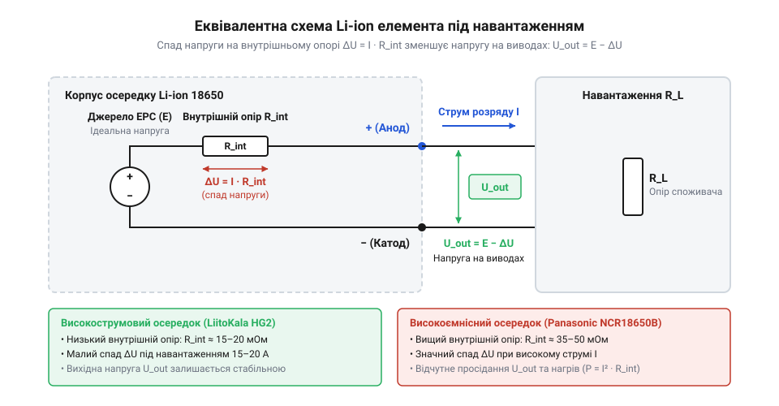
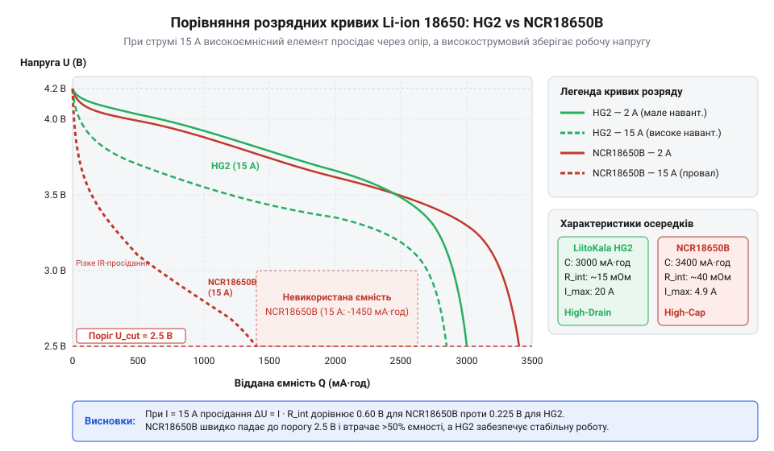
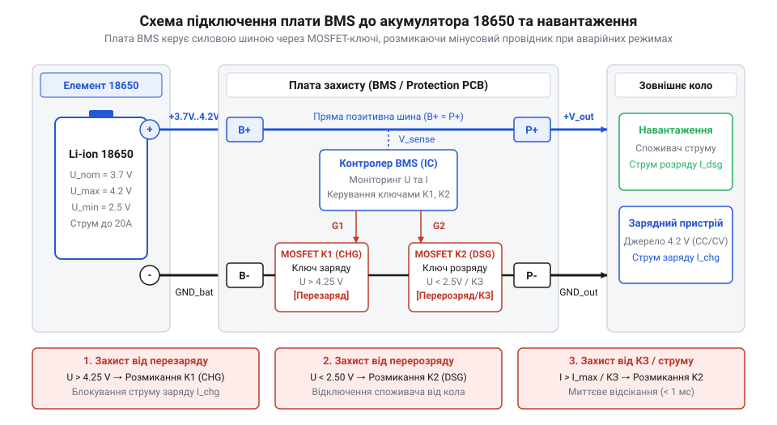

# Li-ion 18650 (LiitoKala HG2, NCR18650B)

<preknowlist>
- [Videx 14500 — Li-ion 3.7V](root:cat-hw-power/videx-14500) — Базовий принцип хімії Li-ion, діапазони робочих напруг (3.0–4.2 В) та поняття електричної ємності акумулятора.
</preknowlist>

## Просідання напруги під високим навантаженням

Підключення потужного споживача до акумулятора @@en|Li-ion@@ спричиняє падіння напруги та вимкнення пристрою. Кожна комірка має @@uk|внутрішній опір@@ `R_int`. Еквівалентна схема містить джерело @@uk|електрорушійної сили@@ (@@uk|ЕРС@@ `E`) та послідовний опір `R_int`. Як і [елементи Videx 14500](root:cat-hw-power/videx-14500), типорозмір @@en|18650@@ підпорядковується цим законам.

*Еквівалентна схема з джерелом ЕРС E та послідовним опором R_int.*

При струмі `I` напруга `U_cell` обчислюється за законом Ома:

        U_cell = E - ΔU           [напруга терміналів зі спадом]
        = E - I · R_int           [закон Ома для внутрішнього опору]

Теплові втрати `P_heat` визначає закон Джоуля-Ленца:

        P_heat = I² · R_int       [втрати на внутрішньому опорі]

Без навантаження спад `ΔU` зникає, а напруга повертається до `E`.

## Внутрішній опір та C-рейтинг елементів

Елемент @@en|18650@@ — це згорнутий рулон із електродів та сепаратора. У [силових осередках LiitoKala HG2](root:cat-hw-power/liitokala-hg2) тонкі електроди з більшою площею, потовщена мідна фольга та численні струмознімальні виводи (@@en|таби@@, від англ. @@en|tab@@ — вивід) знижують @@uk|внутрішній опір@@ `R_int` до 15–20 мОм. У [високоємнісних елементах Panasonic NCR18650B](root:cat-hw-power/panasonic-ncr18650b) товстий активний шар і мінімум табів максимізують заряд, але підвищують `R_int` до 40–50 мОм. Граничне навантаження визначає @@en|C-рейтинг@@ (від англ. @@en|capacity rate@@ — норма ємності, @@en|C-rate@@).

*Графік розряду ілюструє менше просідання напруги високострумового елемента HG2 порівняно з високоємнісним NCR18650B при високих навантаженнях.*

Граничний струм розряду `I_max` обчислюють за формулою:

        I_max = C_rate · C_nom    [обчислення граничного струму розряду]

Для комірки @@en|Panasonic NCR18650B@@ (3.4 А·год, 2C) максимум дорівнює 6.8 А. Порівняння теплових втрат при струмі 10 А для @@en|LiitoKala HG2@@ (`R_int = 0.018 Ом`) та @@en|Panasonic NCR18650B@@ (`R_int = 0.045 Ом`) виконують так:

        P_HG2 = (10)² · 0.018
        = 1.8 Вт                  [теплові втрати LiitoKala HG2]

        P_NCR = (10)² · 0.045
        = 4.5 Вт                  [теплові втрати Panasonic NCR18650B]

Високий `R_int` елемента NCR18650B при силовому навантаженні спричиняє перегрів і просідання напруги.

## Характеристики розряду та термічні обмеження

Через омічне просідання напруги корисна енергія у Вт·год нижча за ємність в А·год. Заряджання нижче 0 °C сповільнює дифузію й осаджує літій (від англ. @@en|lithium plating@@) на аноді з ризиком короткого замикання. Попри вищу теплоємність [великогабаритних елементів 21700](root:cat-hw-power/li-ion-21700-cells), поріг деградації хімії однаковий. Перегрів понад 80 °C руйнує плівку @@en|SEI@@ (від англ. @@en|Solid Electrolyte Interphase@@), запускаючи @@uk|термічний розгін@@ (від англ. @@en|thermal runaway@@).

## Захист і балансування у базі BMS

Для запобігання деструкції комірка @@en|Li-ion@@ вимагає напруг 2.5–4.2 В. Розряд нижче 2.5 В розчиняє мідний анод із проростанням дендритів крізь сепаратор під час заряду, а перезаряд понад 4.25 В руйнує катод. Захист виконує модуль @@en|BMS@@ (від англ. @@en|Battery Management System@@), комутуючи струм через ключі @@en|MOSFET@@.

*Підключення контролера BMS і ключів MOSFET у розрив мінусового провідника.*

Розкид ємності послідовних комірок спричиняє дисбаланс при заряджанні. Вирівнювання забезпечує @@uk|пасивне балансування@@ розсіюванням надлишку на резисторах або @@uk|активне балансування@@ перекачуванням енергії між осередками, що важливо, коли будується [силова літій-полімерна батарея](root:cat-hw-power/lipo-3s) чи збірка 18650.

*Розсіювання енергії при пасивному балансуванні проти її перекачування при активному.*

## Фактори деградації та вибір акумулятора

Хімічне старіння 18650 зумовлене потовщенням плівки @@en|SEI@@ на аноді, що зв'язує іони літію й підвищує @@uk|внутрішній опір@@. Механічне руйнування виникає через деформацію кристалічної ґратки при інтеркаляції (від лат. @@la|intercalare@@ — вставляти), що утворює мікротріщини. Ресурс батареї залежить від глибини розряду @@en|DoD@@ (від англ. @@en|Depth of Discharge@@).

*Прискорення деградації ємності осередку від зростання глибини розряду @@en|DoD@@ та температури.*

Розряд із 100% @@en|DoD@@ (4.2–2.5 В) дає 300–500 циклів до втрати 20% ємності, а обмеження до 80% @@en|DoD@@ продовжує ресурс до 1500 циклів. Для силових пристроїв обирають низькоомні @@en|LiitoKala HG2@@, а для низькострумових систем і [буферного живлення сонячної панелі](root:cat-hw-power/solar-panel-6v) — високоємнісні @@en|Panasonic NCR18650B@@.