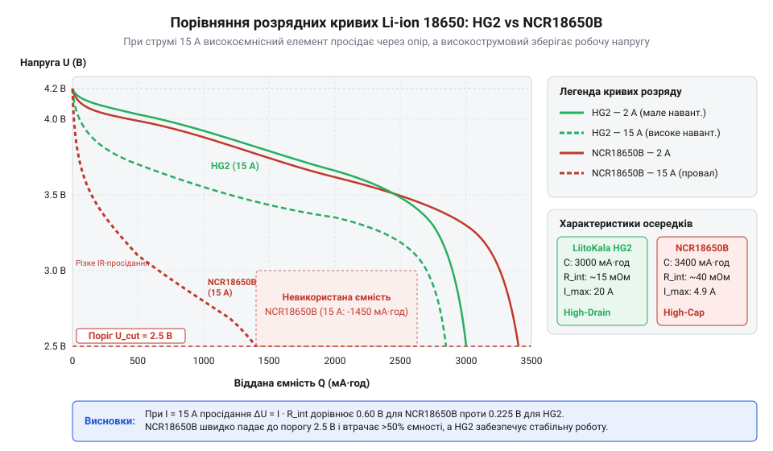

# Стендовий порівняльний аналіз розряду LiitoKala HG2 та Panasonic NCR18650B

## Проблеми вибору 18650 під навантаженням

Під час конструювання портативних пристроїв розробники часто обирають акумулятори форм-фактора 18650, орієнтуючись винятково на маркування ємності (наприклад, 3400 мА·год). Однак спроба використати високоємнісні осередки, такі як Panasonic NCR18650B, у проектах з високими струмами (дрони, потужні ліхтарі, електроінструменти) призводить до непередбачуваних наслідків. За струму 10 А і вище напруга на такому елементі миттєво просідає нижче робочого порогу (зазвичай 3.0 В), активуючи захист або вимикаючи пристрій, хоча акумулятор залишається фактично зарядженим. Крім того, тривале навантаження спричиняє інтенсивне тепловиділення, що може призвести до термічного розгону та займання осередку. Це доводить, що для безпечної та ефективної експлуатації критично важливо розуміти реальну здатність акумулятора віддавати заявлений струм.

## Внутрішній опір та тип хімії

Головним параметром, який визначає здатність акумулятора працювати під високим навантаженням, є його внутрішній опір. На ринку існують два основних класи 18650-елементів, що відрізняються хімією катода та оптимізацією структури. Наприклад, Panasonic NCR18650B (хімія NCA) оптимізований для максимальної ємності та має відносно високий внутрішній опір, що робить його придатним лише для низькострумових застосувань (до 5-7 А). Натомість LiitoKala HG2 (часто на базі NMC-хімії) розроблений як високострумовий елемент (High Drain), здатний витримувати розряд струмами до 20 А.

Внутрішній опір прийнято вимірювати двома методами: AC IR (змінним струмом на частоті 1 кГц, зазвичай до 15-30 мОм для високострумових елементів) та DC IR (розрахунок за падінням напруги при подачі постійного струму). На практиці DC IR краще відображає реальні втрати енергії у вигляді тепла та просідання напруги ($\Delta U = I \cdot R_{DC}$) під навантаженням. Елемент із високим опором буде значно більше нагріватись, перетворюючи частину власної енергії на марне тепло.

## Проектування чотирипровідного вимірювального стенда

Для точного зняття характеристик необхідно зібрати вимірювальний стенд. Звичайне двопровідне підключення вносить значну похибку через опір з'єднувальних дротів і пружинних контактів батарейного холдера. На струмі 15 А навіть опір дротів у 20 мОм дасть падіння напруги в 0.3 В, що спотворить результати вимірювання.

Вирішенням цієї проблеми є використання чотирипровідного підключення (схеми Кельвіна). У цьому випадку силові дроти (Force) подають струм розряду від електронного навантаження, а окремі вимірювальні дроти (Sense) підключаються безпосередньо до полюсів акумулятора. Оскільки струм у вимірювальних лініях мізерний (мікроампери), падіння напруги на них відсутнє, що дозволяє фіксувати істинне значення на контактах акумулятора.

Стенд складається з програмованого електронного навантаження, спеціалізованого холдера для 18650 з роздільними струмовими та потенційними контактами на кожному полюсі, а також мікроконтролера для збору телеметрії.

:::code proj-18650-discharge-bench-test/c/discharge-read-analog.c

:::code proj-18650-discharge-bench-test/cpp/discharge-controller.cpp

## Зняття та аналіз кривих розряду

Зібравши стенд, можна провести порівняльні тести акумулятора HG2 та NCR18650B на струмах 2 А, 10 А та 15 А. Розрядна крива відображає падіння напруги залежно від відданої ємності (mAh). Досягнення напруги відсічки (зазвичай 2.5 В - 2.75 В) вважається кінцем розряду.

На струмі 2 А обидва акумулятори демонструють стабільну плато-криву, при цьому NCR18650B віддає більшу ємність завдяки своїй початковій специфікації. Проте картина кардинально змінюється при струмах 10 А та 15 А. Напруга NCR18650B миттєво просідає через високий DC IR, графік зміщується вниз, і напруга швидко досягає порогу відсічки 2.75 В, віддавши лише невелику частину своєї ємності. Натомість високострумовий LiitoKala HG2 втримує стабільне плато близько 3.4-3.5 В, віддаючи заявлену ємність навіть за екстремального навантаження.

:::code proj-18650-discharge-bench-test/python/log_telemetry.py

## Тепловий контроль і виявлення підробок

Тепловиділення під час розряду тісно пов'язане з втратами на внутрішньому опорі. Завдяки моніторингу температури корпусу термопарою або тепловізором можна виявити деградовані осередки або підробки. Високоємнісний або підроблений елемент із великим опором при розряді струмом 10-15 А нагріватиметься зі швидкістю, що може перевищити безпечний ліміт 60-70 °C ще до вичерпання ємності.

Вхідний контроль якості (Quality Control) 18650 повинен включати не лише заміри ємності малим струмом, але й тест на DC IR та динаміку нагріву під імпульсним високим навантаженням. Якщо акумулятор, промаркований як 3000 mAh 20A, при тестуванні 10 А показує просідання напруги на 0.5 В за перші кілька секунд і різкий ріст температури — це беззаперечна ознака підробки (перепакованого низькострумового елемента). Зняття розрядних кривих та тепловий моніторинг є найнадійнішим способом відбракування сумнівних акумуляторів перед збиранням багатоелементних батарей.
