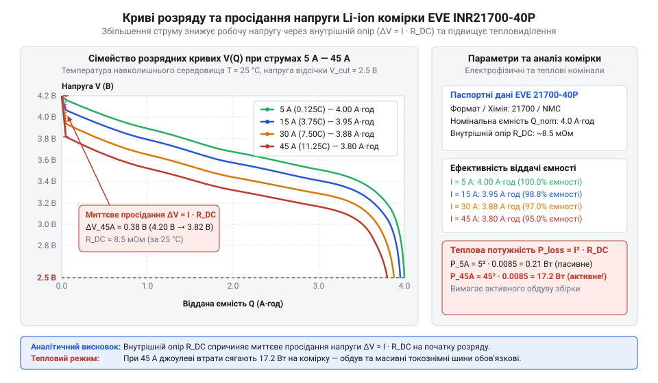
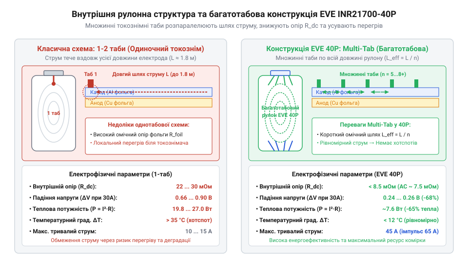
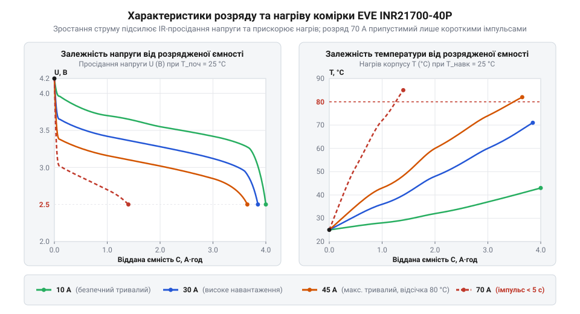
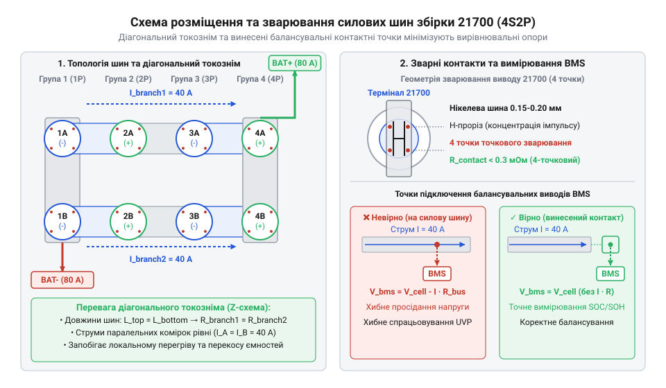
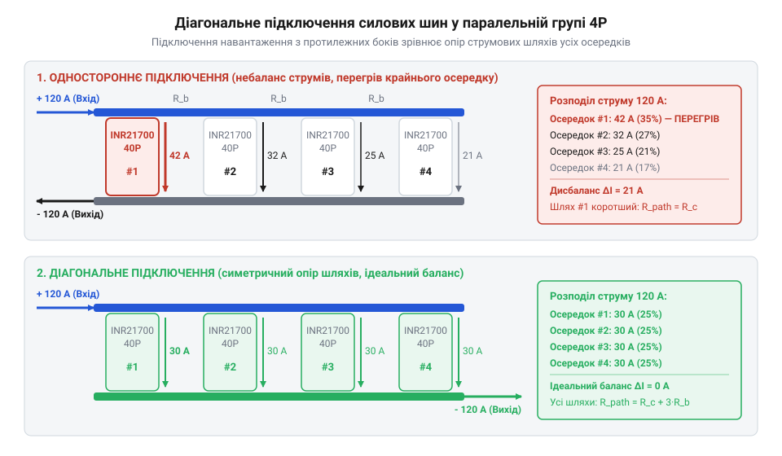

# Li-ion 21700 (EVE INR21700-40P)

<preknowlist>
- [Li-ion 18650 (LiitoKala HG2, NCR18650B)](root:cat-hw-power/li-ion-18650-cells) — принципи хімії літій-іонних елементів, базове поняття внутрішнього опору (ESR) та обмеження розрядного струму у стандартному форматі 18650
- [LiPo-акумулятор (XT60, ~3S)](root:cat-hw-power/lipo-3s) — особливості високонавантаженої струмовіддачі (C-rate) та принципи збірки й балансування багатокоміркових акумуляторних паків
</preknowlist>

## Проблема пікових навантажень у живленні

Під час проектиування та експлуатації силових автономних систем — від високошвидкісних безпілотників до портативних енергостанцій та легкого електротранспорту — розробники регулярно зіштовхуються зі стрибкоподібним зростанням споживання енергії. Коли силова установка вимагає максимального струму під час зльоту, швидкого маневру чи прискорення під навантаженням, напруга акумуляторного паку раптово просідає нижче критичної межі, а самі комірки миттєво розігріваються до небезпечних температур. Спроба розв'язати цю проблему банальним збільшенням кількості стандартних елементів живлення призводить до невиправданого зростання маси та габаритів пристрою, але не усуває фізичну першопричину деградації електричних характеристик під екстремальним струмозніманням.

Головним чинником, що обмежує віддачу енергії під струмом, є внутрішній опір хімічного джерела живлення, який у технічній літературі позначають як @@en|ESR@@ (від англ. *Equivalent Series Resistance* — еквівалентний послідовний опір). Осередок @@en|Li-ion@@ (від англ. *lithium-ion* — літій-іонний) не є ідеальним джерелом ЕРС. Під час розряду позитивно заряджені іони літію `Li⁺` залишають анодний матеріал і мігрують крізь пористий сепаратор, просочений рідким органічним електролітом, до катода. Одночасно електрони рухаються у зовнішньому електричному колі від негативного полюса до позитивного. Опір осередка складається з двох основних частин: омічного опору металевих фольг, колекторів і електроліту та поляризаційного опору, зумовленого обмеженою швидкістю дифузії іонів у приелектродних шарах.

Позначимо напругу відкритого кола осередку через `U_ocv`, розрядний струм через `I`, а внутрішній послідовний опір елемента через `R_int`. Тоді напруга на зовнішніх клемах комірки `U_term` обчислюється як різниця між початковою ЕРС та падінням напруги на внутрішньому опорі:

```
U_term = U_ocv - I · R_int
       = 4.2 В - 40 А · 0.035 Ом      [підстановка параметрів для стандартної комірки]
       = 4.2 В - 1.4 В                [обчислення внутрішнього падіння напруги]
       = 2.8 В                        [напруга на вихідних клемах]
```

Цей розрахунок демонструє явище, що отримало назву @@en|voltage sag@@ (від англ. *voltage sag* — просідання напруги під навантаженням). Під струмом `40 А` напруга стандартного елемента негайно просідає з початкових `4.2 В` до `2.8 В`. У результаті плата захисту або цифровий контролер @@en|BMS@@ (від англ. *Battery Management System* — система керування акумулятором) фіксує досягнення нижньої межі розряду й примусово відключає навантаження, хоча всередині комірки все ще залишається значний запас хімічної енергії.

Другою критичною складовою проблеми є внутрішнє тепловиділення, зумовлене джоулевими втратами. Позначимо потужність тепловиділення всередині герметичного корпусу комірки через `P_heat`. Знаючи розрядний струм `I` та внутрішній опір `R_int`, теплову потужність можна виразити через квадрат струму:

```
P_heat = I² · R_int
       = (40 А)² · 0.035 Ом      [підстановка струму та внутрішнього опору]
       = 1600 А² · 0.035 Ом      [піднесення значення струму до квадрата]
       = 56 Вт                   [підсумкова теплова потужність]
```

Значення у `56 Вт` теплової потужності на один маленький циліндричний елемент розкриває пастку квадратичної залежності: подвоєння струму розряду збільшує тепловиділення у чотири рази. Виділене тепло викликає локальне підвищення температури у центрі рулону, де тепловідведення ускладнене шарами ізоляції. Перегрів понад `60–70 °C` викликає деградацію пасивуючої плівки на аноді, прискорює побічні хімічні реакції та може призвести до неконтрольованого термічного розгону.

Класичні [елементи формату 18650](root:cat-hw-power/li-ion-18650-cells), такі як NCR18650B або LiitoKala HG2, створювалися розробниками переважно для помірних струмових навантажень у діапазоні від `5 А` до `15 А`. Використання таких елементів у високонавантажених силових збірках вимагає масованого паралельного з'єднання осередків для зниження підсумкового опору паку, що надмірно збільшує габарити. Альтернативний варіант у вигляді [багатокоміркових паків LiPo](root:cat-hw-power/lipo-3s) надає високу пікову струмовіддачу, проте пакети пакетного типу мають низьку механічну міцність, обмежений ресурс циклів та підвищену пожежонебезпечність при пошкодженнях.

У 2016–2018 роках автомобільна та промислова галузі зіштовхнулися з межею ефективності класичного габариту `18650`. Прагнення оптимізувати питому енергію та спростити тепловий баланс великих акумуляторних масивів зумовило перехід на розширений формат `21700` (діаметр `21 мм`, довжина `70 мм`). Збільшення фізичного об'єму циліндричного корпусу на `47%` дозволило не лише наростити ємність, а й суттєво покращити геометричні умови для тепловідведення та струмознімання. У відповідь на зростаючий попит у галузі безпілотної авіації та легкого електротранспорту компанія @@en|EVE Energy@@ розробила серію `40P` — високострумові елементи, здатні віддавати пікові струми без руйнівного перегріву й глибокого просідання напруги.


*Сімейство кривих розряду елемента EVE 40P за струмів від 5 А до 45 А із позначенням миттєвого просідання напруги.*

Графік розрядних кривих чітко ілюструє, що при зростанні струму від `5 А` до граничних `45 А` початкове просідання напруги залишається в межах безпечного робочого діапазону. На відміну від стандартних елементів, крива розряду під високим струмом зберігає платоподібний характер у зоні робочої напруги `3.3–3.6 В`, передаючи більшу частину накопиченої енергії на користь корисної роботи. Для точного моделювання таких процесів розробники застосовують спеціальний математичний апарат, щоб розраховувати [просідання напруги під навантаженням](root:cat-hw-power/li-ion-21700-cells/math-eve-40p-thermal-and-electrical-load.md) та оцінювати термічний стан системи під час тривалої роботи.

У результаті виникає чітке розуміння: для забезпечення стабільного живлення потужних споживачів необхідні спеціалізовані елементи формату 21700 з кардинально зменшеним внутрішнім опором та оптимізованим тепловідводом, яскравим представником яких є осередок @@en|EVE INR21700-40P@@.

## Хімія та конструкція елемента EVE 40P

Потреба у створенні елемента, здатного стабільно віддавати струми до `45 А` без катастрофічного падіння напруги, вимагала від інженерів @@en|EVE Energy@@ перегляду як хімічного складу електродів, так і внутрішньої архітектури циліндричного осередку. Модель @@en|EVE INR21700-40P@@ (або спрощено @@en|EVE 40P@@) поєднує в собі передові матеріали хімії @@en|NCM@@ (від англ. *Nickel Cobalt Manganese* — нікель-кобальт-марганець) та інноваційну конструкцію внутрішнього рулону.

Катод елемента побудований на базі потрійного літійованого оксиду нікелю, кобальту та марганцю з оптимізованим високим вмістом нікелю. Нікель відповідає за високу питому ємність та енергетичну щільність матеріалу, забезпечуючи максимальну кількість іонів літію у кристалічному каркасі. Кобальт забезпечує механічну та структурну стабільність ґратки під час інтенсивного виходу іонів при швидкому розряді, а марганець формує стійкість до підвищених температур та запобігає розкладанню матеріалу при нагріванні.

Анод осередку виготовлено з композитного матеріалу на основі графіту з додаванням високостійких наноструктурованих кремнієвих включень (графіт-кремній). Класичний графітовий анод здатний інтеркалювати один атом літію на шість атомів вуглецю (`LiC₆`), що забезпечує теоретичну межу ємності близько `372 мА·год/г`. Додавання кремнію, здатного зв'язувати до `4.4` атомів літію на один атом кремнію (`Li₄.₄Si`), дозволяє наростити ємність анодного шару до значення `~4200 мА·год/г`. Інженери компанії підібрали пропорцію кремнієвої добавки так, щоб суттєво наростити ємність анода, але уникнути руйнівного об'ємного розширення кристалічної матриці під час повторюваних циклів заряду та розряду.

Для забезпечення високої іонної провідності між електродами застосовується пористий поліолефіновий сепаратор з нанесеним керамічним термостійким покриттям. Керамічний шар запобігає усадці сепаратора та короткому замиканню між анодом і катодом навіть при локальному розігріві внутрішніх зон осередка до температури `130 °C`.

Геометричний формат `21700` має фізичні габарити: діаметр `21 мм` та довжину `70 мм`. Порівняно зі стандартним елементом `18650`, який має об'єм `~16.5 см³`, новий осередок займає `~24.2 см³`. Зростання фізичного об'єму на `47%` супроводжується збільшенням площі зовнішньої бічної поверхні корпусу на `33%`. Це дозволяє розмістити всередині металевого стакана електродну стрічку більшої довжини й ширини, зменшуючи частку пасивних компонентів (металевого корпусу, ізоляторів та клапана скидання тиску) у загальній масі елемента.

Проте саме по собі збільшення довжини електродів у циліндричному рулоні створює серйозне фізичне обмеження: струм, протікаючи вздовж довгої тонкої металевої фольги електрода до єдиного токознімного прапорця, долає значний омічний опір металу. Для подолання цього бар'єра в осередку @@en|EVE 40P@@ застосовано інноваційну багатотабову конструкцію рулону — технологію @@en|multi-tab@@ (від англ. *multiple tabs* — множинні струмознімні прапорці).


*Схема внутрішньої рулонної структури елемента 21700 із позначенням багатьох токознімних табів на аноді й катоді.*

Замість одного або двох металевих контактних прапорців (@@en|tab@@), приварених на початку та в кінці електродного рулону, інженери інтегрували безліч струмознімальних виводів, рівномірно розташованих уздовж всієї довжини анодної (мідної) та катодної (алюмінієвої) фольги. Усі прапорці лазерним зварюванням паралельно з'єднуються з верхнім позитивним та нижнім негативним суцільними контактними дисками комірки.

Таке конструктивне рішення принципово змінює шляхи проходження електронів: замість поздовжнього руху вздовж всієї метрової фольги струм рухається короткими поперечними шляхами до найближчого прапорця. У результаті ефективний опір металевих колекторів падає в кілька разів, а загальний внутрішній опір комірки @@en|ESR@@ знижується до рекордного значення `~9 мОм` (виміряно на змінному струмі частотою `1 кГц`) та близько `12–14 мОм` на постійному струмі.

Обчислимо потужність теплових втрат `P_heat` для високострумового елемента @@en|EVE INR21700-40P@@ під граничним тривалим струмом розряду `I = 45 А` при внутрішньому опорі `R_int = 0.009 Ом`:

```
P_heat = I² · R_int
       = (45 А)² · 0.009 Ом      [підстановка номінальних параметрів EVE 40P]
       = 2025 А² · 0.009 Ом      [піднесення розрядного струму до квадрата]
       = 18.225 Вт               [підсумкова теплова потужність комірки]
```

Завдяки зниженню внутрішнього опору до `9 мОм`, тепловиділення елемента при розряді струмом `45 А` становить `18.225 Вт`. Це втричі менше за втрати в стандартних комірках під аналогічним струмовим навантаженням, що робить експлуатацію осередка безпечною та керованою навіть без залучення складних активних систем рідинного охолодження.

Конструктивні параметри @@en|EVE 40P@@ забезпечують номінальну ємність `4000 мА·год` (`4.0 А·год`) при робочій напрузі `3.6 В` (повний заряд `4.2 В`, розряд до `2.5 В`). Допустимий тривалий струм розряду становить `45 А`, що відповідає швидкості розряду @@en|C-rate@@ (від англ. *capacity rate* — швидкість відносно ємності) на рівні `11.25C`. В імпульсному режимі тривалістю до кількох секунд осередок здатний видавати струм до `60 А`.

Ознайомитися з точними кресленнями контактних майданчиків, товщиною стінок та механічними допусками можна переглянувши [детальні електричні параметри](root:cat-hw-power/li-ion-21700-cells/api-eve-inr21700-40p-hardware-spec.md) у специфікації виробника.

Отримані характеристики дозволяють ефективно об'єднувати комірки у високопотужні збірки. Наприклад, проектуючи [силовий батарейний пак 6S1P](root:cat-hw-power/li-ion-21700-cells/proj-high-current-6s1p-fpv-pack.md), розробник отримує компактну батарею з номінальною напругою `22.2 В` та безперервною потужністю понад `1000 Вт`. При збиранні таких паків важливо застосовувати відповідні [токознімні шини та точкове зварювання](root:hw-power/spot-welding-batteries), щоб опір міжосередкових з'єднань не знівелював переваги низького опору самих комірок, а також інтегрувати [системи захисту BMS](root:hw-power/bms) для моніторингу температури кожного елемента.

Зрозумівши зв'язок між хімією NCM/графіт-кремній, багатотабовою рулонною структурою та низьким внутрішнім опором @@en|EVE INR21700-40P@@, читач готовий до детального аналізу термічної динаміки та електричних режимів роботи осередку під навантаженням.

## Електрична й термічна динаміка розряду

Підключаючи до акумуляторного елемента високонавантажений споживач, напруга на його виводах миттєво знижується порівняно зі станом спокою, а сама комірка починає виділяти тепло. Для осередку @@en|EVE INR21700-40P@@ (виробництва компанії @@en|EVE Energy@@) це просідання напруги (@@en|voltage sag@@, від англ. @@en|voltage sag@@ — просідання напруги) визначено сумарним значенням внутрішнього опору (@@en|ESR@@, від англ. @@en|Equivalent Series Resistance@@ — еквівалентний послідовний опір), який у свіжовиготовленого елемента за кімнатної температури 25 °C становить близько 9 мОм.

Внутрішній опір комірки не є суто омічною величиною: він складається з омічного опору металевих струмовідводів, контактних зварних точок, електроліту (`R_{\Omega}`), а також поларизаційного опору перенесення заряду (`R_{ct}`) та дифузійного опору (`R_{diff}`). У перші мілісекунди після подачі навантаження просідання напруги формується виключно омічною складовою `R_{\Omega}`, але протягом 1–5 секунд розгортається поларизація електродів, збільшуючи падіння напруги до повного розрахункового значення.

Для обчислення вихідної напруги комірки @@en|EVE INR21700-40P@@ під безперервним струмовим навантаженням використовується вираз, що пов'язує напругу розімкненого кола, струм розряду та еквівалентний послідовний опір.

U_{load} = U_{ocv} - I × R_{esr}

У цьому виразі `U_{load}` позначає вихідну напругу комірки під струмом у вольтах (В), `U_{ocv}` — напругу розімкненого кола (від англ. *Open Circuit Voltage* — напруга розімкненого кола) у вольтах (В), `I` — розрядний струм у амперах (А), а `R_{esr}` — еквівалентний послідовний опір в омах (Ом). Лінійна залежність показує, що зі зростанням розрядного струму робоча напруга знижується пропорційно внутрішньому опору елемента.

**Обчислення на прикладі**
Припустимо, що комірка @@en|EVE INR21700-40P@@ повністю заряджена до `U_{ocv} = 4.2 В` і розряджається максимальним паспортним безперервним струмом `I = 45 А` при вихідному опорі `R_{esr} = 0.009 Ом`.

Падіння напруги на внутрішньому опорі:
ΔU = 45 А × 0.009 Ом
= 0.405 В      [закон Ома для ділянки кола]

Робоча напруга комірки на початку розряду:
U_{load} = 4.2 В - 0.405 В
= 3.795 В      [віднімання омічного падіння від напруги спокою]

Якщо ж стан заряду комірки знижується до 50% (`U_{ocv} = 3.6 В`), то під тим самим струмом 45 А робоча напруга впаде до `3.195 В`. Порівняно з [класичними комірками 18650](root:cat-hw-power/li-ion-18650-cells), де внутрішній опір зазвичай перевищує 20 мОм і викликає просідання понад 0.9 В, осередок 21700 утримує плато напруги значно стабільніше.

Однак у процесі тривалого розряду струмом 45 А внутрішній опір не залишається константою. Проходження струму через `R_{esr}` генерує теплову потужність джоулевих втрат `P_{loss}`.

P_{loss} = I² × R_{esr}

Де `P_{loss}` — теплова потужність у ватах (Вт), `I` — розрядний струм в амперах (А), а `R_{esr}` — еквівалентний послідовний опір в омах (Ом). Квадратична залежність від струму означає, що при збільшенні розрядного струму вдвічі тепловиділення зростає в чотири рази.

Підставивши значення `I = 45 А` та `R_{esr} = 0.009 Ом`, отримуємо теплову потужність розсіювання:
P_{loss} = (45 А)² × 0.009 Ом
= 2025 А² × 0.009 Ом      [піднесення струму до квадрата]
= 18.225 Вт               [множення на опір]

Виділення понад 18 Вт тепла в обмеженому об'ємі циліндра масою `m ≈ 0.07 кг` (70 грамів) викликає швидке самонагрівання. За питомої теплоємності літій-іонного рулону `c ≈ 1000 Дж/(кг·°C)` адіабатична швидкість наростання температури `ΔT / Δt` визначається відношенням теплової потужності до теплоємності маси комірки.

ΔT / Δt = P_{loss} / (m × c)

Швидкість нагріву за струму 45 А становить:
ΔT / Δt = 18.225 Вт / (0.07 кг × 1000 Дж/(кг·°C))
= 18.225 Вт / 70 Дж/°C      [обчислення повного теплозапасу]
≈ 0.26 °C/с                 [ділення потужності на теплоємність]

Це означає, що без зовнішнього охолодження температура комірки зростає приблизно на 15.6 °C щохвилини. За 2 хвилини безперервної роботи при вихідній температурі 25 °C елемент прогріється до 56.2 °C.

Нагрівання елемента запускає електро-термічний зворотний зв'язок. При підвищенні температури з 25 °C до 50 °C в'язкість рідкого електроліту знижується, а рухливість іонів літію (`Li⁺`) зростає. Це приводить до тимчасового падіння внутрішнього опору `R_{esr}` від 9 мОм до приблизно 6.5–7 мОм. У результаті просідання напруги під навантаженням трохи зменшується, проте сумарна теплова енергія, що накопичується всередині спірально закрученого рулону електродів (@@en|jelly-roll@@, від англ. @@en|jelly-roll@@ — спірально закручений рулон електродів), продовжує небезпечно зростати.

В імпульсних режимах навантаження, характерних для маневрів високонавантажених безпілотників (наприклад, політ у режимі @@en|FPV@@, від англ. @@en|First-Person View@@ — політ від першої особи), комірка @@en|EVE INR21700-40P@@ здатна віддавати короткочасні струми до 70 А (коефіцієнт струмовіддачі близько 17.5C, де @@en|C-rate@@ — від англ. @@en|capacity rate@@ — коефіцієнт струмового навантаження відносно ємності). При імпульсі 70 А падіння напруги досягає:
ΔU_{pulse} = 70 А × 0.009 Ом = 0.63 В

А миттєва теплова потужність сягає:
P_{loss_pulse} = (70 А)² × 0.009 Ом = 4900 А² × 0.009 Ом = 44.1 Вт

Такий короткочасний сплеск потужності наближає комірку за динамічною струмовіддачею до [багатокоміркових літій-полімерних батарей](root:cat-hw-power/lipo-3s), але зберігає суттєво вищу питому енергоємність циліндричного формату. Для безпечної експлуатації тривалість імпульсу 70 А обмежена 5–10 секундами. Це пояснюється тепловою постійною часу `τ` циліндричного елемента (приблизно 15–20 секунд): під час короткого імпульсу тепло виділяється локально в місцях контакту токознімальних виводів електродів (@@en|tab@@, від англ. @@en|tab@@ — токознімальний вивід електрода). Завдяки багатоточковому токозніманню (технологія @@en|multi-tab@@, від англ. @@en|multi-tab@@ — багатовиводна топологія електродів) тепло розподіляється вздовж алюмінієвих та мідних фольг, але перевищення часового ліміту призводить до точкового перегріву сепаратора.


*Графіки просідання напруги та зміни температури комірки EVE INR21700-40P демонструють стабільне плато напруги й контрольований нагрів при тривалих струмах до 45 А та безпеку короткочасних імпульсів до 70 А.*

Детальні математичні моделі для розрахунку [теплового навантаження та падіння напруги](root:cat-hw-power/li-ion-21700-cells/math-eve-40p-thermal-and-electrical-load.md) при різних профілях струму описані в окремому розрахунковому матеріалі. Граничні режими роботи та обмеження струмових вікон узгоджуються з точними даними, які наведено у [паспортних електричних параметрах](root:cat-hw-power/li-ion-21700-cells/api-eve-inr21700-40p-hardware-spec.md) цієї комірки.

## Термічна деградація та межі безпеки

Експлуатація високострумових елементів @@en|EVE INR21700-40P@@ під високими електричними навантаженнями неминуче призводить до генерування тепла, яке суттєво впливає на внутрішні фізико-хімічні структури осередку. Коли температура всередині циліндра перевищує критичні позначки, прискорюються незворотні деградаційні процеси, що зменшують доступну ємність і збільшують внутрішній опір @@en|ESR@@.

Основним джерелом деградації є хімічна нестабільність міжфазного шару на поверхні графітово-кремнієвого анода. Цей захисний шар відомий як пасивуюча твердоелектролітна інтерфаза (@@en|SEI@@, від англ. @@en|Solid Electrolyte Interphase@@ — твердоелектролітна інтерфаза). За нормальної температури (15–30 °C) шар @@en|SEI@@ складається з карбонату літію (`Li₂CO₃`) та алкілкарбонатів літію, захищаючи анод від подальшої реакції з рідким електролітом. Проте при нагріванні понад 50–60 °C шар @@en|SEI@@ починає частково розчинятися й руйнуватися. Реакція відновлення розчинників електроліту відновлюється, безповоротно витрачаючи вільні іони літію (`Li⁺`) для формування нового пасивуючого шару. Втрата активного літію безпосередньо зменшує ємність акумулятора, а потовщення плівки @@en|SEI@@ створює додатковий опір перенесенню іонів, збільшуючи значення @@en|ESR@@.

Одночасно на позитивному катоді з хімічним складом @@en|NCM@@ (абревіатура від елементів @@en|Nickel-Cobalt-Manganese@@ — нікель-кобальт-марганець) підвищена температура прискорює екстракцію перехідних металів у рідкий електроліт. Іони марганцю та нікелю мігрують через пористий сепаратор до анода, де каталізують руйнування шару @@en|SEI@@, створюючи мікроскопічні дефекти.

Вплив температурних режимів на безпеку та структуру комірки розбивається на три чіткі діапазони:

1. **Оптимальний робочий діапазон (15–45 °C):** Рівновага між рухливістю іонів та стабільністю електроліту. Деградація відповідає стандартним паспортним характеристикам. 2. **Зона прискореного старіння (45–60 °C):** Інтенсивне зростання шару @@en|SEI@@, підвищення @@en|ESR@@ на 20–30% за кожні 100 циклів розряду струмом 10C (40 А) та втрата ємності до 25% за скорочений термін експлуатації. 3. **Критична зона термічного розгону (> 80–120 °C):** Настає небезпека явища @@en|thermal runaway@@ (від англ. *thermal runaway* — термічний розгін). При температурі 80–100 °C екзотермічно розпадається шар @@en|SEI@@. Виділене тепло розігріває комірку до 120–130 °C, що призводить до плавлення поліетиленового сепаратора та масивного внутрішнього короткого замикання між анодом і катодом. Далі слідує ланцюгова реакція окислення електроліту з виділенням горючих газів (етилен `C₂H₄`, чадний газ `CO`), спрацюванням запобіжного клапана та можливим вибухоподібним займанням.

Оцінити циклічний ресурс комірки @@en|EVE INR21700-40P@@ залежно від робочої температури та швидкості розряду (@@en|C-rate@@) дозволяє аналіз накопиченої теплової дози. При стандартизованому випробуванні струмом 1C (4 А) та температурі 25 °C комірка зберігає понад 80% початкової ємності після 500 повних циклів. Проте якщо розряд здійснюється безперервним граничним струмом 40 А (10C) у замкненому безвентиляторному корпусі, де температура стабілізується на рівні 70 °C, ресурс комірки до падіння ємності до 80% скорочується до 150–200 циклів.

Впровадження примусового обдуву або пасивного кондуктивного охолодження, яке утримує температуру корпусу нижче 45 °C під час розряду струмом 40 А, відновлює циклічний ресурс до 400+ циклів. Порівняно з іншими моделями в [серії високострумових елементів EVE](root:cat-hw-power/eve-21700-power-cells-lineup), де тепловий розрахунок вимагає зниження струму, комірка 40P демонструє найвищу стійкість до циклічного нагріву за умов належного відведення тепла.

Конструювання силових акумуляторних збірок на базі @@en|EVE INR21700-40P@@ висуває жорсткі вимоги до міжкоміркових з'єднань. Традиційні нікельовані сталеві стрічки товщиною 0.15 мм мають занадто високий власний опір (понад 2–3 мОм на з'єднанні), що викликає паразитний перегрів контактних точок струмами 40–45 А.

Для відведення та комутації великих струмів застосовують спеціалізовані токознімальні шини (@@en|busbar@@, від англ. @@en|busbar@@ — токознімальна шина) з чистої міді або мідно-нікелевих композитів товщиною 0.3–0.5 мм, які приварюються точковим зварюванням із використанням спеціальних проміжних нікелевих вкладок.


*Схема розміщення та зварювання силових токознімальних шин у збірці з позначенням напрямків струму та балансувальних виводів.*

Використання спеціалізованих [широких мідних шин](root:hw-power/spot-welding-batteries) та точкового зварювання дозволяє мінімізувати омічні втрати на з'єднаннях до величин менше 0.2 мОм, запобігаючи локальному перегріву полюсів комірки.

Повноцінна безпека акумуляторного паку вимагає застосування [системи інтелектуального захисту BMS](root:hw-power/bms) з декількома датчиками температури (@@en|NTC@@-терморезистори, від англ. @@en|Negative Temperature Coefficient@@ — терморезистор із негативним температурним коефіцієнтом), розміщеними в найгарячіших точках всередині збірки. Модуль @@en|BMS@@ повинен відключати навантаження при досягненні температури 60 °C, моніторити індивідуальну напругу кожної серійної групи та виконувати балансування при заряджанні.

Усі практичні аспекти проектирования, розрахунку перерізу провідників та вибору матеріалів ізоляції при практичному [проектуванні силового паку 6S1P](root:cat-hw-power/li-ion-21700-cells/proj-high-current-6s1p-fpv-pack.md) для безпілотної авіації зібрані у відповідному практичному керівництві.

## Конструювання силових збірок і шин

Об'єднання окремих високонавантажених осередків @@en|EVE INR21700-40P@@ (виробництва компанії @@en|EVE Energy@@) у силові акумуляторні збірки висуває суворі вимоги до електричної провідності міжкоміркових з'єднань та механічної міцності конструкції. За тривалого розрядного струму до 45 А на один елемент та імпульсних навантаженнях до 70 А навіть найменший паразитний опір струмознімальної шини (@@en|busbar@@, від англ. *busbar* — струмопровідна шина) чи контактного зварного шва стає джерелом виділення додаткової теплової потужності, нівелюючи переваги низького внутрішнього опору осередків.

При конструюванні батарейного паку комірки з'єднують послідовно (позначення `S`, від англ. *series* — послідовний) для нарощування робочої напруги та паралельно (позначення `P`, від англ. *parallel* — паралельний) для збільшення сумарного струму й ємності. За послідовного з'єднання `S` осередків напруга паку `U_{pack}` збільшується кратно: `U_{pack} = S × U_{cell}`, тоді як струм крізь кожен елемент дорівнює повному струму навантаження `I_{pack}`. При паралельному з'єднанні `P` осередків загальний струм розряджання ділиться між гілками: струм окремої комірки `I_{cell} = I_{pack} / P`.

Для передачі високих струмів між комірками необхідно правильно розрахувати площу поперечного перерізу струмознімальної шини `S_{bus}`. Розрахунок спирається на допустиму густину струму `j_{allow}`, яка для металевого провідника визначає граничний струм без небезпечного перегріву.

```
S_{bus} = I_{max} / j_{allow}
```

У цій формулі `S_{bus}` — необхідна площа поперечного перерізу шини у квадратних міліметрах (мм²), `I_{max}` — максимальний струм, що протікає крізь дану ділянку шини в амперах (А), а `j_{allow}` — допустима густина струму в амперах на квадратний міліметр (А/мм²).

Для чистих нікелевих стрічок допустима густина тривалого струму становить `j_{allow\_Ni} ≈ 8–10 А/мм²`, оскільки питомий електричний опір нікелю є відносно високим (`ρ_{Ni} ≈ 6.84 × 10⁻⁸ Ом·м`). Для мідних шин завдяки низькому питому опору (`ρ_{Cu} ≈ 1.68 × 10⁻⁸ Ом·м`) допустима густина струму сягає `j_{allow\_Cu} ≈ 15–20 А/мм²`.

**Обчислення на прикладі**
Розрахуємо необхідні параметри шини для паралельного з'єднання двох комірок @@en|EVE INR21700-40P@@ у конфігурації `2P`, що віддають у сумарну магістраль струм `I_{max} = 90 А`.

Розрахунок перерізу нікелевої шини:
```
S_{bus\_Ni} = 90 А / 10 А/мм²
            = 9 мм²                  [ділення струму на допустиму густину для нікелю]
```

Для забезпечення перерізу `9 мм²` за товщини стрічки `0.2 мм` знадобилася б ширина шини `45 мм`, що фізично перевищує габарити контактного майданчика осередку 21700. Окрім того, опір ділянки такої нікелевої шини завдовжки `L = 30 мм` обчислюється як:

```
R_{bus\_Ni} = ρ_{Ni} × (L / S_{bus\_Ni})
            = (6.84 × 10⁻⁸ Ом·м) × (0.03 м / 9 × 10⁻⁶ м²)   [підстановка параметрів нікелю]
            = (6.84 × 10⁻⁸ Ом·м) × 3333.3 м⁻¹               [обчислення геометричного співвідношення]
            ≈ 0.000228 Ом                                    [підсумковий опір 0.228 мОм]
```

Значення опору `0.228 мОм` лише на одній міжкомірковій перемичці створює помітні втрати. При використанні ж мідної шини переріз обчислюється наступним чином:

```
S_{bus\_Cu} = 90 А / 18 А/мм²
            = 5 мм²                  [ділення струму на допустиму густину для міді]
```

Опір мідної шини перерізом `5 мм²` і довжиною `30 мм`:

```
R_{bus\_Cu} = ρ_{Cu} × (L / S_{bus\_Cu})
            = (1.68 × 10⁻⁸ Ом·м) × (0.03 м / 5 × 10⁻⁶ м²)   [підстановка параметрів міді]
            = (1.68 × 10⁻⁸ Ом·м) × 6000 м⁻¹                 [обчислення геометричного співвідношення]
            ≈ 0.000101 Ом                                    [підсумковий опір 0.101 мОм]
```

Отже, мідна шина перерізом `5 мм²` (наприклад, товщиною `0.5 мм` та шириною `10 мм`) забезпечує вдвічі менший паразитний опір (`0.101 мОм`) за менших габаритів. Проте пряме зварювання міді до сталевого корпусу комірки є технологічно складним через високу теплопровідність та низький омічний опір міді. З цієї причини застосовують комбіновані мідно-нікельовані сендвіч-шини або мідні шини з просічними нікелевими виводами під точкове зварювання (@@en|spot welding@@, від англ. *spot welding* — точкове зварювання).

Використання звичайного паяльника для припаювання силових дротів безпосередньо до полюсів комірки @@en|EVE INR21700-40P@@ є неприпустимим. Тривалий локальний прогрів контактного майданчика до температури `250–300 °C` передається всередину герметичного циліндра, викликаючи термічне руйнування пасивуючого шару на електродах, деградацію поліетиленового сепаратора та ризик розгерметизації клапана.

Безпечне з'єднання забезпечується виключно імпульсним точковим мікрозварюванням. При точковому зварюванні крізь точку контакту електрода, шини та полюса комірки протягом кількох мілісекунд пропускається короткий струмовий імпульс амплітудою `1000–3000 А`. Теплова потужність імпульсу `P_{weld} = I_{weld}² × R_{contact}` локально розплавляє матеріал шини у точці торкання без розігріву внутрішнього електродного рулону. Для мінімізації контактного опору зварювання проводять двоімпульсним профілем: перший короткий імпульс руйнує оксидну плівку та очищає поверхню, а другий основний імпульс формує міцну зварну точку.

При збиранні багатокоміркових паралельних груп виникає критична фізична проблема — нерівномірний розподіл струму між паралельними гілками, відомий як ефект скупчення струму (@@en|current crowding@@, від англ. *current crowding* — нерівномірна концентрація струму). Якщо силові виводи акумуляторної батареї підключені до одного кінця паралельної групи (паралельне підключення за прямою схемою), осередки, розташовані найближче до вивідних клем, мають коротший провідний шлях і менший сумарний опір шини. У результаті найближча комірка пропускає крізь себе значно більшу частку струму, ніж віддалена комірка. Це призводить до нерівномірного нагріву та прискореного локального старіння окремих елементів у паку.

Для усунення цього ефекту застосовують діагональну топологію підключення силових магістралей (@@en|diagonal topology@@, від англ. *diagonal topology* — діагональна схема підключення), коли позитивний силовий кабель підключається до першої комірки паралельної групи, а негативний кабель — до останньої комірки групи. За такої конфігурації сумарна довжина провідного шляху `L_{total} = L_{pos} + L_{neg}` для кожного з паралельних осередків є абсолютно однаковою.


*Схема діагонального підключення силових шин у паралельних групах для вирівнювання струмового навантаження між осередками.*

Вирівнювання електричного опору провідних шляхів забезпечує рівномірне ділення струму `I_{cell} = I_{pack} / P` для кожної комірки в групі.

Механічна конструкція силового паку на базі елементів 21700 вимагає використання міцних пластикових холдерів (структурних сіток із сотовою геометрією), які забезпечують фіксований повітряний зазор `1–2 мм` між стінками осередків для запобігання перетиранню ізоляції та покращення охолодження. Усі контактні шини та зварні точки ізолюються термостійким картоном (@@en|fish paper@@, від англ. *fish paper* — електроізоляційний картон) та поліімідною плівкою (@@en|Kapton@@, від англ. *Kapton* — термостійка поліімідна плівка).

Проектувальникам, які створюють [силові акумуляторні паки](root:cat-hw-power/li-ion-21700-cells/proj-high-current-6s1p-fpv-pack.md) для високонавантаженого обладнання, слід узгоджувати вибір шин із рекомендаціями про [технології точкового зварювання](root:hw-power/spot-welding-batteries) та зважати на [залізовмістні габаритні допуски](root:cat-hw-power/li-ion-21700-cells/api-eve-inr21700-40p-hardware-spec.md) осередків EVE 40P.

## Інтеграція BMS та системи охолодження

Складена силова збірка на базі комірок @@en|EVE INR21700-40P@@ потребує обов'язкової інтеграції електронного модуля системи керування та захисту (@@en|BMS@@, від англ. *Battery Management System* — система керування акумулятором) і ретельно розрахованої системи охолодження. Оскільки під час розряджання струмом 45 А один осередок генерує понад 18 Вт теплової потужності джоулевих втрат, відсутність теплового моніторингу та примусового відведення тепла швидко призведе до термічного деградування або спрацьовування аварійного захисту.

Вибір плат @@en|BMS@@ для високонавантажених батарей з комірками EVE 40P починається з розрахунку струмових режимів силових ключових транзисторів (@@en|MOSFET@@, від англ. *Metal-Oxide-Semiconductor Field-Effect Transistor* — польовий транзистор зі зсуваним затвором). Плата повинна витримувати безперервний розрядний струм `I_{BMS\_cont} ≥ I_{pack\_max}` та піковий короткочасний струм `I_{BMS\_peak} ≥ 1.5 × I_{pack\_max}` без перегріву власної силової платформи. Для зменшення втрат на ключах BMS обирають модулі з низьким опором відкритих каналів `R_{DS(on)} < 1 мОм`.

Основні налаштування порівняно з параметрами комірки:
1. **Захист від перезаряду (Overcharge Protection):** Відсічка за напруги `4.25 В ± 0.025 В` на будь-якій серійній групі `S`. 2. **Захист від перерозряду (Overdischarge Protection):** Відсічка за напруги `2.50 В ± 0.05 В` для запобігання необоротного руйнування анодної фольги. 3. **Захист від струмового перевантаження (Overcurrent Protection):** Порогова відсічка за струмом із затримкою спрацьовування `t_{ocp} ≈ 10–20 мс` для ігнорування пускових імпульсів. 4. **Температурний захист:** Підключення виносних терморезисторів із негативним температурним коефіцієнтом (@@en|NTC@@, від англ. *Negative Temperature Coefficient* — терморезистор із негативним температурним коефіцієнтом). BMS повинна блокувати розряд при досягненні температури `T_{dis\_max} = 60 °C` та блокувати заряд при `T_{chg\_max} = 45 °C`.

Балансування комірок в акумуляторній збірці виконується для вирівнювання напруги між послідовними групами `S` наприкінці фази заряду. Для збірок на якісних осередках EVE 40P з ідентичним внутрішнім опором @@en|ESR@@ достатньо пасивного балансування струмом `30–100 мА`, яке скидає надлишкову енергію більш заряджених комірок на розрядні резистори BMS. У масивних промислових паках великої ємності застосовують активні балансири, що перекачують заряд між групами за допомогою індуктивних або ємнісних перетворювачів зі струмом до `1–2 А`.

Тепловий режим акумуляторного паку визначається балансом між виділенням тепла всередині комірок та його розсіюванням у навколишнє середовище. - **Пасивне охолодження** (конвекція та випромінювання у вільне повітря) забезпечує коефіцієнт тепловіддачі `h ≈ 10–15 Вт/(м²·К)`. Воно є достатнім лише за низьких середніх струмів (до `15 А` на комірку) або за короткочасних імпульсних навантажень із тривалими паузами. - **Примусове повітряне охолодження** (продув повітря вентиляторами крізь канали між комірками) підвищує коефіцієнт тепловіддачі до `h ≈ 40–80 Вт/(м²·К)`, дозволяючи стабілізувати температуру під тривалим струмом `30–45 А`. - **Рідинне охолодження** (циркуляція теплоносія крізь алюмінієві охолоджувальні пластини) застосовується у надпотужних стаціонарних та транспортних системах.

Для проектування примусової повітряної системи охолодження необхідно розрахувати необхідну об'ємну витрату повітря `Q_{air}`. Позначимо сумарну теплову потужність джоулевих втрат паку через `P_{total}`, густину повітря через `ρ_{air} ≈ 1.2 кг/м³`, питому ізобарну теплоємність повітря через `c_{p\_air} ≈ 1005 Дж/(кг·°C)`, а допустимий підйом температури повітря на виході з паку порівняно з входом через `ΔT_{air} = T_{out} - T_{in}`.

Формула теплового балансу для об'ємного потоку повітря має вигляд:

```
Q_{air} = P_{total} / (ρ_{air} × c_{p\_air} × ΔT_{air})
```

У цій формулі `Q_{air}` — об'ємна витрата повітря у кубічних метрах за секунду (м³/с), `P_{total}` — теплова потужність паку у ватах (Вт), `ρ_{air}` — густина повітря у кілограмах на кубічний метр (кг/м³), `c_{p\_air}` — питома теплоємність повітря у джоулях на кілограм-градус (Дж/(кг·°C)), а `ΔT_{air}` — різниця температур повітря на виході та вході у градусах Цельсія (°C).

**Обчислення на прикладі**
Розрахуємо необхідний потік повітря для примусового охолодження акумуляторного паку конфігурації `6S2P` (всього 12 комірок @@en|EVE INR21700-40P@@), який розряджається струмом 45 А на кожну паралельну гілку (сумарний струм паку 90 А). Вхідна температура повітря `T_{in} = 25 °C`, а максимальна дозволена температура повітря на виході `T_{out} = 50 °C` (відповідно `ΔT_{air} = 25 °C`).

Сумарна теплова потужність втрат 12 комірок при `R_{esr} = 0.009 Ом` для кожного елемента:

```
P_{total} = 12 × (45 А)² × 0.009 Ом
          = 12 × 2025 А² × 0.009 Ом     [піднесення струму до квадрата]
          = 12 × 18.225 Вт              [обчислення втрат однієї комірки]
          = 218.7 Вт                    [сумарне тепловиділення паку]
```

Розрахунок необхідної об'ємної витрати повітря:

```
Q_{air} = 218.7 Вт / (1.2 кг/м³ × 1005 Дж/(кг·°C) × 25 °C)
        = 218.7 Вт / 30150 Дж/(м³·°C)                          [обчислення знаменника]
        ≈ 0.00725 м³/с                                         [витрата в кубічних метрах за секунду]
        ≈ 0.00725 × 3600 м³/год                                [переведення у години]
        ≈ 26.1 м³/год                                          [підсумковий об'ємний потік]
```

Переведемо отримане значення об'ємного потоку у стандартні одиниці вимірювання продуктивності вентиляторів — кубічні фути за хвилину (@@en|CFM@@, від англ. *Cubic Feet per Minute* — кубічні фути за хвилину):

```
Q_{air\_CFM} = 26.1 м³/год / 1.699
            ≈ 15.4 CFM                                          [переведення в CFM]
```

Розрахунок показує, що для утримання температури батарейного паку `6S2P` в межах `50 °C` під граничним навантаженням `90 А` достатньо встановити компактний вентилятор з продуктивністю не менше `16–20 CFM` (із урахуванням аеродинамічного опору міжкоміркових каналів).

Поєднання грамотно налаштованої [архітектури плати BMS](root:hw-power/bms) та розрахованого повітряного охолодження дозволяє повністю усунути ризик термічного розгону та зберегти циклічний ресурс осередків EVE 40P. Точний математичний розрахунок [електричного та теплового навантаження](root:cat-hw-power/li-ion-21700-cells/math-eve-40p-thermal-and-electrical-load.md) стає основою під час [практичної збірки 6S паків](root:cat-hw-power/li-ion-21700-cells/proj-high-current-6s1p-fpv-pack.md). У порівнянні з [м'якими LiPo батареями](root:cat-hw-power/lipo-3s), добре охолоджуваний циліндричний пак 21700 демонструє значно вищу термічну та механічну стабільність у важких умовах експлуатації.