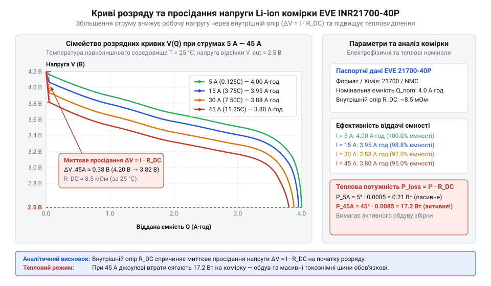
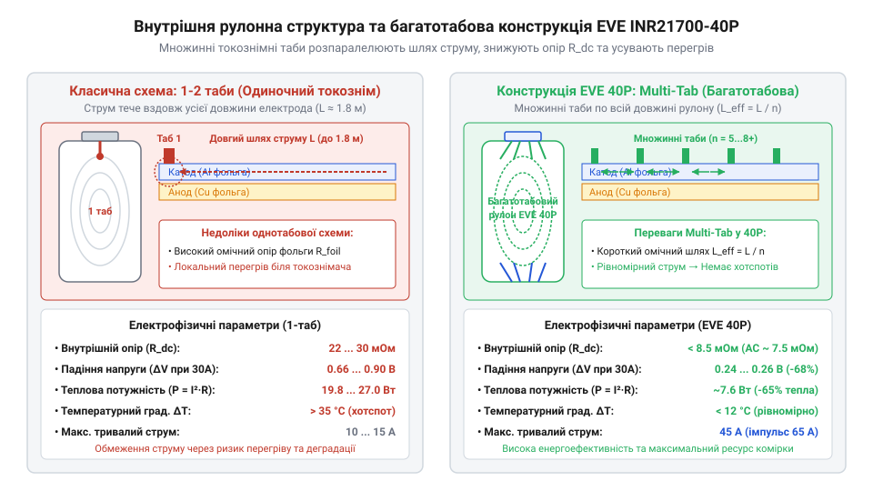
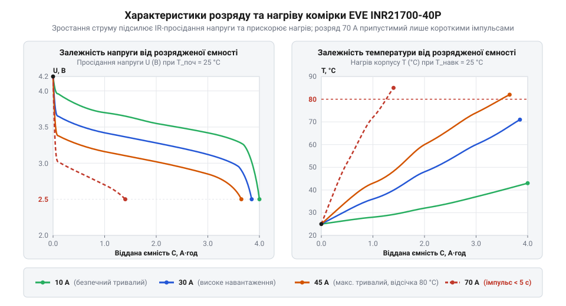
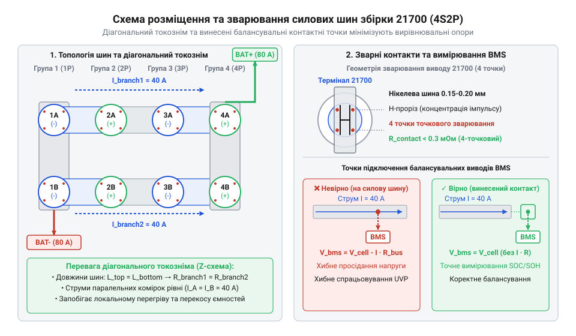
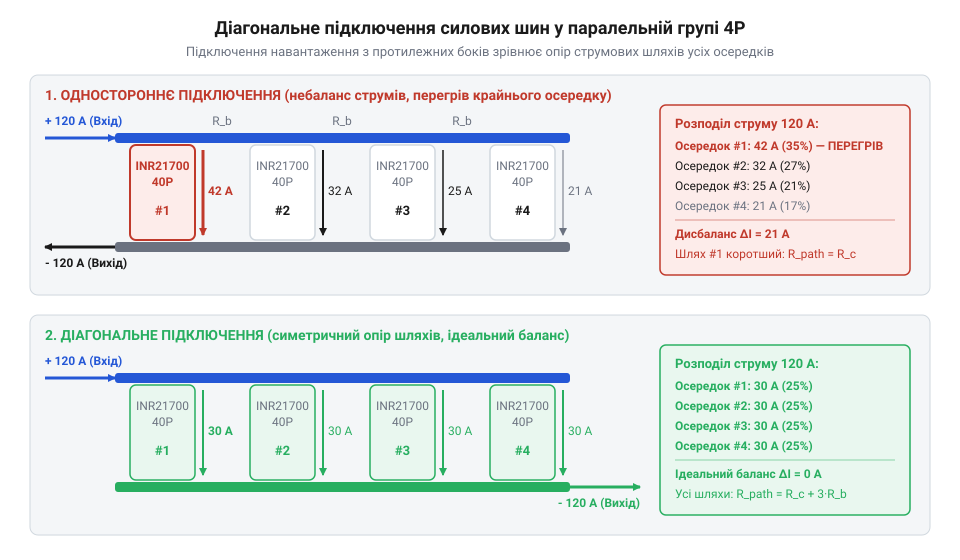

# Li-ion 21700 (EVE INR21700-40P)

<preknowlist>
- [Li-ion 18650 (LiitoKala HG2, NCR18650B)](root:cat-hw-power/li-ion-18650-cells) — принципи хімії літій-іонних елементів, базове поняття внутрішнього опору (ESR) та обмеження розрядного струму у стандартному форматі 18650
- [LiPo-акумулятор (XT60, ~3S)](root:cat-hw-power/lipo-3s) — особливості високонавантаженої струмовіддачі (C-rate) та принципи збірки й балансування багатокоміркових акумуляторних паків
</preknowlist>

## Проблема просідання напруги під навантаженням

Розрядний струм під навантаженням спричиняє миттєве зниження напруги на клемах — просідання напруги (англ. @@en|voltage sag@@). Фізичною першопричиною цього є еквівалентний послідовний опір (англ. @@en|equivalent series resistance@@, від лат. @@la|aequalis@@ — рівний та англ. @@en|series@@ — послідовність) комірки — @@en|ESR@@.

За законом Ома, струм `I` викликає спад `ΔV = I × ESR`. Вихідна напруга `V_out = V_oc - I × ESR` знижується від напруги розімкненого кола `V_oc`. При високому струмі напруга падає нижче порогу захисту (`2.8 В`), і плата керування батареєю (англ. @@en|battery management system@@) — @@en|BMS@@ — передчасно відключає живлення.

Одночасно на внутрішньому опорі виділяється теплова потужність Джоуля:

```
P_loss = I² × ESR
       = 45² × 0.030 [струм I = 45 А, опір ESR = 30 мОм]
       = 2025 × 0.030 [квадрат струму]
       = 60.75 Вт [теплові втрати]
```

Двократне зростання струму викликає чотирикратне виділення тепла, що загрожує термічним розгоном (англ. @@en|thermal runaway@@).

Класичні [елементи формату 18650](root:cat-hw-power/li-ion-18650-cells) мають високий @@en|ESR@@ (`20–40 мОм`), малу площу відведення тепла та єдиний прапорець, що унеможливлює роботу на струмах понад `20 А`. Це зумовлює перехід на елементи 21700 із низькоомною архітектурою.


*Залежність напруги від струму показує стрімке просідання та вимкнення BMS для елементів із високим ESR.*

## Хімія NCM та багатотабова конструкція

Низький внутрішній опір елемента EVE INR21700-40P забезпечують хімія й конструктивні рішення. Катод виконано з літій-нікель-кобальт-марганцевого оксиду (англ. @@en|nickel cobalt manganese@@, від нім. @@de|Nickel@@ — нікель, @@de|Kobalt@@ — кобальт та лат. @@la|manganum@@ — марганець) — хімії @@en|NCM@@ з високою енергоємністю. Графіт-кремнієвий анод прискорює інтеркаляцію іонів літію, а керамічний сепаратор захищає від замикання при нагріві.

Технологічним проривом є багатотабова конструкція (англ. @@en|multi-tab@@ technology, від англ. @@en|multiple@@ — множинний та @@en|tab@@ — прапорець). У звичайних елементах струм знімається в одному місці, і електрон долає `1.5–2.0 метри` фольги. У технології @@en|multi-tab@@ множинні прапорці вздовж стрічки паралелять шляхи струму, скорочуючи його шлях до сантиметрів і знижуючи опір @@en|ESR@@ комірки до `9 мОм` (0.009 Ом).

Тепловтрати EVE 40P при розряді струмом `45 А`:

```
P_loss = I² × ESR
       = 45² × 0.009 [підстановка струму I = 45 А та опору ESR = 0.009 Ом]
       = 2025 × 0.009 [обчислення квадрата струму]
       = 18.225 Вт [сумарні втрати потужності на елементі EVE 40P]
```

Втрати `18.2 Вт` (проти `60.7 Вт` у 18650) роблять розряд струмом `45 А` безпечним, запобігаючи перегріву електроліту.


*Багатотабова конструкція електроду скорочує шлях струму й знижує внутрішній опір до 9 мОм.*

## Електрична й термічна динаміка розряду

Внутрішній [еквівалентний послідовний опір](root:cat-hw-power/li-ion-21700-voltage-sag-and-esr) @@en|ESR@@ є динамічним і складається з омічного `R_ohm` та поляризаційного `R_pol` опорів. Миттєва складова `R_ohm` визначається провідністю струмовідводів і електроліту, а поляризаційна `R_pol` — затримками переносу заряду й дифузією іонів літію в кристалічній ґратці.

Вихідна напруга комірки EVE 40P під струмом `45 А` при `V_oc = 3.6 В`:

```
V_out = V_oc - I × ESR
      = 3.6 - 45 × 0.009 [підстановка V_oc = 3.6 В та ESR = 0.009 Ом]
      = 3.6 - 0.405 [падіння напруги на ESR]
      = 3.195 В [робоча напруга під навантаженням]
```

Швидкість адіабатичного нагрівання комірки масою `m = 0.070 кг` та питомою теплоємністю `c_p = 830 Дж/(кг·К)` при втратах `P_loss = 18.225 Вт`:

```
dT/dt = P_loss / (m × c_p)
      = 18.225 / (0.070 × 830) [підстановка втрат, маси та теплоємності]
      = 18.225 / 58.1 [теплоємність елемента]
      = 0.3136 °C/с [швидкість самонагрівання]
```

Початковий розігрів підвищує рухливість іонів в електроліті: ефект електро-термічного зворотного зв'язку тимчасово знижує `R_ohm` на `10–15%`, стабілізуючи напругу. Завдяки тепловій інерції елемент EVE 40P безпечно витримує пікові імпульси до `70 А` тривалістю до `5 секунд`.


*Розділення миттєвого омічного та повільного поляризаційного спаду напруги під навантаженням.*

## Межі термічної безпеки та деградація

Підвищена температура інтенсифікує побічні хімічні реакції. За нормальних умов графітовий анод захищає твердоелектролітна інтерфаза (англ. @@en|solid electrolyte interphase@@, від лат. @@la|solidus@@ — твердий та англ. @@en|interphase@@ — міжфазна межа) — @@en|SEI@@, яка блокує відновлення електроліту.

За `60–70 °C` плівка @@en|SEI@@ екзотермічно руйнується, виділяючи газ та тепло через реакцію оголеного анода з електролітом. При `130–220 °C` плавиться сепаратор і руйнується катод @@en|NCM@@, спричиняючи катастрофічний @@en|thermal runaway@@.

Тривалий нагрів понад `45 °C` прискорює деградацію ємності через зв'язування іонів літію та потовщення @@en|SEI@@. Порівняно з [безкорпусними LiPo-паками](root:cat-hw-power/lipo-3s), елементи 21700 мають сталевий корпус, проте вимагають жорсткого температурного контролю.

Для запобігання аваріям використовують високопровідні шини та терморезистори з негативним температурним коефіцієнтом (англ. @@en|negative temperature coefficient@@) — @@en|NTC@@-датчики. Вони вимірюють локальні перегріви та розмикають силовий контур через @@en|BMS@@.

## Конструювання силових збірок і шин

У послідовно-паралельних батареях 21700 важливий розрахунок комутаційних шин (англ. @@en|busbar@@). Листова мідь переважає нікель за омічними втратами: питомий опір `ρ_Cu = 0.0175 Ом·мм²/м` в чотири рази менший за `ρ_Ni = 0.068 Ом·мм²/м`.

За допустимої густини струму `J ≤ 5 А/мм²` обчислимо переріз мідної шини для збірки `4P` із струмом `100 А`:

```
S_min = I_total / J_max
      = 100 / 5 [підстановка струму I = 100 А та густини J = 5 А/мм²]
      = 20 мм² [необхідний переріз шини]
```

Паяння контактів заборонено: нагрів жалом (`300–350 °C`) розплавляє полімерні ущільнювачі, руйнує плівку @@en|SEI@@ та спричиняє витік електроліту. Паки збирають двоімпульсним точковим зварюванням (англ. @@en|spot welding@@) нікелевими або мідно-нікелевими стрічками.


*Точкове двоімпульсне зварювання зберігає внутрішні ущільнювачі комірок від теплового руйнування.*

У паралельних групах комірок застосовують діагональну топологію підключення магістралей. Одностороннє знімання струму перевантажує першу комірку через опір шини. Діагональне підключення (плюс і мінус із протилежних кінців) вирівнює опір струмових шляхів і забезпечує однаковий розподіл струму між гілками.


*Діагональна топологія рівномірно розподіляє розрядний струм між комірками паралельної групи.*

## Інтеграція BMS та розрахунок охолодження

Експлуатація паку EVE 21700-40P потребує налаштування плати @@en|BMS@@. Для хімії @@en|NCM@@ задають пороги: верхня напруга `4.25 В`, відсічка `2.5 В` (`2.8 В` під струмом), захист від короткого замикання й відключення при `60 °C` (розряд) і `45 °C` (заряд). Балансування струмом `50–100 мА` вирівнює рівень заряду секцій.

Під високим навантаженням пак потребує примусового охолодження. Знайдемо потік повітря `Q_air` для 4 комірок із втратами `P_total = 72.9 Вт` при `ΔT = 10 °C`:

```
Q_air = P_total / (ρ_air × c_air × ΔT)
      = 72.9 / (1.204 × 1005 × 10) [густина ρ = 1.204 кг/м³, теплоємність c = 1005 Дж/(кг·К)]
      = 72.9 / 12100.2 [розрахунок знаменника]
      = 0.006024 м³/с [об'ємна витрата повітря]
```

Переведемо витрату в кубічні фути за хвилину (англ. @@en|cubic feet per minute@@, або @@en|CFM@@):

```
Q_CFM = Q_m3s × 2118.88
      = 0.006024 × 2118.88 [перерахунок у CFM]
      = 12.76 CFM [мінімальна продуктивність вентилятора]
```

Слабострумові системи використовують [компактні елементи Videx 14500](root:cat-hw-power/videx-14500) або [автономні сонячні панелі 6 В](root:cat-hw-power/solar-panel-6v), а установка EVE 40P вимагає плати @@en|BMS@@ і вентилятора від `13 CFM`.