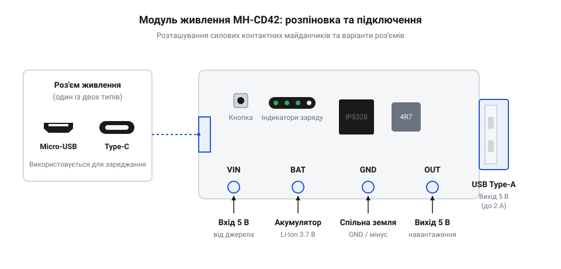
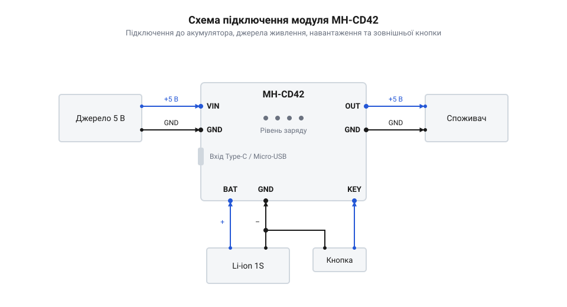

# Специфікація цокольовки, електричних параметрів та індикації модуля MH-CD42

<preknowlist>
- [TP4056](root:cat-hw-power/tp4056) — базові принципи заряджання однокоміркових Li-ion акумуляторів за профілем CC/CV
- [Плата захисту 1S Li-Ion](root:cat-hw-power/pcb-1s-protection) — порогові рівні напруги захисту акумулятора від перерозряду та перезаряду
</preknowlist>

## Проблема живлення портативних 5В пристроїв

Розробка автономних електронних пристроїв на базі мікроконтролерів @@en|ESP32@@, @@en|Arduino@@ або @@en|Raspberry Pi Pico@@ завжди впирається у проблему створення стабільного джерела живлення від акумулятора. Більшість периферійних датчиків, сенсорних екранів та виконавчих модулів розраховані на стандартну напругу шини 5.0 В. Проте одна комірка літій-іонного (від англ. @@en|Lithium-Ion@@, @@en|Li-ion@@) або літій-полімерного (від англ. @@en|Lithium-Polymer@@, @@en|Li-Po@@) акумулятора має номінальну напругу лише 3.7 В. При цьому робоча напруга батареї динамічно змінюється в діапазоні від 4.2 В у повністю зарядженому стані до 3.0 В при глибокому розрядженні.

Спроба підключити мікроконтролерну плату безпосередньо до акумулятора призводить до швидкої зупинки або перезавантаження системних мікросхем, щойно напруга елемента опускається нижче 3.5 В. Для забезпечення стабільної роботи системної шини потрібен підвищувальний перетворювач (від англ. @@en|boost converter@@ або @@en|step-up converter@@), який утримує напругу виходу на рівні 5.0 В незалежно від ступеня розрядження елемента.

Складніша проблема виникає при спробі побудувати схему одночасного живлення пристрою та заряджання акумулятора від зовнішнього USB-порту. Застосування класичних [одноканальних зарядних плат TP4056](root:cat-hw-power/tp4056) у парі з окремим бустером створює небезпечний конфлікт режимів. Коли до схеми підключають зовнішній адаптер 5 В, споживач продовжує відбирати струм через бустер безпосередньо з лінії заряджання. Внаслідок цього контролер заряджання не може зафіксувати падіння струму нижче 10% від максимального значення (фаза завершення профілю @@en|CC/CV@@). Зарядний чіп зависає у режимі постійної напруги, підтримуючи потенціал 4.2 В на батареї невизначено довго, що викликає прискорений термічний знос та деградацію хімічної структури літієвого елемента.

У той час як для потужних пристроїв використовують [двохкоміркові зарядні плати TP5100](root:cat-hw-power/tp5100-charger), складні збірки на [багатокоміркових платах BMS](root:cat-hw-power/bms-multicell) або зовнішні системи від [зарядних пристроїв-балансирів SkyRC](root:cat-hw-power/imax-b6-charger), компактним 5-вольтовим гаджетам потрібне портативне одночіпове рішення. Спроба зібрати таку систему з окремих плашок роздуває габарити корпусу та ускладнює розводку друкованої плати (від англ. @@en|Printed Circuit Board@@, @@en|PCB@@).

Для розв'язання цього комплексу задач створено спеціалізовані інтегральні модулі керування живленням (від англ. @@en|Power Management IC@@, @@en|PMIC@@), яскравим представником яких є плата @@en|MH-CD42@@. Разом із такими рішеннями, як [модуля живлення YP-08](root:cat-hw-power/yp-08-power), сімейство [плат живлення Waveshare SW6106](root:cat-hw-power/power-hat-family) та серія [модулів Li-ion Battery HAT](root:cat-hw-power/liion-hat-rpi), модуль @@en|MH-CD42@@ об'єднує на єдиній мініатюрній платі імпульсний зарядний пристрій, синхронний бустер на 2 А, світлодіодний індикатор ємності та схему кнопкового керування.

## Цокольовка та фізичний інтерфейс @@en|MH-CD42@@

Модуль @@en|MH-CD42@@ виконаний на прямокутній друкованій платі @@en|PCB@@ компактного розміру 22×17 мм. Головним елементом керування є спеціалізована мікросхема контролера @@en|Power Bank@@ у корпусі @@en|eSOP-8@@ або @@en|SOP-8@@, навколо якої розташовані поверхнево-монтовані (від англ. @@en|Surface-Mount Device@@, @@en|SMD@@) компоненти: силовий індуктор, світлодіодні індикатори та контактні майданчики.

На ринку модуль представлений у двох конструктивних виконаннях входів живлення: з роз'ємом @@en|Micro-USB@@ та з сучаснішим роз'ємом @@en|Type-C@@. Конструктивно обидва варіанти повністю ідентичні за електричною схемою та призначенням контактів. Застосування інтерфейсу @@en|Type-C@@ забезпечує вищу механічну міцність роз'єму та зручність підключення симетричного кабелю, хоча модуль працює у базовому режимі USB 2.0 без підтримки протоколів швидкої зарядки (від англ. @@en|Power Delivery@@, @@en|PD@@).


*Контактні майданчики модуля MH-CD42 призначені для роздільного підключення акумулятора, джерела живлення та 5В навантаження.*

Для підключення зовнішніх кіл на платі передбачено шість основних контактних майданчиків під паяння:

* **VIN** (або **VIN+**) — позитивний контакт вхідного джерела живлення напругою 5.0 В. Цей майданчик з'єднаний паралельно з плюсовою лінією живлення USB-роз'єму. Використовується для підключення стаціонарного зовнішнього мережевого адаптера, сонячної панелі або внутрішнього кабелю живлення всередині корпусу. * **GND** — спільний заземлювальний контакт (від англ. @@en|Ground@@). На платі всі площадки з позначкою @@en|GND@@ електрично об'єднані між собою та з металевим екраном USB-роз'єму. Вони слугують єдиною мінусовою шиною для вхідної напруги, акумуляторної батареї та вихідного навантаження. * **BAT** (або **BAT+**) — позитивний контакт для підключення однокоміркового акумулятора @@en|Li-ion@@ або @@en|Li-Po@@ з робочим діапазоном напруг від 3.0 В до 4.2 В. * **OUT** (або **OUT+**) — позитивний вихід підвищеної напруги 5.0 В, призначений для живлення мікроконтролера та периферії. * **KEY** — сигнальний контакт для підключення зовнішньої тактової кнопки керування без фіксації. Другий контакт кнопки підключається до спільної шини @@en|GND@@.

## Електричні параметри та теплові обмеження

Безпечна та надійна експлуатація модуля @@en|MH-CD42@@ вимагає чіткого дотримання його граничних електричних характеристик. Вхідне коло розраховане на напругу від 4.5 В до 5.5 В постійного струму (номінально 5.0 В). Вбудований зарядний контролер працює за високоефективною синхронною понижувальною топологією (від англ. @@en|synchronous buck charger@@), забезпечуючи максимальний струм заряджання батареї до 2.0 А при підключенні відповідного USB-адаптера.

Вихідне коло модуля формує стабілізовану напругу в межах від 5.0 В до 5.15 В з максимально допустимим струмом розряджання 2.1 А. Високий коефіцієнт корисної дії (ККД, позначуваний грецькою літерою `η`) імпульсного перетворювача сягає 92–95% при середніх струмах навантаження (близько 1.0 А). Проте при максимальному вихідному струмі 2.1 А ККД знижується орієнтовно до 89% через зростання опору відкритих каналів внутрішніх ключових польових транзисторів (від англ. @@en|MOSFET@@) та втрати в силовій індуктивності.

Розрахуємо потужність теплових втрат `P_loss` на платі при роботі на граничному навантаженні 2.1 А при вихідній напрузі 5.0 В та ККД `η = 0.89`:

```
P_out = 5.0 × 2.1
= 10.5 W

P_loss = P_out × ((1 - η) ÷ η)
= 10.5 × ((1 - 0.89) ÷ 0.89)
= 10.5 × (0.11 ÷ 0.89)
= 1.30 W
```

Виділення 1.30 Вт теплової енергії на друкованій платі площею лише 3.7 см² створює високе теплове навантаження. Через малу площу мідних полігонів для відведення тепла у повітря температура мікросхеми та дроселя під час тривалої роботи на струмі 2.1 А швидко перевищує 80 °C. Це викликає спрацьовування вбудованого термозахисту (від англ. @@en|thermal shutdown@@), який примусово знижує вихідний струм або вимикає перетворювач.

Для стабільної тривалої експлуатації модуля на струмах понад 1.5 А необхідно забезпечити пасивне охолодження шляхом встановлення невеликого алюмінієвого або мідного радіатора на корпус мікросхеми через теплопровідний клей, або передбачити примусове обдування корпусу вентилятором.

## Світлодіодна індикація режимів роботи

Для діагностики стану акумулятора та поточного режиму роботи на платі @@en|MH-CD42@@ встановлено чотири світлодіодні індикатори (від англ. @@en|Light-Emitting Diode@@, @@en|LED@@), позначені як @@en|LED1@@, @@en|LED2@@, @@en|LED3@@ та @@en|LED4@@. Вони формують чотирьохсегментний шкальний індикатор рівня заряду з дискретністю 25% на кожну позицію.

Логіка роботи світлодіодів залежить від поточного стану системи: розряджання (живлення від акумулятора), заряджання (підключено вхідні 5 В) або режим очікування (від англ. @@en|standby mode@@).

У режимі **розряджання** (коли активний підвищувальний перетворювач і напруга подається на майданчик @@en|OUT@@) комбінація свічення світлодіодів вказує на поточну залишкову напругу на батареї:

* **4 світлодіоди світяться безперервно**: залишок ємності 75–100% (напруга батареї `3.95 В` – `4.20 В`). * **3 світлодіоди світяться безперервно**: залишок ємності 50–75% (напруга батареї `3.75 В` – `3.95 В`). * **2 світлодіоди світяться безперервно**: залишок ємності 25–50% (напруга батареї `3.55 В` – `3.75 В`). * **1 світлодіод світиться безперервно**: залишок ємності 3–25% (напруга батареї `3.30 В` – `3.55 В`). * **1 світлодіод миготить**: критично низький рівень ємності нижче 3% (напруга батареї `3.00 В` – `3.30 В`). При падінні напруги нижче 3.00 В контролер вимикає вихід 5 В для захисту літієвого елемента від глибокого розрядження.

У режимі **заряджання** (коли до роз'єму USB або контактів @@en|VIN@@ підключено зовнішню напругу 5 В) індикація стає динамічною:

* Світлодіоди, що відповідають уже набраному рівню ємності, світяться постійно. * Світлодіод поточного порогу заряджання пульсує з частотою близько 1 Гц. * Усі **4 світлодіоди світяться постійно**: процес заряджання повністю завершено, напруга на акумуляторі досягла 4.20 В, а струм заряджання впав нижче відсічки відключення.

У режимі **очікування** (сон), коли вихідний струм відсутній або вимкнений користувачем, усі світлодіоди повністю гаснуть для збереження енергії батареї.

## Алгоритм керування кнопкою та підключення

Керування станами живлення модуля @@en|MH-CD42@@ здійснюється за допомогою тактової кнопки без фіксації, підключеної між сигнальним контактом @@en|KEY@@ та спільною шиною @@en|GND@@. Внутрішній контролер обробляє часові інтервали натискання кнопки за наступним алгоритмом:

* **Одиничне коротке натискання (тривалість < 1 с)**: вмикає підвищувальний перетворювач 5 В на виході @@en|OUT@@, якщо модуль перебував у режимі сну. Також коротке натискання активує світлодіодну індикацію на кілька секунд для перевірки залишкового заряду батареї. * **Подвійне коротке натискання (два кліки протягом < 1 с)**: примусово вимикає підвищувальний перетворювач та вихідну напругу 5 В, переводячи контролер у режим глибокого енергозбереження із внутрішнім споживанням струму близько 100 мкА. * **Тривале натискання (понад 3 с)**: викликає перезапуск (від англ. @@en|reset@@) системного контролера плати.

Важливо враховувати особливість автоматичного вимкнення пристрою за низьким струмом (від англ. @@en|low-load auto-cutoff@@). Якщо вихідний струм навантаження на лінії @@en|OUT@@ опускається нижче 50 мА і тримається на цьому рівні понад 30 секунд, контролер вважає, що пристрій відключено, і автоматично гасить вихід 5 В, ідучи в сон. Для слабострумових мікроконтролерів (наприклад, @@en|ESP32@@ у режимі глибокого сну @@en|Deep Sleep@@ із споживанням менше 10 мА) це може викликати небажане знеструмлення системи. Щоб уникнути цього, у схему додають періодичний імпульсний генератор навантаження струмом понад 50 мА тривалістю 100 мс кожні 20 секунд.


*Приєднувальна схема показує паралельне підключення зовнішнього джерела 5В, Li-ion акумулятора та вихідного навантаження із зовнішньою кнопкою керування.*

При виконанні монтажу необхідно суворо дотримуватися правил безпеки:

1. **Захист від переполюсовки**: модуль @@en|MH-CD42@@ **не має** захисного діода або транзистора від переполюсовки на контактах @@en|BAT@@. Помилкове підключення плюсового виводу акумулятора до контакту @@en|GND@@ негайно виводить мікросхему з ладу через пробій вихідних ключових транзисторів! 2. **Переріз проводів**: для з'єднання контакту @@en|BAT@@ з акумулятором при струмах до 2 А необхідно використовувати мідні провідники перерізом не менше 20–22 @@en|AWG@@, щоб уникнути падіння напруги на високому опорі тонких дротів. 3. **Додатковий захист**: хоча @@en|MH-CD42@@ має відсічку за низькою напругою (3.0 В), підключення акумулятора зі вбудованою [платою захисту 1S Li-Ion](root:cat-hw-power/pcb-1s-protection) гарантує дубльований захист від коротких замикань на виході батареї та глибокого розрядження нижче 2.5 В.