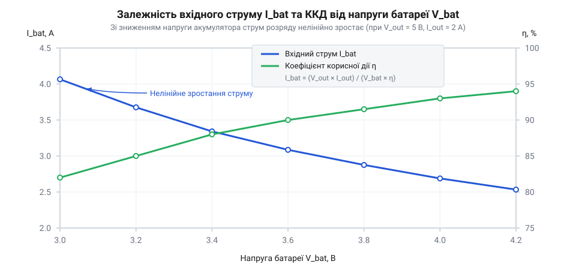
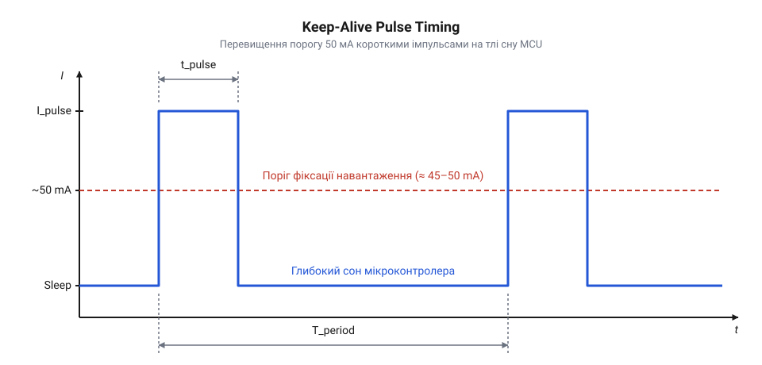

# Математичний розрахунок ККД, балансу струмів та параметрів Keep-Alive для MH-CD42

<preknowlist>
- [TP4056](root:cat-hw-power/tp4056) — принципи лінійного заряду 1S Li-ion та методи обчислення теплового розсіювання на регулюючому транзисторі
- [YP-08 — модуль живлення](root:cat-hw-power/yp-08-power) — базові характеристики імпульсних DC-DC підвищувальних модулів та відмінності між схемотехнікою утримання навантаження
- [Плата захисту 1S Li-Ion](root:cat-hw-power/pcb-1s-protection) — межі безпечної розрядної напруги та струмові характеристики вбудованих ключів захисту Li-ion акумулятора
</preknowlist>

## Чому розряд акумулятора підвищує вхідний струм

Проєктуючи автономний електронний пристрій із живленням від поодинокого Li-ion акумулятора та вихідною стабілізованою напругою 5 В, розробники часто потрапляють у пастку спрощених обчислень. Зазвичай розрахунок часу автономної роботи виконують за лінійною формулою: номінальну ємність батареї в ампер-годинах ділять на виміряний струм споживання навантаження. Проте створений прилад вимикається значно раніше розрахованого терміну, хоча вихідний струм пристрою залишається незмінним упродовж усього сеансу роботи.

Причина цього явища полягає у хибному припущенні, що струм, який споживається від акумулятора, є постійною величиною під час розряду. У базових лабораторних тестах пристрій живлять від лабораторного джерела живлення з фіксованою напругою 4.2 В, де струм здається стабільним. Проте під час реальної експлуатації напруга Li-ion елемента безперервно зменшується. Інтегрований перетворювач модуля MH-CD42 виконує роль підвищувача напруги, працюючи за принципом підтримки постійної вихідної потужності. Згідно з фундаментальним законом збереження енергії, вхідна потужність кола повинна повністю забезпечувати вихідну потужність із урахуванням втрат перетворення:

```
P_in >= P_out
```

Якщо приєднаний мікроконтролер чи сенсорний вузол споживає постійну вихідну потужність `P_out = V_out * I_out` (наприклад, 5 В при струмі 2 А дають 10 Вт), то вхідна потужність, яка відбирається від акумулятора `P_in = V_bat * I_bat`, також повинна залишатися не нижчою за 10 Вт. На початку роботи повністю заряджена батарея забезпечує вхідну напругу `V_bat = 4.2 В`. У міру віддачі заряду напруга на її клемах зменшується до номінальних 3.7 В, а наприкінці розрядного циклу падає до порогу 3.0 В, де навантаження відключає [плата захисту Li-Ion](root:cat-hw-power/pcb-1s-protection).

Щоб зберегти добуток `V_bat * I_bat` сталим при зменшенні вхідної напруги `V_bat`, вхідний струм `I_bat` змушений зворотна пропорційно зростати. Ситуацію ускладнює додаткове падіння напруги на внутрішньому опорі самого акумулятора та з'єднувальних доріжках, через що напруга безпосередньо на вхідних виводах мікросхеми виявляється ще нижчою.

Окрім цього, коефіцієнт корисної дії (англ. @@en|power efficiency@@, від лат. *efficere* — здійснювати) перетворювача `eta` не є постійною величиною. При збільшенні вхідного струму джоулеві втрати на внутрішньому опорі силового ключа та обмотці індуктивності зростають квадратично, що призводить до падіння ККД саме наприкінці розряду. Додатково ситуацію погіршує власний внутрішній опір (англ. @@en|internal resistance@@, від лат. *internus* — внутрішній) акумулятора `R_in` та струмопровідних доріжок. Під час протікання струму `I_bat` на них виникає додаткове падіння напруги `I_bat * R_in`, через що реальна вхідна напруга на виводах перетворювача знижується до `V_in = V_cell - I_bat * R_in`, де `V_cell` — електрорушійна сила комірки. У результаті виникає паразитний позитивний зворотний зв'язок (англ. @@en|positive feedback@@) за струмом: зменшення напруги батареї змушує перетворювач збільшувати вхідний струм `I_bat` для підтримки стабільної вихідної потужності, що збільшує спад `I_bat * R_in`, ще більше знижує напругу `V_in` і провокує додаткове квадратичне падіння ККД `eta`. Цей лавиноподібний процес призводить до того, що під значним навантаженням [плата захисту 1S Li-Ion](root:cat-hw-power/pcb-1s-protection) відсікає живлення за порогом напруги значно раніше розрахункового вичерпання реальної ємності акумулятора.

## Математична модель вхідного струму та ККД

Для побудови точної інженерної моделі розряду акумулятора необхідно кількісно описати залежність вхідного струму від стану батареї. Серцем модуля MH-CD42 є синхронний підвищувальний перетворювач (англ. @@en|synchronous boost converter@@, від грец. *synchronos* — одночасний та англ. *boost* — підвищення), який працює за принципом високочастотного перемикання силових MOSFET-ключів.

Зв'язок між вхідною енергією батареї та корисною вихідною енергією описується рівнянням енергетичного балансу через ККД `eta`:

```
P_out = P_in * eta
V_out * I_out = V_bat * I_bat * eta
```

Шляхом алгебраїчних перетворень виразиємо миттєве значення вхідного струму батареї `I_bat`:

```
I_bat = (V_out * I_out) / (V_bat * eta)
```

У цій формулі використовуються такі величини:
- `V_out` — стабілізована вихідна напруга модуля (5.0 В);
- `I_out` — струм споживання зовнішнього навантаження (А);
- `V_bat` — поточна напруга на клемах акумулятора під навантаженням (В);
- `eta` — ККД перетворювача в поточній робочій точці (безрозмірна величина в межах від 0 до 1).

Шпаруватість (англ. @@en|duty cycle@@, від англ. *duty* — робочий та *cycle* — цикл) силових ключів підвищувального перетворювача обчислюється як `D = 1 - (V_bat / V_out)`. Зі зниженням `V_bat` значення `D` зростає, збільшуючи частку часу, протягом якого вхідний струм протікає через силовий ключ на землю, накопичуючи енергію в індуктивності. Це безпосередньо впливає на середнє значення струму `I_bat`.

Проведемо покроковий розрахунок вхідного струму для граничного вихідного навантаження `I_out = 2.0 А` при `V_out = 5.0 В` (корисна потужність `P_out = 10 Вт`) для трьох характерних станів розряду батареї.

**Крок 1. Повністю заряджений акумулятор (V_bat = 4.2 В, eta = 0.92):**

```
I_bat = (V_out * I_out) / (V_bat * eta)
= (5.0 * 2.0) / (4.2 * 0.92)      [підстановка напруги зарядженого акумулятора 4.2 В та ККД 92%]
= 10.0 / 3.864                     [обчислення вихідної потужності 10 Вт та вхідного знаменника]
= 2.59 A                           [початковий вхідний струм від батареї]
```

**Крок 2. Номінальна напруга розряду (V_bat = 3.7 В, eta = 0.88):**

```
I_bat = (V_out * I_out) / (V_bat * eta)
= (5.0 * 2.0) / (3.7 * 0.88)      [підстановка номінальної напруги 3.7 В та ККД 88%]
= 10.0 / 3.256                     [обчислення вихідної потужності та знаменника]
= 3.07 A                           [вхідний струм при номінальній напрузі]
```

**Крок 3. Гранично розряджений акумулятор (V_bat = 3.0 В, eta = 0.80):**

```
I_bat = (V_out * I_out) / (V_bat * eta)
= (5.0 * 2.0) / (3.0 * 0.80)      [підстановка розрядженої батареї 3.0 В та зниженого ККД 80%]
= 10.0 / 2.40                      [обчислення вихідної потужності та знаменника]
= 4.17 A                           [граничний вхідний струм розрядженого акумулятора]
```


*Графіки залежності коефіцієнта корисної дії eta та вхідного струму I_bat від розрядної напруги батареї V_bat при стабільному навантаженні I_out.*

Отримані математичні результати демонструють, що під час розряду акумулятора вхідний струм зростає з 2.59 А до 4.17 А — тобто на 61%. На відміну від схем, де застосовується альтернативний [імпульсний перетворювач YP-08](root:cat-hw-power/yp-08-power), нелінійний характер кривої ККД модуля MH-CD42 суттєво прискорює розряд на фінальній стадії. Для точного обчислення повного часу автономної роботи `t_run` не можна спиратися на просте середнє арифметичне значення струму. Доступна ємність акумулятора `Q_bat`, яка витрачається від початкового стану 4.2 В до порогу 3.0 В, визначеного через [плата захисту 1S Li-Ion](root:cat-hw-power/pcb-1s-protection), описується інтегралом динамічної функції вхідного струму `I_bat(t)` вздовж часового профілю розряду:

```
Q_bat = ∫₀^{t_run} I_bat(t) dt = ∫₀^{t_run} (V_out * I_out) / (V_bat(t) * eta(V_bat(t))) dt
```

Звідси повна віддана акумулятором енергія `E_bat` визначається інтегруванням миттєвої вхідної потужності:

```
E_bat = ∫₀^{t_run} P_in(t) dt = ∫₀^{t_run} (V_out * I_out) / eta(V_bat(t)) dt
```

Оскільки напруга `V_bat(t)` спадає в часі нелінійно, а ККД `eta` додатково знижується при глибокому розряді, споживання струму прискорюється наприкінці робочого циклу. Спрощений розрахунок за середнім значенням струму штучно завищує оцінку часу автономності на 10–15%, тому для точного проєктування системи живлення параметр `t_run` обчислюють числовим інтегруванням за графіком розрядної кривої акумуляторного елемента.

## Тепловий баланс та розсіювання потужності ключів

Зростання вхідного струму до 4.17 А при максимальному навантаженні 2 А створює високе теплове навантаження на компактну мікросхему модуля MH-CD42. Вся втрачена енергія перетворюється на тепло, яке розсіюється всередині корпусу перетворювача.

Загальна потужність теплових втрат `P_loss` обчислюється як різниця між споживаною вхідною потужністю `P_in` та корисною вихідною потужністю `P_out`:

```
P_loss = P_in - P_out
= (V_out * I_out / eta) - (V_out * I_out)    [вираження вхідної потужності через вихідну та ККД]
= P_out * ((1 / eta) - 1)                    [винесення вихідної потужності за дужки]
= 10.0 * ((1 / 0.80) - 1)                    [підстановка навантаження 10 Вт і ККД 80%]
= 10.0 * 0.25                                [обчислення частки теплових втрат]
= 2.5 Вт                                     [сумарна теплова потужність розсіювання]
```

Основним джерелом цього тепла є опір відкритого каналу (англ. @@en|drain-to-source on-resistance@@) `R_ds_on` вбудованих MOSFET-ключів. Втрати провідності силового ключа обчислюються за формулою `P_cond = I_sw_rms^2 * R_ds_on`, де `I_sw_rms` — середньоквадратичне значення струму через ключ. Оскільки вхідний струм досягає 4.17 А, втрати провідності зростають квадратично від струму.

Розглянемо відмінність теплового режиму MH-CD42 порівняно з системами заряду на базі [лінійного контролера TP4056](root:cat-hw-power/tp4056). У лінійному регуляторі втрати потужності обчислюються як `P_loss = (V_in - V_bat) * I_chg`. Це означає, що TP4056 виділяє максимум тепла на початку заряду (при порожньому акумуляторі `V_bat = 3.0 В`). Натомість підвищувальний перетворювач MH-CD42 працює у протилежному режимі: його теплове навантаження є мінімальним при повному заряді батареї та досягає пікового значення 2.5 Вт саме тоді, коли акумулятор майже повністю розряджений.

Для оцінки ризику перегріву розрахуємо температуру p-n переходу кристала (англ. @@en|junction temperature@@, від лат. *junctio* — з'єднання) `T_j`. Вона залежить від температури навколишнього середовища `T_a` та величини теплового опору (англ. @@en|thermal resistance@@) `R_th` між кристалом і повітрям:

```
T_j = T_a + (P_loss * R_th)
= 25 + (2.5 * 45)         [підстановка кімнатної температури 25 °C та теплового опору 45 °C/Вт]
= 25 + 112.5              [обчислення температурного приросту кристала]
= 137.5 °C                [підсумкова температура кристала мікросхеми]
```

Розрахована температура 137.5 °C наближається до критичного порогу спрацьовування внутрішнього теплового захисту (зазвичай 150 °C). Якщо друкована плата не має достатньої площі мідного полігону для відведення тепла від виводів мікросхеми, температура кристала швидко перевищить допустиму межу, викликаючи циклічне теплове вимкнення перетворювача або його термічне руйнування. Математична модель теплового балансу вказує на необхідність зниження тривалого струму або використання примусового охолодження при роботі з граничними навантаженнями.

## Математичний поріг автовимкнення модуля живлення

Автономні пристрої на базі мікроконтролерів більшу частину часу проводять у режимі глибокого сну (англ. @@en|deep sleep mode@@, від *deep sleep* — глибокий сон), знижуючи власне споживання струму до кількох мікроампер. Тим часом інтегрована контролерна мікросхема, на якій побудовано [модулі MH-CD42](root:cat-hw-power/mh-cd42-charger), безперервно контролює вихідне навантаження. Всередині мікросхеми вбудовано вимірювальний опір (англ. @@en|current sense resistor@@, від *current sense* — відчуття струму) та аналоговий компаратор (англ. @@en|analog comparator@@), що порівнюють поточний вихідний струм `I_out` із зафіксованим внутрішнім порогом фіксації навантаження.

Коли мікроконтролер засинає, струм навантаження спадає нижче критичного порогу фіксації `I_th`, що для даної мікросхеми становить від 45 мА до 50 мА. Замість неперервної роботи компаратор запускає внутрішній цифровий таймер автовимкнення (англ. @@en|shutdown timer@@) із затримкою `t_standby` близько 20–30 секунд. Якщо протягом цього часового вікна вихідний струм жодного разу не перевищує порогове значення `I_th`, внутрішня логіка вважає, що зовнішній пристрій повністю від'єднано або заряджено, і примусово вимикає синхронний підвищувальний перетворювач (англ. @@en|synchronous boost converter@@).

Математична умова безпідставного знеструмлення схеми описується нерівністю:

```
I_out(t) < I_th ,  для всіх t ∈ [t_0, t_0 + t_standby]
I_th = 45 mA ... 50 mA
t_standby ≈ 30 s
```

У результаті напруга на вихідній шині 5 В падає до нуля, і мікроконтролер повністю втрачає живлення, не маючи змоги прокинутися за власним внутрішнім таймером. На відміну від ситуації, де працює [лінійний контролер TP4056](root:cat-hw-power/tp4056) чи імпульсний модуль на зразок [модуля живлення YP-08](root:cat-hw-power/yp-08-power), автоматичне вимкнення в MH-CD42 є апаратно запрограмованою функцією енергозбереження павербанків. Також слід враховувати, що автономна [плата захисту 1S Li-Ion](root:cat-hw-power/pcb-1s-protection) охороняє акумулятор від перерозряду, але не впливає на внутрішній таймер Boost-контролера. Щоб уникнути раптового вимкнення живлення, необхідно математично розрахувати параметри штучного утримання активності.

## Розрахунок параметрів кола Keep-Alive

Серед розробників побутує хибне уявлення, що для запобігання автовимкненню Boost-контролера необхідно підключати постійне баластне навантаження струмом понад 50 мА. Якщо підключити постійний резистор, що споживає 50 мА при напрузі 5 В, втрата потужності становитиме:

```
P_loss_const = V_out × I_const
= 5.0 V × 0.050 A         [закон Ома для постійного навантаження]
= 0.25 W                  [постійне розсіювання потужності]
```

За добу таке баластне навантаження марно витратить 6 Вт·год енергії, що становить понад 60% ємності стандартного Li-Ion акумулятора формату 18650. 

Оптимальне схемотехнічне рішення полягає у застосуванні кола утримання активного стану (англ. @@en|Keep-Alive circuit@@, від *keep alive* — підтримувати живим). Фізичний механізм його роботи спирається на властивість внутрішнього таймера контролера MH-CD42: кожне короткочасне перевищення порогу `I_th` миттєво скидає лічильник затримки `t_standby` у початковий стан. Послідовність коротких імпульсів струму дозволяє утримувати вихідну напругу безперервно активною.


*Часова діаграма періодичного імпульсного споживання кола Keep-Alive із скиданням внутрішнього таймера автовимкнення Boost-перетворювача.*

Для гарантованого скидання таймера необхідно обчислити три ключові параметри імпульсного кола: амплітуду `I_pulse`, тривалість `t_pulse` та період повторення `T_period`.

1. **Амплітуда імпульсу `I_pulse`:** повинна гарантовано перевищувати верхню межу внутрішнього порогу `I_th_max = 50 mA` з урахуванням коефіцієнта запасу `k_safe = 1.3 ... 1.5`:

```
I_pulse = k_safe × I_th_max
= 1.4 × 50 mA             [розрахунок із коефіцієнтом запасу 1.4]
= 70 mA                   [мінімальний необхідний струм імпульсу]
```

Для створення такого струму через розвантажувальний резистор `R_pulse`, що комутується транзисторним ключем від шини 5 В, розраховуємо опір:

```
R_pulse = V_out / I_pulse
= 5.0 V / 0.070 A         [закон Ома для розрахунку опору]
≈ 71.4 Ω                  [теоретичне значення опору]
```

Обираємо найближчий стандартний номінал із ряду E24 — `68 Ω`, що забезпечує фактичну амплітуду:

```
I_pulse_actual = V_out / R_pulse
= 5.0 V / 68 Ω            [підстановка фактичного номіналу]
≈ 73.5 mA                 [фактична амплітуда струмового імпульсу]
```

2. **Тривалість імпульсу `t_pulse`:** внутрішній цифровий фільтр мікросхеми потребує певної тривалості для надійного фіксування струмового сплеску. Експериментально та за вимірами стробування час інтегрування становить від 50 мс до 100 мс. Обираємо розрахункову тривалість `t_pulse = 150 ms` (0.15 с) із 50-відсотковим запасом.

3. **Період повторення `T_period`:** повинен бути меншим за мінімальний час затримки автовимкнення `t_standby ≈ 20 s`. Застосовуючи коефіцієнт періодичності `k_t = 0.5`, отримуємо:

```
T_period = k_t × t_standby
= 0.5 × 30 s              [розрахунок періоду з двократним запасом]
= 15 s                    [інтервал між імпульсами утримання]
```

Таким чином, подача імпульсу тривалістю 150 мс та амплітудою 73.5 мА кожні 15 секунд гарантує скидання внутрішнього таймера та утримує живильний модуль у робочому стані.

## Оптимізація шпаруватості та додаткового споживання

Застосування імпульсного кола Keep-Alive суттєво змінює середній енергетичний баланс пристрою. Щоб оцінити ступінь паразитивного розряду батареї, необхідно обчислити шпаруватість (англ. @@en|duty cycle@@, від *duty cycle* — робочий цикл) та середній додатковий струм споживання.

Шпаруватість `D` прямокутного імпульсного сигналу визначається як відношення тривалості імпульсу `t_pulse` до періоду його повторення `T_period`:

```
D = t_pulse / T_period
= 0.15 s / 15 s           [підстановка часових параметрів]
= 0.01                    [розрахунок коефіцієнта заповнення]
```

Отримана шпаруватість `D = 0.01` відповідає коефіцієнту заповнення 1%. Середнє додаткове споживання струму `I_avg_extra` на виході підвищувального перетворювача 5 В обчислюється як добуток амплітуди імпульсу на шпаруватість:

```
I_avg_extra = I_pulse × D
= I_pulse × (t_pulse / T_period)  [формула середнього струму прямокутних імпульсів]
= 73.5 mA × 0.01                  [множення амплітуди на шпаруватість]
= 0.735 mA                        [середній додатковий струм на виході 5 В]
```

Оскільки живлення перетворювача здійснюється від Li-Ion акумулятора з номінальною напругою `V_bat = 3.7 V`, необхідно врахувати нелінійний коефіцієнт корисної дії (англ. @@en|power efficiency@@) `eta` синхронного підвищувального каскаду. При малому середньому навантаженні ККД становить близько 90% (`eta = 0.90`). Середній додатковий струм, що відбирається від акумулятора `I_bat_extra`, обчислюється через енергетичний баланс потужностей:

```
I_bat_extra = (V_out × I_avg_extra) / (V_bat × eta)
= (5.0 V × 0.735 mA) / (3.7 V × 0.90)  [підстановка напруг та ККД]
= 3.675 mW / 3.33 V                   [обчислення вихідної потужності]
≈ 1.103 mA                            [середній струм додаткового розряду батареї]
```

Порівняємо отримане значення із безперервним баластним навантаженням. Постійне споживання 50 мА від шини 5 В створює струм розряду батареї:

```
I_bat_const = (5.0 V × 50 mA) / (3.7 V × 0.90)
= 250 mW / 3.33 V         [розрахунок потужності безперервного навантаження]
≈ 75.08 mA                [постійний струм розряду від акумулятора]
```

Аналітичний порівняльний розрахунок показує скорочення паразитивних енергетичних втрат:

```
ΔI_rel = ((I_bat_const - I_bat_extra) / I_bat_const) × 100%
= ((75.08 mA - 1.103 mA) / 75.08 mA) × 100%   [відносне зменшення втрат]
≈ 98.53%                                     [економія батарейної енергії]
```

Отримані результати показують, що оптимізоване імпульсне коло утримання зменшує додаткові втрати енергії батареї до часток відсотка від загального балансу. Спираючись на дані, які містить документ [апаратної специфікації MH-CD42](root:cat-hw-power/mh-cd42-charger/api-mh-cd42-hardware-spec), розраховані значення можна безпосередньо інтегрувати у безперебійній [системі живлення UPS](root:cat-hw-power/mh-cd42-charger/proj-mh-cd42-mcu-ups-keepalive), розрахованій на багатомісячну роботу мікроконтролерних вузлів у режимі сну.