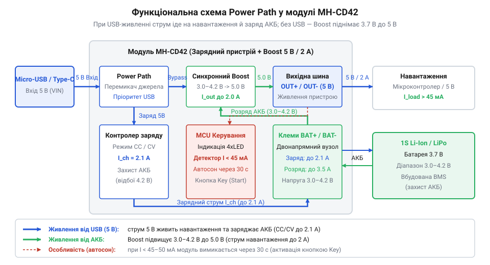
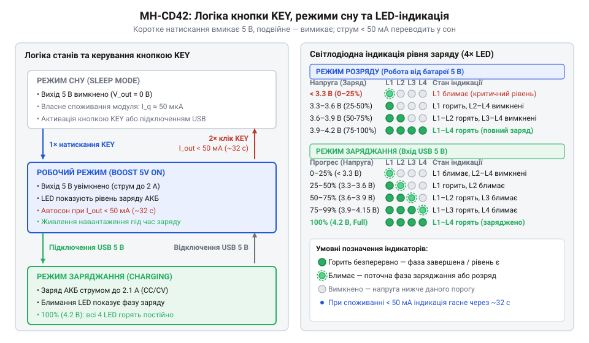
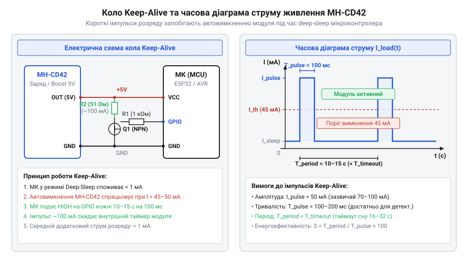
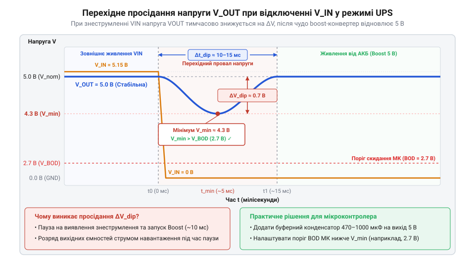
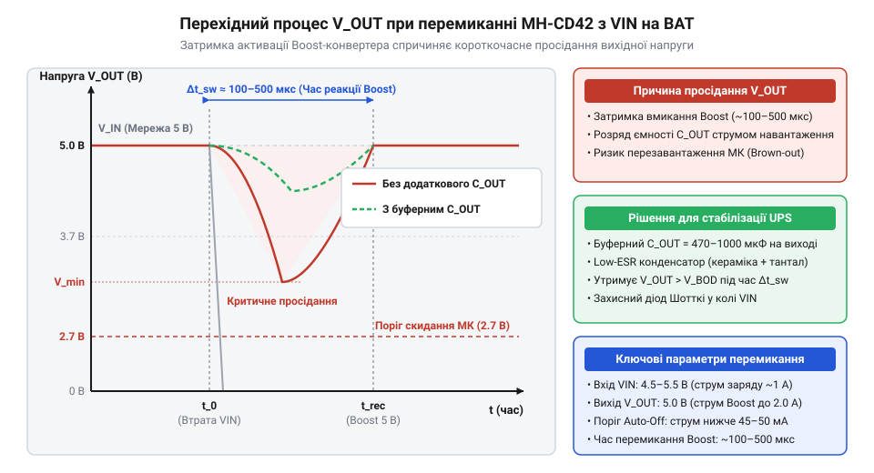

# MH-CD42 — заряд-розряд 1S (5 В / 2 А)

<preknowlist>
- [TP4056](root:cat-hw-power/tp4056) — принципи роботи лінійних контролерів заряджання 1S Li-Ion за профілем CC/CV та обмеження роздільних схем без Power Path
- [Плата захисту 1S Li-Ion](root:cat-hw-power/pcb-1s-protection) — призначення мікросхем захисту акумуляторів від перезаряду, перерозряду та короткого замикання (DW01A, FS8205A)
- [Родина живильних HAT-ів Waveshare (SW6106)](root:cat-hw-power/power-hat-family) — архітектурні особливості інтегрованих Power Bank SoC із підвищувальними синхронними перетворювачами та світлодіодним моніторингом
</preknowlist>

## Проблема живлення систем від Li-Ion

Розробка автономних електронних пристроїв на базі мікроконтролерів традиційно спирається на використання однокоміркових літій-іонних або літій-полімерних акумуляторів (1S Li-Ion/LiPo) із номінальною напругою 3.7 В (робочий діапазон напруги становить від 3.0 В у розрядженому стані до 4.2 В у повністю зарядженому). Оскільки більшість мікроконтролерів, сенсорів, дисплеїв та периферійних модулів вимагають стабілізованого живлення 5.0 В або 3.3 В, розробники початківці часто застосовують найпростішу каскадну схему: підключають автономну плату заряджання акумулятора, таку як [лінійний модуль TP4056](root:cat-hw-power/tp4056), безпосередньо до клем батареї, а паралельно до цих же клем підключають підвищувальний імпульсний перетворювач, який формує вихідну напругу 5 В для живлення всієї системи.

Така пряма паралельна топологія створює серйозний системний конфлікт струмів у момент, коли до вхідного роз'єму зарядного пристрою підключають зовнішнє мережеве живлення (наприклад, від USB-адаптера чи мережевого блоку живлення). Інтегрований контролер заряджання керує процесом відновлення ємності акумулятора за класичним двостадійним профілем @@en|CC/CV@@ (англ. *Constant Current / Constant Voltage* — сталий струм / стала напруга). На першій стадії сталого струму (CC) чип видає у вихідне коло заданий максимальний струм (наприклад, 1.0 А). Однак, оскільки робоче навантаження пристрою підключене безпосередньо паралельно акумулятору, струм від зарядного модуля розгалужується за першим законом Кірхгофа: частина енергії йде на підзарядку хімічного осередку, а інша частина споживається підвищувальним конвертером та мікроконтролером. Якщо навантаження системи споживає, наприклад, 400 мА, то на безпосереднє заряджання батареї залишається лише 600 мА. Це помітно подовжує час заряджання, але не є головною небезпекою.

Основна фундаментальна проблема виникає при переході на другу стадію — сталу напругу (CV), коли напруга на клемах акумулятора досягає порогу 4.2 В. Згідно з алгоритмом @@en|CC/CV@@, контролер фіксує напругу на рівні 4.2 В і починає відстежувати поступове падіння струму заряджання в міру насичення осередку. Коли струм, що входить у батарею, знижується до порогу відсічки (зазвичай це 10% від початкового значення струму CC, тобто близько 100 мА), мікросхема зарядного пристрою повинна повністю знеструмити зарядний контур і вимкнути світлодіодний індикатор заряджання. Проте за умов паралельного підключення навантаження пристрою продовжує безперервно відбирати свої 400 мА безпосередньо з вихідного вузла зарядного модуля. Як наслідок, сумарний струм, який витікає з контролера заряджання, ніколи не опускається нижче значення 400 мА, тобто ніколи не досягає критичного порогу відсічки 100 мА.

У результаті виникає небезпечний режим: зарядний пристрій зависає у нескінченній стадії CV, не здатний визначити факт закінчення заряду. Безперервне утримання високого потенціалу 4.2 В на електродах Li-Ion акумулятора при постійному протіканні струму викликає прискорену деградацію кристалічної ґратки катода, прискорює деградацію електроліту, супроводжується газоутворенням, роздуванням корпусу осередку та створює високий ризик теплового розгону. Додатково лінійний регулятор зарядного модуля тривалий час працює у режимі максимального тепловиділення, розсіюючи надлишкову вхідну напругу у вигляді тепла і нагріваючи розташований поруч акумулятор. Відсутність єдиної узгодженої логіки між зарядом та захистом від перерозряду через окрему [плату захисту акумулятора](root:cat-hw-power/pcb-1s-protection) призводить до непередбачуваної поведінки пристрою при просіданні напруги мережі.

Перехід від роздільних дискретних схем заряджання та підвищення напруги до високоінтегрованих одночіпових рішень @@en|Power Bank@@ @@en|SoC@@ (англ. *System on Chip* — система на кристалі) став логічним етапом розвитку портативної мікроелектроніки. Стрімке поширення комерційних павербанків сформувало потребу в спеціалізованих мікросхемах, які об'єднують на одному кремнієвому кристалі інтелектуальний контролер заряджання, синхронний підвищувальний перетворювач, вузол автоматичного визначення навантаження, світлодіодний драйвер індикації рівня заряду та силові транзистори прямого керування живильним шляхом @@en|Power Path@@ (англ. *power* — живлення, *path* — шлях). Впровадження цієї архітектури у масовий модуль MH-CD42 дозволило повністю усунути системний конфлікт струмів у мікроконтролерних пристроях. Разом із тим, комерційне походження плати MH-CD42 принесло і характерні обмеження: автоматичний перехід модуля в режим сну при падінні струму навантаження нижче 45–50 мА, що потребує спеціальних схемотехнічних прийомів при живленні мікроконтролерів у режимах глибокого сну.

Єдиним правильним інженерним рішенням проблеми конфлікту струмів є використання двонапрямного динамічного керування живильним шляхом, яке физично та логічно розділяє струм живлення навантаження та струм заряджання акумулятора. Побудова такої системи на дискретних елементах вимагає складного обв'язування з польових транзисторів та компараторів, тоді як інтегрований модуль MH-CD42 реалізує цей функціонал у компактному форматі єдиного вузла.

## Архітектура та принципи Power Path

Модуль MH-CD42 побудований на базі спеціалізованої мікросхеми @@en|Power Bank@@ @@en|SoC@@, яка об'єднує силовий імпульсний перетворювач напруги, вузол вимірювання струму, логічний контролер керування режимами та систему світлодіодного моніторингу ємності акумулятора. При проектуванні систем живлення необхідно враховувати фізичні обмеження плати, вивчаючи [цокольовку та електричні параметри](root:cat-hw-power/mh-cd42-charger/api-mh-cd42-hardware-spec.md) модуля MH-CD42, де вказані граничні значення напруг та струмів для силових контактів.

Головною функціональною ланкою MH-CD42 є вбудована система керування живильним шляхом @@en|Power Path@@, яка забезпечує двонапрямний розподіл енергетичних потоків залежно від наявності зовнішньої напруги живлення на контактах `VIN` (Micro-USB або USB Type-C) та поточного стану акумулятора, підключеного до майданчиків `BAT`.


*Структурна схема розподілу струмів Power Path у модулі MH-CD42 при зовнішньому живленні та автономній роботі від акумулятора.*

Електрична топологія модуля MH-CD42 автоматично перемикається між двома основними режимами функціонування:

1. **Режим мережевого живлення та заряджання (`VIN` підключено)**:
   При подачі зовнішньої напруги 5.0 В на контактний вузол `VIN` внутрішній логічний контролер активує прямий силовий шлях @@en|Pass-Through@@ (англ. *pass through* — проходити наскрізь) від входу до вихідних клем `OUT`. Зовнішній адаптер живлення бере на себе повне забезпечення струму споживання навантаження `I_load`. Одночасно із цим внутрішній імпульсний каскад перемикається в режим понижувального регулятора (Buck), спрямовуючи зарядний струм `I_charge` в акумулятор за точним профілем @@en|CC/CV@@ з максимальним значенням струму до 2.1 А. Завдяки тому, що струм навантаження `I_load` прямує від `VIN` до `OUT` в обхід батарейного контуру, внутрішній вимірювальний резистор @@en|SoC@@ аналізує виключно той струм, який протікає безпосередньо через лінії `BAT`. Коли напруга на акумуляторі досягає 4.2 В, струм `I_charge` безперешкодно знижується нижче 100 мА, що дозволяє контролеру вчасно та безпечно зупинити процес заряджання, продовжуючи живити підключений мікроконтролер від зовнішньої мережі.

2. **Режим автономного живлення від акумулятора (`VIN` відключено)**:
   У разі знеструмлення зовнішнього входу `VIN` модуль миттєво запускає вбудований [синхронний підвищувальний перетворювач](root:hw-power/boost). Силові MOSFET-транзистори починають високочастотне перемикання, підвищуючи змінну напругу акумулятора `V_bat` (яка просідає від 4.2 В до 3.0 В у процесі розряджання) до стабілізованого рівня 5.0 В на виході `OUT`. Застосування синхронного випрямлення (використання нижнього та верхнього керованих транзисторів замість класичного випрямного діода Шотткі) суттєво зменшує статичні втрати потужності на активному опорі каналу `R_ds(on)`. Це дозволяє модулю досягати коефіцієнта корисної дії (ККД) до 91–93% при середніх навантаженнях.

Для точного проектування автономного живлення необхідно розраховувати енергетичний баланс між акумуляторною батареєю та вихідним навантаженням. Оскільки підвищувальний перетворювач працює за принципом збереження потужності, зниження напруги на акумуляторі викликає пропорційне зростання струму, який витягується з осередку.

Вхідна потужність `P_in`, яка відбирається від акумулятора, дорівнює вихідній потужності `P_out`, поділеній на коефіцієнт корисної дії перетворювача `η` (грец. *η* — коефіцієнт корисної дії):

```
P_in = P_out / η
```

Де:
- `P_out` — корисна потужність, яка передається у навантаження на виході 5 В (`P_out = V_out × I_out`), Вт;
- `P_in` — повна потужність, що відбирається від Li-Ion акумулятора (`P_in = V_bat × I_bat`), Вт;
- `V_out` — вихідна стабілізована напруга модуля (5.0 В);
- `I_out` — струм споживання зовнішньої електронної схеми, А;
- `V_bat` — поточна робоча напруга на клемах акумулятора, В;
- `I_bat` — струм розряду, що протікає через акумуляторне коло, А;
- `η` — ККД підвищувального перетворювача (дробове число в діапазоні від 0 до 1).

Виразимо струм розряду акумулятора `I_bat` через параметри вихідного навантаження та ККД перетворювача:

```
I_bat = (V_out × I_out) / (V_bat × η)
```

Проведемо покроковий обчислювальний приклад для граничного режиму робочого навантаження 2 А при майже розрядженому акумуляторі.

**Розрахунок струму розряду акумулятора при вихідному навантаженні 2 А та низькій напрузі осередку**
Вихідні дані: напруга виходу `V_out = 5.0` В, струм споживання пристрою `I_out = 2.0` А, напруга на клемах акумулятора під навантаженням `V_bat = 3.3` В, ККД перетворювача при максимальному струмі `η = 0.88`.

```
P_out = 5.0 × 2.0 = 10.0 Вт          [обчислення вихідної потужності навантаження]
I_bat = 10.0 / (3.3 × 0.88)          [підстановка значень у вираз вхідного струму]
= 10.0 / 2.904                       [обчислення добутку напруги та ККД у знаменнику]
= 3.44 А                             [результат розрахунку струму розряду батареї]
```

**Висновок**: при віддачі у навантаження потужності 10 Вт (5 В / 2 А) розряджений Li-Ion акумулятор змушений віддавати струм 3.44 А. Це означає, що для забезпечення надійної роботи пристрою без передчасного вимкнення через просідання напруги необхідно використовувати високострумові акумулятори (high-drain) та з'єднувальні провідники відповідного перерізу. Детальні таблиці залежності ККД від напруги батареї та режимів роботи наведено у розрахунковому документі, де наведено [розрахунок ККД та параметрів утримання](root:cat-hw-power/mh-cd42-charger/math-mh-cd42-power-efficiency-calc.md) модуля.

Наявність інтегрованого контролера @@en|Power Path@@ дає можливість будувати розвинені [схеми керування живильним шляхом](root:hw-power/power-path), забезпечуючи безперебійну роботу мікроконтролерів при коливаннях або повній відсутності мережевого живлення.

## Світлодіодна індикація та режим сну

Масовий перехід портативної електроніки від громіздких комбінацій з окремих лінійних контролерів і зовнішніх підвищувальних плат до монолітних мікросхем докорінно змінив архітектуру автономного живлення. Перші покоління систем збиралися на дискретних компонентах, де заряджання акумулятора виконував окремий чип, а підвищення напруги для навантаження — автономний імпульсний перетворювач. Поява інтегрованих мікросхем @@en|SoC@@ (англ. *System-on-Chip* — система на кристалі) для комерційних @@en|Power Bank@@ (англ. *power* — енергія, *bank* — сховище) об'єднала ці функції в єдиному напівпровідниковому кристалі, додавши автоматичне виявлення підключення пристроїв, інтелектуальну світлодіодну індикацію залишкової ємності та режим глибокого енергозбереження. Модуль MH-CD42 є прямою реалізацією цієї комерційної концепції: вбудований у нього контролер керує силовими @@en|MOSFET@@ (англ. *Metal-Oxide-Semiconductor Field-Effect Transistor* — польовий транзистор із ізольованим затвором) ключами, вимірює напругу батареї та постійно моніторить струм вихідного кола, адаптуючи поведінку платформи під поточний стан живлення.

Інформація про залишкову ємність акумулятора та поточний режим роботи модуля виводиться за допомогою чотирьох світлодіодів, позначених на платі як LED1, LED2, LED3 та LED4. Алгоритм індикації чітко розрізняє напрямок проходження енергії — заряджання акумулятора від зовнішнього роз'єму чи розряджання на зовнішнє навантаження. На відміну від ситуації, коли використовуються [одноканальні лінійні контролери](root:cat-hw-power/tp4056) із двома статичними світлодіодами, чотирьохрівнева система MH-CD42 забезпечує дискретну градацію напруги на виводах акумулятора з кроком приблизно 25% від загального діапазону робочої напруги 1S Li-Ion комірки. Для усунення хаотичного миготіння світлодіодів при пульсаціях напруги під навантаженням у внутрішній компаратор @@en|SoC@@ закладено гістерезис величиною близько 50 мВ.

Під час заряджання від зовнішнього джерела напругою 5 В (режим зниження напруги @@en|Buck@@, англ. *buck* — знижувати) світлодіоди працюють у динамічному режимі. Поточний рівень заряду визначається за напругою на контакті `BAT`:

1. При напрузі `V_bat` нижче 3.4 В блимає світлодіод LED1, а LED2–LED4 вимкнені (рівень заряду менше 25%). 2. При напрузі `V_bat` від 3.4 В до 3.7 В світлодіод LED1 світиться постійно, LED2 блимає, а LED3–LED4 вимкнені (заряд від 25% до 50%). 3. При напрузі `V_bat` від 3.7 В до 4.0 В світлодіоди LED1 і LED2 світяться постійно, LED3 блимає, а LED4 вимкнений (заряд від 50% до 75%). 4. При напрузі `V_bat` від 4.0 В до 4.2 В світлодіоди LED1–LED3 світяться постійно, а LED4 блимає (заряд від 75% до 100%).

Коли акумулятор досягає напруги повного заряду 4.2 В і внутрішній контролер відсікає фазу постійної напруги (CV), усі чотири світлодіоди починають світитися безперервно.

У режимі розряджання, коли зовнішнє джерело відключене і модуль працює як [синхронний підвищувальний перетворювач](root:hw-power/boost) (режим @@en|Boost@@, англ. *boost* — підвищувати), світлодіодна лінійка відображає залишок енергії батареї статичним світінням відповідної кількості сегментів. Світлодіод LED4 згасає першим, коли напруга опускається нижче 4.0 В. При зниженні напруги `V_bat` нижче критичної межі 3.0–3.1 В останній світлодіод LED1 починає часто блимати, попереджаючи про швидке відключення живлення. Якщо напруга продовжує падати, вмикається захист від глибокого розряду @@en|UVLO@@ (англ. *Under-Voltage Lock-Out* — блокування при зниженні напруги), і перетворювач повністю знеструмлює вихідні контакти `OUT`. Повну таблицю електричних параметрів індикації та порогів напруг описує [специфікація призначень контактів](root:cat-hw-power/mh-cd42-charger/api-mh-cd42-hardware-spec.md) плати.

Керування станом модуля здійснюється за допомогою тактової кнопки, підключеної до виводу `KEY`. Внутрішня логіка мікросхеми підтягує цей контакт до високого рівня, реагуючи на замикання на силовий дріт `GND`:

- **Коротке натискання (тривалість менше 1 с):** активує вихідний підвищувальний перетворювач 5 В, якщо він перебував у стані сну, та вмикає світлодіодну індикацію на 16–30 секунд для візуального контролю ємності. - **Подвійне швидке натискання (два кліки протягом 0.5 с):** примусово вимикає вихідну напругу 5 В і переводить модуль у режим наднизького споживання струму (менше 50 мкА).


*Граф станів керування модулем MH-CD42: переходи між режимами Buck-заряджання, Boost-розряджання та сну за сигналами кнопки KEY та за значенням вихідного струму.*

Найважливішою особливістю автоматики MH-CD42 є алгоритм самостійного переходу в режим енергозбереження @@en|Standby@@ (англ. *standby* — режим очікування). Вбудований у @@en|SoC@@ струмовий датчик (вимірювальний резистор або детектор падіння напруги на відкритому каналі силового ключа) постійно контролює величину вихідного струму `I_load`. Якщо струм споживання навантаження падає нижче відсічного порогу `I_auto_off` (приблизно 45–50 мА) і залишається на цьому рівні протягом інтервалу часу `t_auto_off` (від 16 до 30 секунд), внутрішній таймер контролера лічить це як відключення споживача. Після цього підвищувальний DC-DC перетворювач автоматично вимикається, світлодіоди згасають, а вихідна напруга на шині `OUT` падає до нуля. Таке рішення запобігає саморозряду акумулятора, коли до павербанка не підключено навантаження, однак у мікроконтролерній техніці воно перетворюється на серйозний бар'єр.

## Проблема сну MCU та Keep-Alive

Автоматичний алгоритм вимкнення живлення при малому струмі споживання є оптимальним для заряджання смартфонів, проте створює критичний конфлікт при використанні модуля MH-CD42 у системах з мікроконтролерами. Сучасні мікроконтролери (наприклад, ESP32 або STM32) для забезпечення тривалої автономності використовують режими глибокого сну @@en|deep-sleep@@ (англ. *deep* — глибокий, *sleep* — сон). У цьому стані більшість периферійних вузлів і процесорних ядер знеструмлюються, а працюючими залишаються лише таймер реального часу RTC та мала область пам'яті. Споживання струму мікроконтролером при цьому падає до кількох мікроампер або одиниць міліампер, що в десятки разів нижче порогу `I_auto_off` = 45–50 мА.

Коли мікроконтролер переходить у режим @@en|deep-sleep@@, модуль MH-CD42 сприймає це зниження струму як відключення навантаження. Внутрішній таймер відраховує паузу `t_auto_off` тривалістю від 16 до 30 секунд, після чого вимикає підвищувальний перетворювач. Вихідна шина 5 В миттєво знеструмлюється. В результаті мікроконтролер втрачає живлення повністю і вже не може самостійно прокинутися за таймером RTC. Системна плата перебуває у знеструмленому стані доти, доки користувач вручну не натисне кнопку `KEY` для повторного запуску @@en|SoC@@.

Для вирішення цієї проблеми застосовують методи генерації періодичних імпульсів струму @@en|Keep-Alive@@ (англ. *keep* — тримати, *alive* — живим). Ідея полягає в тому, щоб періодично підключати до шини 5 В додаткове баластне навантаження, яке створює сплеск струму `I_pulse` > 50 мА на короткий час `t_w`. Якщо інтервал між цими імпульсами `T_p` є меншим за час спрацьовування внутрішнього таймера модуля `t_auto_off` (тобто `T_p` < 16 с), лічильник сну MH-CD42 постійно скидається у вихідний стан, утримуючи підвищувальний перетворювач 5 В увімкненим.


*Форма струму навантаження та електрична схема апаратного утримання MH-CD42 в активному стані за допомогою коротких імпульсів струму через польовий транзистор.*

Параметри імпульсів @@en|Keep-Alive@@ розраховуються так, щоб мінімізувати даремні витрати енергії акумулятора. Для надійного скидання лічильника струм імпульсу `I_pulse` вибирають на рівні 80–100 мА, а тривалість імпульсу `t_w` — у діапазоні 100–200 мс. Середній додатковий струм споживання `I_avg_extra` визначається за співвідношенням:

`I_avg_extra = I_pulse · (t_w / T_p)`

Задамо конкретні значення величин: вихідний струм імпульсу `I_pulse` = 100 мА, тривалість імпульсу `t_w` = 0.15 с (150 мс), а період повторення імпульсів `T_p` = 10 с.

Приклад обчислення середнього струму утримання:

```
I_avg_extra = 100 мА · (0.15 с / 10 с)
            = 100 мА · 0.015                [обчислення відношення тривалості до періоду]
            = 1.5 мА                         [підсумкове середнє споживання кола Keep-Alive]
```

Додавання всього 1.5 мА до середнього струму споживання дозволяє утримувати модуль в активному стані цілодобово. Детальний [розрахунок балансу струмів](root:cat-hw-power/mh-cd42-charger/math-mh-cd42-power-efficiency-calc.md) показує вплив ККД перетворювача на загальну тривалість автономної роботи від акумулятора різної ємності.

Схема генерації імпульсів @@en|Keep-Alive@@ може реалізовуватися як програмно-апаратним способом за участю самого мікроконтролера, так і повністю автономним апаратним колом. 

У програмно-апаратному варіанті мікроконтролер використовує один зі своїх виводів GPIO для керування N-канальним @@en|MOSFET@@ транзистором або NPN біполярним транзистором. Послідовно з транзистором у коло 5 В вмикається баластний резистор `R_load`. За законом Ома опір цього резистора для забезпечення струму `I_pulse` = 100 мА розраховується як `R_load` = `V_out` / `I_pulse` = 5 В / 0.1 А = 50 Ом. Вибирають стандартний номінал 47 Ом або 51 Ом із розсіюваною потужністю не менше 0.5 Вт. Поки мікроконтролер перебуває в режимі @@en|deep-sleep@@, його таймер RTC періодично (наприклад, кожні 9 секунд) на короткий час пробуджує процесор або активує вивід GPIO, формуючи імпульс високого рівня тривалістю 150 мс, після чого мікроконтролер знову повертається в глибокий сон.

Для систем, де мікроконтролер занурюється у сон на невизначений термін або не має можливості періодичного таймерного пробудження GPIO, застосовують апаратний генератор на базі таймера TPL5110 або класичної схеми на миготливому світлодіоді чи @@en|RC-колі@@ (англ. *Resistor-Capacitor* — резисторно-конденсаторне коло). Такі рішення вивчають [методи запобігання автовимкненню](root:hw-power/li-ion-keepalive-methods) адаптивних DC-DC джерел живлення.

Практичну реалізацію програмного утримання модулів живлення ілюструє приклад коду для ESP32 під керуванням середовищ ESP-IDF та Arduino IDE.

:::tabs
@tab ESP-IDF (C)
:::code mh-cd42-charger-d/c/esp-idf/app-main.c
@tab Arduino (C++)
:::code mh-cd42-charger-d/cpp/arduino/setup.cpp
:::

Використання модуля MH-CD42 спільно з колами утримання струму дозволяє будувати надійні [джерела безперебійного живлення](root:cat-hw-power/mh-cd42-charger/proj-mh-cd42-mcu-ups-keepalive.md) (режим @@en|UPS@@, англ. *Uninterruptible Power Supply* — джерело безперебійного живлення). Під час наявності мережевої напруги 5 В на вході `VIN` модуль живить мікроконтролер наскрізним шляхом через силові транзистори (режим @@en|Pass-Through@@, англ. *pass-through* — наскрізний прохід) та одночасно заряджає акумулятор. У момент раптового відключення зовнішнього живлення внутрішній контролер миттєво перемикає вихідну шину `OUT` на роботу від підвищувального перетворювача `Boost`.


*Динаміка вихідної напруги 5 В під час перемикання з зовнішнього джерела живлення VIN на акумуляторну батарею в режимі UPS.*

Як видно з осцилограми, під час перемикання спостерігається короткочасне просідання напруги тривалістю кілька мікросекунд, однак його амплітуда не призводить до перезавантаження мікроконтролера за умови встановлення згладжувального конденсатора ємністю 100–470 мкФ на шині 5 В. Готовий проєкт містить повну принципову схему та рекомендації щодо вибору ємностей. Крім того, при роботі під високим навантаженням використовується [спеціалізована система тепловідведення](root:cat-hw-power/mh-cd42-charger/proj-mh-cd42-high-current-thermal-rig.md), що запобігає перегріву @@en|SoC@@ при тривалому вихідному струмі до 2 А. Вивчення складніших альтернативних рішень можна продовжити, аналізуючи [живлення платформ Raspberry Pi](root:cat-hw-power/liion-hat-rpi) та розглянуту раніше [родину платформ Waveshare](root:cat-hw-power/power-hat-family) на базі чипів SW6106. Щоб глибше зрозуміти системні принципи комутації живильних шин, варто дослідити різноманітні [топології керування живильним шляхом](root:hw-power/power-path) у портативній техніці.

## Організація UPS та теплові режими

Автономна мікроконтролерна система, що вимірює параметри довкілля або передає дані через бездротовий зв'язок, не повинна перезавантажуватися при знеструмленні зовнішнього мережевого адаптера. Якщо підключити мікроконтролер до звичайного зарядного модуля без вбудованого керування живильним шляхом, зникнення вхідного живлення спричиняє обрив напруги на системній шині та негайний скид процесора. Модуль @@en|MH-CD42@@ розв'язує цю проблему, поєднуючи функції зарядного пристрою та джерела безперебійного живлення — @@en|UPS@@ (від англ. *uninterruptible power supply* — безперебійне джерело живлення). Здатність плати одночасно заряджати акумулятор і живити зовнішнє навантаження базується на інтегрованій топології @@en|Power Path@@ (від англ. *power path management* — керування живильним шляхом).

Коли до входу `VIN` модуля під'єднано зовнішню напругу 5 В, внутрішній силовий контролер @@en|SoC@@ (від англ. *system-on-chip* — система на чипі) працює в режимі перетворення @@en|Buck@@ (від англ. *buck converter* — понижувальний перетворювач). У цьому стані вхідний струм розгалужується: одна частина спрямовується на наснаження 1S Li-Ion або LiPo акумулятора за контрольованим профілем, а інша — проходить безпосередньо на вихідний роз'єм `OUT` для живлення навантаження. Повна схемотехнічна реалізація та часові діаграми безперебійного вузла наведені в інструкції до [безперебійного вузла живлення](root:cat-hw-power/mh-cd42-charger/proj-mh-cd42-mcu-ups-keepalive.md). Головна відмінність цього режиму від простих лінійних зарядок полягає в тому, що струм споживання навантаження не спотворює алгоритм відсічки стадії CV (постійної напруги) зарядного циклу батареї.

Критичний момент для системи виникає під час раптового зникнення вхідної напруги `VIN`. У мить вимкнення мережевого адаптера внутрішня логіка @@en|MH-CD42@@ виявляє падіння вхідного потенціалу нижче допустимого порогу і миттєво перемикає силові @@en|MOSFET@@ (від англ. *metal-oxide-semiconductor field-effect transistor* — польовий транзистор зі структурою метал-оксид-напівпровідник) ключі. Модуль реверсує напрямок передачі енергії: знижувальний перетворювач вимикається, а синхронний підвищувальний каскад @@en|Boost@@ (від англ. *boost converter* — підвищувальний перетворювач) починає відбирати енергію від акумулятора та формувати стабільні 5 В на шині `OUT`. Детальний опис силового транзисторного моста та електричних характеристик майданчиків підключення міститься в [специфікації апаратного інтерфейсу](root:cat-hw-power/mh-cd42-charger/api-mh-cd42-hardware-spec.md).

Перехідний процес перемикання джерел живлення супроводжується коротким просіданням напруги на виході модуля. Оскільки внутрішній логіці чипа потрібен час для виявлення аварії вхідної мережі та перезапуску генератора @@en|PWM@@ (від англ. *pulse-width modulation* — широтно-імпульсна модуляція) у підвищувальному режимі, напруга на шині `OUT` на кілька мілісекунд знижується. Якщо навантаження не має достатньої власної ємності фільтрації, це просідання може перетинати поріг скиду мікроконтролера за зниженою напругою. Для запобігання збоям системну шину доповнюють зовнішнім згладжувальним конденсатором із низьким еквівалентним послідовним опором — @@en|ESR@@ (від англ. *equivalent series resistance* — еквівалентний послідовний опір). Принцип побудови таких перехідних вузлів докладніше розглядається у матеріалі про [керування живильним шляхом](root:hw-power/power-path).


*Динаміка зміни вихідної напруги модуля MH-CD42 при знеструмленні входу VIN та час реакції підвищувального перетворювача.*

Тривала робота модуля при граничному вихідному струмі 2 А супроводжується значним виділенням тепла. Розрахунок теплового балансу починається з визначення струму, який відбирається від акумулятора. Оскільки вихідна потужність становить 10 Вт (5 В × 2 А), а напруга на акумуляторі `V_BAT` зменшується в процесі розряджання від 4.2 В до 3.0 В, струм акумулятора `I_BAT` неперервно зростає. Визначимо максимальний струм розряджання батареї при коефіцієнті корисної дії перетворювача η = 0.88 та робочій напрузі елемента 3.2 В.

        I_BAT = P_OUT / (η × V_BAT)
        = 10 / (0.88 × 3.2)      [підстановка вихідної потужності та напруги акумулятора]
        = 3.55                   [струм акумулятора в амперах]

Отримане значення показує, що для забезпечення вихідного струму 2 А при напрузі 5 В від акумулятора відбирається струм понад 3.5 А. Цей струм протікає через внутрішні силові ключі та дросель модуля. Потужність втрат `P_loss`, яка повністю перетворюється на тепло всередині компактного корпусу micro-SoC, обчислюється через вихідну потужність `P_OUT` та коефіцієнт корисної дії η.

        P_loss = P_OUT × (1 / η - 1)
        = 10 × (1 / 0.88 - 1)      [підстановка вихідної потужності 10 Вт та ККД 88%]
        = 1.36                     [теплова потужність втрат у ватах]

Значення теплових втрат 1.36 Вт є критичним для маленької друкованої плати площею в кілька квадратних сантиметрів. За відсутності спеціального тепловідведення тепловий опір кристал-довкілля R_θJA для корпусів типів ESOP-8 або QFN становить приблизно 50 °C/Вт. Обчислимо температуру напівпровідникового кристала T_j при кімнатній температурі довкілля T_a = 25 °C.

        T_j = T_a + (P_loss × R_θJA)
        = 25 + (1.36 × 50)         [підстановка кімнатної температури та опору]
        = 93                       [температура кристала в градусах Цельсія]

Якщо температура кристала досягає 93 °C у відкритому просторі, то всередині закритого пластикового корпусу пристрою температура довкілля може зрости до 50 °C, що підніме температуру чипа понад 118 °C. При нагріванні вище допустимої межі вмикається апаратний тепловий тротлінг — @@en|Thermal Throttling@@ (від англ. *thermal throttling* — теплове обмеження потужності), який примусово знижує вихідний струм або активує тепловий захист. Вичерпний математичний аналіз залежності ККД від напруги елемента та струму навантаження наведено у [розрахунковій документації ККД](root:cat-hw-power/mh-cd42-charger/math-mh-cd42-power-efficiency-calc.md).

Для забезпечення стабільної роботи при високому навантаженні критично важливо правильно вибрати переріз підключених провідників. При струмі розряджання 3.55 А навіть невеликий опір дротів або контактних з'єднань викликає суттєве падіння напруги. Наприклад, опір лінії 0.05 Ом при струмі 3.55 А створює падіння напруги 0.178 В та додаткове теплове виділення 0.63 Вт на дротах. Внаслідок цього падіння напруги модуль @@en|MH-CD42@@ фіксує на своїх виводах напругу 3.02 В замість реальних 3.2 В на клемах акумулятора, що призводить до передчасного спрацьовування захисту від глибокого розряду — @@en|UVLO@@ (від англ. *under-voltage lockout* — блокування за зниженої напруги).

Підключення батареї до модуля має виконуватися мідними провідниками з перерізом не менше 0.5 мм² (AWG20 або AWG18) та мінімальною довжиною лінії. При розробці друкованих плат із інтегрованим модулем необхідно передбачити широкі мідні полігони для відведення тепла від силових виводів чипа та масивну сітку теплових перехідних отворів (Thermal Vias). У пристроях із постійним споживанням 2 А рекомендується встановлювати алюмінієвий радіатор через теплопровідну прокладку або забезпечувати примусове обдування корпусу. Практичні поради містить інструкція щодо [випробування системи тепловідведення](root:cat-hw-power/mh-cd42-charger/proj-mh-cd42-high-current-thermal-rig.md). Розуміння теплових меж готує підґрунтя для розбору апаратних захистів чипа при аварійних станах.

## Граничні режими та апаратний захист

Експлуатація джерел живлення у реальних приладах завжди пов'язана з ризиком виникнення аварійних ситуацій: короткого замикання в кабелях навантаження, помилок монтажу, підключення потужних ємкісних споживачів або перегріву корпусу. Для запобігання руйнуванню внутрішніх силових ключів та пошкодженню літієвого акумулятора модуль @@en|MH-CD42@@ містить багаторівневий комплекс апаратних захистів, вбудованих безпосередньо у кристалі внутрішнього контролера.

Першим контуром безпеки є захист від перевантаження за струмом — @@en|OCP@@ (від англ. *over-current protection* — захист від перевантаження за струмом). Якщо струм навантаження на шині `OUT` перевищує поріг близько 2.4–2.6 А, внутрішній компаратор струму фіксує падіння напруги на вимірювальному резисторі та обмежує тривалість імпульсів генератора @@en|PWM@@. Перетворювач виходить із режиму стабілізації напруги і починає знижувати вихідний потенціал. Якщо опір навантаження продовжує падати й вихідний струм досягає рівня короткого замикання, активується захист від короткого замикання — @@en|SCP@@ (від англ. *short-circuit protection* — захист від короткого замикання). У цьому режимі чип негайно блокує всі силові ключі, знеструмлюючи вихід для відвернення термічного пробою.

Другий контур опікується станом акумулятора. Для захисту літієвого осередку від деградації та незворотної втрати ємності внаслідок глибокого розряджання модуль використовує алгоритм @@en|UVLO@@. Коли напруга на клемах `BAT` знижується до порогу близько 2.9–3.0 В, підвищувальний перетворювач автоматично вимикається, а сам модуль переходить у режим ультранизького споживання (Standby). Захист від перезаряджання — @@en|OVP@@ (від англ. *over-voltage protection* — захист від перенапруги) — зупиняє процес заряджання при досягненні напруги 4.21 В на акумуляторі. Слід зазначити, що хоча @@en|MH-CD42@@ самостійно контролює напругу осередку, у професійних пристроях акумулятор обов'язково повинен мати власну плату безпеки, таку як [плати захисту 1S Li-Ion](root:cat-hw-power/pcb-1s-protection). Зовнішня плата захисту створює дубльований бар'єр на випадок пробою внутрішніх транзисторів @@en|MH-CD42@@.

Третім контуром є захист від перегріву — @@en|TSD@@ (від англ. *thermal shutdown* — теплове вимкнення). Якщо внаслідок тривалого відбору високого струму або відсутності вентиляції температура кристала перевищує безпечну межу (зазвичай 150 °C), внутрішній термодатчик видає сигнал на примусове вимкнення силових каскадів. Модуль залишається знеструмленим доти, доки температура кристала не знизиться на 20–30 °C завдяки апаратному гістерезису.

Поширеною пасткою при експлуатації модуля є поведінка при гарячому підключенні навантаження (Hot-Plug). Коли до працюючого виходу `OUT` під'єднується зовнішній модуль або мікроконтролерний блок, у момент контакту відбувається заряджання вхідних конденсаторів навантаження. Розряджений конденсатор ємністю 220–470 мкФ у перші мікросекунди підключення діє як пряме коротке замикання. Виникає потужний пусковий кидок струму — @@en|Inrush Current@@ (від англ. *inrush current* — пусковий кидок струму), пікове значення якого може перевищувати 5 А.

Цей короткочасний імпульс струму помилково сприймається компаратором @@en|MH-CD42@@ як коротке замикання, через що модуль негайно активує захист @@en|SCP@@ і засуває вихідну напругу в нуль. Навантаження залишається знеструмленим, а індикатори модуля гаснуть. Діагностика такого стану показує, що модуль не пошкоджено, але його вихід заблоковано в аварійному стані. Для відновлення працездатності модуля після спрацьовування апаратного захисту необхідно або подати вхідну напругу на роз'єм `VIN`, або короткочасно натиснути на керуючу кнопку `KEY`.

Для запобігання помилковим спрацьовуванням захисту при підключенні ємкісних споживачів застосовують зовнішні схеми м'якого запуску (Soft-Start). Найпростіший вузол м'якого запуску будується на польовому транзисторі @@en|MOSFET@@ та RC-ланцюжку, який плавно відкриває канал транзистора і обмежує швидкість наростання струму заряду конденсаторів. Детальний розбір таких схем наведено у матеріалі про застосування [підвищувальними DC-DC перетворювачами](root:hw-power/boost) та у посібнику з побудови [обмеження пускового струму](root:hw-power/inrush-current).

Безпечна інтеграція модуля @@en|MH-CD42@@ у фінальні портативні та стаціонарні пристрої вимагає дотримання комплексу інженерних правил. По-перше, корпус пристрою повинен мати вентиляційні отвори для вільної конвекції повітря, а сам літієвий акумулятор не можна розміщувати впритул до плати модуля, щоб запобігти деградації хімічного осередку від тепла, яке виділяє силовий чип. По-друге, в лінію підключення акумулятора рекомендується послідовно впаювати самовідновлювальний запобіжник (PTC) або плавкий запобіжник відповідного номіналу для захисту від катастрофічного замикання при випадковому пошкодженні ізоляції. По-третє, необхідно пам'ятати про відсутність у модуля захисту від переполюсовки акумулятора: помилкове підключення `BAT+` і `BAT-` із зворотною полярністю миттєво виводить із ладу силовий міст через пробій внутрішніх паразитних діодів.

Дотримання розрахованих теплових режимів, правильний вибір перерізу проводів живлення, застосування схем придушення пускових струмів та утримання живлення Keep-Alive перетворюють @@en|MH-CD42@@ на високоефективний, надійний та доступний вузол безперебійного живлення для сучасних мікроконтролерних систем.