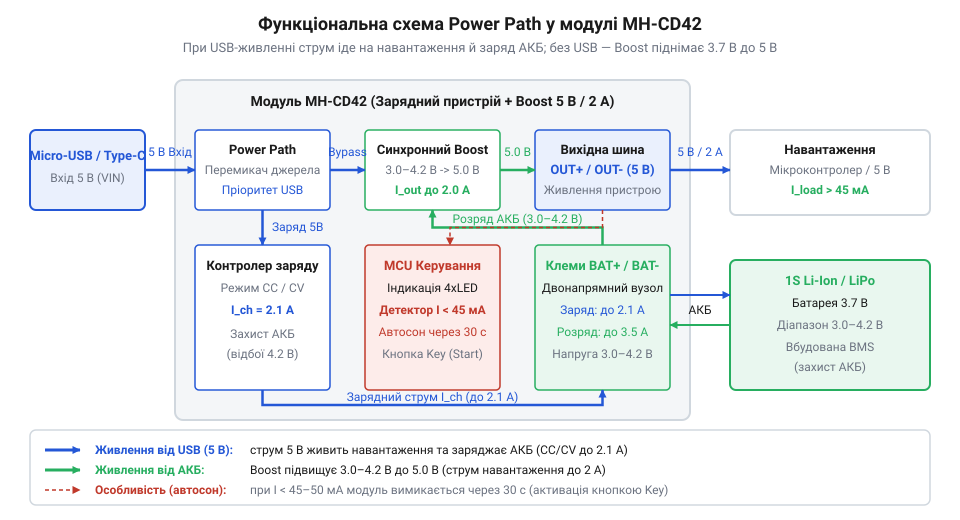
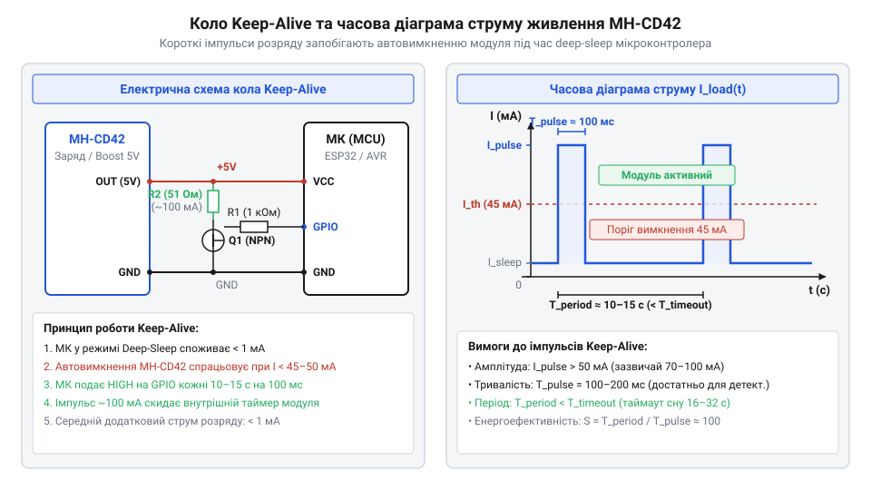
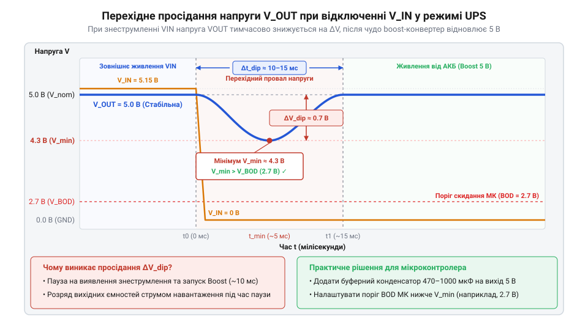

# MH-CD42 — заряд-розряд 1S (5 В / 2 А)

<preknowlist>
- [TP4056](root:cat-hw-power/tp4056) — обмеження роздільних схем заряджання 1S Li-Ion за профілем @@en|CC/CV@@ та проблеми паралельного підключення навантаження
- [Плата захисту 1S Li-Ion](root:cat-hw-power/pcb-1s-protection) — принципи захисту 1S Li-Ion акумулятора від перезаряду, перерозряду та короткого замикання
</preknowlist>

## Проблема паралельного живлення від Li-Ion

Паралельне підключення [зарядного модуля TP4056](root:cat-hw-power/tp4056), @@en|Li-Ion@@ акумулятора та підвищувального перетворювача для живлення 5 В пристроїв із мережевим буфером викликає системний конфлікт струмів.

Зарядний чип керує відновленням ємності за профілем @@en|CC/CV@@ (англ. *Constant Current / Constant Voltage* — сталий струм / стала напруга). У фазі сталої напруги @@en|CV@@ струм в акумуляторі падає, і контролер вимикає заряджання при зниженні споживання до 10% від початкового (поріг відсічки).

Проте струм навантаження додається до струму заряджання на клемах акумулятора. Зарядний чип вимірює загальну суму струмів і не може відокремити споживання пристрою. Якщо навантаження споживає понад 100 мА, підсумковий струм не падає нижче 10% порогу.

Внаслідок цього вимкнення не відбувається, і чип безперервно утримує на акумуляторі 4.2 В. Це спричиняє мікроперезаряд і прискорену деградацію @@en|Li-Ion@@ елемента, а лінійний контролер зазнає небезпечного теплового перегріву.

## Архітектура та принципи @@en|Power Path@@

Для усунення конфлікту струмів у модулі @@en|MH-CD42@@ застосовано двонапрямну топологію розподілу енергії @@en|Power Path@@ (англ. *power path* — шлях живлення) на вбудованих транзисторних ключах @@en|MOSFET@@.


*Функціональна архітектура Power Path у модулі MH-CD42 із незалежними каналами живлення навантаження та заряджання.*

При підключенні зовнішнього живлення 5 В вхідний струм спрямовується напряму на вихідну шину навантаження. Одночасно вбудований зарядний вузол живить @@en|Li-Ion@@ акумулятор окремим регульованим каналом за профілем @@en|CC/CV@@. Струм мікроконтролера більше не проходить через сенсор заряджання, тому пристрій вчасно відсікає заряд при досягненні 10% ємності.

При відключенні мережі ключі перемикають джерело. Напруга акумулятора (3.0–4.2 В) надходить на синхронний підвищувальний @@en|DC-DC@@ перетворювач, що формує на виході 5.1 В із струмом до 2.1 А.

З огляду на збереження потужності та коефіцієнт корисної дії перетворювача `η ≈ 0.9`, розрядний струм обчислюється за формулою:

```
I_batt = (U_out × I_out) / (U_batt × η)
= (5.1 × 2.0) / (3.6 × 0.9)     [підстановка параметрів навантаження 2 А]
≈ 3.15 А                       [підсумковий струм розряду акумулятора]
```

При вихідному струмі 2 А розрядний струм акумулятора досягає 3.15 А, що вимагає високострумових елементів. Відсутність конфлікту струмів робить @@en|MH-CD42@@ надійнішим за зв'язку з [зарядного контролера TP5100](root:cat-hw-power/tp5100-charger) та зовнішнього бустера.

## Автовимкнення та імпульси @@en|Keep-Alive@@

Модуль @@en|MH-CD42@@ вимикає підвищувальний перетворювач, якщо струм споживання падає нижче 45–50 мА протягом 32 секунд. У режимі глибокого сну мікроконтролер споживає мікроампери, тому плата знеструмлює шину 5 В і блокує його пробудження.


*Принцип генерації періодичних струмових імпульсів Keep-Alive для запобігання автовимкненню модуля MH-CD42.*

Живлення утримують методом @@en|Keep-Alive@@ (англ. *keep alive* — утримання живим): таймер або мікроконтролер кожні 10–15 секунд відкриває транзисторний ключ із резистором 47 Ом. Імпульс струму 100 мА тривалістю 50–100 мс скидає лічильник автовимкнення @@en|MH-CD42@@.

Вихід 5 В також вмикається одним натисканням кнопки, а подвійне натискання переводить модуль у сон.

## Безперебійне живлення та апаратний захист

Завдяки топології @@en|Power Path@@ модуль @@en|MH-CD42@@ працює як джерело безперебійного живлення (@@en|UPS@@). При знеструмленні мережі 5 В вихідна напруга короткочасно просідає до 4.2–4.5 В, що спричиняє перезапуск мікроконтролера.


*Перехідний процес та просідання вихідної напруги модуля MH-CD42 при знеструмленні зовнішнього джерела.*

Для компенсації падіння паралельно шині 5 В підключають конденсатор ємністю 220–470 мкФ.

Чип @@en|MH-CD42@@ також має апаратні захисти:
- **Від глибокого розряду**: вимикає перетворювач при 2.9–3.0 В, на відміну від схем без [окремої плати захисту](root:cat-hw-power/pcb-1s-protection). - **Від перевантаження**: обмежує струм на рівні 2.5 А й вимикається при короткому замиканні. - **Тепловий захист**: знижує струм чи вимикає вихід при 120–150 °C.

За надійністю модуль перевершує рішення з [готових систем живлення](root:cat-hw-power/power-hat-family).