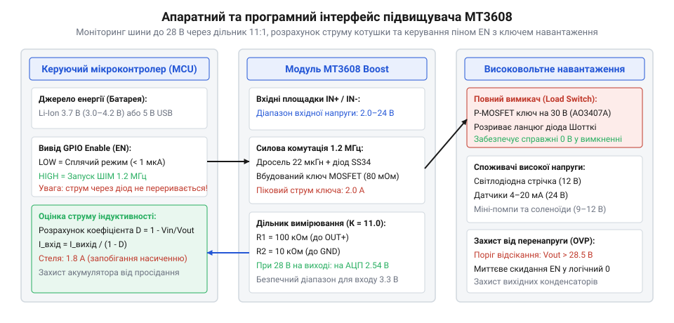

# ⚙️ Керування підвищувачем MT3608: моніторинг високої напруги, розрахунок струму індуктивності та керування EN

Модуль MT3608 — це імпульсний підвищувальний перетворювач (step-up), який підіймає напругу від 2.0–24 В до регульованих 28 В при піковому струмі вбудованого ключа до 2 А. Його типова роль у портативних приладах — живлення 12-вольтових реле, моторів, підсвічування або 24-вольтових промислових давачів від однієї банки Li-Ion акумулятора (3.7 В).

Більшість розробників використовують плату MT3608 як пасивний вузол: виставили викруткою 12 В і забули. Проте в мікроконтролерній системі підвищувач має суворий **апаратний та програмний контракт (API)**, порушення якого призводить до вигорання акумулятора чи здуття вихідних конденсаторів. 

Головна схемотехнічна пастка підвищувальної топології: **прямий шлях струму від входу до виходу**. Між контактом `IN+` та `OUT+` постійно стоїть послідовний ланцюг із силового дроселя та випрямного діода Шотткі SS34. Навіть якщо повністю зупинити генерацію мікросхеми, вихідна напруга **ніколи не впаде до нуля** — на навантаженні завжди залишається вхідний потенціал мінус спадання на діоді (V_out ≈ V_in - 0.4 В). Повне програмне керування живленням вимагає комбінації піна EN та зовнішнього силового ключа.

Ця стаття описує повний інтерфейс керування підвищувачем MT3608: вимірювання напруги до 28 В через прецизійний дільник, програмну оцінку струму котушки для захисту акумулятора від просідання, аварійне відсікання перенапруги (OVP) та двостадійне увімкнення на C (ESP-IDF, STM32 HAL, Arduino) та C++.

> 🔧 **Навіщо це.** Закон збереження енергії у підвищувачі безжальний: струм, який забирається від низьковольтної батареї, у кілька разів перевищує вихідний струм навантаження. Якщо від 3.7 В ви живите 12-вольтовий соленоїд струмом 500 мА, вхідний струм через дросель сягає майже 1.8 А — це межа насичення кристала MT3608. Програмний супервізор розраховує коефіцієнт заповнення ШІМ і запобігає перевантаженню акумулятора та виходу дроселя в насичення.

## Апаратний контракт MT3608: входи, межі та фізичні інваріанти

Плата містить пару вхідних площадок `IN+`/`IN-`, вихідних `OUT+`/`OUT-`, дросель 22 мкГн, діод SS34 та багатооборотний потенціометр зворотного зв'язку на 100 кОм.

```
Вхід IN+ (2.0..24 В) ──►[ Дросель 22 мкГн ]──┬──►[ Діод SS34 ]──┬──► Вихід OUT+ (до 28 В)
                                             │                  │
                                       [ Ключ 1.2 МГц ]     [ Дільник FB ]
                                             │                  │
Вхід IN- (GND) ──────────────────────────────┴──────────────────┴──► Вихід OUT- (GND)
```

### Електричні параметри та граничні умови (Contract Invariants)

| Параметр інтерфейсу | Номінальне значення | Гранично допустиме | Наслідок порушення |
| :--- | :--- | :--- | :--- |
| **Вхідна напруга Vin** | 3.0–12.0 В | 2.0–24.0 В | При &lt; 2.0 В мікросхема блокується; при &gt; 24 В пробій ключа |
| **Вихідна напруга Vout** | Vin ... 24.0 В | 28.0 В (максимум) | Перевищення 28 В вибиває вихідні керамічні конденсатори |
| **Мінімальна напруга виходу** | Завжди ≥ Vin - 0.4 В | Фізичний інваріант | Підвищувач **не вміє понижувати** напругу нижче вхідної! |
| **Піковий струм ключа** | 1.5 А (безпечний) | 2.0 А (межа) | Насичення дроселя, різкий перегрів чипа, тепловий захист |
| **Частота комутації ШІМ** | 1.2 МГц (фіксована) | 1.0–1.4 МГц | Задає вимоги до високочастотного фільтрування АЦП |
| **Струм споживання в сні (EN=0)** | 0.1 мкА (чип) | 1.0 мкА | Струм самої MT3608; навантаження продовжує живитися через діод! |

### Струмовий множник та розрахунок навантаження на батарею

Коефіцієнт заповнення імпульсів ШІМ (від англ. @@en|duty cycle@@, D) визначається відношенням напруг:

    D = 1 - (V_in / V_out)

Враховуючи ККД перетворювача (η ≈ 88%), середній вхідний струм, що споживається від акумулятора:

    I_in = I_out / ((1 - D) × 0.88)

Приклад розрахунку для живлення 12 В / 400 мА від Li-Ion батареї (3.7 В):
- D = 1 - (3.7 / 12.0) = 1 - 0.308 = 0.692.
- I_in = 0.400 / ((1 - 0.692) × 0.88) = 0.400 / (0.308 × 0.88) ≈ 1.47 А.

Струм 1.47 А знаходиться в безпечній зоні. Проте якщо батарея розрядиться до 3.0 В, той самий вихід 12 В / 400 мА вимагатиме вже:
- D = 1 - (3.0 / 12.0) = 0.75.
- I_in = 0.400 / (0.25 × 0.88) ≈ 1.82 А.

Струм перетинає поріг 1.8 А — дросель входить у магнітне насичення, ККД падає, і батарея миттєво просідає в аварійний розряд.


*Архітектура взаємодії: мікроконтролер зчитує вихід через дільник 11:1, розраховує струм індуктивності та керує піном EN разом із силовим ключем P-MOSFET.*

## Крок 1. Моніторинг високої напруги через АЦП (Дільник 11:1)

Оскільки вихід MT3608 може досягати 28 В, для входу АЦП мікроконтролера (максимум 3.3 В) необхідний дільник із високим вхідним опором:
- **R1 (до шини OUT+):** 100 кОм (1%).
- **R2 (до землі GND):** 10 кОм (1%).
- **Коефіцієнт ділення:** K = (100 + 10) / 10 = 11.0.
- При максимальній напрузі 28 В на вхід АЦП потрапляє 28.0 / 11.0 = 2.54 В, що має комфортний запас до межі 3.3 В.

:::tabs
:::code api-boost-control/c/esp-idf/krok-1-boost-adc-monitor.c
:::code api-boost-control/c/stm32/krok-1-boost-adc-monitor.c
:::code api-boost-control/c/arduino/krok-1-boost-adc-monitor.ino
:::

## Крок 2. Оцінка струму індуктивності в реальному часі

Супервізор у прошивці періодично зіставляє виміряну вхідну напругу батареї та вихідну напругу підвищувача. Якщо розрахунковий вхідний струм перевищує 1.8 А, прошивка знижує інтенсивність навантаження (зменшує яскравість світлодіодів або обмежує ШІМ мотора):

:::tabs
:::code api-boost-control/c/esp-idf/krok-2-current-estimator.c
:::code api-boost-control/c/stm32/krok-2-current-estimator.c
:::code api-boost-control/c/arduino/krok-2-current-estimator.ino
:::

## Крок 3. Керування EN та повний розрив навантаження (0 В Standby)

Вивід 4 мікросхеми MT3608 — це вхід увімкнення `EN`. На дешевих платах він з'єднаний тонкою доріжкою прямо з площадкою `IN+`. Якщо перерізати цю доріжку або підпаятися безпосередньо до ніжки 4, мікроконтролер отримує можливість переводити генератор у сплячий режим із власним споживанням менше 1 мкА.

Але вимкнення EN не знеструмлює навантаження: струм продовжує йти від входу через дросель і діод SS34. Щоб отримати справжні 0 В у вимкненому стані, на виході встановлюється силовий P-MOSFET ключ (наприклад, AO3407A на 30 В):

:::tabs
:::code api-boost-control/c/esp-idf/krok-3-en-load-switch.c
:::code api-boost-control/c/stm32/krok-3-en-load-switch.c
:::code api-boost-control/c/arduino/krok-3-en-load-switch.ino
:::code api-boost-control/cpp/boost_supervisor.hpp
:::

Двостадійний запуск:
1. Виставити `EN = HIGH` — генератор MT3608 запускається й накачує вихідний конденсатор Cout до 12 В.
2. Зачекати 15 мс (завершення заряду ємностей).
3. Відкрити P-MOSFET (`GATE = LOW`), підключивши навантаження до готової стабілізованої шини.

## Складність і типові пастки MT3608

### 1. Пастка 20 обертів підлаштовного гвинта

Майже кожен початківець, увімкнувши новий модуль MT3608 уперше, вважає його несправним: крутить гвинт потенціометра на пару обертів, а напруга на виході не змінюється й точно дорівнює вхідній.

**Причина:** Багатооборотний резистор W3296 на заводі виставляється в крайнє положення максимального опору (100 кОм). Щоб мікросхема почала піднімати напругу, дільник має опустити потенціал на піні FB нижче 0.6 В. Для цього гвинт треба повернути **проти годинникової стрілки на 10–20 повних обертів**, доки не з'явиться тихе клацання пружини. Лише після цього вихід почне плавно зростати.

### 2. Повна відсутність захисту від короткого замикання на виході

Підвищувальна топологія не має вбудованого захисту від КЗ. Якщо замкнути контакти `OUT+` та `OUT-`:
- Струм від джерела живлення тече напряму через дросель і діод Шотткі SS34 прямо в замикання.
- Вбудований ключ мікросхеми в цьому контурі участі не бере, тому внутрішній захист MT3608 безсилий.
- Через 0.5 секунди діод SS34 розігрівається до +200 °C і вибухає, або плавиться дріт дроселя.

**Правило:** Під час роботи з літієвими акумуляторами обов'язково встановлюйте плату захисту (BMS/PCM) або плавний запобіжник на 2 А перед входом MT3608.

## Що забрати з собою

1. **MT3608 не вміє видавати менше за Vin.** Вихідна напруга завжди вища або дорівнює вхідній мінус 0.4 В.
2. **Вимкнення EN не знеструмлює вихід.** Для повного відключення споживача до 0 В обов'язковий зовнішній P-MOSFET ключ.
3. **Струм індуктивності росте з розрядом батареї.** Контролюйте струм за формулою I_in = I_out / ((1 - D) × 0.88), щоб не перевищити межу 1.8 А при низькому заряді батареї.
4. **КЗ на виході вбиває модуль миттєво.** Завжди страхуйте вхідне коло апаратним запобіжником.
