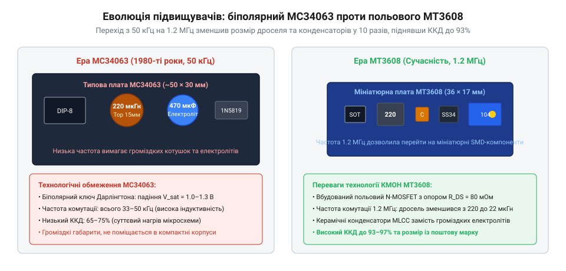

# MT3608 — підвищувач 2 А / 28 В

<preknowlist>
- [LM2596 — регульований понижувач (і версія CC/CV)](root:cat-hw-power/lm2596-buck) — базові принципи імпульсної комутації та накопичення енергії в індуктивності
</preknowlist>

## Доба низькочастотних перетворювачів: мікросхема MC34063 та біполярні ключі

Коли в 1970–1980-х роках виникала потреба отримати з низької напруги гальванічного елемента чи акумулятора вищу напругу для аналогових операційних підсилювачів або люмінесцентних індикаторів, інженери стикалися з жорсткими обмеженнями тодішньої напівпровідникової бази. Поширені лінійні стабілізатори в принципі не здатні підвищувати напругу, тому єдиним виходом була імпульсна комутація в топології підвищувача (англ. @@en|boost converter@@, від англійського @@en|boost@@ — піднімати, підсилювати). Справжнім проривом того часу стала поява мікросхеми MC34063, розробленої компанією Motorola на початку 1980-х років. Цей восьминижковий чип об'єднав на одному кремнієвому кристалі джерело опорної напруги 1.25 В, компаратор, генератор імпульсів та біполярний вихідний транзистор (англ. @@en|bipolar junction transistor@@, BJT) зі струмом комутації до 1.5 А.

Головним технічним бар'єром цієї доби була низька швидкість перемикання біполярних транзисторів. Через ефект накопичення неосновних носіїв заряду в базі час розсмоктування та вимикання ключа становив сотні наносекунд. Спроба розігнати такий ключ вище 50–100 кГц призводила до того, що динамічні втрати під час перехідних процесів перевищували корисну потужність, а кристал перегрівався й виходив з ладу. Тому типова робоча частота перетворювачів на MC34063 становила лише 33–50 кГц.

Закони електромагнетизму невблаганні: що менша частота комутації, то більше енергії дросель мусить накопичувати в магнітному полі за кожен окремий період тактового сигналу. Щоб передати ту саму потужність при частоті 33 кГц порівняно із сучасними мегагерцовими чипами, потрібна індуктивність від 100 до 220 мкГн. Такий дросель вимагав масивного відкритого феритового осердя типу «гантель» або важкого кільця з розпорошеного заліза, намотаного товстим мідним дротом, аби уникнути магнітного насичення осердя при струмах до 1–1.5 А.

Другим слабким місцем біполярного транзистора було спадання напруги насичення між колектором та емітером. У мікросхемі MC34063 інтегрований транзистор Дарлінгтона створював спадання напруги близько 1.0–1.3 В у відкритому стані. Якщо вхідна напруга схеми становила 5 В, понад 20–25 % усієї енергії безповоротно перетворювалося на тепло безпосередньо всередині пластикового корпусу DIP-8 або SOIC-8. Це різко обмежувало коефіцієнт корисної дії схеми на рівні 65–75 %.

Низька частота комутації визначала й громіздкість фільтрів. Щоб згладити низькочастотні пульсації струму на виході перетворювача, доводилося застосовувати об'ємні алюмінієві електролітичні конденсатори місткістю сотні мікрофарад. Такі конденсатори мали високий еквівалентний послідовний опір (англ. @@en|equivalent series resistance@@, ESR), через що вихідна напруга містила значні високочастотні голки комутації. Плата навіть малопотужного підвищувача на MC34063 виходила розміром із сірникову коробку і помітно нагрівалася навіть при струмі навантаження 150–200 мА, хоча для менш вибагливих схем пониження широко використовували споріднений перетворювач [LM2596 — регульований понижувач](root:cat-hw-power/lm2596-buck) на 150 кГц.

> 🔧 **Навіщо це.**
> Розуміння обмежень MC34063 рятує від поширеної помилки розробників-початківців, які намагаються використати дешевий застарілий чип у компактних пристроях з живленням від акумулятора. Втрата понад 1 В на біполярному ключі при вхідній напрузі 3.7 В спалює третину заряду батареї на марне нагрівання плати, а габарити дроселя 100–220 мкГн унеможливлюють встановлення в кишенькові корпуси.

## Прорив потужних КМОН-процесів та мегагерцова комутація

Перелом у розвитку компактних перетворювачів стався наприкінці 1990-х і на початку 2000-х років завдяки стрімкому розвитку субмікронних технологій кремнію та інтеграції потужних польових транзисторів (англ. @@en|metal-oxide-semiconductor field-effect transistor@@, MOSFET). На відміну від біполярних транзисторів, польовий транзистор керується потенціалом електричного поля на затворі, а не постійним струмом бази, і не страждає від повільного розсмоктування неосновних носіїв.

Головна перевага силового польового ключа — відсутність фіксованого порогу спадання напруги. У відкритому стані канал польового транзистора поводиться як чистий омічний опір (англ. @@en|drain-source on-resistance@@, R_ds(on)). Досягнення опору каналу на рівні 80–100 мОм означало, що при струмі комутації 1 А спадання напруги на ключі становить лише 0.08–0.1 В замість 1.2 В у біполярному каскаді MC34063. Тепловиділення в ключі зменшилося більш ніж у десять разів, що відкрило шлях до використання надкомпактних поверхнево-монтованих корпусів SOT-23-6 без тепловідвідних радіаторів.

Висока швидкодія польових ключів дозволила підняти частоту комутації в 25–40 разів — з 33–50 кГц до 1.2–1.5 МГц. Робоча частота 1.2 МГц кардинально змінила пасивні компоненти перетворювача:
- **Мініатюризація індуктивності:** Необхідна величина індуктивності впала з 100–220 мкГн до 4.7–22 мкГн. Замість важких дроселів намотки на гантельні ферити з'явилася змога використовувати мініатюрні екрановані SMD-індуктивності типорозмірів 0805, 1210 або CD32 заввишки менше 3 мм.
- **Використання керамічних конденсаторів MLCC:** Замість громіздких електролітичних «бочок» на 220–470 мкФ на мегагерцових частотах стало достатньо багатошарових монолітних керамічних конденсаторів (англ. @@en|multi-layer ceramic capacitor@@, MLCC) місткістю лише 10–22 мкФ. Вони мають майже нульовий паразитна опір ESR (кілька міліомів) та практично не нагріваються високочастотним струмом пульсацій.

Показовим результатом цієї еволюції стала поява мікросхеми MT3608 від компанії Aerosemi. Інженерам вдалося розмістити в мініатюрному шестививідному корпусі SOT-23-6 розміром 2.9 × 1.6 мм повноцінний контролер широтно-імпульсної модуляції на 1.2 МГц, ланцюги плавного пуску, схему обмеження струму та силовий N-канальний MOSFET-ключ, здатний витримувати напругу до 28 В і піковий струм до 4 А (номінальний струм ключа до 2 А).

*Еволюційний стрибок підвищувальних DC-DC перетворювачів: перехід від біполярних ключів 33 кГц на базі MC34063 до мегагерцового польового чипа MT3608 дозволив скоротити площу друкованої плати у 6 разів і зменшити масу пасивних компонентів.*

Повна плата перетворювача на MT3608 разом із підлаштовним потенціометром, діодом Шотткі, дроселем 22 мкГн та парою керамічних конденсаторів типорозміру 1206 стала розміром лише 36 × 17 мм. Для потужніших застосувань використовують споріднений модуль [XL6009 — підвищувач 3–32 В → 5–35 В](root:cat-hw-power/xl6009-boost) зі струмом ключа 4 А на частоті 400 кГц, а для живлення від однієї пальчикової батарейки застосовують спеціалізований [Підвищувач 0.9–4.2 В → 5 В](root:cat-hw-power/low-voltage-boost). Проте саме MT3608 став світовим стандартом масового й дешевого підвищувача для портативної електроніки на літій-іонних акумуляторах 18650.

> 🔧 **Навіщо це.**
> Перехід на мегагерцову комутацію дозволяє монтувати модуль MT3608 безпосередньо поруч із чутливими сенсорами та мікроконтролерами всередині герметичних датчиків IoT. Відсутність високих електролітичних конденсаторів з рідким електролітом усуває ризик висихання ємності від нагрівання й гарантує багаторічний ресурс роботи модуля.

## Поява чипа MT3608 компанії Aerosemi: революція в DIY-електроніці

На початку 2010-х років бурхливий розвиток ринку смартфонів, портативних повербанків та розумних автономних пристроїв створив гостру потребу в ультракомпактних підвищувачах, здатних ефективно живитися від одного літій-іонного або літій-полімерного елемента з напругою 3.0–4.2 В. Відповіддю на цей запит став випуск мікросхеми MT3608 шанхайською безфабричною компанією Aerosemi Technology.

Чип MT3608 став квінтесенцією еволюції монолітних імпульсних стабілізаторів. У мініатюрному шестививідному корпусі SOT-23-6 виробник інтегрував:
- Внутрішній польовий N-канальний транзистор із максимальною робочою напругою до 28 В та паспортним струмом до 2 А, що має низький опір відкритого каналу близько 80 мОм.
- Генератор тактових імпульсів на фіксовану високу частоту 1.2 МГц із вбудованою широтно-імпульсною модуляцією (англ. @@en|pulse-width modulation@@, PWM).
- Прецизійне джерело опорної напруги 0.6 В, що дало змогу підтримувати стабільну вихідну напругу з точністю до ±2 % навіть при зміні вхідної напруги батареї від 4.2 В до 3.0 В.
- Схему блокування при зниженні напруги (англ. @@en|under-voltage lockout@@, UVLO) на рівні 2.0 В, захист від перегріву кристала та обмеження пікового струму ключа до 4 А.

Поява MT3608 спричинила справжній бум серед виробників модулів та розробників електроніки. На платі розміром лише 36 × 17 мм вдалося розмістити весь підвищувач: чип MT3608, силовий діод Шотткі SS34 або B240, компактний екранований дросель 22 мкГн, два керамічні MLCC-конденсатори та багатообертовий підлаштовний резистор W3296 для плавного регулювання вихідної напруги в діапазоні від 5 В до 28 В.

Такий готовий модуль вартістю менше одного долара розв'язав одвічну проблему живлення в аматорських та комерційних проектах. Тепер живлення 5-вольтового мікроконтролера, реле 12 В або світлодіодної стрічки від єдиного акумулятора 18650 не вимагало складних схем чи громіздких плат, як у добу [XL6009 — підвищувач 3–32 В → 5–35 В](root:cat-hw-power/xl6009-boost) чи [LM2596 — регульований понижувач](root:cat-hw-power/lm2596-buck). Водночас для систем заряджання з USB-портами з'явилися вузькоспеціалізовані чипи, як-от [IP5310 — підвищувач 5 В / 3 А з USB](root:cat-hw-power/ip5310-boost), а для гальванічно відокремлених ланцюгів датчиків — [B0505S-1W — ізольований DC-DC 5 В → 5 В](root:cat-hw-power/b0505s-isolated). Модуль на базі MT3608 закріпив за собою статус найбільш масового, простого та доступного підвищувального перетворювача свого десятиліття.

> 🔧 **Навіщо це.**
> Завдяки фіксованій робочій частоті 1.2 МГц та вбудованому польовому ключу MT3608 став «робочою конячкою» автономних пристроїв. Він дає змогу розробникові отримати стандартні 5 В або 12 В від однієї літієвої батарейки без жодного радіатора, займаючи мінімум місця в корпусі.
