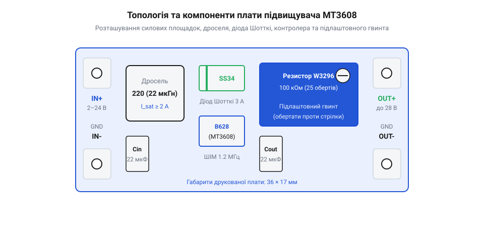
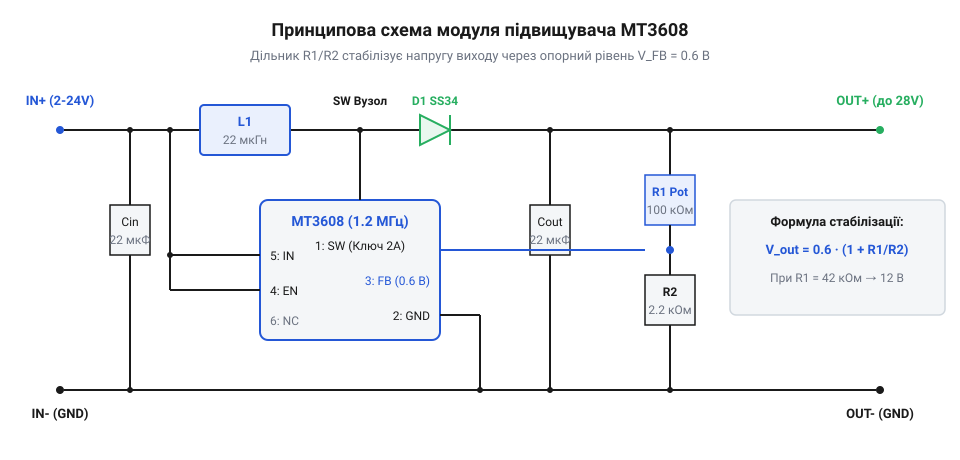
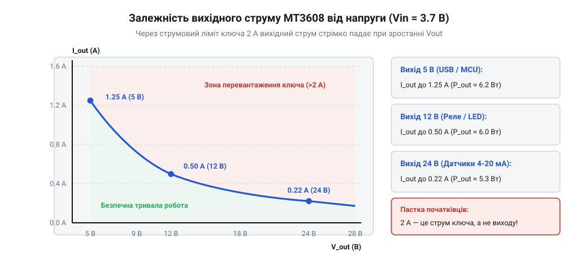

# MT3608 — підвищувач 2 А / 28 В

<preknowlist>
- [LM2596 — регульований понижувач (і версія CC/CV)](root:cat-hw-power/lm2596-buck) — Робота дроселя, діода Шотткі та згладжувальних конденсаторів в імпульсних регуляторах.
</preknowlist>

## Захід із проблеми: розрив між напругою батареї та навантаження

При розробці автономної електроніки інженер постійно стикається з фундаментальним розривом між хімічною напругою компактного джерела живлення та вимогами навантаження. Одиничний літій-іонний акумулятор формату 18650 або літій-полімерний пакет віддає номінальні 3.7 В (від 4.2 В у повному заряді до 3.0 В під час глибокого розряджання), а пара звичайних лужних батарейок AA забезпечує лише 3.0 В зі спадом до 2.0 В. Водночас типові периферійні вузли вимагають істотно вищих потенціалів: поширені світлодіодні модулі та стрічки розраховані на 12 В, ультразвукові далекоміри, реле та сервоприводи часто живляться від 5 В або 9 В, а промислові давачі з інтерфейсом «струмова петля» потребують стабільних 24 В.

Традиційний екстенсивний шлях — послідовне з'єднання кількох акумуляторних банок (конфігурації 2S, 3S або 4S) — створює комплекс серйозних інженерних проблем. Збірка з кількох елементів стає важкою та габаритною, вимагає складного контролера захисту й балансування (BMS), а також спеціалізованого зарядного пристрою з підвищеною напругою. Крім того, напруга батарейного блоку неминуче просідає в міру розряджання елементів, через що чутливі вузли все одно потребують проміжного регулювання.

Щоб наочно відчути цю різницю в масі, об'ємі та вартості, порівняємо дві типові інженерні реалізації живлення портативного 12-вольтового приладу помірної потужності:

| Критерій | Збірка 4S (4 акумулятори 18650 + BMS) | 1 банка 18650 + модуль MT3608 |
| :--- | :--- | :--- |
| **Кількість банок** | 4 штуки 18650 | 1 штука 18650 |
| **Загальна маса джерела** | Близько 220–240 г (банки + холдер + BMS) | Близько 52–55 г (одна банка + модуль) |
| **Габаритний об'єм** | ~130 см³ (громіздкий цеглина-блок) | ~30 см³ (компактне кишенькове розміщення) |
| **Плата керування та балансування** | Обов'язкова BMS-плата 4S з балансиром | Вбудований контролер заряду TP4056 + MT3608 |
| **Спосіб заряджання** | Спеціалізований блок 16.8 В з круглим штекером | Звичайний кабель Type-C / Micro-USB від смартфона |
| **Орієнтовна собівартість компонентів** | $16–22 | $4–6 |

Як бачимо, для пристроїв із помірним споживанням енергії (наприклад, переносні роутери, вимірювальні прилади, підсвічування чи малопотужні насоси) класична 4S-батарея дає чотирикратний програш у вазі та об'ємі. До того ж, прив'язка користувача до нестандартного мережевого адаптера 16.8 В зводить нанівець портативність: розряджений у дорозі прилад неможливо підзарядити від автомобільного прикурювача чи повербанка без спеціального інвертора. Рішення на базі MT3608 дозволяє збирати ультракомпактні пристрої, сумісні з універсальною екосистемою 5-вольтової USB-зарядки.

Альтернативою стає використання імпульсного перетворювача, здатного «викачувати» енергію з низьковольтної батареї та генерувати стабільний високий потенціал на виході. Саме таку задачу розв'язує мініатюрний модуль на базі мікросхеми MT3608. Плата розміром менше за поштову марку (36 × 17 мм) перетворює вхідну напругу від 2 В до 24 В на регульовану вихідну напругу в діапазоні від 2.5 В до 28 В. Докладніше про те, як висока частота комутації витіснила масивні моточні вузли, розказано у вставці [Еволюція імпульсних перетворювачів](root:cat-hw-power/mt3608-boost/hist-boost-converter-development.md).

> 🔧 **Навіщо це.** Замість громіздкої батареї з чотирьох банок 18650 із балансиром пристрій живиться від однієї-єдиної легкої банки, яку можна заряджати від звичайного телефонного USB-порту на 5 В, а модуль MT3608 підіймає напругу до потрібних 12 В для живлення всього приладу.

## Будова та компоненти модуля MT3608

Популярний модуль MT3608 являє собою асинхронний підвищувальний перетворювач (від англ. @@en|boost converter@@ або @@en|step-up@@), зібраний за класичною однотактною схемою з мінімальною кількістю зовнішніх компонентів завдяки високій інтеграції кристала.

*Розташування елементів на платі MT3608: ліворуч контактні площадки входу IN+/IN-, у центрі дросель 22 мкГн, мікросхема в корпусі SOT-23-6 та діод SS34, праворуч підлаштовний резистор і площадки виходу OUT+/OUT-.*

Центральним елементом плати є інтегральна мікросхема MT3608 у мініатюрному шестививідному корпусі SOT-23-6. Усередині кристала інтегровано задавальний генератор фіксованої частоти 1.2 МГц, вузол джерела опорної напруги 0.6 В, схему обмеження пікового струму та силовий N-канальний польовий транзистор із низьким опором відкритого каналу (близько 80 мОм). Вбудований ключ здатний комутувати піковий струм до 2 А.

На платі змонтовано такі силові та сигнальні вузли:
1. **Силовий дросель (L1):** компактний екранований SMD-індуктор індуктивністю 22 мкГн (часто позначається маркуванням «220»). Завдяки високій тактовій частоті 1.2 МГц мікросхеми перетворювача котушці не потрібні великі габарити для накопичення достатньої порції магнітної енергії в кожному циклі ШІМ.
2. **Швидкодіючий діод Шотткі (D1):** випрямний діод SS34 (розрахований на струм 3 А і зворотну напругу до 40 В). Діод запобігає зворотному перетіканню заряду з вихідного конденсатора на землю в момент відкриття силового транзистора, а мале пряме падіння напруги (близько 0.4–0.5 В) мінімізує теплові втрати. Детальніше властивості таких випрямлячів описано в статті [Діоди Шотткі в імпульсних колах](root:hw-components/diode-types).
3. **Фільтруючі конденсатори (Cin, Cout):** багатошарові керамічні SMD-конденсатори (MLCC) ємністю типово по 10–22 мкФ. На відміну від електролітичних конденсаторів у старіших модулях на кшталт [LM2596](root:cat-hw-power/lm2596-buck), кераміка на мегагерцових частотах має мізерний еквівалентний послідовний опір (ESR), що пригнічує високочастотний бруд без закипання електроліту.
4. **Багатооборотний підлаштовний потенціометр (W3296):** прецизійний резистор номіналом 100 кОм (маркування «104»), увімкнений у дільник зворотного зв'язку на сигнальний вивід FB (від англ. @@en|feedback@@). Він дозволяє плавно й точно регулювати вихідну напругу гвинтом з черв'ячною передачею.
5. **Вхідні та вихідні контакти:** пара площадок `IN+` / `IN-` для підключення джерела струму та `OUT+` / `OUT-` для живлення споживача. Мінусові шини `IN-` та `OUT-` електрично з'єднані між собою суцільним полігоном землі модуля.

> 🔧 **Навіщо це.** Знання вузлів плати дозволяє швидко діагностувати несправності: наприклад, пробій силового діода SS34 повністю закорочує вхід на землю через відкритий дросель, викликаючи миттєве задимлення, а висихання або тріщина керамічного конденсатора Cout спричиняє зрив генерації або появу сильних пульсацій.

## Принцип підвищення напруги та розрахунок дільника

Фізика роботи MT3608 базується на накопиченні енергії в магнітному полі дроселя та додаванні її до потенціалу джерела живлення під час комутації на фіксованій частоті 1.2 МГц.

Цикл перетворення складається з двох послідовних фаз:
1. **Фаза накопичення (ключ замкнено):** внутрішній N-канальний польовий транзистор мікросхеми відкривається на землю. Струм від входу через дросель L1 стрімко наростає, накопичуючи енергію в магнітному полі сердечника. У цей момент діод Шотткі SS34 зміщений у зворотному напрямку високим потенціалом на виході й закритий; навантаження живиться виключно за рахунок заряду вихідного конденсатора Cout.
2. **Фаза передачі (ключ розімкнено):** транзистор закривається. Струм в індуктивності не може обірватися миттєво через ЕРС самоіндукції, тому потенціал у точці з'єднання дроселя й ключа (вивід SW) стрибкоподібно підіймається вище рівня вхідної напруги. Діод SS34 миттєво відкривається, і сума напруги джерела живлення та ЕРС індуктивності виштовхується у вихідний конденсатор Cout і навантаження.

*Принципова електрична схема MT3608: силова петля через дросель і діод SS34, ланцюг зворотного зв'язку на вивід FB з дільником із підлаштовного та постійного резисторів.*

Стабілізація заданої напруги здійснюється через сигнальний вивід зворотного зв'язку FB (від англ. @@en|feedback@@). Внутрішній диференціальний підсилювач порівнює напругу на цьому контакті з високостабільним опорним рівнем:

    V_ref = 0.6 В

Вихідна напруга задається резистивним дільником між лінією `OUT+`, виводом FB та землею:

    V_out = V_ref × (1 + R1 ÷ R2)
          = 0.6 × (1 + R1 ÷ R2)

У типових платах нижній постійний резистор R2 має опір 2.2 кОм, а верхнім плечем R1 виступає багатооборотний потенціометр опором до 100 кОм, послідовно з'єднаний із захисним низькоомним резистором. Змінюючи опір R1, регулюють коефіцієнт передачі дільника. Детальний математичний аналіз шпаруватості та струмів наведено у вставці [Шпаруватість, струм дроселя та граничні режими](root:cat-hw-power/mt3608-boost/math-boost-converter-duty-cycle-and-current.md). Програмне вимірювання високої напруги, оцінку струму індуктивності та керування піном EN розглянуто в [API підвищувача MT3608](root:cat-hw-power/mt3608-boost/api-boost-control.md).

Особливу увагу під час проектування та експлуатації буст-перетворювача слід звертати на сигнальний вивід FB (контакт 3 мікросхеми MT3608). Це високоомний чутливий вхід підсилювача помилки. Оскільки верхнє плече дільника R1 може мати опір до 100 кОм, навіть мізерна паразитна ємність монтажних доріжок або контактних площадок (типово 5–10 пФ відносно землі) утворює з опором R1 низькочастотний RC-фільтр низьких частот.

Цей паразитний фільтр затримує сигнал зворотного зв'язку за фазою. На комутаційній частоті 1.2 МГц затримка фази зворотного зв'язку призводить до зменшення запасу стійкості петлі регулювання:
- перетворювач починає видавати низькочастотний свист або зудіння;
- на виході з'являються періодичні пакетні сплески (так звана субгармонійна генерація);
- динамічне просідання напруги при різкому підключенні навантаження зростає в кілька разів.

Для компенсації паразитної ємності та відновлення фазового зсуву паралельно до верхнього резистора дільника R1 рекомендується запаяти керамічний конденсатор випередження (від англ. @@en|feed-forward capacitor@@, C_ff) номіналом від 10 до 22 пФ. Конденсатор C_ff створює високочастотний обхідний шлях для змінної складової пульсацій вихідної напруги безпосередньо на вивід FB, забезпечуючи нуль у передавальній функції петлі. Це розширює смугу пропускання зворотного зв'язку, придушує субгармонійні коливання та робить реакцію MT3608 на динамічні стрибки струму миттєвою й чистою.

> 🔧 **Навіщо це.** Завдяки фіксованому опорному рівню 0.6 В модуль підтримує встановлену напругу (наприклад, 12.0 В) абсолютно незмінною, навіть коли вхідний літієвий акумулятор поступово розряджається від 4.2 В до 3.2 В під час автономної роботи.

## Практична пастка: холостий хід підлаштовного гвинта

Найпоширеніша проблема, через яку початківці вважають новий модуль MT3608 бракованим і викидають у смітник, полягає в ефекті так званого «мертвого ходу» регулятора під час першого тестування.

Типовий сценарій виглядає так: розробник підключає на вхід `IN+` / `IN-` джерело напруги 5 В або акумулятор 3.7 В, під'єднує вольтметр до виходу `OUT+` / `OUT-`, бачить на екрані рівно ті самі 5 В (або на 0.3–0.4 В менше через спадання на діоді SS34), повертає латунний гвинт підлаштовного резистора на один-два оберти — але вихідна напруга не змінюється ні на мілівольт.

Причина полягає в конструкції використаного резистора та схемотехнічних законах буст-топології:
1. **Багатооборотний резистор W3296:** це черв'ячний потенціометр на 25 повних обертів. На заводі під час масового складання рухомий повзунок викручують у крайнє положення, що відповідає мінімальному вихідному рівню або максимальному зміщенню дільника.
2. **Неможливість пониження напруги:** буст-перетворювач здатний лише підіймати напругу. Коли дільник налаштований так, що внутрішній компаратор вимагає на виході 2.5 В, а на вхід подано 5 В, мікросхема просто вимикає силовий транзистор. Але оскільки струм від входу до виходу тече напряму через котушку L1 та діод SS34, на виході залишається вхідна напруга за вирахуванням прямого падіння на діоді.

Щоб модуль почав регулювати напругу, необхідно взяти тонку шліцову викрутку й крутити латунний регулювальний гвинт **проти годинникової стрілки**. Залежно від початкового заводського положення повзунка потрібно зробити **від 10 до 20 повних обертів**, перш ніж опір R1 виросте настільки, що цільова напруга перевищить вхідну, і мікросхема почне генерувати імпульси. Щойно поріг пройдено, напруга на вольтметрі починає слухняно зростати з кожним чверть-обертом.

> 🔧 **Навіщо це.** Запам'ятайте золоте правило першого запуску MT3608: під'єднали мультиметр і крутіть гвинт проти годинникової стрілки до 20 обертів. Модуль оживає лише після того, як повзунок вийде з довгої неробочої зони.

## Енергетичний баланс, ККД та реальний вихідний струм

Маркетинговий опис модуля MT3608 часто голосно заявляє: «вихідний струм до 2 А». Недосвідчений розробник купує плату з розрахунком отримати 12 В і 2 А (тобто 24 Вт корисної потужності) від одного акумулятора 18650, підключає потужне навантаження — і модуль миттєво закипає, напруга просідає до 4 В, а через хвилину мікросхема вибухає з викидом диму.

Причина полягає в підміні понять між піковим струмом силового ключа та середнім струмом у навантаженні. Струм 2 А у паспорті MT3608 — це **максимальний піковий струм внутрішнього польового транзистора** (від англ. @@en|switch current limit@@), при перевищенні якого внутрішній компаратор аварійно перериває такт ШІМ.

Згідно з фундаментальним законом збереження енергії, вихідна потужність перетворювача не може перевищувати споживану від джерела вхідну потужність, скориговану на коефіцієнт корисної дії (ККД, η):

    P_in = P_out ÷ η
    V_in × I_in = (V_out × I_out) ÷ η

Звідси середній струм, який модуль викачує з акумулятора:

    I_in = (V_out × I_out) ÷ (V_in × η)

Нехай ми підіймаємо напругу з літієвого акумулятора 3.7 В до 12 В для навантаження зі струмом 0.5 А (6 Вт) при типовому ККД перетворювача η ≈ 85%:

    I_in = (12 × 0.5) ÷ (3.7 × 0.85)
         = 6.0 ÷ 3.145
         ≈ 1.91 А

При вихідному струмі лише 500 мА середній вхідний струм від батареї вже впритул наближається до 2 А! Оскільки струм дроселя є пилкоподібним, його пікове значення сягає:

    I_peak = I_in + (ΔI_L ÷ 2) ≈ 2.2–2.3 А

Це перевищує внутрішній ліміт кристала MT3608.

*Крива зниження допустимого струму MT3608 при живленні від акумулятора 3.7 В: зі зростанням вихідної напруги допустимий струм падає від 1 А (при 5 В) до 400 мА (при 12 В) та 150 мА (при 24 В).*

Практичну картину теплового навантаження модуля чудово ілюструє аналіз тепловізійних знімків (термограм) плати MT3608 при спробі тривало знімати потужність близько 8 Вт (наприклад, напруга 12 В при струмі навантаження 650–700 мА від вхідного джерела 4.0 В).

На термограмі чітко проявляються дві екстремальні теплові зони:
1. **Випрямний діод Шотткі SS34:** це найгарячіша точка на всій платі. При вихідному струмі 700 мА та прямому спаді напруги близько 0.5 В на переході діода безперервно виділяється близько 0.35 Вт потужності у крихітному корпусі SMA/DO-214AC. Через мізерну площу тепловідвідних мідних полігонів температура корпусу діода вже за 3–5 хвилин тесту досягає 95–105 °C, що загрожує термодеградацією напівпровідникового кристала та збільшенням зворотного струму витоку.
2. **Мікросхема MT3608 у корпусі SOT-23-6:** кристал розігрівається до 85–90 °C внаслідок динамічних комутаційних втрат на частоті 1.2 МГц та омічного нагрівання відкритого каналу польового транзистора (R_ds_on ≈ 80 мОм) під дією струмів амплітудою понад 2 А.
3. **Екранований дросель 22 мкГн:** нагрівається до 70–75 °C як через опір мідного дроту обмотки, так і через теплопередачу від сусіднього розпеченого діода SS34.

Експеримент доводить: тривала експлуатація модуля на вихідних потужностях понад 6–7 Вт без примусового обдуву або наклеювання крихітного алюмінієвого радіатора на діод і чип призводить до спрацьовування захисту або деградації паяних з'єднань.

Реальні робочі ліміти струму модуля MT3608 при живленні від однієї Li-ion банки 3.7 В:
- **Вихід 5 В:** струм до 1.0–1.2 А (тривало без радіатора);
- **Вихід 9 В:** струм до 600–700 мА;
- **Вихід 12 В:** струм не більше 400–500 мА;
- **Вихід 24 В:** струм не більше 150–200 мА.

Якщо проєкту потрібні значно більші потужності (наприклад, 12 В при струмі 2–3 А), слід переходити на габаритніші підвищувачі з потужними зовнішніми дроселями, такі як [XL6009](root:cat-hw-power/xl6009-boost).

> 🔧 **Навіщо це.** Завжди розраховуйте споживання від батареї через збереження потужності: при підвищенні напруги втричі вхідний струм зростає майже вчетверо через неминучі теплові втрати перетворення.

## Критичні обмеження, відсутність захисту від КЗ та безпека

Головна схемотехнічна вразливість класичного асинхронного буст-перетворювача — принципова відсутність захисту від короткого замикання (КЗ) на виході.

Погляньте на ланцюг протікання струму: від площадки `IN+` через силовий дросель L1 і далі через діод Шотткі SS34 на площадку `OUT+` існує прямий фізичний шлях. Внутрішній транзистор мікросхеми увімкнений паралельно — між точкою з'єднання дроселя з діодом і землею.
- Якщо на виході `OUT+` виникає коротке замикання на землю, транзистор закривається, але струм КЗ тече повз нього напряму від джерела живлення через котушку L1 і випрямний діод SS34.
- Оскільки опір дроселя й діода становить частки ома, струм від високострумового акумулятора 18650 за частки секунди стрибає до 15–20 А.
- Діод SS34 миттєво перегрівається і згорає з руйнуванням корпусу, а дросель сплавляється або прогорають доріжки друкованої плати.

Для захисту від пожежі та руйнування вхідну лінію `IN+` обов'язково захищають плавким запобіжником або самовідновлюваним полімерним запобіжником (PolySwitch) на 2–2.5 А.

Друга фундаментальна властивість буст-топології — односпрямованість підвищення. Якщо підлаштовний дільник налаштовано на 5 В, а на вхід помилково подати напругу 9 В або 12 В, вихідна напруга не стабілізується на рівні 5 В. Вхідний потенціал просто пройде через відкритий діод на вихід, і підключене навантаження 5 В згорить від перенапруги. Якщо вхідна напруга може бути як вищою, так і нижчою за вихідну, слід використовувати універсальні топології на кшталт [Програмований DC-DC buck-boost](root:cat-hw-power/dcdc-buck-boost).

Покроковий приклад проєктування надійного автономного джерела наведено у практичній вставці [Портативне джерело 12 В від акумулятора 18650](root:cat-hw-power/mt3608-boost/proj-battery-powered-12v-portable-device.md).

> 🔧 **Навіщо це.** Ніколи не використовуйте модуль MT3608 на макеті без вхідного запобіжника: випадкове коротке замикання щупом на виході миттєво знищить модуль і розігріє підключений літієвий акумулятор до критичної температури.
