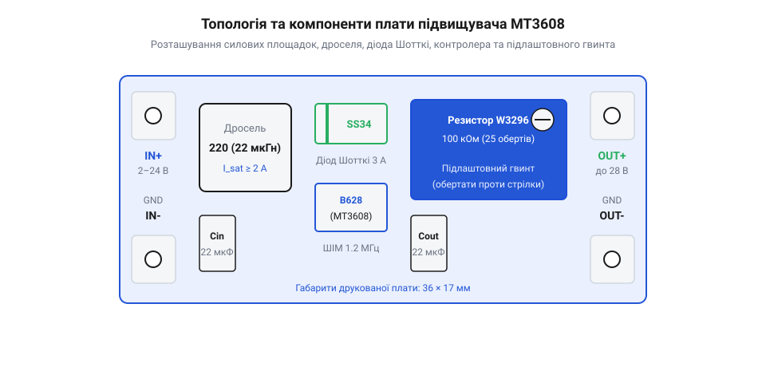
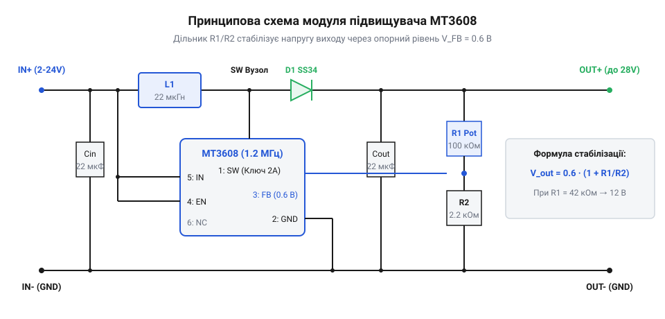
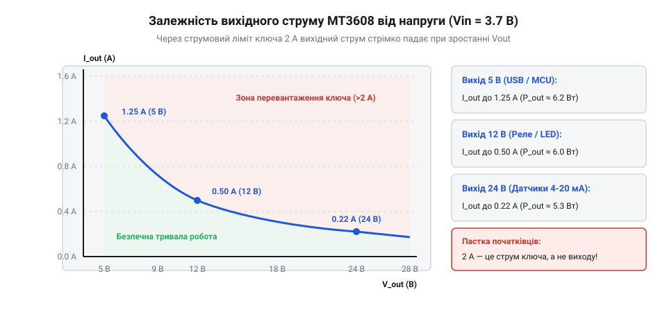

# MT3608 — підвищувач 2 А / 28 В

<preknowlist>
- [LM2596 — регульований понижувач (і версія CC/CV)](root:cat-hw-power/lm2596-buck) — Робота дроселя, діода Шотткі та фільтруючих конденсаторів в імпульсних перетворювачах
</preknowlist>

## Проблема напруги батареї та перевага підвищувача

Під час створення портативної електроніки розробник неминуче стикається з розривом між напругою компактного джерела живлення та вимогами навантаження. Популярний одиночний літій-іонний акумулятор 18650 або плоский Li-Po пакет дає номінальні 3.7 В, просідаючи під навантаженням від 4.2 В до 3.0 В. Водночас поширена периферія розрахована на вищі рівні: модулі реле, сервоприводи та мікроконтролерні плати потребують 5 В, світлодіодні стрічки — 12 В, а промислові датчики — 24 В.

Прямолінійне рішення — з'єднати кілька акумуляторів послідовно (збірки 2S, 3S чи 4S) — робить конструкцію громіздкою та важкою. Багатоелементна батарея обов'язково вимагає спеціальної плати захисту й балансування (BMS), а також нестандартного мережевого адаптера з напругою 8.4–16.8 В. Це позбавляє прилад мобільності: його неможливо зарядити від універсального 5-вольтового зарядного пристрою USB від звичайного смартфона.

Застосування імпульсного підвищувального перетворювача (англ. @@en|boost converter@@) докорінно спрощує архітектуру живлення. Замість важкого батарейного блока пристрій живиться від однієї банки 18650 з дешевим контролером заряджання TP4056 через порт Type-C. Мініатюрна плата перетворювача MT3608 розміром лише 36 × 17 мм бере напругу від 2 В до 24 В і стабільно підіймає її до потрібних 5–28 В. Для понижувальних задач, коли напруга джерела навпаки вища за навантаження, застосовують [LM2596 — регульований понижувач](root:cat-hw-power/lm2596-buck) або компактний [Mini560 — понижувач з фіксованими 5 В](root:cat-hw-power/mini560-buck).

> 🔧 **Навіщо це.**
> Замість дорогої й важкої батареї з чотирьох банок 18650 з окремою BMS-платою та спеціальною зарядкою прилад живиться від однієї стандартної банки, яка підзаряджається від звичайного павербанка через роз'єм Type-C.

## Анатомія та компоненти плати MT3608

Модуль MT3608 побудовано за асинхронною схемою підвищення напруги з мінімальною кількістю зовнішніх компонентів. Головна перевага плати полягає у високій тактовій частоті комутації — 1.2 МГц. Саме робота на мегагерцовій частоті дала змогу інженерам відмовитися від масивних котушок і громіздких електролітичних конденсаторів, вмістивши повноцінний перетворювач на плату розміром із поштову марку.



На друкованій платі розташовано п'ять ключових функціональних вузлів:
1. **Інтегральна мікросхема MT3608 (маркування B628):** шестививідний контролер у мініатюрному корпусі SOT-23-6. Усередині кремнієвого кристала розміщено генератор ШІМ на 1.2 МГц, джерело опорної напруги 0.6 В, схему струмового захисту та вбудований польовий N-канальний транзистор із допустимим піковим струмом до 2 А та опором каналу всього 80 мОм.
2. **Силовий SMD-дросель L1:** екранована індуктивність номіналом 22 мкГн (типове маркування «220»). Дросель накопичує енергію у магнітному полі під час відкритого стану внутрішнього ключа і віддає її у вихідне коло при закритті.
3. **Випрямний діод Шотткі SS34:** силовий діод, розрахований на прямий струм 3 А і зворотну напругу до 40 В. Завдяки малому спаду напруги (близько 0.4 В) він мінімізує теплові втрати при передачі накопиченої дроселем енергії у навантаження.
4. **Керамічні конденсатори Cin та Cout:** багатошарові SMD-конденсатори ємністю по 22 мкФ. Вони мають наднизький еквівалентний послідовний опір (ESR), що ефективно згладжує високочастотні пульсації струму.
5. **Багатооборотний підлаштовний резистор W3296:** потенціометр номіналом 100 кОм (маркування «104») з черв'ячним механізмом на 25 повних обертів. Він формує верхнє плече дільника зворотного зв'язку і дозволяє прецизійно встановити вихідну напругу за допомогою звичайної викрутки. Контактні площадки `IN+`/`IN-` та `OUT+`/`OUT-` слугують для підпаювання джерела та навантаження, причому мінусові шини мають спільне заземлення.

> 🔧 **Навіщо це.**
> Чітке розуміння компонентів дає змогу швидко перевірити справність плати: наприклад, пробій діода SS34 викличе коротке замикання дроселя на землю та перегрів входу, а механічне пошкодження або тріщина керамічного конденсатора Cout спричинить зрив стабілізації вихідної напруги.

## Двотактний цикл підвищення напруги та стабілізація виходу

Підвищення напруги в імпульсному перетворювачі MT3608 ґрунтується на фундаментальному законі електромагнітної індукції. Робота схеми розбита на безперервну чергу двох циклічних фаз, що повторюються з фіксованою частотою 1.2 МГц.

У першій фазі внутрішній силовий польовий транзистор мікросхеми відкривається і замикає вивід SW безпосередньо на землю. Діод Шотткі в цей момент виявляється під зворотною напругою і закривається, ізолюючи вихідний фільтруючий конденсатор і навантаження. Струм від джерела живлення тече крізь синій силовий дросель на землю. Оскільки індуктивність протидіє миттєвій зміні струму, струм через котушку наростає лінійно, накопичуючи енергію в магнітному полі осердя.

У другій фазі контролер різко розмикає силовий транзистор. Струм через індуктивність не може зникнути миттєво, тому на виводах котушки виникає електрорушійна сила (ЕРС) самоіндукції зворотного знака. Магнітне поле котушки починає спадати, створюючи на виводі SW додатний потенціал, який сумується з напругою джерела живлення. Сумарний потенціал відкриває випрямний діод Шотткі SS34, і накопичена порція енергії спрямовується у вихідний керамічний конденсатор та навантаження.


*Принципова електрична схема модуля MT3608: накопичення енергії в індуктивності та регулювання вихідної напруги за допомогою дільника зворотного зв'язку.*

Для утримання стабільного вихідного рівня модуль використовує контур зворотного зв'язку через вивід FB (@@en|Feedback@@). Напруга на виході контролюється резистивним дільником, нижнім плечем якого є фіксований резистор R2 (зазвичай 2.2 кОм), а верхнім — підлаштовний багатооборотний потенціометр R1. Внутрішній диференціальний підсилювач мікросхеми порівнює напругу на виводі FB з вбудованим високоточним опорним джерелом 0.6 В.

Вихідна напруга розраховується за співвідношенням плечей дільника:

```
V_out
= V_ref · (1 + R1 / R2)      [формула резистивного дільника]
= 0.6 · (1 + R1 / R2)        [опорна напруга мікросхеми V_ref = 0.6 В]
```

> 🔧 **Навіщо це.**
> Зворотний зв'язок на виводі FB постійно порівнює вихідну напругу з внутрішнім еталоном 0.6 В і динамічно коригує тривалість відкритого стану силового ключа (коефіцієнт заповнення ШІМ), утримуючи стабільний рівень на виході при коливаннях навантаження та розряді акумулятора.

Якщо напруга на виході падає через збільшення споживання струму, сигнал на FB стає меншим за 0.6 В. ШІМ-контролер збільшує шпаруватість (тривалість відкритого стану ключа), накачуючи більше енергії в дросель за кожен такт. При зменшенні навантаження тривалість імпульсу зменшується, забезпечуючи точну стабілізацію.

## Експлуатаційні пастки: регулювання, струм та безпека

Модуль MT3608 надзвичайно популярний завдяки низькій вартості, але його схемотехніка приховує декілька критичних пасток, з якими стикається майже кожен розробник під час першого знайомства.

Перша й найпоширеніша проблема — позірна «несправність» нового модуля з фабрики. Потенціометр W3296 із заводу викручений у крайнє положення, де опір верхнього плеча мінімальний, а вихідна напруга практично дорівнює вхідній. Через те, що підлаштовник має 25 повних обертів і оснащений захисною фрикційною муфтою, поворот на один-два оберти не дає жодного ефекту. Щоб вивести потенціометр із мертвої зони та запустити генерацію підвищеної напруги, необхідно зробити від 10 до 20 повних обертів регулювального гвинта проти годинникової стрілки, контролюючи вихід мультиметром.

Друга фундаментальна властивість буст-топології — принципова неможливість понизити напругу нижче за вхідну. Дросель і діод Шотткі з'єднані послідовно між входом IN+ і виходом OUT+. Навіть коли контролер повністю вимкнено або знеструмлено, струм вільно протікає від джерела живлення у навантаження через котушку та відкритий p-n перехід діода. Вихідна напруга ніколи не може бути меншою за рівень живлення за вирахуванням прямого падіння на діоді:

```
V_out_min
= V_in - V_diode             [проходження через закритий перетворювач]
≈ V_in - 0.4                 [падіння на діоді Шотткі SS34]
```

Якщо для чутливої схеми 3.3 В подати живлення від USB 5 В, модуль видасть близько 4.6 В і спалить навантаження, оскільки для пониження потрібні перетворювачі топології @@en|buck@@, такі як root:cat-hw-power/lm2596-buck або root:cat-hw-power/mini360-mp1482.


*Залежність допустимого вихідного струму від вихідної напруги: при живленні від літієвого акумулятора струм обмежується паспортною межею внутрішнього ключа 2 А.*

Третя пастка — розрахунок вихідної потужності та граничного струму. Паспортна характеристика «2 А» позначає піковий струм внутрішнього кремнієвого ключа, а не вихідний струм модуля. Оскільки потужність на вході дорівнює потужності на виході з урахуванням втрат на ККД, вхідний струм пропорційно зростає зі збільшенням коефіцієнта підйому напруги:

```
I_in
= (V_out · I_out) / (V_in · η)      [рівняння балансу потужності з урахуванням ККД]
```

Розрахуємо граничний режим для живлення навантаження 12 В від одного літій-іонного акумулятора з типовою напругою 3.7 В при реальному ККД 85%:

**Обчислення струму ключа при підйомі з 3.7 В до 12 В при вихідному струмі 0.5 А:**

```
I_in
= (12 · 0.5) / (3.7 · 0.85)         [підстановка параметрів режиму]
= 6.0 / 3.145                       [обчислення вхідної потужності]
≈ 1.91 А                            [граничне наближення до ліміту ключа 2 А]
```

При спробі зняти 12 В зі струмом 1 А вхідний струм повинен скласти понад 3.8 А, що миттєво викличе спрацювання внутрішнього теплового захисту або незворотний пробій транзистора.

Четверта пастка — повна відсутність захисту від короткого замикання на виході. Якщо вихідні клеми OUT+ і OUT- випадково замкнути накоротко, внутрішній ключ нічим не захищає ланцюг: виникає прямий струмовий контур «джерело → дросель → діод → коротке замикання». Струм обмежений лише внутрішнім опором джерела й дроселя, що призводить до миттєвого згоряння діода Шотткі SS34 або вигоряння мідних доріжок плати.

> 🔧 **Навіщо це.**
> Розрахунок запасу за струмом ключа 2 А рятує модуль від теплового пробою: якщо спробувати зняти 12 В при струмі 1 А від розрядженого акумулятора 3.2 В, вхідний струм перевищить 4 А, і крихітний кристал SOT23-6 миттєво згорить через відсутність захисту від перевантаження.
