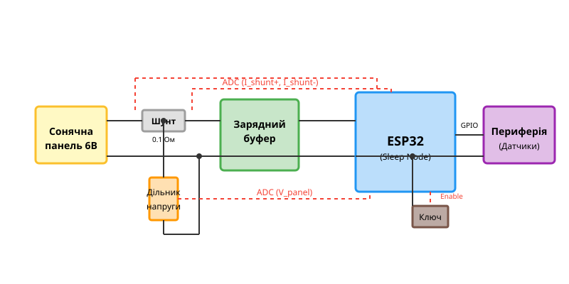
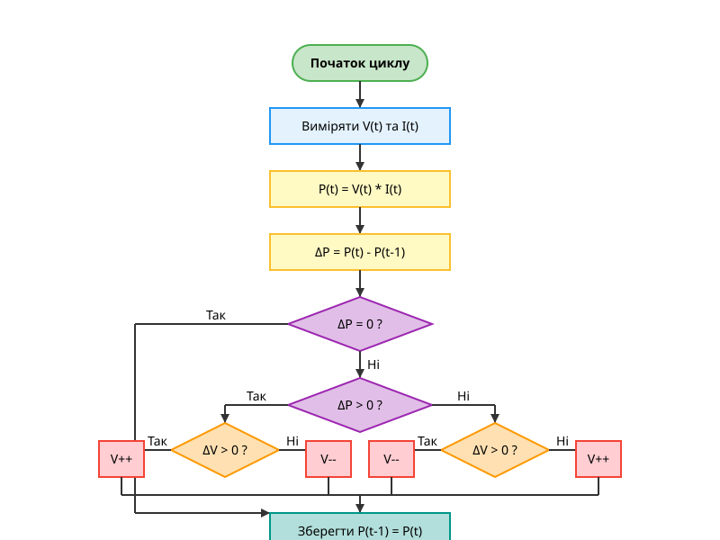

# Проєкт: Вузол збору енергії (Harvesting Node) з MPPT на ESP32

## Проблема виснаження живлення автономного вузла

Пряме підключення 6 В сонячної панелі до акумулятора або стабілізатора часто призводить до нестабільної роботи автономного вузла (наприклад, на базі ESP32) при дефіциті освітлення. Якщо споживання пристрою перевищує генерацію, буфер розряджається швидше, ніж панель встигає його відновити. Крім того, напруга сонячної панелі падає при збільшенні навантаження, і без контролю струму система не зможе відбирати максимальну потужність. Для надійної роботи необхідний програмний контроль точки максимальної потужності (MPPT) та адаптивне управління станами глибокого сну мікроконтролера.

## Схемотехніка узгодження та каналів АЦП

Для апаратної реалізації вузла використовується 6 В сонячна панель, накопичувальний буфер (іністор або Li-ion акумулятор), вимірювальні дільники напруги та струмовий шунт. Сигнали від панелі необхідно привести до рівнів, безпечних для входів АЦП ESP32 (до 3.3 В).



Правильне підключення аналогових кіл вимагає мінімізації завад та надійного узгодження рівнів. Завдяки цій схемі мікроконтролер має змогу вимірювати вхідну напругу й струм фотомодуля для подальшого розрахунку потужності у реальному часі. Щоб уникнути зайвих витоків енергії через подільники або периферію, використовуються MOSFET-ключі, які розривають коло під час сну мікроконтролера.

## Програмний алгоритм P&O для MPPT

Маючи дані напруги та струму, програмно реалізується алгоритм відстеження точки максимальної потужності методом "збурення та спостереження" (Perturb and Observe, P&O). Логіка полягає у циклічній зміні (збуренні) робочої напруги чи струму та обчисленні зміни потужності $\Delta P$.



Якщо потужність зростає, напрямок коригування залишається незмінним. Якщо падає — напрямок змінюється на протилежний. Завдяки цьому пристрій динамічно адаптується до зміни сонячної інсоляції та знаходить пікову точку генерації.

```c
// Алгоритм P&O MPPT, опитування АЦП та налаштування режимів глибокого сну ESP32 на чистому C (ESP-IDF)
#include "esp_adc_cal.h"
#include "esp_sleep.h"
#include "driver/adc.h"

float prev_power = 0;
float prev_voltage = 0;
int pwm_duty = 128; // Початкове значення ШІМ

void mppt_po_step(float voltage, float current) {
    float power = voltage * current;
    float delta_p = power - prev_power;
    float delta_v = voltage - prev_voltage;
    
    if (delta_p != 0) {
        if (delta_p > 0) {
            if (delta_v > 0) {
                pwm_duty++; // Збільшуємо напругу/навантаження
            } else {
                pwm_duty--; // Зменшуємо
            }
        } else {
            if (delta_v > 0) {
                pwm_duty--;
            } else {
                pwm_duty++;
            }
        }
    }
    
    prev_power = power;
    prev_voltage = voltage;
    // Оновлення ШІМ на DC-DC конвертері
}

void enter_deep_sleep(uint64_t time_us) {
    // Вимкнення периферії через GPIO
    esp_sleep_enable_timer_wakeup(time_us);
    esp_deep_sleep_start();
}
```

```cpp
// Реалізація об'єктно-орієнтованого контролера енерговиділення та MPPT-трекера для ESP32 у середовищі Arduino/ESP-IDF
class MPPTTracker {
private:
    float prev_p;
    float prev_v;
    int pwm_val;
public:
    MPPTTracker(int start_pwm) : prev_p(0), prev_v(0), pwm_val(start_pwm) {}
    
    int process(float v, float i) {
        float p = v * i;
        float dp = p - prev_p;
        float dv = v - prev_v;
        
        if (dp > 0) {
            pwm_val += (dv > 0) ? 1 : -1;
        } else if (dp < 0) {
            pwm_val += (dv > 0) ? -1 : 1;
        }
        
        prev_p = p;
        prev_v = v;
        return pwm_val;
    }
};
```

## Оптимізація сну та мінімізація витоків

Для автономного вузла алгоритм MPPT не повинен працювати безперервно, адже мікроконтролер сам по собі споживає чимало струму. ESP32 налаштовується на режим глибокого сну (Deep Sleep), під час якого струм споживання падає до мікроамперів. Апаратне вимкнення вимірювальних дільників, радіомодулів та датчиків забезпечується транзисторними ключами. Пристрій прокидається лише на короткий інтервал для вимірювання, розрахунку MPPT, передачі пакету даних і знову засинає. Це гарантує максимальний коефіцієнт корисного використання накопиченої енергії.

## Адаптивна періодичність та енергетичний баланс

Щоб досягти стійкого енергетичного балансу, період між пробудженнями не має бути сталим. Він адаптується залежно від рівня інсоляції та заряду буфера (наприклад, Li-ion 18650 або LiitoKala HG2, NCR18650B). При високому сонячному потоці та зарядженому акумуляторі вузол може прокидатися щохвилини для швидкої передачі даних. Якщо ж енергії бракує (хмарність, сутінки, розряджений буфер), мікроконтролер збільшує період сну до десятків хвилин, призупиняючи активність для збереження життєздатності системи. Така логіка дозволяє створити дійсно автономний IoT-вузол.
