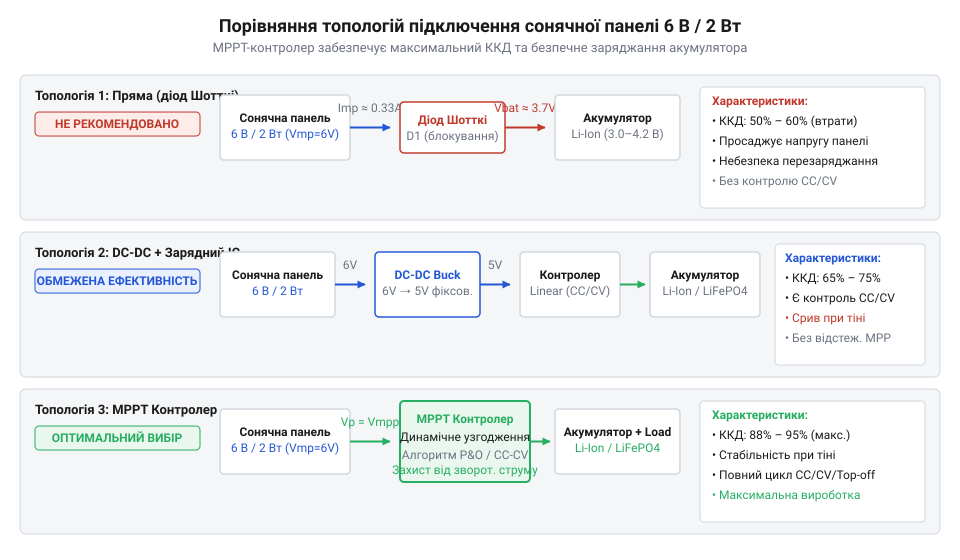
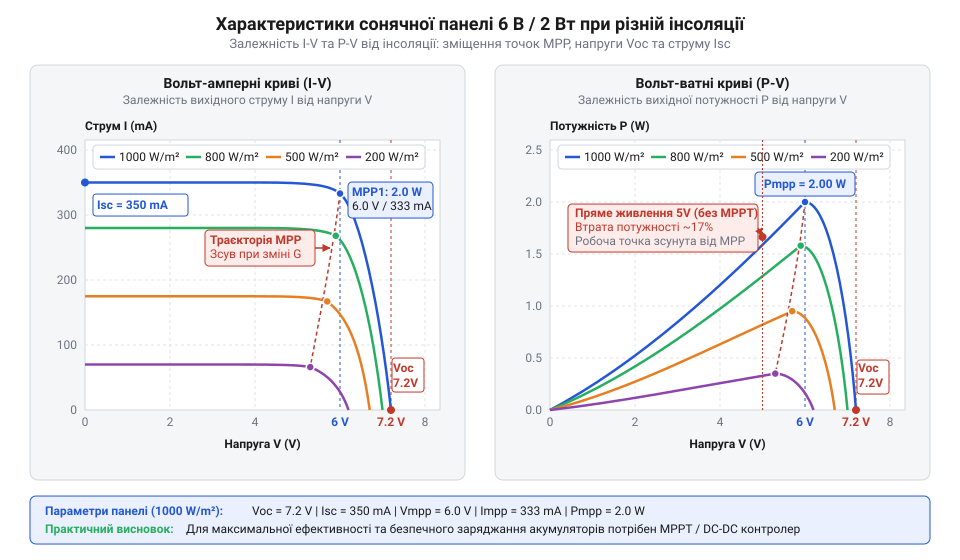
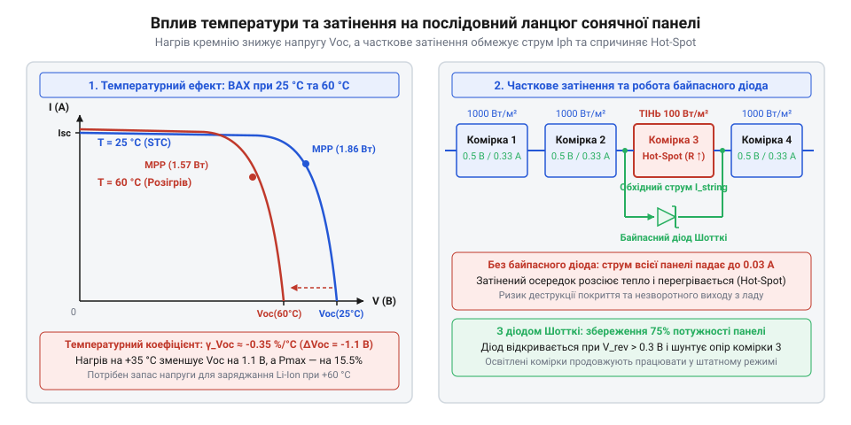
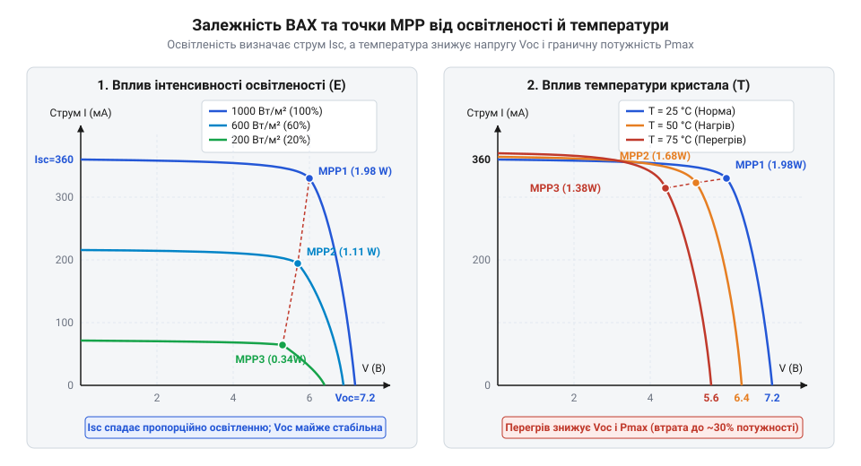
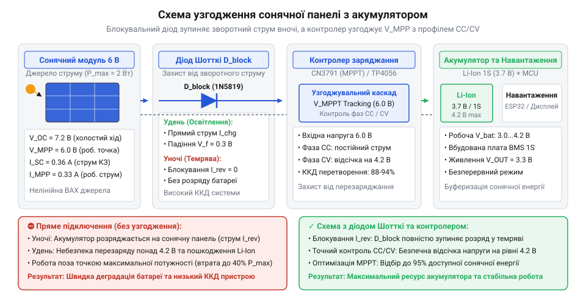

# Сонячна панель 6 В / 2 Вт

<preknowlist>
- [Li-ion 18650 (LiitoKala HG2, NCR18650B)](root:cat-hw-power/li-ion-18650-cells) — робочий діапазон напруг (2.7–4.2 В) та критичність дотримання режиму CC/CV під час заряджання
- [Videx 14500 — Li-ion 3.7V](root:cat-hw-power/videx-14500) — особливості живлення малогабаритних автономних пристроїв та межі допустимого струму заряджання
</preknowlist>

## Пастки прямого підключення малопотужного фотомодуля

Пряме підключення компактної сонячної панелі з номіналом 6 В / 2 Вт до накопичувача енергії здається найпростішим інженерним рішенням для автономного пристрою. Проте спроба з'єднати виводи фотомодуля напряму з виводами літієвого акумулятора майже одразу призводить до двох протилежних пасток: пристрій розряджається впродовж ночі, а у хмарний день акумулятор взагалі не отримує заряду.

Перша пастка ховається у поведінці кремнієвих осередків за відсутності випромінювання. Коли сонце сідає, генерація носіїв заряду під дією фотонів припиняється, і внутрішня електрорушійна сила сонячного елемента падає до нуля. У цей момент напівпровідникові `@@en|P-N переходи@@` перетворюються на прямо зміщений діод, підключений паралельно до акумулятора. Оскільки напруга на акумуляторі (наприклад, 3.7 В) вища за нульову ЕРС панелі, виникає `@@en|зворотний струм@@`, який тече від акумулятора крізь кристали панелі. Внаслідок цього замість накоплення енергії автономна система марнує збережений заряд на паразите нагрівання кремнієвої пластини. Навіть при невеликому зворотному струмі у кілька міліампер акумулятор ємністю 2600 мА·год може втратити вагому частку своєї енергії за тривалу ніч. Захистити накопичувач допомагає [пасивне розмикання кола](root:cat-hw-power/solar-panel-6v/api-solar-panel-6v-hardware-interface.md), яке не дозволяє струму рухатися у зворотному напрямку.

Друга пастка обумовлена тим, що сонячна панель докорінно відрізняється від традиційного джерела напруги (такого як мережевий блок живлення чи хімічна батарея). Звичайне джерело напруги прагне утримувати фіксований потенціал незалежно від споживаного струму, маючи низький внутрішній опір. Натомість сонячний фотомодуль поводиться як нелінійне `@@en|джерело струму@@` з високим змінним внутрішнім опором. Величина згенерованого струму прямо пропорційна інтенсивності світлового потоку. У похмурий день струм короткого замикання панелі падає зі штатного значення 330 мА до 20–30 мА. Якщо акумулятор розряджений і готовий поглинати струм понад 500 мА, підключення такої сонячної панелі напряму миттєво просаджує її вихідну напругу до рівня потенціалу батареї (наприклад, до 3.2 В). Через це напруга панелі зміщується далеко ліворуч від її оптимального робочого стану, а вихідна потужність падає у рази нижче потенційно можливої.

Крім того, у ясний сонячний день вихідна напруга фотомодуля без навантаження сягає 7.2 В. Якщо підключати панель безпосередньо до літій-іонного осередку, після досягнення напруги повної зарядки 4.2 В струм не припиняється. Для таких накопичувачів, як [елементи формату 18650](root:cat-hw-power/li-ion-18650-cells) або [компактні елементи 14500](root:cat-hw-power/videx-14500), систематичний перезаряд вище критичного порогу викликає деградацію електроліту та спрацьовування внутрішніх захисних клапанів. Також для живлення більш потужних систем застосовують [багатобатарейні LiPo-збірки](root:cat-hw-power/lipo-3s) або [високоелементні батареї 21700](root:cat-hw-power/li-ion-21700-cells), для яких точне узгодження напруг заряджання є однаково критичним.

Щоб усунути ці пастки, застосовують спеціальні топології узгодження електричного зв'язку між фотомодулем та акумулятором. Найпростіший спосіб — включення діода Шотткі (`@@en|діод Шотткі@@`) послідовно у позитивну лінію. Діод Шотткі має мале пряме падіння напруги (близько 0.2–0.3 В) і блокує зворотний струм розряду вночі. Проте діод не вирішує проблему узгодження опору та перезаряду. Більш досконалі рішення передбачають використання лінійних або імпульсних контролерів заряджання. Знижувальний імпульсний DC-DC перетворювач (`@@en|DC-DC перетворювач@@`) знижує вихідну напругу панелі до рівня зарядки батареї із трансформацією надлишку напруги у додатковий струм. А найбільш ефективною є топологія з відстеженням точки максимальної потужності (`@@en|MPPT@@`, від англ. *Maximum Power Point Tracking* — стеження за точкою максимальної потужності), де контролер безперервно коригує свій еквівалентний вхідний опір під характеристики панелі.


*Порівняльна характеристика топологій узгодження малопотужної сонячної панелі з накопичувачем.*

На практиці для невеликих сонячних систем розробляють спеціалізовані мікросхеми, такі як [зарядний модуль CN3791](root:cat-hw-power/solar-panel-6v/proj-solar-charger-tp4056-cn3791.md), які поєднують режим узгодження напруги фотомодуля з безпечним алгоритмом `@@en|CC/CV@@` (від англ. *Constant Current / Constant Voltage* — сталий струм / стала напруга). Для більш складних пристроїв створюють [автономний IoT-вузол](root:cat-hw-power/solar-panel-6v/proj-mppt-esp32-harvesting-node.md) із програмним регулюванням відбору енергії. Розуміння історії розвитку цих технологій показує [еволюцію кремнієвої фотовольтаїки](root:cat-hw-power/solar-panel-6v/hist-silicon-photovoltaics.md), яка пройшла шлях від перших громіздких лабораторних елементів до сучасних інтегрованих енергетичних систем. При виборі відповідного типу батареї під сонячне живлення розглядають [різноманітні електрохімічні накопичувачі](root:hw-power/energy-storage-solar-harvesting-backup), а специфіку керування потужністю вивчають через [спеціалізовані контролери MPPT](root:hw-power/mppt-controllers-low-power-harvesting).

## Електрична модель і крива вольт-амперної характеристики

Для того щоб передбачити поведінку панелі за будь-яких умов довкілля, необхідно розібратися в її внутрішній будові. Сонячна панель із номіналом 6 В / 2 Вт являє собою послідовний ланцюг із 12 окремих монокристалічних або полікристалічних кремнієвих фотоелементів. Кожен такий елемент є планарним `@@en|P-N переходом@@`. Під дією сонячного випромінювання кванти світла (фотони) вибивають електронно-діркові пари в збідненій зоні напівпровідника, створюючи внутрішню різницю потенціалів завдяки фотоелектричному ефекту (`@@gr|фотоелектричний ефект@@`, від грец. *phōs* — світло та *ēlektron* — бурштин).

У кремнієвих осередках вихідна напруга одного фотоелемента в режимі холостого ходу за стандартних умов вимірювання (STC: освітленість 1000 Вт/м², температура 25 °C, спектр AM 1.5) становить приблизно 0.6 В. Оскільки в модулі послідовно з'єднано 12 осередків, загальна `@@en|напруга холостого ходу@@` (`@@en|U_oc@@`, від англ. *Open Circuit Voltage*) обчислюється як сума напруг кожного переходу і становить близько 7.2 В. При цьому струм у зовнішньому колі дорівнює нулю. Якщо ж коротко замкнути виводи панелі через амперметр з нульовим опором, виникає `@@en|струм короткого замикання@@` (`@@en|I_sc@@`, від англ. *Short Circuit Current*), який для даного модуля номіналом 2 Вт зазвичай складає 360 мА.

Залежність вихідного струму від напруги під навантаженням описується вольт-амперною характеристикою (`@@en|ВАХ@@`). Вольт-амперна крива фотомодуля не є прямою лінією (як у звичайного резистора за законом Ома), а має характерний нелінійний вигин. При збільшенні опору навантаження від нуля напруга на панелі зростає, а струм залишається майже незмінним аж до певного перегину. Після цього струм починає стрімко падати до нуля по мірі наближення до `U_oc`.

На цій кривій існує єдина `@@en|точка максимальної потужності@@` (`@@en|MPP@@`, від англ. *Maximum Power Point*), у якій добуток вихідної напруги `U_mp` та струму `I_mp` досягає пікового значення `P_max`. Для досліджуваної панелі номінальні параметри в цій точці становлять `U_mp = 6.0 В` та `I_mp = 0.333 А`.

Обчислення номінальної потужності виконується за формулою добутку робочих параметрів:

```
P_max = U_mp · I_mp
= 6.0 · 0.333           [підстановка номінальної напруги та струму MPP]
= 1.998                 [номінальна потужність у ватах (~2 Вт)]
```

Якість та ефективність форми вольт-амперної кривої характеризують параметром, який називається `@@en|коефіцієнт заповнення@@` (`@@en|FF@@`, від англ. *Fill Factor*). Він показує відношення реальної максимальної потужності до теоретичного прямокутника, утвореного множенням `U_oc` на `I_sc`:

```
FF = P_max ÷ (U_oc · I_sc)
= 1.998 ÷ (7.2 · 0.360) [підстановка номінальних значень U_oc та I_sc]
= 1.998 ÷ 2.592         [перемноження напруги холостого ходу та струму короткого замикання]
= 0.771                 [коефіцієнт заповнення ВАХ (~77.1%)]
```

Значення `FF` у межах 0.75–0.80 свідчить про високу якість кремнієвих осередків та низький внутрішній послідовний опір модуля.


*Залежність вихідної напруги, струму та генеруваної потужності від рівня інсоляції.*

На реальну вольт-амперну характеристику суттєво впливають зовнішні фактори — освітленість, температура та рівномірність падіння сонячних променів. При зміні інтенсивності сонячного випромінювання (`@@la|інсоляція@@`, від лат. *insolatio* — виставляння на сонце) струм короткого замикання змінюється прямо пропорційно: якщо освітленість падає вдвічі (з 1000 Вт/м² до 500 Вт/м²), `I_sc` також зменшується вдвічі (до ~180 мА). Натомість `U_oc` падає дуже повільно — за логарифмічним законом.

Нагрівання панелі на сонці дає протилежний ефект. Кремній має негативний температурний коефіцієнт напруги. При зростанні температури кристала звужується ширина забороненої зони напівпровідника, що призводить до падіння `U_oc` зі швидкістю приблизно -2.1 мВ/°C на кожен осередок. Для послідовного ланцюга з 12 осередків загальне падіння становить близько -25 мВ/°C. Нагрівання панелі на даху чи під склом до 65 °C (що на 40 °C вище за STC) знижує напругу холостого ходу на 1.0 В, зміщуючи робочу напругу `U_mp` з 6.0 В до 5.0 В.

Ще критичнішим є вплив часткового затінення. Оскільки всі 12 осередків з'єднані послідовно, струм усієї панелі обмежений струмом найменш освітленого осередку. Якщо один осередок затінений опалим листом, він перестає генерувати струм і перетворюється на високий опір для решти 11 осередків. Вони починають прикладати до затіненого елемента зворотну напругу, що призводить до локального нагрівання (утворення `@@en|гарячої плями@@`, від англ. *hot spot*) та катастрофічного падіння загальної потужності панелі.


*Температурний зсув напруги та деградація струму послідовного ланцюга P-N переходів у разі затінення.*

Для точного чисельного аналізу роботи фотомодуля в схемах живлення застосовують [математичну модель ВАХ](root:cat-hw-power/solar-panel-6v/math-solar-iv-curve-model.md), засновану на еквівалентній схемі з діодом і послідовно-паралельними опорами. Оцінку річного або добового виробітку енергії проводять через [розрахунок добового виробітку](root:cat-hw-power/solar-panel-6v/math-insolation-energy-balance.md) із врахуванням географічних координат та кутів нахилу. Фізичні розміри, тип захисного ламінування та роз'єми підключення описано в матеріалі про [залізний інтерфейс панелі](root:cat-hw-power/solar-panel-6v/api-solar-panel-6v-hardware-interface.md). Порівняти цей модуль з іншими рішеннями на ринку можна проглянувши [огляд малогабаритних панелей](root:hw-power/solar-panels-energy-harvesting-overview).

## Залежність потужності від освітлення та температури

Сонячна панель генерує електричну енергію завдяки поглинанню фотонів напівпровідниковим кристалом. Коли інтенсивність світлового потоку змінюється, швидкість утворення електрон-діркових пар у кремнієвих P-N переходах пропорційно зростає або падає. Падіння @@en|інсоляції@@ (з лат. @@la|insolatio@@ — виставляння на сонце) з номінальних 1000 Вт/м² під прямим сонцем до 200 Вт/м² у щільній хмарності зменшує кількість генерованих носіїв заряду в п'ять разів. Оскільки струм короткого замикання `I_sc` визначається чисельністю розділених фотострумом носіїв, він демонструє суворо лінійну залежність від щільності сонячного випромінювання: панель із номінальним струмом 330 мА при 200 Вт/м² здатна видати лише близько 66 мА.

Натомість напруга холостого ходу `U_oc` реагує на зміну освітленості нелінійно. Вона зв'язана з фотострумом через логарифмічну функцію, тому зменшення інсоляції в п'ять разів призводить до незначного зниження напруги — орієнтовно на 40–60 мВ на весь модуль (з 7.2 В до 6.7 В). Ця фізична властивість створює підступну ілюзію: під хмарами вольтметр показує практично номінальну напругу панелі, але спроба відібрати навіть третину номінальної потужності негайно завалює робочу точку до нуля.

Підключення панелі до сонячних променів під кутом додатково зменшує ефективну інсоляцію за законом косинуса. Робоча площа приймання випромінювання скорочується пропорційно відхиленню нормалі панелі від напрямку на сонце:

E_eff = E_0 × cos θ

Де `E_0` — поточна щільність сонячного випромінювання (Вт/м²), а `θ` — кут між нормаллю до поверхні модуля та сонячними променями. При куті падіння 60° ефективна інсоляція зменшується вдвічі. Понад це, при кутах `θ > 60°` починають домінувати оптичні втрати на поверхневе відбиття: захисне покриття відбиває значну частку фотонів.

Еволюційні зміни у складах напівпровідників та текстуруванні захисних поверхонь розкрито в [еволюції кремнієвих фотоелементів](root:cat-hw-power/solar-panel-6v/hist-silicon-photovoltaics.md). Математичний зв'язок між оптичною генерацією носіїв і параметрами еквівалентної схеми наведено у [моделі вольт-амперної характеристики](root:cat-hw-power/solar-panel-6v/math-solar-iv-curve-model.md). Практичні методи обчислення кутових втрат та сезонного виробітку викладено у [розрахунку добового енергетичного балансу](root:cat-hw-power/solar-panel-6v/math-insolation-energy-balance.md).


*Залежність кривої ВАХ панелі від рівня освітленості та температури напівпровідникових осередків.*

Температура кремнієвих осередків є другим вирішальним фактором, який визначає реальну вихідну потужність. При розігріві напівпровідника кристалічна ґратка розширюється, що призводить до незначного звуження забороненої зони (з англ. @@en|band gap@@). Це полегшує тепловий перехід електронів у зону провідності і викликає мізерне зростання струму короткого замикання (приблизно +0.05% / °C). Проте одночасно експоненційно зростає зворотний струм насичення P-N переходу `I_0`, зумовлений тепловою генерацією неосновних носіїв заряду.

Оскільки напруга холостого ходу прямо пропорційна термодинамічному потенціалу та логарифму відношення фотоструму до зворотного струму насичення, зростання `I_0` призводить до стрімкого просідання напруги. Кремнієва сонячна панель має від'ємний @@en|температурний коефіцієнт@@ (з англ. @@en|temperature coefficient@@) напруги `γ_V`, який для 12 послідовних осередків 6 В модуля становить приблизно -0.38% / °C (або близько -23 мВ/°C).

При використанні панелі на прямому літньому сонці за температури довкілля +25 °C сам модуль через поглинання інфрачервоного випромінювання розігрівається до +60 °C. Це створює температурне відхилення `ΔT = +35 °C` від стандартних випробувальних умов @@en|STC@@ (25 °C).

**Розрахунок падіння напруги сонячної панелі при нагріванні до +60 °C**
```
T_STC = 25 °C
T_cell = 60 °C
ΔT = 60 - 25 = 35 °C
γ_V = -0.38 % / °C
U_MPP_STC = 5.00 V
ΔU_MPP = U_MPP_STC × (γ_V / 100) × ΔT
       = 5.00 × (-0.0038) × 35
       = -0.665 V
U_MPP_60C = 5.00 - 0.665 = 4.335 V
```

Зниження точки максимальної потужності з 5.00 В до 4.335 В означає, що при нагріванні панелі вихідна напруга наближається до мінімальної межі, необхідної для заряджання акумулятора або живильного каскаду. Якщо лінійний регулятор чи DC-DC перетворювач розрахований на вхідну напругу не нижче 4.5 В, при гарячій панелі збір енергії повністю припиниться.

Часткове затінення створює ще більшу загрозу для стабільності та цілісності модуля. Малогабаритна сонячна панель 6 В складається з 12 послідовно з'єднаних осередків, через які протікає єдиний сквозний струм. Якщо 11 осередків яскраво освітлені й генерують 330 мА, а один осередок затінений тінню від листочка й здатний пропустити лише 30 мА, він стає вузьким місцем для всього ланцюга.

Освітлені осередки підвищують напругу на полюсах модуля, прикладаючи зворотне зміщення близько 5.5 В до затіненого елемента. Затінений осередок перестає генерувати ЕРС і переходить у режим зворотного пробою, розсіюючи у вигляді тепла всю потужність, вироблену сусідніми елементами. У цій точці виникає @@en|гаряча пляма@@ (з англ. @@en|hot spot@@ — розпечений осередковий локальний перегрів), де температура може перевищувати +100 °C. Це спричиняє деградацію напівпровідникового кристала та локальне розплавлення полімерного захисного покриття.

Вибір матеріалу захисного покриття визначає довговічність панелі в експлуатаційних умовах. Дешеві модулі покривають шаром @@en|PET@@ (поліетилентерефталат). Під дією ультрафіолету PET жовтіє, вкривається мікротріщинами й втрачає прозорість за 12–18 місяців. Більш надійні панелі використовують @@en|ETFE@@ (етилен-тетрафлуороетилен) — фторопластове покриття з високим пропусканням світла (до 95%), стійкістю до УФ-випромінювання та хімічно інертною текстурованою поверхнею, яка самоочищається під дощем і служить понад 10 років. Для стаціонарних систем застосовують загартоване скло, яке забезпечує абсолютну оптичну стабільність, проте суттєво збільшує масу пристрою.

## Схеми узгодження та захист від розряду

У темну пору доби або при глибокому затіненні фотоелектричний ефект у сонячній панелі припиняється. 12 послідовних P-N переходів перетворюються на звичайну ланцюжок прямозміщених кремнієвих діодів. Якщо панель підключена до акумулятора (наприклад, на [елементах Li-ion 18650](root:cat-hw-power/li-ion-18650-cells) або акумуляторах у [форматі Videx 14500](root:cat-hw-power/videx-14500)), напруга батареї 3.7–4.2 В перевищує відсутню ЕРС панелі. Починає протікати зворотний струм із батареї в панель, марно розряджаючи накопичувач і розігріваючи кремнієві комірки.

Для запобігання нічному розряду в коло послідовно вмикають @@en|блокувальний діод@@ (з англ. @@en|blocking diode@@). Звичайний кремнієвий діод створює падіння напруги близько 0.7 В, що забирає до 15% вихідної напруги панелі. Оптимальним рішенням є діод Шотткі (наприклад, SS14 або MBR0540), у якому прямоспрямоване падіння становить лише `U_f ≈ 0.3–0.4 В`.

Для високоефективних малопотужних систем застосовують схеми "ідеального діода" на P-канальному MOSFET-транзисторі або спеціалізованих мікросхемах. Опір відкритого каналу транзистора `R_ds(on) ≈ 20–50 мОм` знижує втрати напруги до менш ніж 15 мВ при максимальному струмі панелі 330 мА. Докладний порівняльний аналіз втрат у запірних каскадах подано в матеріалі про [діодах з низьким падінням](root:hw-power/reverse-current-protection).

Пряме підключення сонячної панелі до імпульсного DC-DC перетворювача з фіксованою вихідною напругою (наприклад, модуля USB 5 В) призводить до виникнення системного збою. Коли освітленість зменшується, панель перестає віддавати необхідний струм. Навантаження на виході перетворювача прагне втримати споживану потужність, змушуючи DC-DC конвертер знижувати свій еквівалентний вхідний опір для витягування більшого струму з входу.

Оскільки сонячна панель є джерелом струму, зниження опору навантаження призводить не до зростання струму, а до катастрофічного просідання напруги модуля нижче порогу вимкнення перетворювача за низькою вхідною напругою (з англ. @@en|Under-Voltage Lockout@@, UVLO). DC-DC перетворювач вимикається, напруга панелі без навантаження миттєво зростає до `U_oc`, перетворювач знову вмикається і знову завалює панель. Пристрій потрапляє в циклічний @@en|режим безперервного перезапуску@@ (з англ. @@en|hiccup mode@@ — гикаючий режим), витрачаючи енергію на перехідні процеси без передачі заряду в навантаження.


*Структурна схема каскаду автономного живлення з блокуванням зворотного струму та контролером заряджання.*

Узгодження навантаження із сонячною панеллю виконують за допомогою спеціалізованих топологій керування:

1. **Заряджання з широтно-імпульсною модуляцією (PWM):**
   Пристрої з @@en|широтно-імпульсною модуляцією@@ (з англ. @@en|Pulse-Width Modulation@@, PWM) періодично з'єднують панель напряму з акумулятором через ключовий транзистор. Під час замкненого стану робоча напруга панелі насильно прирівнюється до поточної напруги акумулятора `U_bat` (наприклад, 3.6 В). Оскільки точка максимальної потужності панелі розташована біля `U_MPP ≈ 5.0 В`, вся різниця напруг `(5.0 В - 3.6 В) × I` втрачається. ККД такої системи не перевищує 65–70%.

2. **Відстеження точки максимальної потужності (MPPT):**
   Контролери з відстеженням точки максимальної потужності (з англ. @@en|Maximum Power Point Tracking@@, MPPT) використовують регульований DC-DC перетворювач, який динамічно змінює свій коефіцієнт трансформації. Контур керування вимірює напругу панелі й утримує її в точці `U_MPP ≈ 0.75–0.80 × U_oc`, перетворюючи надлишок напруги в додатковий струм заряджання. ККД передачі енергії досягає 92–97%.

Спеціалізовані мікросхеми для малогабаритних сонячних панелей 6 В реалізують спрощений або повноцінний алгоритм MPPT:
- **CN3791**: спеціалізований контролер заряджання Li-Ion акумуляторів, який утримує вхідну напругу панелі на фіксованому рівні (налаштовується зовнішнім дільником на 5 В). - **TP4056 із зовнішнім контролем входу**: стандартний лінійний контролер, доповнений аналоговим транзисторним ключем або оптопарою, яка блокує вивід `CE` при просіданні напруги панелі нижче 4.6 В, запобігаючи завалу в hiccup mode.

Схемотехнічні рішення зарядних каскадів для акумуляторних осередків детально показано у [реалізації сонячного зарядного пристрою](root:cat-hw-power/solar-panel-6v/proj-solar-charger-tp4056-cn3791.md). Приклади побудови малоспоживаючих бездротових контролерів подано в [автономному вузлі на ESP32](root:cat-hw-power/solar-panel-6v/proj-mppt-esp32-harvesting-node.md). Способи пайки, типи кабелів та герметичні роз'єми наведено у [довіднику залізного інтерфейсу](root:cat-hw-power/solar-panel-6v/api-solar-panel-6v-hardware-interface.md).

Особливості вибору ємності акумуляторних систем на [акумуляторах Li-ion 21700](root:cat-hw-power/li-ion-21700-cells), високострумових [збірках LiPo 3S](root:cat-hw-power/lipo-3s) або іоністорах висвітлено в порівнянні [накопичувачах автономної енергії](root:hw-power/energy-storage-solar-harvesting-backup). Базові параметри при виборі модулів розміщено у вступному огляді [малогабаритних сонячних модулях](root:hw-power/solar-panels-energy-harvesting-overview), а архітектуру промислових контролерів викладено в [спеціалізованих контролерах MPPT](root:hw-power/mppt-controllers-low-power-harvesting).

Програмовані мікроконтролери у складі автономних сенсорів можуть самостійно контролювати напругу панелі та керувати підключенням навантаження через вивід GPIO.

:::tabs
@tab C (ESP-IDF)
:::code solar-panel-6v-d/c/esp-idf/solar-power-manager-init.c
@tab C++ (Arduino)
:::code solar-panel-6v-d/cpp/arduino/setup.cpp
:::

## Розрахунок добового виробітку та ємності акумулятора

Початківці в розробці автономної електроніки нерідко припускаються простих арифметичних помилок: якщо сонячна панель має паспортну потужність `2 Вт`, то за 24 години вона теоретично мала б згенерувати `48 Вт·год` енергії, чого з великим запасом вистачило б для живлення мікроконтролера разом із датчиками та радіопередавачем. Проте в реальних експлуатаційних умовах пристрій часто вимикається вже на другий день через повністю розряджений акумулятор. Паспортне значення потужності панелі вимірюють за стандартних лабораторних умов (інсоляція `1000 Вт/м²`, температура кристала `+25 °C`), які в реальному житті тривають сукупно не більше кількох десятків хвилин на добу.

Для точного проектування автономного вузла перш за все визначають реальний приплив сонячної енергії за допомогою показника @@en|Peak Sun Hours@@ (від англ. *peak sun hours* — пікові сонячні години, PSH). Показник PSH перераховує нерівномірне сонячне освітлення протягом світлового дня у кількість еквівалентних годин, під час яких панель працювала б на своїй максимальній номінальній потужності при стандартній інсоляції. У помірних широтах України середньодобовий показник @@en|Peak Sun Hours@@ улітку становить орієнтовно від `4.5` до `5.5` годин, тоді як узимку через низьке стояння сонця над горизонтом та коротку тривалість дня він падає до `0.8`–`1.5` годин.

Навіть з урахуванням значення @@en|Peak Sun Hours@@, згенерована сонячними елементами енергія не доходить до споживача в повному обсязі. Для врахування реальних експлуатаційних втрат вводять системний знижувальний коефіцієнт @@en|derating factor@@ (від англ. *de-* — зниження + *rate* — норма, коефіцієнт зниження, K_sys), який об'єднує такі парціальні втрати:
- Неоптимальний кут нахилу та орієнтація панелі за азимутом: `K_angle ≈ 0.85`–`0.90`. - Запорошення, бруд та поверхневе відбиття захисного покриття: `K_dirt ≈ 0.93`–`0.95`. - Нагрів панелі на сонці понад +25 °C (через негативний температурний коефіцієнт напруги): `K_temp ≈ 0.90`–`0.93`. - ККД DC-DC перетворювача або MPPT-контролера: `K_conv ≈ 0.85`–`0.90`. - Ефективність заряджання й розряджання накопичувача (ККД за зарядом): `K_bat ≈ 0.90`.

Перемноживши ці коефіцієнти, отримуємо підсумковий системний ККД:

```
K_sys = K_angle × K_dirt × K_temp × K_conv × K_bat
      = 0.88 × 0.94 × 0.91 × 0.88 × 0.90      [підстановка середніх коефіцієнтів втрат]
      = 0.68                                  [підсумковий системний ККД]
```

Отже, реальний системний коефіцієнт @@en|derating factor@@ становить орієнтовно `0.65`–`0.70`.

Виразимо добовий виробіток енергії `E_gen` через номінальну потужність панелі `P_max`, коефіцієнт пікових сонячних годин `PSH` та підсумковий знижувальний коефіцієнт `K_sys`.

Розрахуємо реальну генерацію для панелі `6 В / 2 Вт` у літній період:

```
E_gen = P_max × PSH × K_sys
      = 2.0 × 4.5 × 0.70      [підстановка параметрів для літнього дня: 2 Вт, 4.5 PSH, ККД 0.7]
      = 6.30                  [реальний добовий виробіток у літній день, Вт·год]
```

У зимовий період розрахунок суттєво змінюється через зниження рівня інсоляції:

```
E_gen = P_max × PSH × K_sys
      = 2.0 × 1.0 × 0.70      [підстановка параметрів для зимового дня: 2 Вт, 1.0 PSH, ККД 0.7]
      = 1.40                  [реальний добовий виробіток у зимовий день, Вт·год]
```

Таким чином, невелика сонячна панель потужністю `2 Вт` влітку забезпечує близько `6.3 Вт·год` корисної енергії на добу, а взимку цей показник знижується до `1.4 Вт·год`. Щоб детально розібратися в нюансах обчислення за географічними координатами, рекомендуємо оцінити [детальний добовий енергобаланс](root:cat-hw-power/solar-panel-6v/math-insolation-energy-balance.md) для різних пікових сезонів.

Тепер порівняємо отриману генерацію з енергетичними потребами автономного пристрою. Припустимо, що наш пристрій — це [автономний сенсорний вузол](root:cat-hw-power/solar-panel-6v/proj-mppt-esp32-harvesting-node.md) на базі мікроконтролера, який працює в періодичному режимі: кожні 10 хвилин (`600 с`) він прокидається на `2 с` для зчитування датчиків та передачі даних по радіоканалу (`I_active = 120 мА` при напрузі `3.3 В`), а решту `598 с` перебуває в режимі глибокого сну (`I_sleep = 20 мкА`).

Розрахуємо середній струм споживання `I_avg` та добову потребу в енергії `E_load`:

```
I_avg = (I_active × t_active + I_sleep × t_sleep) ÷ T_cycle
      = (120.0 × 2 + 0.020 × 598) ÷ 600      [підстановка струмів у мА та інтервалів у секундах]
      = (240 + 11.96) ÷ 600                  [зважений підсумок струму за один цикл]
      = 0.42                                 [середній струм споживання пристрою, мА]
```

Для забезпечення роботи системи з напругою `3.3 В` від DC-DC перетворювача з ККД `90%` (`0.90`) добове споживання енергії від акумулятора `E_load` складе:

```
P_avg = I_avg × U_sys ÷ K_reg
      = 0.42 × 3.3 ÷ 0.90                    [середня потужність з урахуванням втрат регулятора, мВт]
      = 1.54                                 [середньодобова споживана потужність, мВт]

E_load = P_avg × 24
       = 1.54 × 24                           [множення середньої потужності в мВт на 24 години]
       = 36.96                               [добова споживана енергія в міліват-годинах, мВт·год]
       = 0.037                               [добова споживана енергія у ват-годинах, Вт·год]
```

Бачимо, що в даному економічному режимі пристрій споживає всього `0.037 Вт·год` на добу, що з запасом перекривається навіть зимовим виробітком у `1.4 Вт·год`. Для максимально ефективної передачі потужності до акумулятора рекомендується використовувати [практичний сонячний контролер](root:cat-hw-power/solar-panel-6v/proj-solar-charger-tp4056-cn3791.md) на базі спеціалізованих мікросхем CN3791 або адаптованих TP4056. Проте якщо мікроконтролер не занурювати в глибокий сон і залишити постійно активним (`I_active = 50 мА`), добове споживання зросте до `5.0 Вт·год`, що перевищить можливості панелі в зимовий період та призведе до швидкого виснаження батареї.

Навіть якщо середньодобовий виробіток перевищує споживання, сонячна генерація є переривчастою: вночі сонце відсутнє, а в хмарні дні генерація падає в кілька разів. Для забезпечення безперебійної роботи системи акумулятор повинен мати запас енергії на кілька похмурих днів поспіль. Цей параметр називають запасом автономності `N_aut` (для надійних пристроїв обирають від `3` до `5` днів).

Крім того, акумулятор не можна розряджати повністю до нуля без ризику його прискореної деградації. Граничну частку енергії, яку дозволено вилучати з елемента, характеризує @@en|depth of discharge@@ (від англ. *depth* — глибина + *discharge* — розряд, DoD). Для класичних літій-іонних комірок параметр @@en|depth of discharge@@ рекомендують обмежувати на рівні `0.7`–`0.8` (`70`–`80%`), щоб зберегти ресурс циклування.

Розрахуємо необхідну ємність акумулятора `C_bat` у ват-годинах та міліампер-годинах для автономної роботи пристрою з добовим споживанням `E_load = 1.2 Вт·год/день` впродовж `N_aut = 4` днів похмурої погоди:

```
C_wh = E_load × N_aut ÷ DoD
     = 1.2 × 4 ÷ 0.80                       [підстановка добового споживання 1.2 Вт·год, 4 днів та DoD 80%]
     = 6.00                                 [необхідний запас енергії акумуляторної батареї, Вт·год]
```

Переведемо отриману енергію в електричну ємність у мА·год для літієвого акумулятора з номінальною напругою `3.7 В`:

```
C_mah = (C_wh ÷ U_nom) × 1000
      = (6.00 ÷ 3.7) × 1000                 [ділення запасу енергії у Вт·год на номінальну напругу 3.7 В]
      = 1621.62                             [значення мінімальної ємності акумулятора, мА·год]
```

Для надійної роботи пристрою достатньо використати один [елемент живлення 18650](root:cat-hw-power/li-ion-18650-cells) ємністю `2200`–`2600 мА·год`. Якщо ж проектована конструкція має суворі габаритні обмеження, варто розглянути застосування [компактних літієвих батарей](root:cat-hw-power/videx-14500) типу 14500. Для правильного обрання хімії накопичувача слід оцінити [накопичувач сонячної енергії](root:hw-power/energy-storage-solar-harvesting-backup), враховуючи робочі температури та вимоги до безпеки.


*Добовий профіль генерації сонячної панелі 6 В та динаміка заряду акумулятора при постійному споживанні.*

## Конструкція покриття та експлуатаційна стійкість

Часто автономний пристрій, розміщений на відкритому повітрі, раптово припиняє роботу через пів року чи рік після монтажу, хоча електронна плата й акумулятор залишаються повністю справними. Причиною стає сама сонячна панель: її прозорий верхній шар пожовтів, покрився мережею мікротріщин, а всередині з'явилися плями відшарування та сліди корозії на струмознімальних доріжках. Напівпровідникові кремнієві кристали здатні працювати десятиліттями, але термін служби всієї панелі визначається стійкістю матеріалів, які герметизують її внутрішній сендвіч від агресивного зовнішнього середовища.

Малогабаритна сонячна панель потужністю `2 Вт` являє собою багатошарову ламіновану структуру. В її основі лежить жорстка підкладка (склотекстоліт `FR4`, пластик або скло), на яку укладають послідовно з'єднані кремнієві елементи. Кристали кремнію надзвичайно крихкі, тому їх з обох боків заливають прозорим інкапсулюючим клеєм — полімером @@en|EVA@@ (від англ. *ethylene-vinyl acetate* — етиленвінілацетат). Понад @@en|EVA@@ накладають зовнішнє захисне покриття, яке сприймає прямі сонячні промені, вітрові навантаження та вологу.

На ринку компактних фотомодулів 6 В поширені три основні конструктивні варіанти захисного покриття:
- **Плівка PET (поліетилентерефталат):**
  Найдешевший і найлегший варіант ламінації, що широко використовується в бюджетних автономних іграшках та одноразових датчиках. Термопластик @@en|PET@@ (від англ. *polyethylene terephthalate* — поліетилентерефталат) швидко деградує під дією сонячного ультрафіолету. Жорсткі УФ-промені розривають полімерні ланцюги, що викликає фотодеградацію @@en|photodegradation@@ (від грец. *phōs* — світло + лат. *degradatio* — зниження якості). Внаслідок цього виникає пожовтіння @@en|yellowing@@ (від англ. *yellow* — жовтіти) матеріалу та втрата оптичної прозорості. Через різницю в коефіцієнтах теплового розширення між @@en|PET@@, @@en|EVA@@ та кремнієм виникає розшарування @@en|delamination@@ (від лат. *de-* — зняття + *lamina* — пластина), крізь яке всередину проникає волога. Реальний термін служби @@en|PET@@-панелей під відкритим сонцем рідко перевищує `1`–`2` роки.

- **Фторполімерна плівка ETFE (етилентетрафлуоретилен):**
  Сучасний високоефективний матеріал для зовнішніх пристроїв середнього та преміального сегментів. Покриття @@en|ETFE@@ (від англ. *ethylene tetrafluoroethylene* — етилентетрафлуоретилен) має високу хімічну інертність та стійкість до ультрафіолетового випромінювання. На відміну від @@en|PET@@, @@en|ETFE@@ не жовтіє з часом і не кришиться. Поверхня таких панелей зазвичай має текстуру у вигляді стільників (@@en|honeycomb texture@@, від англ. *honeycomb* — бджолині стільники + *texture* — фактура, стільникова структура), яка знижує поверхневе відбиття сонячних променів при косих кутах падіння світла. Крім того, @@en|ETFE@@ володіє високою гідрофобністю (@@en|hydrophobic@@, від грец. *hydōr* — вода + *phobos* — боязнь, гідрофобність), завдяки чому пил та бруд легко змиваються дощем. Термін служби @@en|ETFE@@-панелей становить від `5` до `10` років.

- **Загартоване скло (tempered glass):**
  Класичне рішення, що забезпечує максимальну довговічність та надійність. Текстуроване загартоване скло @@en|tempered glass@@ (від англ. *tempered* — загартований + *glass* — скло) товщиною `2.0`–`3.2 мм` має абсолютну стійкість до УФ-випромінювання та абсолютно нульову вологопроникність. Скло забезпечує коефіцієнт оптичного пропускання понад `91%` та захищає крихкі кремнієві кристали від механічних згинів та граду. Проте скляні панелі мають найбільшу масу й габарити, а при локальних точкових ударах можуть розтріскатися. Термін експлуатації скляних модулів сягає `15`–`25` років.

Основним ворогом тривалої роботи сонячної панелі є проникнення вологи вглиб інкапсулянта @@en|EVA@@. Вода реагує з залишковими хімічними сполуками в полімері, утворюючи оцтову кислоту, яка роз'їдає срібні та мідні контактні доріжки на кремнієвих кристалах. Корозія збільшує послідовний опір модуля, що призводить до падіння вихідного струму та потужності. Детальніше про фізико-хімічні механізми старіння EVA, PET та ETFE під впливом ультрафіолету і вологи читайте в матеріалі про [деградацію полімерних інкапсулянтів сонячних модулів](root:hw-power/polymeric-encapsulants-degradation).

Другим фактором деградації є добові температурні коливання. При зміні температури від `-20 °C` уночі до `+65 °C` під прямим сонцем матеріали панелі розширюються з різною швидкістю. Механічна напруга спричиняє виникнення мікротріщин у кремнієвих пластинах та розрив внутрішніх паяних з'єднань між 12 осередками. Для захисту зворотного боку модуля та виводів слід уважно врахувати [механічний та електричний інтерфейс](root:cat-hw-power/solar-panel-6v/api-solar-panel-6v-hardware-interface.md), забезпечивши належну герметизацію контактних майданчиків силіконовим компаундом або герметичним корпусом.

При виборі панелі під конкретні умови варто оглянути [особливості малого фотовольтаїчного живлення](root:hw-power/solar-panels-energy-harvesting-overview), щоб збалансувати масу, вартість та необхідний термін експлуатації пристрою.


*Внутрішня багатошарова структура сонячного модуля та порівняння захисних покриттів.*