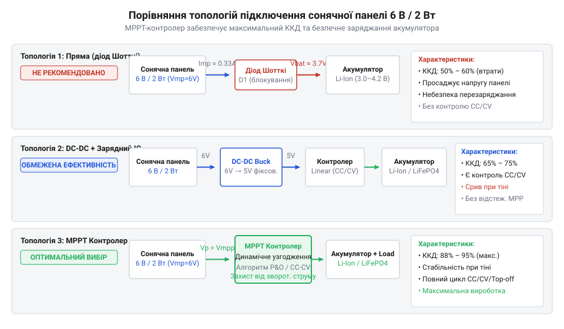
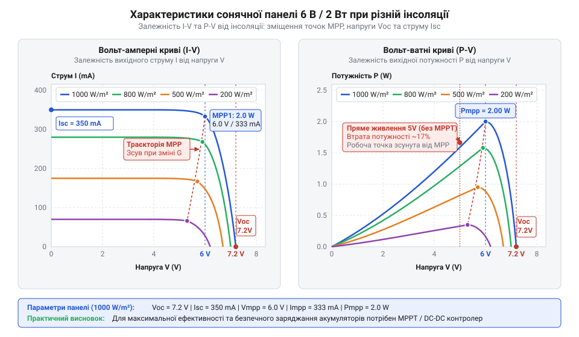
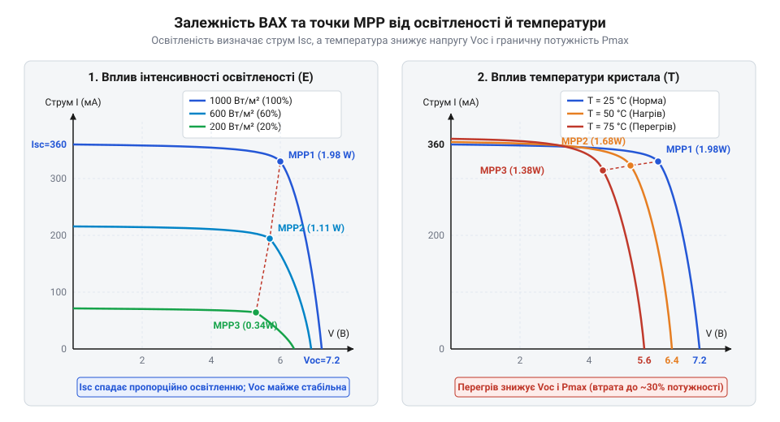
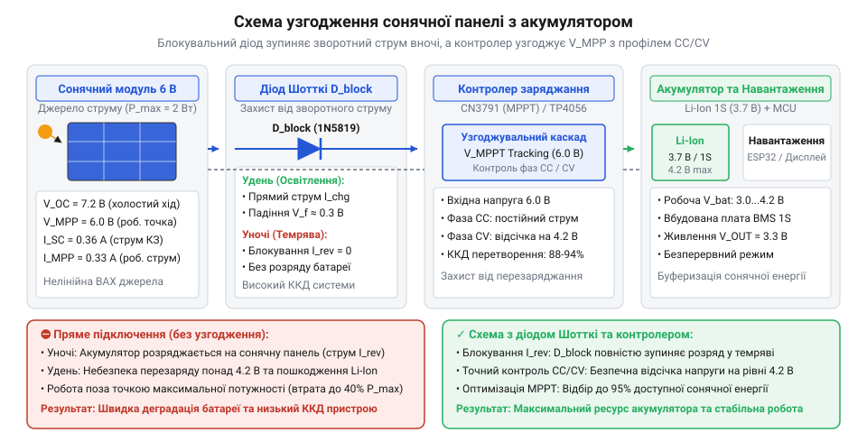

# Сонячна панель 6 В / 2 Вт

<preknowlist>
- [Li-ion 18650 (LiitoKala HG2, NCR18650B)](root:cat-hw-power/li-ion-18650-cells) — робочий діапазон напруг (2.7–4.2 В) та критичність дотримання режиму CC/CV під час заряджання
- [Videx 14500 — Li-ion 3.7V](root:cat-hw-power/videx-14500) — особливості живлення малогабаритних автономних пристроїв та межі допустимого струму заряджання
</preknowlist>

## Пастки прямого підключення малопотужного фотомодуля

Пряме підключення фотомодуля номіналом 6 В / 2 Вт до [акумуляторів Li-ion 18650](root:cat-hw-power/li-ion-18650-cells) створює критичні схемотехнічні пастки. У темряві панель втрачає фотогенерацію і поводиться як прямо зміщений діод щодо накопичувача. Напруга батареї зміщує p-n переходи, викликаючи зворотний струм розряду (англ. @@en|reverse current@@) із розсіюванням енергії у вигляді тепла.

Друга пастка — перезаряд (англ. @@en|overcharge@@). За яскравого світла напруга холостого ходу (англ. @@en|open circuit voltage@@, `V_oc`) фотомодуля сягає 7.0–7.2 В. Перевищення порогу 4.20 В одиночного літієвого елемента без контролера призводить до деградації електроліту та теплового розгону.

Фізично фотомодуль є нелінійним джерелом струму (англ. @@en|current source@@) із високим внутрішнім опором. У похмуру погоду струм фотогенерації падає, і спроба відібрати більше струму викликає завал робочої точки з просіданням напруги практично до нуля, що вимагає застосування узгоджувальних та блокувальних схем.


*Порівняння топологій підключення фотомодуля до акумулятора від прямого з'єднання до MPPT-перетворення.*

## Вольт-амперна характеристика та електрична модель

Сонячний модуль 6 В / 2 Вт є послідовним ланцюгом з 12 кремнієвих p-n переходів по 0.5–0.6 В кожен, які за стандартних випробувальних умов (STC: інсоляція 1000 Вт/м², температура 25 °C, спектр AM 1.5) формують сумарні паспортні параметри.

Головними характеристиками модуля є напруга холостого ходу (англ. @@en|open circuit voltage@@, `V_oc` ≈ 7.2 В), струм короткого замикання (англ. @@en|short circuit current@@, `I_sc` ≈ 0.37 А) та точка максимальної потужності (англ. @@en|maximum power point@@, MPP), де добуток струму `I_mpp` ≈ 0.33 А та напруги `V_mpp` ≈ 6.0 В дає номінальну потужність `P_mpp` = 2.0 Вт.

Якість напівпровідникових осередків та рівень внутрішніх втрат описує коефіцієнт заповнення ВАХ (англ. @@en|fill factor@@, `FF`):

```
FF = (V_mpp × I_mpp) ÷ (V_oc × I_sc)
   = P_mpp ÷ (V_oc × I_sc)               [визначення коефіцієнта заповнення]
```

Значення `FF` ≈ 0.75 свідчить про низький послідовний опір осередків та відсутність значних витоків.


*Вольт-амперна та ват-амперна характеристики сонячної панелі з позначенням точок V_oc, I_sc та P_mpp.*

## Вплив інсоляції, температури та затінення

Зниження інсоляції (з лат. @@la|insolatio@@) викликає лінійне зменшення струму `I_sc`, тоді як напруга `V_oc` спадає логарифмічно, залишаючись у межах 5.5–6.5 В.

Нагрівання модуля діє протилежно: від'ємний температурний коефіцієнт (англ. @@en|temperature coefficient@@ `γ_Voc` ≈ -0.35% / °C) при 65 °C знижує `V_oc` на 1.0–1.2 В, зміщуючи точку MPP у бік нижчих напруг і зменшуючи вихідну потужність.

Затінений осередок із 12 послідовних перетворюється на високомний опір. Решта 11 осередків спрямовують зворотний струм через кристал, спричиняючи локальний пробій, джоулеве нагрівання та гарячі плями (англ. @@en|hot spot@@), що руйнують напівпровідник.


*Деформація сімейства вольт-амперних кривих сонячного модуля під впливом зміни рівня інсоляції та робочої температури.*

## Топології узгодження та блокування розряду

Для захисту від нічного зворотного струму вживають діод Шотткі (англ. @@en|Schottky diode@@, `V_f` ≈ 0.3 В) або P-канальний MOSFET.

Звичайний DC-DC конвертер під навантаженням [модулів LiPo 3S](root:cat-hw-power/lipo-3s) зумовлює циклічний перезапуск: відбір струму валить напругу панелі нижче порогу UVLO (англ. @@en|under-voltage lockout@@), вимикаючи перетворювач до відновлення напруги.

Пасивний ШІМ-контролер втрачає до 35% енергії через просідання напруги, тоді як динамічний MPPT-контролер (англ. @@en|maximum power point tracking@@) утримує `V_mpp` = 6.0 В незалежно від стану накопичувача.


*Структурна схема автономного вузла живлення з блокувальним діодом та інтегрованим MPPT-контролером заряджання.*

## Розрахунок енергобалансу та вибір покриття

Добовий виробіток енергії `E_daily` пристроїв на [осередках Li-ion 21700](root:cat-hw-power/li-ion-21700-cells) обчислюють за піковими сонячними годинами (англ. @@en|peak sun hours@@, PSH) та системним коефіцієнтом втрат (англ. @@en|derating factor@@, `k_derate` ≈ 0.70):

```
E_daily = P_panel × PSH × k_derate
        = 2.0 W × 4.5 h × 0.70          [обчислення добового виробітку]
        = 6.30 Wh                       [реальна корисна енергія]
```

Необхідну ємність накопичувача `E_bat` визначають за добовим споживанням `E_load`, автономністю `N_days` та допустимою глибиною розряду (англ. @@en|depth of discharge@@, DoD ≈ 0.70):

```
E_bat = (E_load × N_days) ÷ DoD
      = (2.0 Wh × 3) ÷ 0.70             [розрахунок ємності накопичувача]
      = 8.57 Wh                         [необхідна енергоємність]
```

Довговічність модуля залежить від матеріалу ламінування: дешевий @@en|PET@@ мутніє й руйнується УФ за 1–2 роки, фторопласт @@en|ETFE@@ служить 5–10 років зі світлопропусканням 95%, а загартоване скло забезпечує максимальну прозорість понад 20 років.


*Добовий профіль інсоляції та генерації енергії з урахуванням пікових сонячних годин і коефіцієнта втрат.*