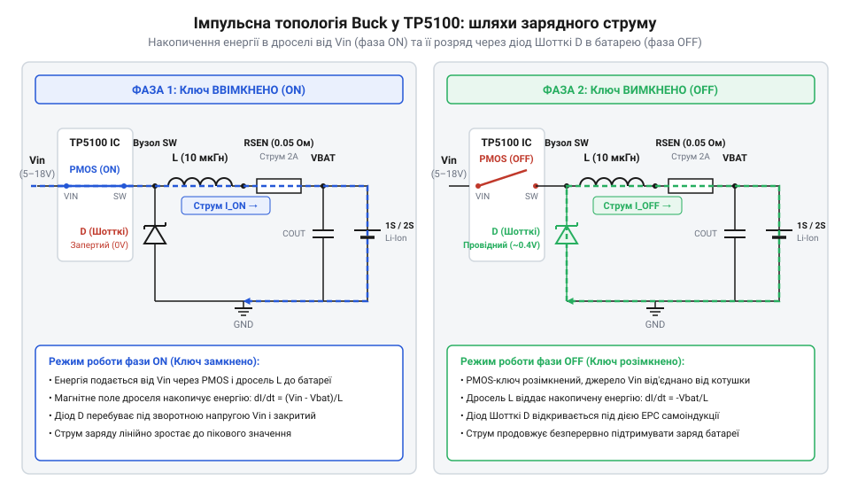
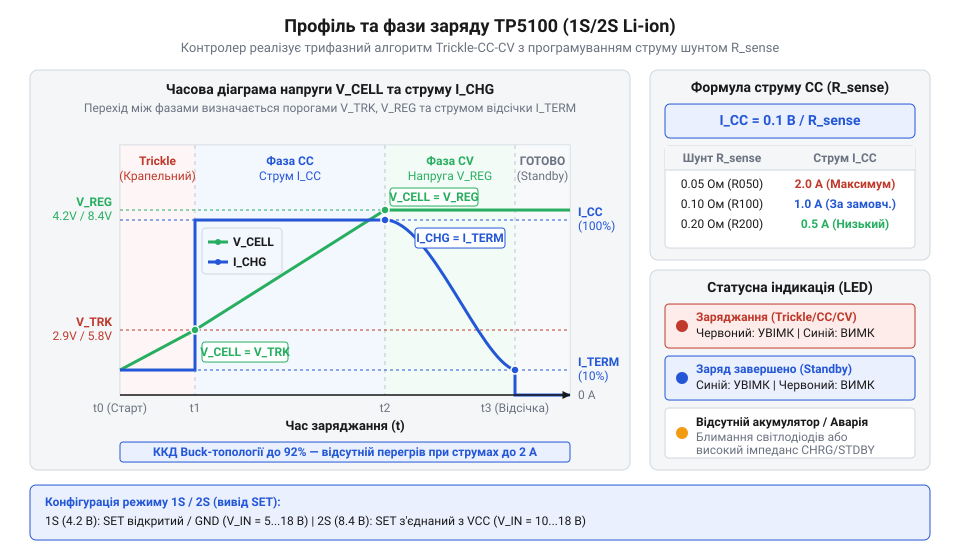
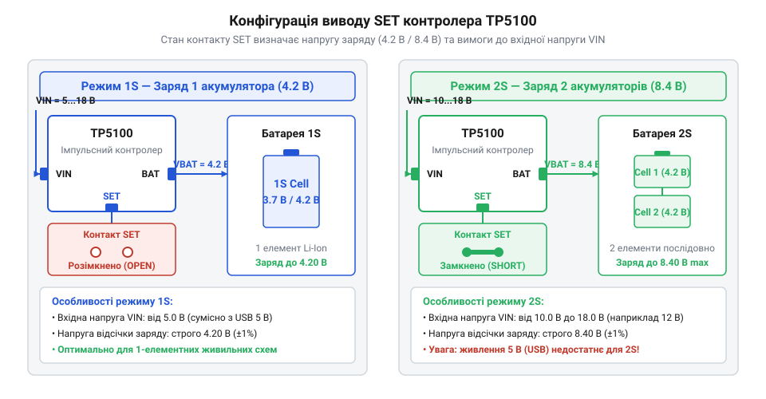

# TP5100 — заряд 1S/2S

<preknowlist>
- [TP4056](root:cat-hw-power/tp4056) — принцип роботи класичного лінійного контролера заряду 1S та його обмеження щодо струму й тепловиділення
- [BMS 2S/3S/4S із балансуванням](root:cat-hw-power/bms-multicell) — призначення захисту комірок від перезаряду та принцип балансування послідовних елементів акумулятора
</preknowlist>

## Перегрів лінійного заряду за високих струмів

Розробник бездротового пристрою або портативного інструмента часто стикається з потребою пришвидшити заряджання акумулятора, збільшивши струм до 1.5–2 А, або заживити модуль від наявного джерела з напругою 9 В чи 12 В. Спроба реалізувати таке завдання на базі популярних лінійних контролерів серії @@en|TP4056@@ призводить до швидкого розігріву мікросхеми до критичних 120–140 °C. Плата стає гарячою на дотик, спрацьовує апаратний тепловий захист, а струм заряду хаотично скидається практично до нуля. У результаті процес заряджання розтягується на тривалі години, або чип виходить з ладу від постійного теплового стресу.

Фізична причина цього явища полягає в самому принципі лінійного регулювання. Лінійний регулятор (від лат. @@la|linearis@@ — лінійний) працює як керований електричний опір: його внутрішній силовий транзистор еквівалентний реостату, який гасить усю надлишкову різницю напруг між джерелом живлення та акумулятором. Ця різниця напруги не зникає безвісти, а повністю перетворюється на чисте тепло за рахунок пасивного (від лат. @@la|passivus@@ — той, що піддається впливу) розсіювання на напівпровідниковому кристалі.

Потужність втрат `P_loss`, яка виділяється на регулювальному елементі у вигляді тепла, обчислюється як добуток різниці між вхідною та вихідною напругою на поточний струм заряду.

P_loss = (U_in - U_bat) · I_charge

Для оцінки масштабу проблеми розглянемо два типові сценарії роботи зарядного вузла.

**Сценарій 1: Заряджання 1S акумулятора від джерела 5 В при струмі 1 А**

P_loss = (U_in - U_bat) · I_charge
= (5.0 - 3.0) · 1.0     [підстановка параметрів живлення 5 В та напруги розрядженої комірки 3 В]
= 2.0 Вт                [теплова потужність, яка розсіюється на корпусі мікросхеми]

**Сценарій 2: Спроба збільшити струм до 1.5 А або подати живлення від джерела 9 В**

P_loss = (U_in - U_bat) · I_charge
= (9.0 - 3.0) · 1.5     [підстановка підвищеної вхідної напруги 9 В та струму 1.5 А]
= 9.0 Вт                [катастрофічний рівень тепловиділення для малого корпусу]

Компактний корпус типу @@en|SOP-8@@ із пасивним охолодженням на мідних полігонах друкованої плати здатний розсіювати без небезпечного перегріву не більше ніж 1.0–1.2 Вт. Коли потужність втрат сягає 2.0 Вт і більше, температура кристала миттєво перевищує допустиму межу, змушуючи контролер активувати тепловий захист (@@en|thermal throttling@@). При вищому вхідному рівні (наприклад, 9 В чи 12 В) пасивне розсіювання тепла стає фізично неможливим, а спроба зняти струм понад 1 А призводить до термічного руйнування елемента.

Для порівняння параметрів розсіювання варто звернути увагу на обмеження, які має [класичний лінійний чип](root:cat-hw-power/tp4056), де робота зі струмами понад 1 А викликає значні труднощі. Традиційні [плати захисту акумулятора](root:cat-hw-power/pcb-1s-protection) також розраховані на суворі температурні межі. Повний аналіз схемотехнічних відмінностей наведено у порівняльному [огляді контролерів TP](root:cat-hw-power/overview-tp-series-lithium-chargers).

Детальний історичний огляд еволюції схемотехніки акумуляторних зарядників висвітлює [історична розвідка про еволюцію](root:cat-hw-power/tp5100-charger/hist-lithium-charger-evolution.md), де показано передумови переходу від неефективного лінійного регулювання до високоефективних імпульсних чипів.

Для збереження високого ККД і безпечної експлуатації за високих струмів потрібен перехід до імпульсного понижувального перетворення (@@en|Buck converter@@). Саме для розв'язання цієї задачі створено імпульсний контролер @@en|TP5100@@.

## Принцип імпульсного зниження напруги в TP5100

Щоб подолати фізичне обмеження лінійного розсіювання тепла, контролер @@en|TP5100@@ використовує понижувальну імпульсну топологію (@@en|Buck topology@@). В її основі лежить принцип ключування: внутрішній силовий транзистор (@@en|MOSFET@@) не працює як змінний опір, а високочастотно перемикається між двома крайніми станами — повністю відкритим та повністю закритим із частотою близько 400 кГц.


*Структурна схема імпульсного силового тракту контролера TP5100, що демонструє шляхи проходження струму під час відкритого та закритого стану силового ключа.*

Робочий цикл імпульсного перетворювача складається з двох послідовних фаз:

1. **Фаза накопичення (ключ відкритий):** Струм від вхідного джерела живлення `U_in` тече через відкритий силовий ключ, зовнішній накопичувальний дросель (від нім. @@de|Drossel@@ — обмежувач, глушник) `L` та акумулятор. Струм в індуктивності плавно зростає, а в її магнітному полі накопичується енергія. 2. **Фаза розряду (ключ закритий):** Силовий ключ розмикається, відключаючи вхідне джерело. Проте дросель не може миттєво змінити струм і вивільняє накопичену магнітну енергію, підтримуючи проходження струму через акумулятор. Електричне коло замикається через зовнішній діод Шотткі (@@en|Schottky diode@@), який у цей момент відкривається у прямому напрямку.

Висока ефективність (ККД понад 90%) досягається завдяки тому, що в обох станах ключа втрата потужності прямує до нуля. Коли ключ відкритий, опір його каналу є мізерним, і падіння напруги на ньому близьке до нуля (`P = U_ds · I ≈ 0`). Коли ключ закритий, струм через нього не тече (`P = U_in · 0 = 0`). Основні мінімальні втрати виникають лише на опорі обмотки дроселя та на діоді Шотткі, що дозволяє чипу @@en|TP5100@@ впевнено віддавати струм до 2 А без значного нагрівання.

Крім високої ефективності, імпульсний (від лат. @@la|impulsus@@ — поштовх, удар) метод забезпечує керування фазами заряду літієвого акумулятора.


*Часова діаграма фаз заряджання акумулятора контролером TP5100, яка ілюструє перехід від попереднього крапельного заряду до стабільного струму та підтримання напруги.*

Контролер @@en|TP5100@@ послідовно реалізує три стандартні фази заряду: Детальніше про фізико-хімічні процеси та електричні характеристики кожного етапу накопичення енергії читайте в матеріалі про [алгоритм трифазного заряду літієвих акумуляторів](root:hw-power/cc-cv-bms).

- **Попередній заряд (@@en|Trickle Charge@@):** Якщо напруга на акумуляторі впала нижче критичної межі (2.9 В для 1S або 5.8 В для 2S), чип подає безпечний малий струм (приблизно 10% від встановленого номіналу) для м'якого відновлення структури електродів. - **Стабільний струм (@@en|Constant Current@@, @@en|CC@@):** Після підйому напруги до безпечного рівня контролер вмикає фазу швидкого заряду максимальним встановленим струмом (до 2 А). - **Стабільна напруга (@@en|Constant Voltage@@, @@en|CV@@):** Коли напруга досягає цільової межі (4.2 В або 8.4 В), чип переходить у режим прецизійного утримання напруги, а струм природно спадає до моменту повного відключення.

Розрахунок номіналу токовимірювального шунта, підбір індуктивності дроселя та оцінку теплових втрат детально описано у [математичному розрахунку обв'язки](root:cat-hw-power/tp5100-charger/math-tp5100-calculations.md), що дозволяє точно налаштувати режим під конкретну батарею.

Для поглиблення знань щодо перетворення напруги рекомендуємо вивчити [функціонування понижувальних перетворювачів](root:hw-power/buck). Також корисно порівняти роботу чипа з [іншими силовими модулями](root:cat-hw-power/mh-cd42-charger).

## Перемикання конфігурацій між 1S та 2S

Ключовою схемотехнічною перевагою @@en|TP5100@@ є його дворежимна архітектура: чип здатен заряджати як одиночну літієву комірку (@@en|1S@@, кінцева напруга 4.2 В), так і послідовну збірку з двох комірок (@@en|2S@@, кінцева напруга 8.4 В).

Вибір режиму роботи здійснюється за допомогою конфігураційного виводу @@en|SET@@ мікросхеми.


*Схема конфігурації виводу SET мікросхеми TP5100 для вибору режима заряду одиничного елемента 1S (4.2 В) або послідовної збірки 2S (8.4 В).*

Логіка задання режимів на модулі реалізована через контактний майданчик @@en|SET@@:

- **Режим 1S (4.2 В):** Вивід @@en|SET@@ залишається вільним (непідключеним / @@en|floating@@). На друкованій платі модуля контактна перемичка залишається розімкненою. Контролер автоматично встановлює пороги напруги для одного елемента (попередній заряд до 2.9 В, кінцева напруга 4.2 В). - **Режим 2S (8.4 В):** Вивід @@en|SET@@ з'єднується з вхідною шиною живлення @@en|VCC@@ (або шиною @@en|BAT@@). Для цього на платі модуля необхідно запаяти контактную перемичку @@en|SET@@ краплею припаю. Контролер перемикає внутрішні дільники напруги на подвійний поріг (попередній заряд до 5.8 В, кінцева напруга 8.4 В).

Критично важливим фактором під час вибору режиму є дотримання вимог щодо мінімальної вхідної напруги джерела живлення. Оскільки @@en|TP5100@@ є виключно понижувальним перетворювачем (@@en|Buck converter@@), вхідна напруга `U_in` повинна перевищувати максимальну напругу акумулятора з урахуванням технологічного запасу (@@en|headroom@@) близько 1.0–1.5 В:

- У режимі **1S** (4.2 В) мінімальна вхідна напруга становить `U_in ≥ 5.0 В`. Стандартні джерела @@en|USB@@ (5 В) або блоки живлення 9–12 В працюють абсолютно коректно. - У режимі **2S** (8.4 В) мінімальна вхідна напруга повинна становити `U_in ≥ 9.5–10.0 В`. Оптимальним вибором є джерело живлення з напругою 12 В (допустимий діапазон від 10 до 18 В).

**Поширена пастка розробника:** спроба заживити модуль @@en|TP5100@@ у режимі 2S від звичайного 5 В @@en|USB@@-порту. Оскільки чип не має функції підвищення напруги, у цьому стані заряджання 2S акумулятора буде неможливим, а індикація покаже помилку або повну відсутність струму.

Слід пам'ятати, що під час роботи з 2S збіркою контролер @@en|TP5100@@ контролює лише загальну напругу на двох крайніх виводах (8.4 В) і не має внутрішніх кіл балансування. Для безпечної експлуатації 2S акумулятора його необхідно обов'язково підключати через зовнішній платарний балансир. Нехтування балансуванням призводить до дисбалансу комірок та їхнього виходу з ладу.

Повний опис апаратної розпіновки, призначень виводів @@en|STDBY@@, @@en|CHRG@@ та принципової схеми модуля наведено в [довіднику апаратного інтерфейсу](root:cat-hw-power/tp5100-charger/api-tp5100-hardware.md).

Покрокову інструкцію зі створення практичного зарядного блоку з можливістю швидкого перемикання 1S/2S розглянуто в [практичному проєкті збірки модуля](root:cat-hw-power/tp5100-charger/proj-tp5100-dual-mode-charger.md).

Для побудови надійних батарейних блоків рекомендуємо застосовувати захисні плати [багатоелементних акумуляторних збірок](root:cat-hw-power/bms-multicell) та враховувати принципи [балансування послідовних елементів 2S](root:hw-power/bms). Поведінку модуля можна порівняти з тими параметрами, які надають [професійні зарядні станції](root:cat-hw-power/imax-b6-charger). Отримане рішення підходить для підключення [систем живлення YP-08](root:cat-hw-power/yp-08-power), розширення можливостей [плата-розширення живлення Raspberry Pi](root:cat-hw-power/liion-hat-rpi) чи живлення пристроїв у рамках [модульних плат живлення Waveshare](root:cat-hw-power/power-hat-family).

## Задання струму та фази заряду

Підключення літієвого акумулятора безпосередньо до джерела живлення без обмеження струму призводить до миттєвого перегріву та руйнування електродів. Для безпечного заряджання ємність акумулятора визначає максимально допустимий струм, який зазвичай становить від `0.5C` до `1C` (де `C` — чисельне значення номінальної ємності в ампер-годинах). Якщо підключити компактну комірку ємністю `500 мА·год` до зарядного пристрою, налаштованого на струм `2 А`, внутрішній хімічний опір спричинить інтенсивний виділ газу та деградацію літію. Контролер TP5100 обмежує ампераж завдяки вимірюванню спаду напруги на виділеному вимірювальному елементі — @@en|токовимірювальний шунт@@ (від середньоангл. *schunten* — відхиляти шляхом відведення струму).

Усередині чипа TP5100 інтегровано прецизійний підсилювач помилки та внутрішній @@en|компаратор@@ (від лат. *comparare* — порівнювати), який безперервно порівнює напругу між виводами `VS` та `BAT` через зовнішній @@en|шунт@@. Порогова напруга спрацьовування вимірювача позначена як `V_sense`, опір струмовимірювального елемента як `R_s`, а струм фази як `I_ch`. Порогова напруга внутрішнього вимірювача становить `V_sense = 0.1 В` (`100 мВ`). Як тільки спад напруги на струмовому резисторі `R_s` досягає `0.1 В`, контролер зменшує широтна-імпульсну модуляцію силових транзисторів, утримуючи постійну величину струму. Розрахунок максимального струму фази @@en|Constant Current@@ (`CC`) здійснюється за закономірністю Ohm:

```
I_ch = V_sense / R_s
     = 0.1 В / R_s               [підстановка опорної напруги компаратора TP5100]
```

Для отримання бажаного струму заряджання `I_ch` вибір номіналу вимірювального резистора виконується зворотним перетворенням:

```
R_s = V_sense / I_ch
    = 0.1 В / I_ch                [знаходження опору шунта для заданого струму]
```

На стандартних заводських модулях TP5100 найчастіше встановлено два паралельні SMD-резистори розміру `1206` із маркуванням `R100` (`0.1 Ом`). Паралельне з'єднання двох резисторів `0.1 Ом` дає еквівалентний опір `R_s = 0.05 Ом`. Підстановка цього значення у формулу показує граничний струм модуля:

```
I_ch = 0.1 В / 0.05 Ом
     = 2.0 А                     [максимальний струм заряду з двома шунтами R100]
```

Якщо для конкретного акумулятора потрібен струм `1 А`, один із двох резисторів `R100` демонтують, отримуючи `R_s = 0.1 Ом`. При цьому на резисторі розсіюється теплова потужність `P_s`:

```
P_s = I_ch² × R_s
    = (1.0 А)² × 0.1 Ом         [підстановка струму 1 А та опору 0.1 Ом]
    = 0.1 Вт                    [теплова потужність на шунті]
```

Для струму `2 А` розсіювана потужність становить `P_s = (2 А)² × 0.05 Ом = 0.2 Вт`, що вимагає використання резисторів із відповідною розсіюваною потужністю (не менше `0.25 Вт`). Детальний [математичний розрахунок параметрів](root:cat-hw-power/tp5100-charger/math-tp5100-calculations.md) індуктивності та теплових втрат дозволяє точніше обрати компоненти обв'язки під нестандартні струми.

Заданий струм `I_ch` є верхньою межею лише для основної фази заряду. TP5100 реалізує повний трифазний алгоритм відновлення літієвих елементів:

1. **Фаза попереднього заряду (@@en|Trickle Charge@@):** Якщо напруга на акумуляторі впала нижче безпечного порогу (`2.9 В` для 1S або `5.8 В` для 2S), глибокий розряд робить активну речовину нестабільною. Контролер подає обмежений малий струм величиною `0.1 × I_ch` (`10%` від основного). Це м'яко відновлює хімічний склад комірки без ризику локального перегріву. 2. **Фаза стабільного струму (@@en|Constant Current@@ / `CC`):** Коли напруга долає поріг `2.9 В` на комірку, TP5100 вмикає максимальний розрахований струм `I_ch`. У цьому режимі напруга на батареї поступово зростає, а імпульсний перетворювач автоматично коригує коефіцієнт заповнення ШІМ для підтримки стабільного струму через @@en|шунт@@. На цю фазу припадає близько `70–80%` переданої енергії. 3. **Фаза стабільної напруги (@@en|Constant Voltage@@ / `CV`):** Як тільки напруга акумулятора досягає цільового рівня (`4.2 В` для 1S або `8.4 В` для 2S), контролер стабілізує напругу. Струм починає природно спадати. Коли струм знижується до порогу відсічки (близько `10%` від `I_ch`), TP5100 повністю вимикає подачу енергії.

Для відновлення заряду чип має внутрішній @@en|гістерезис@@ (від грец. *hysteresis* — запізнення, відставання) напруги: якщо напруга на підключеній батареї через саморозряд знижується до `4.05 В` на комірку (`8.1 В` для 2S), контролер автоматично перезапускає цикл `CC/CV`.

Відстеження поточного стану процесу відбувається за допомогою двох виводів статусного оповіщення — `CHRG` (заряд) та `STDBY` / `PWR_BAT` (готовність). Ці виводи мають внутрішні ключі типу @@en|відкритий сток@@ (від англ. *open drain* — відкритий сток польового транзистора), що вимагає підключення світлодіодів через обмежувальні резистори до позитивної шини живлення.

Логіка індикації працює за чіткими станами:
- **Під час фаз `Trickle`, `CC` та `CV`:** вивід `CHRG` замикається на землю, умикаючи червоний світлодіод. Вивід `STDBY` перебуває у високоімпедансному стані. - **Після завершення заряду (струм упав нижче порогу відсічки):** вивід `CHRG` розмикається, а `STDBY` замикається на землю, засвічуючи зелений або синій світлодіод. - **За відсутності акумулятора або виникненні помилки:** обидва виводи розмикаються або по черзі блимають залежно від наявності паразитної ємності на виході.

Повний опис [апаратного інтерфейсу та розпінівки](root:cat-hw-power/tp5100-charger/api-tp5100-hardware.md) дозволяє правильно проектити світлодіодну індикацію на зовнішній панелі пристрою.

## Межі безпеки та експлуатаційні ризики

Хоча TP5100 забезпечує високий коефіцієнт корисної дії за рахунок імпульсного перетворення, експлуатація мікросхеми на межі її електричних та теплових параметрів створює ризики відмови. Вхідна напруга контролера має перебувати в діапазоні від `5 В` до `18 В`. Проте для режимів 1S та 2S вимоги до мінімального запасу напруги (@@en|headroom@@) відрізняються: для 1S вхідна напруга повинна перевищувати напругу батареї щонайменше на `1 В` (від `5 В`), а для 2S — мінімум на `1.5–2 В` (не менше `10 В` для надійного виходу в режим `CC` за струму `2 А`). При перевищенні вхідної напруги понад `15 В` або при роботі на максимальному струмі `2 А` кристал мікросхеми зазнає додаткового нагріву через динамічні втрати на перемикання силових транзисторів. При досягненні температури кристала `140 °C` спрацьовує внутрішній тепловий захист (@@en|thermal shutdown@@), який примусово вимикає генерацію ШІМ до охолодження.

Найбільш критичним експлуатаційним ризиком модулів на TP5100 у режимі 2S є відсутність вбудованого схематичного балансира. Контролер підключається виключно до двох крайніх полюсів акумуляторної збірки — `B+` та `B-`. Чип вимірює лише суммарну напругу всієї послідовної гілки (`8.4 В`), залишаючись повністю «сліпим» до стану середньої точки з'єднання двох елементів.

Якщо в послідовній збірці 2S одна з комірок має меншу ємність або вищий внутрішній опір, під час заряду напруга на ній зростатиме значно швидше. Наприклад, у той час коли зношена комірка A досягне небезпечних `4.5 В`, менш заряджена комірка B матиме лише `3.9 В`. Сумарна напруга збірки складе `8.4 В`. TP5100 сприйме цей стан як норму і продовжуватиме подавати струм. Перезаряд літієвої комірки понад `4.25 В` призводить до незворотного виділення кисню з катодного матеріалу, розкладання електроліту, здуття корпусу та виникнення небезпечного @@en|тепловий розгін@@ (від англ. *thermal runaway* — неконтрольоване саморозігрівання комірки).

Заряджати збірку 2S безпосередньо від TP5100 без зовнішньої схеми контролю суворо заборонено. Обов'язковою умовою є встановлення між TP5100 та акумуляторами [зовнішнього захисного модуля](root:cat-hw-power/bms-multicell) із функцією автоматичного пасивного або активного балансування. На відміну від [одноелементної плати захисту](root:cat-hw-power/pcb-1s-protection), балансувальний модуль 2S відстежує потенціал середньої точки та примусово шунтує струм комірки, яка першою досягла `4.2 В`. Ознайомитися з нюансами вибору [системи захисту 2S](root:hw-power/bms) необхідно перед проектуванням будь-якого двокоміркового джерела живлення.

Другим рубежем захисту є моніторинг температури самих акумуляторних елементів за допомогою терморезистора. У чипі TP5100 передбачено спеціалізований вивід `TS` (`TEMP`), який підключається до вимірювального дільника на базі @@en|NTC-терморезистор@@ (від англ. *Negative Temperature Coefficient* — елемент із від'ємним температурним коефіцієнтом опору).

Усередині TP5100 вивід `TS` підключено до двох віконних компараторів. Якщо температура акумулятора виходить за межі безпечного вікна (за замовчуванням нижче `0 °C` або вище `45 °C`), напруга на виводі `TS` виходить за межі діапазону `45%–80%` від напруги живлення `VREG`. У цьому випадку контролер миттєво зупиняє процес заряду. Заряджання літію при температурі нижче `0 °C` призводить до металізації акустичного літію на аноді та короткого замикання, а при високих температурах — прискорює деградацію сепаратора.

Для побудови надійного зарядного пристрою модуль TP5100 інтегрується в єдину систему з елементами захисту:

```
[ Джерело живлення 12V ]
           │
           ▼
     [ Модуль TP5100 ]
      │ (BAT+)  │ (BAT-)
      │         │           ┌────────────────────────────────┐
      ▼         ▼           │ External 2S BMS with Balancer  │
    ┌─────────────┐         │                                │
    │   BMS B+    ├─────────┤  Controls cell A & cell B      │
    └─────────────┘         └───────────────┬────────────────┘
                                            │
                                            ▼
                                  [ 2S Li-ion Battery ]
                                  (NTC sensor attached)
```

Сенсор NTC закріплюється безпосередньо на корпусі акумуляторного блоку через теплопровідний скотч або клей та з'єднується з клемною колодкою `TEMP` модуля TP5100. Практичний керівництво з [створення готового пристрою](root:cat-hw-power/tp5100-charger/proj-tp5100-dual-mode-charger.md) містить покрокові монтажні схеми та конструктивні рекомендації щодо розведення силових провідників.

Для порівняння параметрів TP5100 з іншими рішеннями можна звернутися до [огляду лінійки TP](root:cat-hw-power/overview-tp-series-lithium-chargers), де наведено порівняльний аналіз чипів TP4056, TP5000 та TP5100.